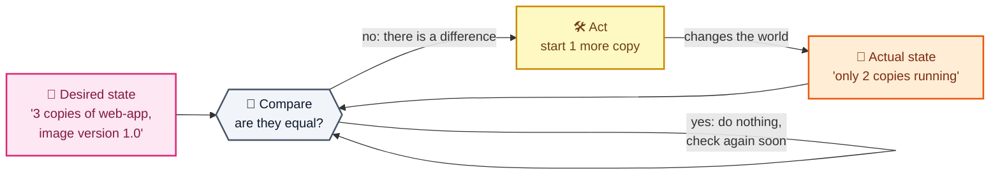
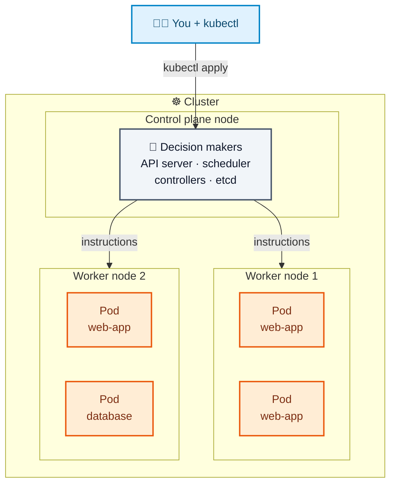

# 01 · Kubernetes Fundamentals

[⬅ Module 1](README.md) · Page 1 of 5 · [🏠 Reference home](../README.md)

**01 Fundamentals** › [02 Architecture](02-kubernetes-architecture.md) › [03 Images & Runtime](03-images-and-container-runtime.md) › [04 API Resources](04-api-resources-and-object-definitions.md) › [05 HA Control Plane](05-high-availability-control-plane.md)

---

## The problem: Docker alone stops being enough

Docker is excellent at one job: **running a container on one machine**.

```bash
docker run -d -p 8080:80 nginx:1.27-alpine
```

That works on your laptop. Now imagine your application becomes popular and you need to run it for real:

| Situation | With Docker alone, *you* must… |
|---|---|
| The container crashes at 3 a.m. | Wake up, notice, and run `docker run` again |
| The whole machine dies | Find another machine, install Docker, start everything again |
| Traffic triples on a sale day | Start more containers by hand, on more machines |
| You ship version 2 | Stop the old containers and start new ones, hoping nobody notices the gap |
| Version 2 is broken | Remember exactly what version 1 was and redeploy it, fast |
| You have 20 machines | Remember which container runs where, and which machine has free CPU |

None of these is hard *once*. Doing all of them, all the time, for dozens of services, is impossible to do by hand
without mistakes. You need **something that does this work for you, continuously.** That is Kubernetes.

> **Note:** The name *Kubernetes* comes from the Greek word for **helmsman**, the person who steers a ship. It is
> often shortened to **K8s**: "K", then 8 letters, then "s".

---

## The idea in one picture: desired state vs actual state

The single most important idea in Kubernetes is this:

> **You describe the *desired state*. Kubernetes continuously works to make the *actual state* match it.**



This never-ending **observe → compare → act** cycle is called the **reconciliation loop**, or **control loop**. It is
exactly how a home thermostat works:

| Thermostat | Kubernetes |
|---|---|
| You set 22 °C | You write a YAML file saying `replicas: 3` |
| It measures the room: 19 °C | It counts running copies: 2 |
| Difference found → heater on | Difference found → start one more copy |
| Room reaches 22 °C → heater off | 3 copies running → do nothing |
| Window opens, temperature drops → heater on again | A copy crashes → start a new one again |

You never tell the thermostat *"turn the heater on for 14 minutes"*. You tell it the **goal**. Kubernetes works the
same way.

---

## How it works: declarative vs imperative

There are two ways to give instructions to any system.

| | **Imperative**: "do this" | **Declarative**: "this is what I want" |
|---|---|---|
| Analogy | Giving a taxi driver turn-by-turn directions | Giving the taxi driver the destination address |
| Docker example | `docker run`, `docker stop`, `docker run` again | *(not really possible with plain Docker)* |
| Kubernetes example | `kubectl run`, `kubectl scale`, `kubectl delete` | `kubectl apply -f my-app.yaml` |
| If something changes later | Nothing happens; the command already finished | Kubernetes keeps working towards the goal |
| Can you store it in Git? | Only as a list of commands | Yes: the YAML file **is** the documentation |
| Repeatable? | Running twice may create two things | Running twice gives the same result (**idempotent**) |

Kubernetes supports both, but **declarative is the Kubernetes way**. Imperative commands are fine for quick
experiments. For anything real, you write YAML files, keep them in Git, and `kubectl apply` them.

> 🎯 **Interview:** *"What is the difference between `kubectl create` and `kubectl apply`?"*
> `create` is imperative: it fails if the object already exists. `apply` is declarative: it creates the object if
> missing, or updates it to match the file if present. You can run `apply` a hundred times safely.

---

## The vocabulary you need on day one

Kubernetes has many terms. These are the ones that appear everywhere. Each later page explains one of them in depth.

| Term | Plain-language meaning | Real-world analogy |
|---|---|---|
| **Cluster** | A group of machines managed together by Kubernetes | A whole airport |
| **Node** | One machine in the cluster (physical or virtual) | One runway or hangar |
| **Control plane** | The "brain" components that make decisions | The control tower |
| **Worker node** | A node that actually runs your application containers | A hangar where planes are serviced |
| **Pod** | The smallest unit Kubernetes runs: one or more containers that live together | One plane |
| **Deployment** | An object that keeps N copies of a Pod running and handles upgrades | A flight schedule: "3 flights a day, always" |
| **Namespace** | A named folder that groups objects inside a cluster | A terminal (Terminal 1, Terminal 2) |
| **Object** | Any "record of intent" you create: a Pod, a Deployment, a ConfigMap… | One entry in the airport's master plan |
| **Manifest** | A YAML (or JSON) file that describes one or more objects | The written flight plan |
| **kubectl** | The command-line tool you use to talk to the cluster | The radio you use to talk to the tower |



---

## What Kubernetes gives you (and what it doesn't)

### ✅ What it does for you

| Capability | What it means in practice |
|---|---|
| **Self-healing** | A crashed container is restarted. A Pod on a dead node is re-created on a healthy node. |
| **Scheduling** | It chooses which node runs each Pod, based on free CPU and memory. You don't pick machines. |
| **Scaling** | Change `replicas: 3` to `replicas: 10`, and 7 more copies appear. |
| **Rolling updates** | New versions replace old ones gradually, so users don't see downtime. |
| **Rollback** | One command returns you to the previous version. |
| **Configuration** | Settings (ConfigMaps) and passwords (Secrets) live outside the image. |
| **Service discovery** | Apps find each other by name instead of hard-coded IP addresses. |
| **Portability** | The same YAML runs on your laptop (Kind), a data center, or a cloud (EKS, AKS, GKE). |

### ❌ What it does *not* do

| Myth | Reality |
|---|---|
| "Kubernetes builds my images" | No. You still build images with Docker (or similar) and push them to a registry. |
| "Kubernetes fixes buggy code" | No. If your app crashes on start, Kubernetes restarts it forever. That loop is called `CrashLoopBackOff`. |
| "Kubernetes makes any app scalable" | Only if the app is designed for it. Two copies of an app that keeps data in local memory will disagree with each other. |
| "Kubernetes replaces my database administrator" | No. It can *run* a database, but backups, upgrades and tuning are still your job. |

---

## Where Kubernetes runs

Kubernetes is the same software everywhere. Only the way you get a cluster changes.

| Option | What it is | Good for |
|---|---|---|
| **Kind** (Kubernetes in Docker) | Each "node" is a Docker container on your laptop | Learning (used throughout this repo) |
| **Minikube** | A single-node cluster in a VM or container | Learning |
| **kubeadm** | Official tool to build a cluster on your own servers | Learning internals, on-premise |
| **Managed cloud**: EKS (AWS), AKS (Azure), GKE (Google) | The cloud provider runs the control plane for you | Production |

> 🧪 **Demo vs 🏭 production:** On Kind, your whole "cluster" lives inside Docker on one laptop. If the laptop
> sleeps, the cluster sleeps. In production, nodes are separate machines spread across data-center zones, so one
> failure doesn't take everything down. **The YAML you write is the same in both.**

---

## Try it

> 🧪 **Try it:** Watch the reconciliation loop with your own eyes. You need the Kind cluster from the
> [reference home page](../README.md#what-you-need-to-follow-along).

**Step 1: declare a desired state of 3 copies.**

```bash
kubectl create deployment hello --image=nginx:1.27-alpine --replicas=3
```

*What it does:* asks Kubernetes for a Deployment named `hello` that always keeps 3 nginx Pods running.

**Step 2: look at the actual state.**

```bash
kubectl get pods
```

Expected output (names will differ):

```
NAME                     READY   STATUS    RESTARTS   AGE
hello-6d4b8c9f7d-2xkqp   1/1     Running   0          10s
hello-6d4b8c9f7d-8mzvt   1/1     Running   0          10s
hello-6d4b8c9f7d-tq5wl   1/1     Running   0          10s
```

**Step 3: break reality on purpose.** Delete one Pod (copy one name from your own output):

```bash
kubectl delete pod hello-6d4b8c9f7d-2xkqp
kubectl get pods
```

Expected: **still 3 Pods**. One has a new name and a very young `AGE`. Kubernetes noticed that actual (2) ≠
desired (3) and fixed it within a second or two. Nobody typed `docker run`.

**Step 4: change the desired state.**

```bash
kubectl scale deployment hello --replicas=5
kubectl get pods
```

Expected: 5 Pods. Now clean up:

```bash
kubectl delete deployment hello
```

> **Tip:** `kubectl get pods --watch` (or `-w`) keeps the list open and prints every change live. Run it in a
> second terminal during step 3 to see the Pod being replaced in real time.

---

## Common mistakes

| Mistake | What you see | Fix |
|---|---|---|
| Deleting a Pod to "stop" an app | The Pod comes straight back | Delete or scale down the **Deployment** that owns it |
| Thinking `kubectl` runs containers | Confusion about where things live | `kubectl` only sends requests to the API server. The cluster does the work. |
| Editing live objects by hand forever | Nobody knows what is really deployed | Keep YAML in Git and `kubectl apply` it |
| Expecting Kubernetes to fix an app that crashes on start | `CrashLoopBackOff` | Read the logs with `kubectl logs <pod>` and fix the app or its configuration |

---

## Quick recap

- Docker runs containers on **one** machine. Kubernetes manages containers across **many** machines.
- You declare a **desired state** in YAML. Kubernetes runs a **reconciliation loop** to make reality match it.
- Declarative (`kubectl apply -f file.yaml`) is the Kubernetes way. It is repeatable and lives in Git.
- A **cluster** is a set of **nodes**. The **control plane** decides; **worker nodes** run your **Pods**.
- Kubernetes gives you self-healing, scheduling, scaling, rolling updates and rollback.
- It does **not** build images or fix broken code.

**Next question:** you've seen *that* Kubernetes fixes things. But *who*, inside the cluster, actually noticed the
missing Pod and created a new one? → [02 · Kubernetes Architecture](02-kubernetes-architecture.md)

---

## 📚 Official documentation

Everything above is self-contained. These links are for going deeper, not for filling gaps.

| Reference | What it adds |
|---|---|
| [Overview](https://kubernetes.io/docs/concepts/overview/) | The official "what Kubernetes is and is not" page, including the history from VMs to containers |
| [Controllers](https://kubernetes.io/docs/concepts/architecture/controller/) | The control-loop and thermostat idea, as the project itself explains it |
| [Kubernetes Object Management](https://kubernetes.io/docs/concepts/overview/working-with-objects/object-management/) | Imperative commands vs declarative configuration, with trade-offs |
| [Learn Kubernetes Basics](https://kubernetes.io/docs/tutorials/kubernetes-basics/) | The official interactive beginner tutorial |

*Links verified 2026-11-22.*

---

| ◀ Previous | ▲ Up | Next ▶ |
|---|:--:|---:|
| ◀ **[Module 1 overview](README.md)** | [Module 1](README.md) · [Reference home](../README.md) | **[02 Architecture](02-kubernetes-architecture.md)** ▶ |
