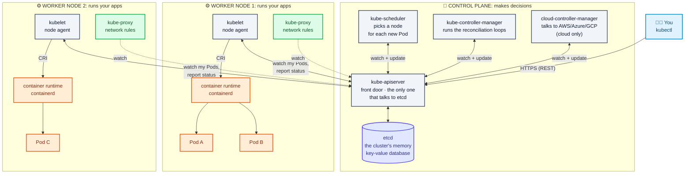
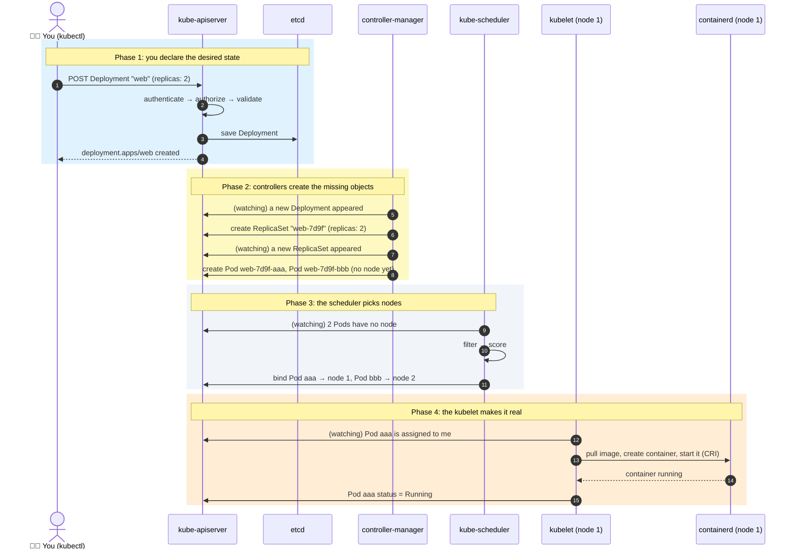

# 02 · Kubernetes Architecture

[⬅ Module 1](README.md) · Page 2 of 5 · [🏠 Reference home](../README.md)

[01 Fundamentals](01-kubernetes-fundamentals.md) › **02 Architecture** › [03 Images & Runtime](03-images-and-container-runtime.md) › [04 API Resources](04-api-resources-and-object-definitions.md) › [05 HA Control Plane](05-high-availability-control-plane.md)

---

## The problem: "Kubernetes fixed it" is not an explanation

On the previous page you deleted a Pod and a new one appeared. When something goes *wrong*, for example a Pod stays
`Pending` forever, "Kubernetes" is too vague to debug. You need to know **which component** is responsible for which
step, so you know **where to look**.

Kubernetes is not one program. It is a **team of small programs**, each with one job, all talking through one
central point.

---

## The idea in one picture



**The golden rule in this picture:** every arrow goes through the **API server**. Components never talk to each
other directly, and only the API server reads and writes etcd. Think of the API server as the **control tower's
radio**: pilots, ground crew and fuel trucks all talk through it, never to each other.

---

## How it works: the control plane

The control plane is the **brain**. It decides *what* should happen. It does not run your application containers.

### kube-apiserver: the front door

| | |
|---|---|
| **Job** | Receives every request (from you, from other components), checks it, and saves it |
| **Talks to** | Everyone. It is the hub of the whole system. |
| **What it checks** | *Who are you?* (authentication) → *Are you allowed?* (authorization) → *Is this valid?* (validation) |
| **Analogy** | The airport's reception desk: every request goes through it, and it writes everything in the master book |
| **If it's down** | `kubectl` stops working and nothing new can change. **Already-running Pods keep running.** |

### etcd: the cluster's memory

| | |
|---|---|
| **Job** | Stores the entire state of the cluster: every object, every setting, every status |
| **Type** | A distributed **key-value** database (like a giant dictionary: key → value) |
| **Who talks to it** | **Only** the API server |
| **Analogy** | The master logbook locked in the tower. If it's lost, the airport forgets every plan. |
| **If it's lost** | The cluster forgets everything it knew. This is why etcd is backed up in production. |

> 🏭 **Production:** etcd runs as **3 or 5** copies (an odd number), so that a majority can always agree on the truth
> even if one copy fails. The agreement algorithm is called **Raft**. Managed services such as EKS run and back up
> etcd for you. How this works is explained on [page 05 · HA Control Plane](05-high-availability-control-plane.md).

### kube-scheduler: the matchmaker

| | |
|---|---|
| **Job** | Looks for new Pods that have **no node assigned yet**, and picks the best node for each one |
| **How** | 1. **Filter**: drop nodes that can't fit the Pod (not enough CPU/memory, wrong labels…). 2. **Score**: rank the remaining nodes. 3. **Bind**: write the winning node name into the Pod. |
| **What it doesn't do** | It does **not** start the container. It only *writes a decision*. The kubelet does the starting. |
| **Analogy** | The gate planner: "Flight 42 goes to gate B7." It doesn't fly the plane. |
| **If it can't find a node** | The Pod stays `Pending`, and `kubectl describe pod` shows a `FailedScheduling` event |

### kube-controller-manager: the reconcilers

| | |
|---|---|
| **Job** | Runs dozens of **controllers** (reconciliation loops), packaged as one program |
| **Examples** | **Deployment controller** (manages ReplicaSets), **ReplicaSet controller** (keeps N Pods alive), **Node controller** (notices dead nodes), **Namespace controller** (cleans up deleted namespaces) |
| **How each one works** | Watch the API server → compare desired vs actual → create, update or delete objects to close the gap |
| **Analogy** | Supervisors, one per department, each constantly checking "is my department on plan?" |

### cloud-controller-manager: the cloud translator (cloud only)

Talks to the cloud provider's API, for example to create a cloud load balancer or to learn that a VM was deleted.
On Kind or Minikube on your laptop there is no cloud, so it isn't used.

---

## How it works: the worker node

Worker nodes are the **muscles**. They run your actual application containers.

| Component | Job | Analogy |
|---|---|---|
| **kubelet** | An agent on every node. It asks the API server *"which Pods are assigned to me?"*, makes sure they're running, and reports their health back. | The hangar foreman |
| **container runtime** | The software that actually pulls images and starts containers (usually **containerd**). The kubelet tells it what to do through a standard interface called **CRI**. | The mechanics who physically work on the plane |
| **kube-proxy** | Maintains network rules on the node so traffic sent to a Service reaches the right Pods. *(Networking is covered later, in the projects.)* | The signs that direct passengers to the right gate |

> **Note:** On many clusters, including Kind, the control-plane node *also* runs a kubelet and a container runtime.
> That's how the control-plane components themselves run: as Pods in the `kube-system` namespace.

> 🎯 **Interview:** *"Is the kubelet a Pod?"* No. The kubelet is a regular program (a system service) running directly
> on each node. It has to be, because it's the thing that starts Pods. Something has to exist *before* the first Pod.

---

## How it works: following one `kubectl apply` end to end

This is the most useful diagram on the page. When something breaks, find the step where it stopped.

You run `kubectl apply -f deployment.yaml` asking for a Deployment with **2 replicas**:



**Read it again and notice:** `kubectl` returned "created" at step 4, long before any container existed. "Created"
means *"your desired state is saved"*, not *"your app is running"*. Always follow up with `kubectl get pods`.

### Where to look when each phase fails

| Stuck at… | Symptom | Who is responsible | Where to look |
|---|---|---|---|
| Phase 1 | `kubectl` prints an error | API server (bad YAML, no permission) | The error message itself |
| Phase 2 | Deployment exists, but no Pods appear | Controller manager | `kubectl describe deployment <name>`, `kubectl describe replicaset` |
| Phase 3 | Pod stuck in `Pending` | Scheduler (no node fits) | `kubectl describe pod <name>` → *Events* |
| Phase 4 | `ImagePullBackOff`, `CrashLoopBackOff`, `ContainerCreating` | kubelet + container runtime | `kubectl describe pod <name>`, `kubectl logs <name>` |

---

## Add-ons: helpers that run *on* the cluster

Some important pieces are not core components. They run as ordinary Pods inside the cluster:

| Add-on | What it does |
|---|---|
| **CoreDNS** | Gives Services DNS names so apps can find each other by name |
| **CNI plugin** (e.g. kindnet, Calico, Cilium, AWS VPC CNI) | Gives every Pod an IP address and connects Pods across nodes |
| **Metrics Server** | Collects CPU/memory usage so `kubectl top` and autoscaling work |

---

## Try it

> 🧪 **Try it:** See every component running on your own Kind cluster.

**1. The node(s) in your cluster:**

```bash
kubectl get nodes -o wide
```

Expected (Kind single-node): one node with `ROLES` = `control-plane` and `CONTAINER-RUNTIME` = `containerd://…`.
The control plane and the worker are the same machine here.

**2. The control-plane components, running as Pods:**

```bash
kubectl get pods -n kube-system
```

Expected (names abbreviated):

```
NAME                                                   READY   STATUS
coredns-xxxxxxxxxx-xxxxx                               1/1     Running
etcd-kubernetes-lab-control-plane                      1/1     Running
kindnet-xxxxx                                          1/1     Running
kube-apiserver-kubernetes-lab-control-plane            1/1     Running
kube-controller-manager-kubernetes-lab-control-plane   1/1     Running
kube-proxy-xxxxx                                       1/1     Running
kube-scheduler-kubernetes-lab-control-plane            1/1     Running
```

Every box from the big diagram is here, except the **kubelet** and **containerd**, because those aren't Pods.

**3. Prove the kubelet is a normal program on the node.** A Kind node is a Docker container, so you can look inside:

```bash
docker exec kubernetes-lab-control-plane systemctl status kubelet --no-pager | head -5
```

Expected: `Active: active (running)`. It's a system service, not a Pod.

**4. Watch the scheduler's decision being recorded:**

```bash
kubectl run probe --image=nginx:1.27-alpine
kubectl get pod probe -o wide          # NODE column = the scheduler's choice
kubectl describe pod probe | tail -8   # Events: Scheduled → Pulling → Pulled → Created → Started
kubectl delete pod probe
```

The `Events` at the bottom of `describe` are the sequence diagram above, printed by the cluster itself:
`Scheduled` comes from the scheduler, and `Pulling`, `Pulled`, `Created`, `Started` come from the kubelet.

---

## Common mistakes

| Mistake | Reality |
|---|---|
| "The scheduler starts containers" | The scheduler only writes a node name into the Pod. The **kubelet** starts containers. |
| "If the control plane dies, my app dies" | Running Pods keep running. You just can't *change* anything, and nothing gets self-healed until it's back. |
| "kubectl talks to the nodes" | `kubectl` only ever talks to the **API server**. |
| "etcd is optional" | Without etcd there is no cluster state. It's the single most important thing to back up. |
| Reading only `kubectl get` | `get` shows *what*; `describe` → *Events* shows *why*. Always check Events first. |

---

## Quick recap

- **Control plane** = brain: `kube-apiserver` (front door), `etcd` (memory), `kube-scheduler` (picks nodes),
  `kube-controller-manager` (reconciliation loops), `cloud-controller-manager` (cloud only).
- **Worker node** = muscles: `kubelet` (node agent), container runtime (`containerd`), `kube-proxy` (network rules).
- **Everything goes through the API server.** Only the API server touches etcd.
- Components **watch** the API server and react. Nobody gives direct orders to anyone else.
- `kubectl apply` returns "created" once the desire is *saved*. Running happens a few steps later.
- Debugging = find the phase that stopped, then use `kubectl describe` and check *Events*.

**Next question:** the last step said *"the kubelet tells containerd to pull the image and start the container."*
What exactly is an image, where does it come from, and what is containerd? →
[03 · Images & Container Runtime](03-images-and-container-runtime.md)

---

## 📚 Official documentation

Everything above is self-contained. These links are for going deeper, not for filling gaps.

| Reference | What it adds |
|---|---|
| [Cluster Architecture](https://kubernetes.io/docs/concepts/architecture/) | The official architecture diagram and the design principles behind it |
| [Kubernetes Components](https://kubernetes.io/docs/concepts/overview/components/) | One-paragraph definition of every component, including optional add-ons |
| [Nodes](https://kubernetes.io/docs/concepts/architecture/nodes/) | Node status, heartbeats, and what happens when a node stops responding |
| [Controllers](https://kubernetes.io/docs/concepts/architecture/controller/) | How controllers watch the API server and why they never talk to each other directly |
| [The Kubernetes API](https://kubernetes.io/docs/concepts/overview/kubernetes-api/) | Why the API server is the centre of everything |

*Links verified 2026-11-22.*

---

| ◀ Previous | ▲ Up | Next ▶ |
|---|:--:|---:|
| ◀ **[01 Fundamentals](01-kubernetes-fundamentals.md)** | [Module 1](README.md) · [Reference home](../README.md) | **[03 Images & Runtime](03-images-and-container-runtime.md)** ▶ |
