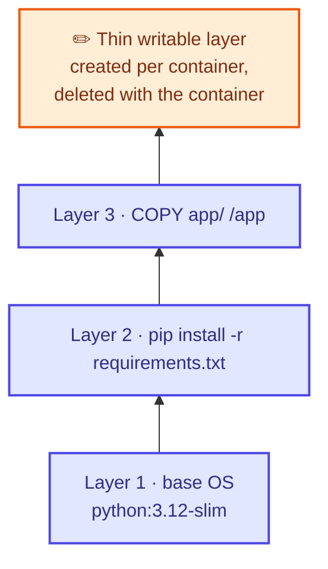
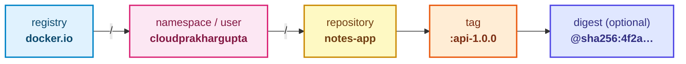
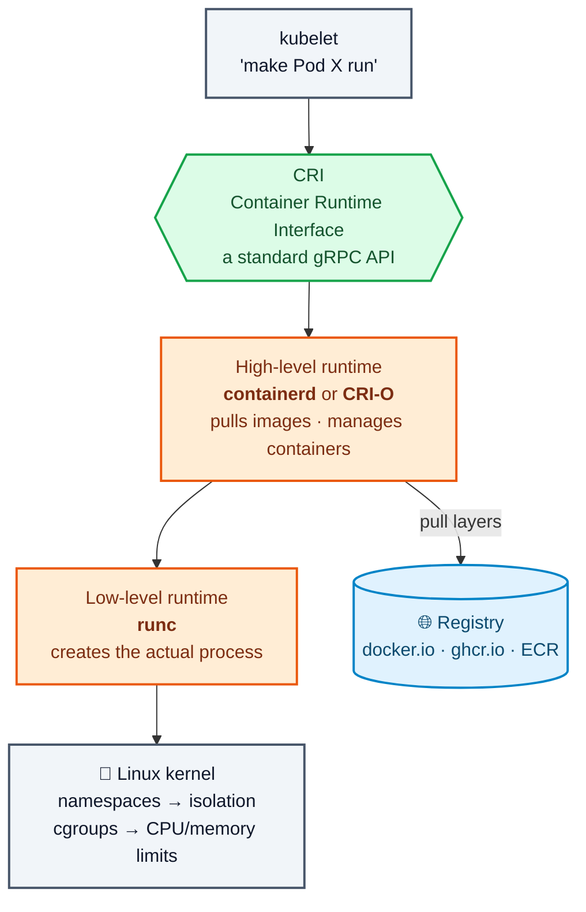
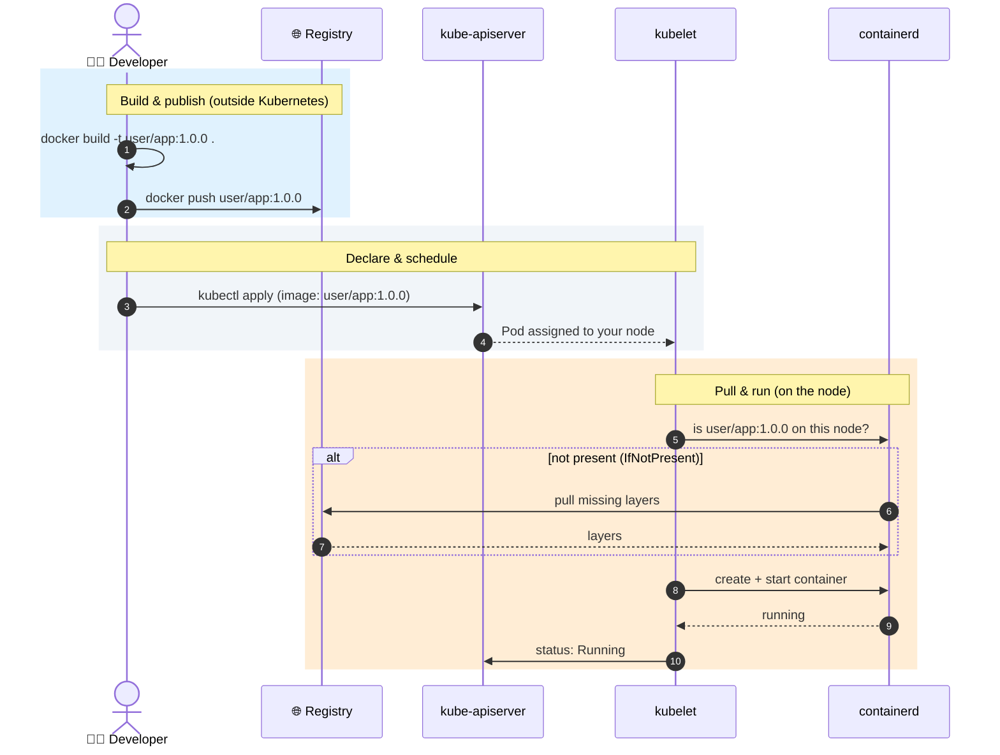

# 03 · Images & Container Runtime

[⬅ Module 1](README.md) · Page 3 of 5 · [🏠 Reference home](../README.md)

[01 Fundamentals](01-kubernetes-fundamentals.md) › [02 Architecture](02-kubernetes-architecture.md) › **03 Images & Runtime** › [04 API Resources](04-api-resources-and-object-definitions.md) › [05 HA Control Plane](05-high-availability-control-plane.md)

---

## The problem: a node is just an empty machine

When the scheduler sends your Pod to node 2, that node has never seen your application. It has no code, no Python, no
libraries. Somehow it must get **exactly** the same software you tested on your laptop, and run it in **exactly**
the same way.

Two things solve this together:

| Piece | Answers the question |
|---|---|
| **Container image** | *What* should run: the packaged application with everything it needs |
| **Container runtime** | *How* it runs: the software on each node that downloads the image and starts a container from it |

---

## Part 1: Container images

### What an image is

An **image** is a read-only package that contains:

1. A **filesystem**: your code, the language runtime (Python, Node, Java…), libraries, and OS files.
2. **Metadata**: which command to run on start, default environment variables, which port the app uses, and so on.

A **container** is a *running instance* of an image, the same way a running program is an instance of an `.exe` file.
One image can start thousands of identical containers.

> **Analogy:** an image is a **recipe card plus pre-measured ingredients, sealed in a box**. A container is the dish
> being cooked from it. Every kitchen (node) that opens the same box gets the same dish.

### Images are made of layers

Each instruction in a `Dockerfile` adds a **layer**. Layers are stacked, and each one is identified by a hash of its
contents.



Why this matters to you:

| Fact | Consequence |
|---|---|
| Layers are shared and cached | If 10 images use the same base layer, a node downloads it **once** |
| Changing a late layer only rebuilds that layer | Put rarely-changing steps (installing dependencies) **before** often-changing steps (copying code) |
| The writable layer is thrown away when the container is deleted | Anything your app writes inside the container **is lost** on restart. Real data needs a volume (see [StatefulSets](../02-deploy-apps-the-kubernetes-way/06-statefulsets.md)). |

### Images follow an open standard (OCI)

Images built by Docker, Podman, Buildah or any other tool follow the **OCI (Open Container Initiative) image
specification**. So an image built with `docker build` runs perfectly on a Kubernetes node that has **no Docker
installed at all**.

---

### How an image is named

The full image reference has up to five parts. Most of them have defaults, which is where confusion comes from.



| You write | What Kubernetes actually pulls | Why |
|---|---|---|
| `nginx` | `docker.io/library/nginx:latest` | Default registry is Docker Hub, default namespace for official images is `library`, default tag is `latest` |
| `nginx:1.27-alpine` | `docker.io/library/nginx:1.27-alpine` | Tag given |
| `cloudprakhargupta/notes-app:api-1.0.0` | `docker.io/cloudprakhargupta/notes-app:api-1.0.0` | A user namespace on Docker Hub |
| `ghcr.io/org/app:2.3.1` | exactly that | A different registry (GitHub Container Registry) |
| `nginx@sha256:4f2a…` | exactly that content, byte for byte | A **digest** identifies the content itself, so it can never change |

### Tags vs digests

| | **Tag** (e.g. `:1.27-alpine`) | **Digest** (e.g. `@sha256:4f2a…`) |
|---|---|---|
| What it is | A human-friendly label | A fingerprint (hash) of the image content |
| Can it move? | **Yes.** The owner can re-push a different image under the same tag | **No.** Different content always means a different digest. |
| Readability | Easy | Hard |
| Best for | Day-to-day work, with **specific** versions | Maximum certainty in production |

> ⚠️ **Warning: never use `:latest` (or no tag) in Kubernetes.** `latest` is just a tag name. It does *not* mean
> "newest". It means "whatever was pushed last without a tag". Two nodes may pull `latest` an hour apart and run
> **different code**, and you can't roll back to "the previous latest". Always pin an explicit version such as
> `nginx:1.27-alpine`.

### Registries: where images live

A **registry** is a server that stores images. Nodes pull from it, and your build pipeline pushes to it.

| Registry | Address example | Typical use |
|---|---|---|
| Docker Hub | `docker.io/…` (default) | Public images, personal projects |
| GitHub Container Registry | `ghcr.io/…` | Images built in GitHub Actions |
| Amazon ECR | `<account>.dkr.ecr.<region>.amazonaws.com/…` | AWS / EKS |
| Azure ACR / Google Artifact Registry | `*.azurecr.io/…` / `*-docker.pkg.dev/…` | Azure / Google Cloud |

> **Note:** Private registries need credentials. Kubernetes passes them using a special Secret type called an
> **image pull secret**. That belongs to security topics and is covered later in the projects.

### Image pull policy: when does the node download?

Every container has an `imagePullPolicy` that controls when the kubelet pulls the image:

| Policy | Behaviour | Default when… |
|---|---|---|
| `IfNotPresent` | Pull only if the image isn't already on this node | The tag is anything **other than** `latest` |
| `Always` | Check the registry every time a container starts (layers already present are reused) | The tag is `latest` **or** no tag is given |
| `Never` | Never pull. The image must already be on the node, or the container fails. | Never a default |

```yaml
containers:
  - name: web
    image: nginx:1.27-alpine       # explicit tag → default policy is IfNotPresent
    imagePullPolicy: IfNotPresent  # written out here only to make it visible
```

---

## Part 2: The container runtime

### What a runtime is

The **container runtime** is the software on each node that does the real, low-level work:

1. **Pull** the image layers from the registry.
2. **Unpack** them into a filesystem.
3. **Create** an isolated environment and **start** the process inside it.
4. **Report** whether the process is running, and stop it when asked.

The kubelet never does these things itself. It **delegates** to the runtime.

### The layers of "starting a container"



| Layer | Role | Analogy |
|---|---|---|
| **kubelet** | Decides *what* should run on this node | Restaurant manager reading the orders |
| **CRI** | A standard "plug shape" between the kubelet and any runtime | A standard electrical socket |
| **containerd / CRI-O** | Pulls images, manages container lifecycles | Head chef who fetches ingredients and runs the kitchen |
| **runc** | Asks the Linux kernel to create the isolated process | Line cook who actually cooks |
| **Linux kernel** | Provides isolation (**namespaces**) and resource control (**cgroups**) | The kitchen itself: walls, ovens, gas meter |

> **Key insight:** a container is **not a small virtual machine**. It's an ordinary Linux process, wrapped in kernel
> features that make it *think* it's alone: its own filesystem, its own process list, its own network. That's why
> containers start in milliseconds.

### "Kubernetes dropped Docker": what that really means

| Question | Answer |
|---|---|
| Does Kubernetes still use Docker to run containers? | **No.** Built-in Docker support (called *dockershim*) was removed in Kubernetes **1.24**. Nodes use containerd or CRI-O directly. |
| Do my Docker-built images still work? | **Yes, completely.** They're standard OCI images. |
| Do I still use Docker on my laptop? | Yes, to **build** images, and Kind uses Docker to simulate nodes. |
| Why remove it? | Docker wasn't built for the CRI. Kubernetes needed an extra adapter to talk to it, while containerd (which Docker itself uses inside) speaks CRI natively. |

### The image's journey, end to end



---

## Try it

> 🧪 **Try it:** Break an image on purpose and learn the error names.

**1. Start a Pod with an image tag that doesn't exist:**

```bash
kubectl run broken --image=nginx:9.99-does-not-exist
kubectl get pod broken --watch
```

Expected: the status moves through `ErrImagePull` and then settles on `ImagePullBackOff`. Press `Ctrl+C` to stop
watching.

**2. Ask *why*:**

```bash
kubectl describe pod broken | tail -6
```

Expected, near the bottom:

```
Warning  Failed   ...  kubelet  Failed to pull image "nginx:9.99-does-not-exist": ... not found
Warning  Failed   ...  kubelet  Error: ErrImagePull
Normal   BackOff  ...  kubelet  Back-off pulling image "nginx:9.99-does-not-exist"
```

Notice the source column says **kubelet**. Pulling is a node-level job.

**3. Fix it in place and clean up:**

```bash
kubectl set image pod/broken broken=nginx:1.27-alpine
kubectl get pod broken        # → Running
kubectl delete pod broken
```

**4. Look at the runtime directly.** Inside a Kind node, `crictl` is the CRI command-line tool:

```bash
docker exec kubernetes-lab-control-plane crictl images | head -5
docker exec kubernetes-lab-control-plane crictl ps | head -5
```

Expected: a list of the images cached **on that node**, and the containers containerd is running there. `docker ps`
on your laptop shows only the Kind node container itself, because containerd inside the node does the real work.

### Image error cheat sheet

| Status | Meaning | Usual cause |
|---|---|---|
| `ErrImagePull` | The first pull attempt failed | Typo in the name/tag, tag doesn't exist, registry unreachable |
| `ImagePullBackOff` | Kubernetes is waiting longer and longer between retries | Same as above. It's still failing. |
| `InvalidImageName` | The image string isn't valid at all | Upper-case letters, spaces, bad characters |
| `ErrImageNeverPull` | Policy is `Never` and the image isn't on the node | Image not preloaded (e.g. forgot `kind load docker-image`) |
| `CreateContainerConfigError` | The image is fine, but the container's configuration isn't | A referenced ConfigMap/Secret is missing (see Module 2) |

---

## Common mistakes

| Mistake | What happens | Fix |
|---|---|---|
| Using `:latest` | Different nodes run different code; rollback is impossible | Always pin a version tag |
| Re-pushing the same tag with new code | Nodes that already cached the old image keep running it (`IfNotPresent`) | Use a **new tag for every build** (e.g. `1.0.1`) |
| Building on your laptop and expecting the cluster to see it | `ErrImagePull`: the cluster's nodes can't see your laptop's local images | Push to a registry, or on Kind: `kind load docker-image <image> --name kubernetes-lab` |
| Building on an Apple Silicon Mac for amd64 nodes | `exec format error` in the logs | `docker buildx build --platform linux/amd64 …` |
| Saving data inside the container | Data disappears on restart | Use a volume. Covered with StatefulSets. |

---

## Quick recap

- An **image** = layered, read-only filesystem + metadata. A **container** = a running instance of it.
- Images follow the **OCI** standard, so Docker-built images run on any Kubernetes runtime.
- Full name: `registry/namespace/repository:tag@digest`. Defaults: `docker.io`, `library`, `latest`.
- **Never use `:latest`.** Pin explicit tags, or digests for maximum certainty.
- `imagePullPolicy`: `IfNotPresent` (default for pinned tags), `Always`, `Never`.
- kubelet → **CRI** → **containerd / CRI-O** → **runc** → Linux kernel (namespaces + cgroups).
- Kubernetes removed dockershim in 1.24. Docker *images* still work everywhere.

**Next question:** you've now seen YAML fields like `image:` and `imagePullPolicy:`. But what is the *overall*
shape of a Kubernetes YAML file, and how do you find out which fields exist? →
[04 · API Resources & Object Definitions](04-api-resources-and-object-definitions.md)

---

## 📚 Official documentation

Everything above is self-contained. These links are for going deeper, not for filling gaps.

| Reference | What it adds |
|---|---|
| [Images](https://kubernetes.io/docs/concepts/containers/images/) | Image names, pull policy defaults, and private registries in full detail |
| [Container Runtime Interface (CRI)](https://kubernetes.io/docs/concepts/architecture/cri/) | How the kubelet and the runtime communicate |
| [Container Runtimes](https://kubernetes.io/docs/setup/production-environment/container-runtimes/) | Installing and configuring containerd and CRI-O on nodes |
| [Containers](https://kubernetes.io/docs/concepts/containers/) | Containers as Kubernetes sees them, plus environment and lifecycle |
| [containerd documentation](https://containerd.io/docs/) | The runtime used by Kind, EKS and most clusters |
| [OCI Image Format Specification](https://github.com/opencontainers/image-spec) | The open standard every container image follows |

*Links verified 2026-11-22.*

---

| ◀ Previous | ▲ Up | Next ▶ |
|---|:--:|---:|
| ◀ **[02 Architecture](02-kubernetes-architecture.md)** | [Module 1](README.md) · [Reference home](../README.md) | **[04 API Resources](04-api-resources-and-object-definitions.md)** ▶ |
