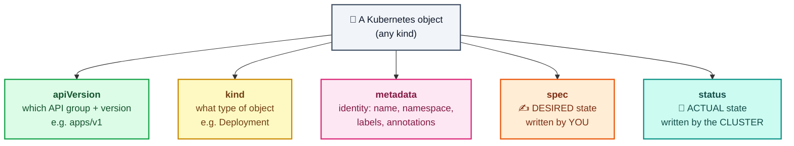
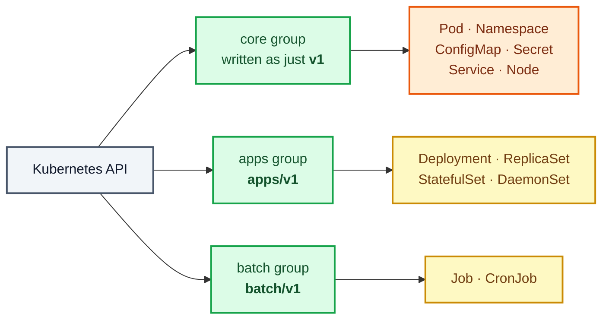
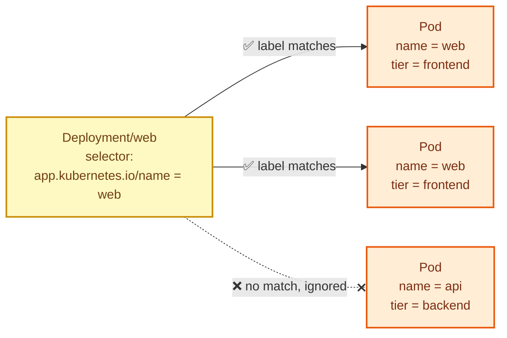
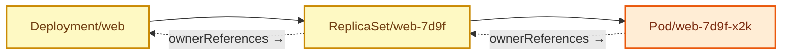
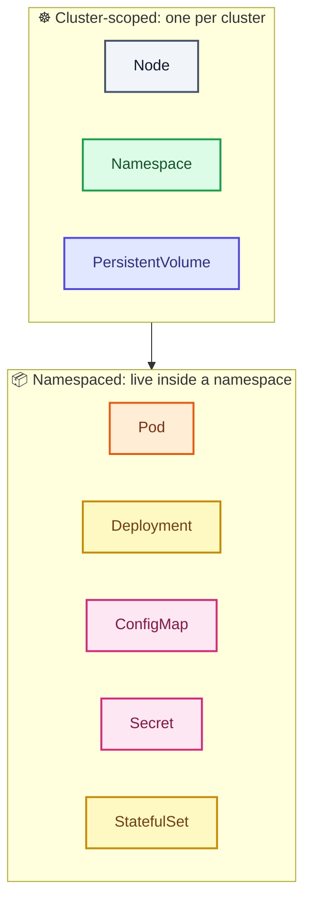

# 04 · API Resources & Object Definitions

[⬅ Module 1](README.md) · Page 4 of 5 · [🏠 Reference home](../README.md)

[01 Fundamentals](01-kubernetes-fundamentals.md) › [02 Architecture](02-kubernetes-architecture.md) › [03 Images & Runtime](03-images-and-container-runtime.md) › **04 API Resources** › [05 HA Control Plane](05-high-availability-control-plane.md)

---

## The problem: "how am I supposed to know what to type?"

Kubernetes has dozens of object types, and each has dozens of fields. Nobody memorises them, and you don't need to.
Two things make Kubernetes YAML learnable:

1. **Every object has the same four-part shape.** Learn it once, and you can read any manifest.
2. **The cluster documents itself.** `kubectl api-resources` lists every object type, and `kubectl explain` describes
   every field, straight from the API server you're connected to.

---

## The idea in one picture: the shape of every object



Here is a real example, with each part labelled:

```yaml
apiVersion: apps/v1            # 1. WHICH API: the "apps" group, version "v1"
kind: Deployment               # 2. WHAT TYPE of object this is
metadata:                      # 3. IDENTITY: who this object is
  name: web                    #    unique name within its namespace
  namespace: shop              #    which namespace it lives in
  labels:                      #    key/value tags used for grouping and selecting
    app.kubernetes.io/name: web
spec:                          # 4. DESIRED STATE: what you want
  replicas: 3
  selector:
    matchLabels:
      app.kubernetes.io/name: web
  template:
    metadata:
      labels:
        app.kubernetes.io/name: web
    spec:
      containers:
        - name: web
          image: nginx:1.27-alpine
# 5. status: is NOT written by you. The cluster adds it after you apply the file.
```

### `spec` vs `status`: the reconciliation loop, written down

| | `spec` | `status` |
|---|---|---|
| Who writes it | **You** (in your YAML file) | **The cluster** (controllers and the kubelet) |
| What it means | "This is what I want" | "This is what is actually true right now" |
| Example | `replicas: 3` | `readyReplicas: 2` |
| Is it in your Git repo? | Yes | No. It exists only in the live cluster. |

When `spec` and `status` disagree, a controller is working on closing the gap. This is the reconciliation loop from
[page 01](01-kubernetes-fundamentals.md), visible as data.

> **Note:** A few objects, such as ConfigMap and Secret, have **no `spec`**. They store data directly in a `data:`
> field, because they're *information*, not something to reconcile.

---

## How it works: each field in detail

### `apiVersion`: group + version

Kubernetes object types are organised into **API groups**, and each group has **versions**.



| Version label | Meaning | Use in production? |
|---|---|---|
| `v1alpha1` | Experimental, may change or disappear, often disabled by default | No |
| `v1beta1` | Fairly well tested, but details may still change | With care |
| `v1`, `v2` | **Stable.** Will be supported for a long time. | Yes |

> ⚠️ **Warning:** `apiVersion` must match the `kind`. `apiVersion: v1` + `kind: Deployment` fails with
> `no matches for kind "Deployment" in version "v1"`, because Deployment lives in `apps/v1`. When in doubt, ask the
> cluster with `kubectl api-resources`, shown below.

### `kind`: the type of object

Always written in **CamelCase**, singular: `Pod`, `Deployment`, `ConfigMap`, `StatefulSet`.

### `metadata`: identity

| Field | Required? | What it's for |
|---|---|---|
| `name` | ✅ Yes | Unique among objects of the same kind in the same namespace. Lowercase letters, digits and `-`, starting and ending with a letter or digit. Example: `web-api`. |
| `namespace` | Optional | Which namespace the object lives in. If missing, your current namespace is used (usually `default`). |
| `labels` | Optional (but always use them) | Short key/value tags that Kubernetes uses to **select** and **group** objects |
| `annotations` | Optional | Longer key/value notes for tools and humans. Never used for selecting. |
| `uid`, `resourceVersion`, `creationTimestamp` | Added by the cluster | Internal identity and change tracking. Never write these yourself. |

### Labels and selectors: how objects find each other

Kubernetes objects are connected by **labels**, not by names. One object puts a label on Pods; another object
**selects** Pods with that label.



| Labels | Annotations |
|---|---|
| `app.kubernetes.io/name: web` | `description: "Customer-facing storefront"` |
| Short, structured, **queryable** | Free text, can be long |
| `kubectl get pods -l app.kubernetes.io/name=web` | Read by tools, not by selectors |

> **Tip:** The `app.kubernetes.io/*` label keys (`name`, `instance`, `version`, `component`, `part-of`) are the
> officially recommended set. Using them means other tools understand your objects automatically.

### Who owns whom: owner references

When a Deployment creates a ReplicaSet, and the ReplicaSet creates Pods, each child records its parent in
`metadata.ownerReferences`. That's how Kubernetes knows that **deleting the Deployment should delete its
ReplicaSets and Pods too**. This automatic clean-up is called **garbage collection**.



---

## How it works: discovering resources with `kubectl api-resources`

A **resource** is an endpoint in the Kubernetes API (for example `/apis/apps/v1/deployments`). Each one stores
objects of one **kind**. `kubectl api-resources` asks the API server to list every resource it knows about:

```bash
kubectl api-resources
```

Example output (shortened):

```
NAME            SHORTNAMES   APIVERSION   NAMESPACED   KIND
configmaps      cm           v1           true         ConfigMap
namespaces      ns           v1           false        Namespace
nodes           no           v1           false        Node
pods            po           v1           true         Pod
secrets                      v1           true         Secret
deployments     deploy       apps/v1      true         Deployment
replicasets     rs           apps/v1      true         ReplicaSet
statefulsets    sts          apps/v1      true         StatefulSet
```

| Column | What it tells you | How you use it |
|---|---|---|
| `NAME` | The resource name (plural, lowercase) | `kubectl get deployments` |
| `SHORTNAMES` | Abbreviations | `kubectl get deploy`, `kubectl get po`, `kubectl get cm` |
| `APIVERSION` | The value to put in `apiVersion:` | `apps/v1` for Deployment |
| `NAMESPACED` | `true` = lives inside a namespace; `false` = cluster-wide | Nodes and Namespaces themselves are cluster-wide |
| `KIND` | The value to put in `kind:` | `Deployment` |

Useful variations:

| Command | Shows |
|---|---|
| `kubectl api-resources --namespaced=true` | Only resources that live inside namespaces |
| `kubectl api-resources --namespaced=false` | Only cluster-wide resources |
| `kubectl api-resources --api-group=apps` | Only the `apps` group |
| `kubectl api-versions` | Every `group/version` the cluster serves |

### Namespaced vs cluster-scoped



---

## How it works: documenting any field with `kubectl explain`

`kubectl explain` prints the documentation for any field, taken from the cluster you're connected to, so it always
matches your Kubernetes version.

```bash
kubectl explain deployment
kubectl explain deployment.spec
kubectl explain deployment.spec.strategy
kubectl explain pod.spec.containers.imagePullPolicy
```

Example output for the last one:

```
KIND:       Pod
VERSION:    v1

FIELD: imagePullPolicy <string>
ENUM:
    Always
    IfNotPresent
    Never

DESCRIPTION:
    Image pull policy. One of Always, Never, IfNotPresent. Defaults to Always if
    :latest tag is specified, or IfNotPresent otherwise. ...
```

| Tip | Command |
|---|---|
| See the **whole tree** of fields at once | `kubectl explain deployment.spec --recursive` |
| Is a field required? | Look for `-required-` next to the field name |
| What type is it? | Shown in `<angle brackets>`: `<string>`, `<integer>`, `<Object>`, `<[]Object>` (a list) |

---

## YAML in five minutes

Kubernetes manifests are YAML. These are the only rules you need for now:

```yaml
# 1. key: value pairs (a "map"). A space after the colon is required.
name: web

# 2. Nesting is done with INDENTATION, using SPACES only, never tabs. Two spaces is the convention.
metadata:
  name: web
  labels:
    tier: frontend

# 3. A list uses "- " for each item
containers:
  - name: web
    image: nginx:1.27-alpine
  - name: helper
    image: busybox:1.36

# 4. Quote values that look like numbers or booleans when they must be strings
env:
  - name: PORT
    value: "8080"        # env values MUST be strings → quote numbers
  - name: DEBUG
    value: "true"        # unquoted true would be a boolean → error

# 5. "---" separates several objects in one file
---
apiVersion: v1
kind: Namespace
metadata:
  name: shop
```

> ⚠️ **Warning:** The most common beginner error is wrong indentation. If `kubectl apply` complains about an
> `unknown field`, check that the field is indented under the right parent.

---

## Try it

> 🧪 **Try it:** Let the cluster teach you.

**1. Find the right `apiVersion` for StatefulSet:**

```bash
kubectl api-resources | grep -i statefulset
```

Expected: `statefulsets   sts   apps/v1   true   StatefulSet`, so you'd write `apiVersion: apps/v1`.

**2. Let kubectl write a starter YAML for you, without creating anything:**

```bash
kubectl create deployment web --image=nginx:1.27-alpine --replicas=2 --dry-run=client -o yaml
```

*What it does:* `--dry-run=client` means "don't send this to the cluster", and `-o yaml` means "print it as YAML".
This is the fastest way to get a correct skeleton. Redirect it to a file (`> web.yaml`), then edit it.

**3. Create it, then compare what you wrote with what the cluster stores:**

```bash
kubectl create deployment web --image=nginx:1.27-alpine --replicas=2 --dry-run=client -o yaml > web.yaml
kubectl apply -f web.yaml
kubectl get deployment web -o yaml | less
```

Look for the fields **you didn't write**: `uid`, `creationTimestamp`, `generation`, many defaulted fields such as
`strategy` and `revisionHistoryLimit`, and the whole `status:` block at the bottom. The API server filled in
defaults, and the controllers wrote `status`.

**4. See the owner chain:**

```bash
kubectl get pods -l app=web -o jsonpath='{.items[0].metadata.ownerReferences[0].kind}{"\n"}'
```

Expected: `ReplicaSet`. Now clean up. The Deployment's children are deleted automatically:

```bash
kubectl delete -f web.yaml
rm web.yaml
```

---

## Common mistakes

| Mistake | Error you'll see | Fix |
|---|---|---|
| Wrong `apiVersion` for the `kind` | `no matches for kind "Deployment" in version "v1"` | `kubectl api-resources` → copy `APIVERSION` |
| Typo in a field name | `unknown field "spec.replica"` | `kubectl explain` the parent field |
| Tabs in YAML | `found character that cannot start any token` | Use spaces only |
| Number in an env value | `cannot unmarshal number into … string` | Quote it: `"8080"` |
| Writing a `status:` block | Silently ignored | Remove it. Status is the cluster's job. |
| Upper-case in `name` | `a lowercase RFC 1123 subdomain must consist of…` | Lowercase letters, digits and `-` only |

---

## Quick recap

- Every object = `apiVersion` + `kind` + `metadata` + `spec` (+ `status` written by the cluster).
- **`spec` = desired state (you). `status` = actual state (cluster).**
- `apiVersion` is `group/version`. The core group is written as just `v1`.
- **Labels** connect objects: controllers select Pods by label, not by name.
- `ownerReferences` link children to parents. Deleting a parent garbage-collects its children.
- `kubectl api-resources` → which kinds exist, their `apiVersion`, short names, and whether they are namespaced.
- `kubectl explain <kind>.<field>` → documentation for any field. `--recursive` shows the whole tree.
- `--dry-run=client -o yaml` generates correct starter YAML.

**Next question:** every object you just learned to read is stored in **etcd** and served by the **API server**. On a
single control-plane node, losing that node means losing the cluster's brain. How do production clusters run
*several* control-plane nodes, decide who's in charge, and keep etcd consistent? →
[05 · High-Availability (Multi-Master) Control Plane](05-high-availability-control-plane.md)

---

## 📚 Official documentation

Everything above is self-contained. These links are for going deeper, not for filling gaps.

| Reference | What it adds |
|---|---|
| [Objects In Kubernetes](https://kubernetes.io/docs/concepts/overview/working-with-objects/kubernetes-objects/) | The official explanation of spec vs status and required fields |
| [Labels and Selectors](https://kubernetes.io/docs/concepts/overview/working-with-objects/labels/) | Full selector syntax, including set-based selectors (`in`, `notin`) |
| [Object Names and IDs](https://kubernetes.io/docs/concepts/overview/working-with-objects/names/) | Exact naming rules, with every format and length limit |
| [Kubernetes API Concepts](https://kubernetes.io/docs/reference/using-api/api-concepts/) | Resources, verbs, API groups and how the REST API is organised |
| [kubectl api-resources](https://kubernetes.io/docs/reference/kubectl/generated/kubectl_api-resources/) | Every flag for listing resources |
| [kubectl explain](https://kubernetes.io/docs/reference/kubectl/generated/kubectl_explain/) | Every flag for exploring fields |

*Links verified 2026-11-22.*

---

| ◀ Previous | ▲ Up | Next ▶ |
|---|:--:|---:|
| ◀ **[03 Images & Runtime](03-images-and-container-runtime.md)** | [Module 1](README.md) · [Reference home](../README.md) | **[05 HA Control Plane](05-high-availability-control-plane.md)** ▶ |
