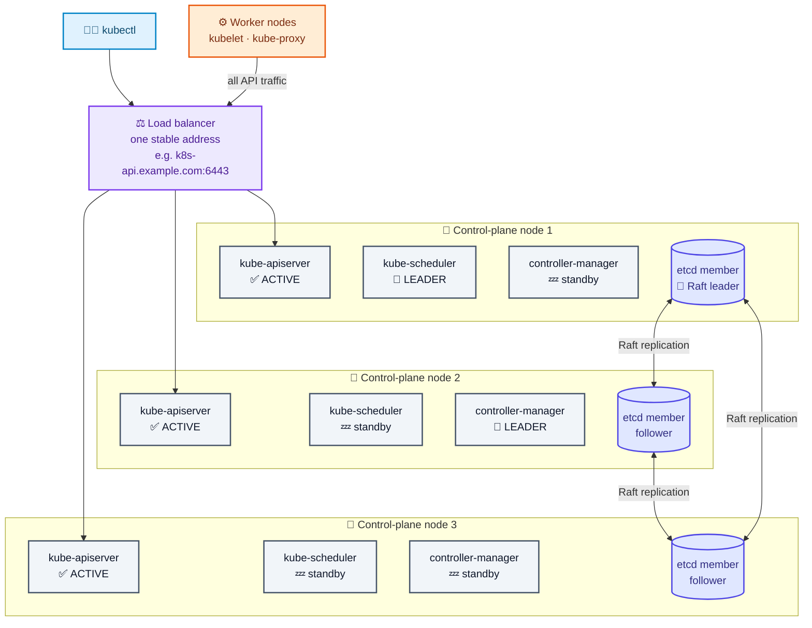
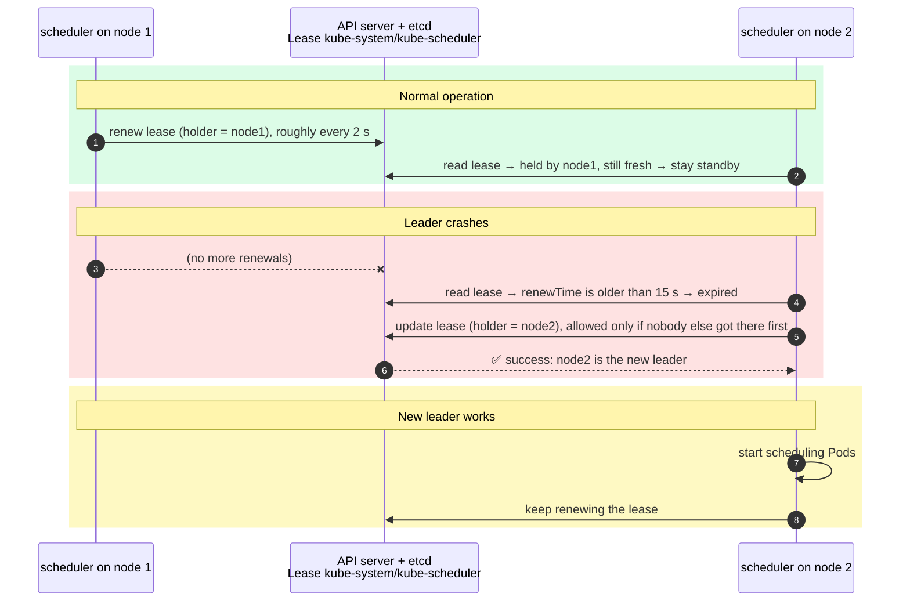
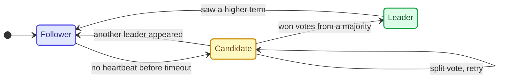
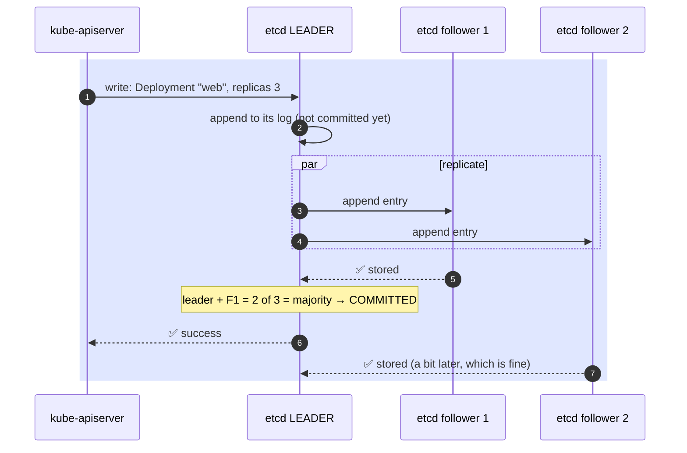
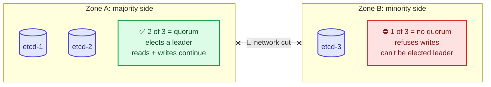
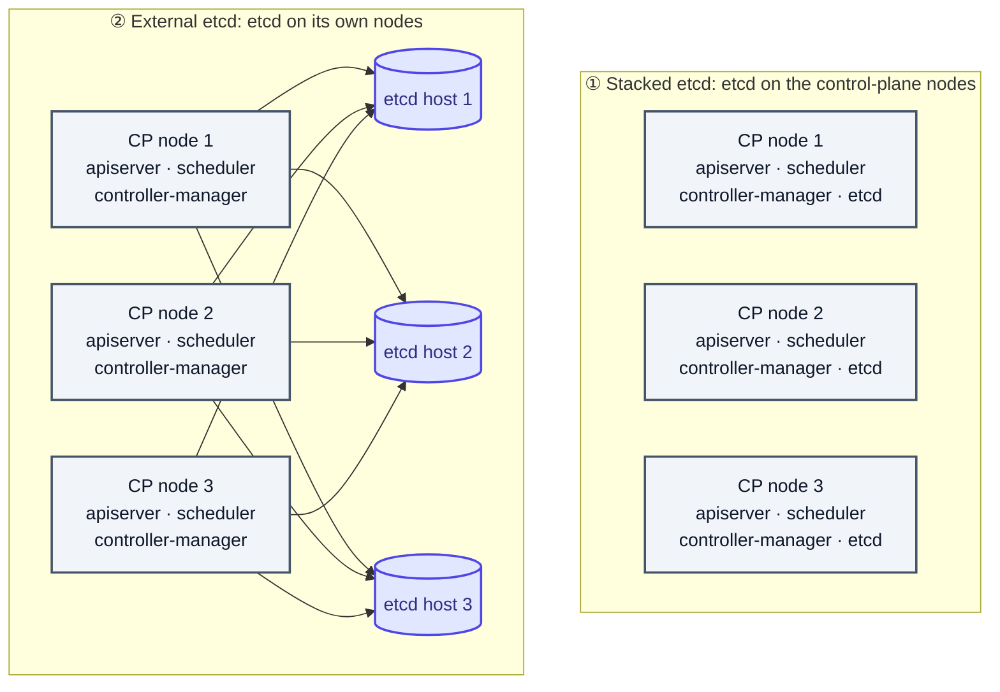

# 05 · High-Availability (Multi-Master) Control Plane

[⬅ Module 1](README.md) · Page 5 of 5 · [🏠 Reference home](../README.md)

[01 Fundamentals](01-kubernetes-fundamentals.md) › [02 Architecture](02-kubernetes-architecture.md) › [03 Images & Runtime](03-images-and-container-runtime.md) › [04 API Resources](04-api-resources-and-object-definitions.md) › **05 HA Control Plane**

---

## The problem: one brain is a single point of failure

On [page 02](02-kubernetes-architecture.md), the control plane ran on **one** node. If that node dies:

| What stops | What keeps working |
|---|---|
| `kubectl` (no API server to talk to) | Pods that are already running keep running |
| Self-healing: crashed Pods on dead nodes aren't replaced | Containers restarted by their own kubelet |
| New deployments, scaling, rolling updates | |
| **If etcd's disk is lost: the entire cluster state, permanently** | |

For learning, that's fine. For production, it's not. The answer is to run **several control-plane nodes**. This is
often called a **multi-master** cluster.

> **Note on words:** older docs say **master** node. The official term today is **control-plane node**. This page
> uses both, because you'll meet both in the real world.

---

## The idea in one picture

A typical highly-available (HA) cluster has **3 control-plane nodes** behind a **load balancer**, with workers
talking only to that load balancer.



Look closely. **There is no single "master of the masters".** Each component type handles redundancy in its own way:

| Component | HA style | How many work at the same time? |
|---|---|---|
| **kube-apiserver** | **Active-active** behind a load balancer | **All** of them |
| **kube-scheduler** | **Active-passive** via **leader election** | **One** leader; the others wait |
| **kube-controller-manager** | **Active-passive** via **leader election** | **One** leader; the others wait |
| **cloud-controller-manager** | **Active-passive** via **leader election** | **One** leader |
| **etcd** | **Consensus cluster** using the **Raft** algorithm | All store data; **one** Raft leader orders every write |

The leaders are chosen **independently**. The scheduler leader can be on node 1 while the controller-manager leader
is on node 2 and the etcd leader is on node 3. That's normal.

> **Analogy:** an airport with three control towers. All three **radios** (API servers) answer calls. But for each
> job (gate planning, runway supervision) only **one** tower is "on shift" at a time, and the others are ready to
> take over. The **logbook** (etcd) is kept in all three towers, and a change counts only when a majority has written
> it down.

---

## How it works, part 1: API servers are active-active

The API server is **stateless**: everything it knows lives in etcd. So any number of API servers can run side by
side, and each request can go to any of them.

| Detail | Why it matters |
|---|---|
| A **load balancer** (cloud LB, HAProxy, keepalived VIP…) sits in front on port **6443** | Clients need **one** stable address, not three |
| kubelets, kube-proxy, `kubectl` and controllers all use the **load-balancer address** | If they pointed at node 1 directly, losing node 1 would cut them off |
| The LB health-checks each API server (e.g. `/readyz`) | Dead API servers are removed from rotation automatically |
| The API server certificate must include the LB name/IP | Otherwise clients get TLS errors through the LB |

---

## How it works, part 2: leader election for the scheduler and controller-manager

The scheduler and the controller-manager **must not** run active-active. Two schedulers could put the same Pod on
two nodes. Two ReplicaSet controllers could each create the "missing" Pod, so you'd get double. So exactly **one**
instance does the work, and the others stand by.

### The mechanism: a Lease object as a "talking stick"

The instances coordinate **through the API server**, using a small object of kind **Lease** (API group
`coordination.k8s.io`) in the `kube-system` namespace:

| Lease field | Meaning |
|---|---|
| `holderIdentity` | Who is the leader right now (node name + a unique ID) |
| `leaseDurationSeconds` | How long the lease is valid without renewal (default **15 s**) |
| `renewTime` | The last time the leader said "I'm still alive" |
| `leaseTransitions` | How many times leadership has changed hands |



| Setting (default) | Meaning |
|---|---|
| `--leader-elect=true` | Leader election is on (kubeadm and managed clusters enable it) |
| `--leader-elect-lease-duration=15s` | Followers wait this long after the last renewal before taking over |
| `--leader-elect-renew-deadline=10s` | A leader that can't renew within this time **steps down by itself** |
| `--leader-elect-retry-period=2s` | How often candidates retry and leaders renew |

**Why two leaders can't both win:** every update to an object in Kubernetes carries a `resourceVersion`. If two
standbys try to take the expired lease at the same moment, the API server accepts the **first** write. The second
write uses an outdated `resourceVersion` and gets a **conflict** error. The loser simply goes back to waiting.

> 🎯 **Interview:** *"How is the master node selected in Kubernetes?"* There's **no single master selection**. API
> servers are all active behind a load balancer. The scheduler and controller-manager each elect their **own** leader
> by competing for a **Lease** object in `kube-system`, and the leader keeps renewing it. etcd elects its own leader
> with **Raft**. Failover takes about one lease duration (~15 s) for the controllers, and about one second for etcd.

---

## How it works, part 3: etcd in a multi-master cluster

etcd is the **only** stateful part of the control plane, which makes it the hardest part to run in HA.

### Raft in plain language

etcd keeps several copies of the data (**members**) consistent using the **Raft** consensus algorithm:

| Raft idea | Plain meaning |
|---|---|
| **Leader** | One member accepts all writes and sends them to the others |
| **Followers** | The other members copy the leader's log, and forward any writes they receive to the leader |
| **Heartbeat** | The leader sends a short "I'm alive" message often (etcd default: every **100 ms**) |
| **Election timeout** | A follower that hears nothing for a while (default ~**1 s**, randomised a little) becomes a **candidate** and asks for votes |
| **Term** | A numbered "era". Every new election starts a higher term, so old leaders are recognised as stale. |
| **Commit** | A write is final only when a **majority (quorum)** of members has stored it |



### How a single write travels



The API server reports success **only after a majority has the data on disk**. If the leader crashes right after,
the new leader is guaranteed to have that write, because Raft only elects a candidate whose log is up to date.

### Quorum: why 3 or 5, never 2 or 4

**Quorum** = the majority needed to elect a leader and commit writes = `floor(N / 2) + 1`.

| etcd members (N) | Quorum needed | Failures tolerated | Verdict |
|:--:|:--:|:--:|---|
| 1 | 1 | **0** | 🧪 Learning only |
| 2 | 2 | **0** | ❌ Worse than 1: twice the hardware, and either failure stops the cluster |
| **3** | 2 | **1** | ✅ The standard production choice |
| 4 | 3 | **1** | ❌ Same tolerance as 3, but more members to coordinate |
| **5** | 3 | **2** | ✅ For larger or more critical clusters |
| 7 | 4 | 3 | ⚠️ Rarely worth it: every write waits for more members |

> **Rule:** always use an **odd** number of etcd members. Adding the even member raises the quorum without raising
> the failures you can survive.

### Network partitions: why majority matters



The minority side **stops accepting writes** instead of making its own decisions. That's what prevents
**split-brain**: two halves of the cluster each believing they're in charge and writing conflicting data. When the
network heals, `etcd-3` catches up from the leader automatically.

### What happens when etcd loses quorum entirely

| Situation | Effect |
|---|---|
| 1 of 3 members down | ✅ No visible effect; the cluster keeps working |
| 2 of 3 members down | ⛔ **No quorum.** API reads/writes fail or time out, and `kubectl` stops working. |
| Running Pods during no-quorum | ✅ Keep running (kubelets keep containers alive) |
| Self-healing, scheduling, new deployments | ⛔ Stopped until quorum returns |
| Members come back | ✅ Raft elects a leader and the cluster resumes. No data is lost. |
| Disks of a **majority** permanently destroyed | 🔥 Only a **backup snapshot** can restore the cluster |

---

## How it works, part 4: the two topologies

Where etcd runs is a design choice.



| | ① **Stacked** etcd | ② **External** etcd |
|---|---|---|
| Machines for 1-failure tolerance | **3** | **6** (3 control plane + 3 etcd) |
| Set-up | Simple; the `kubeadm` default | More work (separate certificates, separate hosts) |
| Each API server talks to | Its **local** etcd member | The etcd cluster endpoints |
| Losing one node loses | One API server **and** one etcd member together | Only one or the other |
| Best for | Most clusters | Very large or very critical clusters |

---

## How it works, part 5: managing etcd day to day

| Task | What it means | Typical command (run on a control-plane node, with etcd's TLS certificates) |
|---|---|---|
| **See members** | Which members exist and their addresses | `etcdctl member list -w table` |
| **Check health / find the leader** | Is every member healthy? Who is the Raft leader? | `etcdctl endpoint status --cluster -w table` (look at `IS LEADER`) |
| **Add a member** | Join a new control-plane node | Done for you by `kubeadm join --control-plane …` (it runs `member add` behind the scenes) |
| **Remove a member** | Retire a dead or replaced node, so it no longer counts towards quorum | `etcdctl member remove <id>`. `kubeadm reset` on that node does it for you. |
| **Back up** | Take a point-in-time copy of the whole cluster state | `etcdctl snapshot save /backup/etcd-$(date +%F).db` |
| **Restore** | Rebuild a cluster from a snapshot after a disaster | `etcdutl snapshot restore <file> --data-dir <new-dir>`, then point etcd at the new directory |
| **Compact / defragment** | Remove old revisions and reclaim disk space | The API server compacts automatically. `etcdctl defrag` reclaims space. |

| Port | Used for |
|---|---|
| **2379** | Clients (the API server) → etcd |
| **2380** | etcd member ↔ member (peer replication and elections) |

> 🏭 **Production checklist for etcd:**
> - **Odd** number of members (3 or 5), spread across **failure zones**: one per zone.
> - **Fast disks (SSD)** and low network latency between members. etcd writes every change to disk before it says
>   "OK", so slow disks mean a slow cluster and false leader elections.
> - **Regular, automated snapshots, stored off the cluster**, and a **tested** restore procedure.
> - **TLS everywhere**: client and peer traffic both use certificates. kubeadm generates them under
>   `/etc/kubernetes/pki/etcd/`.
> - When replacing a dead member: **remove the old one first, then add the new one**, so that quorum math stays correct.

### On managed Kubernetes (EKS, AKS, GKE)

You don't see the control plane at all. The provider runs the API servers and etcd for you, and handles leader
election, etcd backups and upgrades. AWS documents that *"Amazon EKS runs and scales the Kubernetes control plane
across multiple AWS Availability Zones to ensure high availability"*
([source](https://docs.aws.amazon.com/eks/latest/userguide/disaster-recovery-resiliency.html)). Your job is only to
make the **worker nodes and applications** highly available.

---

## Try it

> 🧪 **Try it:** Build a 3-control-plane cluster **on your laptop** with Kind, find the leaders, then kill nodes and
> watch failover. Needs ~6 GB of free RAM. It's for learning only, because all "nodes" share one machine.

**1. Create an HA Kind cluster.** Kind automatically adds a small HAProxy load-balancer container in front of the
API servers.

```bash
cat > kind-ha.yaml <<'EOF'
# 3 control-plane nodes + 1 worker. Kind adds an HAProxy load balancer in front of the API servers.
kind: Cluster
apiVersion: kind.x-k8s.io/v1alpha4
nodes:
  - role: control-plane
  - role: control-plane
  - role: control-plane
  - role: worker
EOF
kind create cluster --name ha-lab --config kind-ha.yaml
kubectl get nodes
docker ps --format '{{.Names}}' | grep ha-lab
```

Expected: three nodes with role `control-plane` (`ha-lab-control-plane`, `ha-lab-control-plane2`,
`ha-lab-control-plane3`), one `worker`, and an extra container `ha-lab-external-load-balancer`. That container is the
LB from the big diagram.

**2. Three of everything:**

```bash
kubectl get pods -n kube-system -o wide | grep -E 'apiserver|scheduler|controller-manager|etcd'
```

Expected: 3 × kube-apiserver, 3 × kube-scheduler, 3 × kube-controller-manager, 3 × etcd, one of each per control-plane
node. All `Running`, even the standbys.

**3. Find the scheduler and controller-manager leaders:**

```bash
kubectl get lease -n kube-system
kubectl get lease kube-scheduler -n kube-system -o jsonpath='{.spec.holderIdentity}{"\n"}'
kubectl get lease kube-controller-manager -n kube-system -o jsonpath='{.spec.holderIdentity}{"\n"}'
```

Expected: something like `ha-lab-control-plane2_4f1c…`. The part before `_` is the node holding leadership. The two
leaders may well be on different nodes.

**4. Find the etcd Raft leader:**

```bash
kubectl -n kube-system exec etcd-ha-lab-control-plane -- etcdctl \
  --endpoints=https://127.0.0.1:2379 \
  --cacert=/etc/kubernetes/pki/etcd/ca.crt \
  --cert=/etc/kubernetes/pki/etcd/server.crt \
  --key=/etc/kubernetes/pki/etcd/server.key \
  endpoint status --cluster -w table
```

Expected: a table of 3 endpoints. Exactly **one** row shows `IS LEADER = true`, and all rows share the same
`RAFT TERM`. Replace `endpoint status --cluster` with `member list` to see the three members.

**5. Kill the scheduler leader's node and watch failover.** Use the node name you found in step 3:

```bash
docker stop ha-lab-control-plane2          # ← your scheduler leader's node
sleep 20
kubectl get lease kube-scheduler -n kube-system -o jsonpath='{.spec.holderIdentity}{"\n"}'
kubectl get nodes
```

Expected: `kubectl` **still works**, because the LB routes around the dead API server. The lease now names a
**different** node, taken over after ~15 s. That node shows `NotReady` after about 40 s. etcd still has 2 of 3
members, which is quorum.

**6. Kill a second control-plane node, and lose quorum:**

```bash
docker stop ha-lab-control-plane3          # pick a control-plane node that is still running
kubectl get nodes --request-timeout=10s
```

Expected: errors or timeouts, such as `etcdserver: request timed out` or `context deadline exceeded`. Only 1 of 3 etcd
members is left, so **no quorum**, and the API can't serve. Existing Pods on the worker are still running.

**7. Bring them back, and the cluster heals itself:**

```bash
docker start ha-lab-control-plane2 ha-lab-control-plane3
sleep 60
kubectl get nodes                          # all Ready again
```

**8. Clean up:**

```bash
kind delete cluster --name ha-lab
rm kind-ha.yaml
```

---

## Common mistakes

| Mistake | What goes wrong | Better |
|---|---|---|
| Running **2** control-plane nodes "for HA" | Losing either one loses etcd quorum. That's less available than 1. | Use 3 (or 5) |
| Pointing kubelets/kubectl at one control-plane node's IP | That node dies → everyone loses the API | Always use the **load-balancer** address |
| Putting all control-plane nodes in one rack or zone | One power or network failure takes out the majority | One member per failure zone |
| No etcd backups ("we have 3 copies") | Replicas copy mistakes too: an accidental `delete namespace` replicates instantly | Scheduled snapshots, stored outside the cluster |
| Replacing a dead member without `member remove` | The dead member still counts, so quorum math is wrong | Remove the old member first, then add the new one |
| Slow disks for etcd | Leader elections flap, and the API becomes slow | SSD storage, and monitor etcd disk latency |

---

## Quick recap

- **Multi-master** = several control-plane nodes, usually **3**, behind a **load balancer** on port 6443.
- **API servers: active-active.** They're stateless, so all of them serve traffic.
- **Scheduler and controller-manager: active-passive.** One **leader** each, elected through a **Lease** object in
  `kube-system`. If renewals stop, a standby takes over after ~15 s.
- **There's no single "master selection".** Each component elects independently, and etcd has its own Raft leader.
- **etcd uses Raft**: one leader orders writes, and a write is committed only when a **majority** stores it.
- **Quorum = floor(N/2)+1.** Use **odd** sizes: 3 tolerates 1 failure, 5 tolerates 2.
- Losing quorum stops the API (running Pods keep running). Losing a majority's disks means **restore from backup**.
- Topologies: **stacked** (etcd on the control-plane nodes, 3 machines) or **external** (separate etcd, 6+ machines).
- On EKS/AKS/GKE, the provider does all of this for you.

**🎉 Module 1 complete.** You know *what* Kubernetes is, *who* does what inside it, *how* containers start, *how* to
read any object, and *how* the control plane itself survives failures. Now let's deploy an app, the Kubernetes way.
→ [Module 2 · 01 Namespaces](../02-deploy-apps-the-kubernetes-way/01-namespaces.md)

---

## 📚 Official documentation

Everything above is self-contained. These links are for going deeper, not for filling gaps.

| Reference | What it adds |
|---|---|
| [Options for Highly Available Topology](https://kubernetes.io/docs/setup/production-environment/tools/kubeadm/ha-topology/) | Official diagrams of stacked vs external etcd, with pros and cons |
| [Creating Highly Available Clusters with kubeadm](https://kubernetes.io/docs/setup/production-environment/tools/kubeadm/high-availability/) | The step-by-step build, including load-balancer requirements |
| [Leases](https://kubernetes.io/docs/concepts/architecture/leases/) | How Lease objects are used for leader election and node heartbeats |
| [Operating etcd clusters for Kubernetes](https://kubernetes.io/docs/tasks/administer-cluster/configure-upgrade-etcd/) | Cluster sizing, backups, restores, and member replacement |
| [etcd FAQ](https://etcd.io/docs/v3.5/faq/) | Why odd sizes, what quorum loss means, and member changes |
| [The Raft Consensus Algorithm](https://raft.github.io/) | The algorithm itself, with an interactive visualisation |

*Links verified 2026-11-22.*

---

| ◀ Previous | ▲ Up | Next ▶ |
|---|:--:|---:|
| ◀ **[04 API Resources](04-api-resources-and-object-definitions.md)** | [Module 1](README.md) · [🏠 Reference home](../README.md) | **[Module 2 · 01 Namespaces](../02-deploy-apps-the-kubernetes-way/01-namespaces.md)** ▶ |
