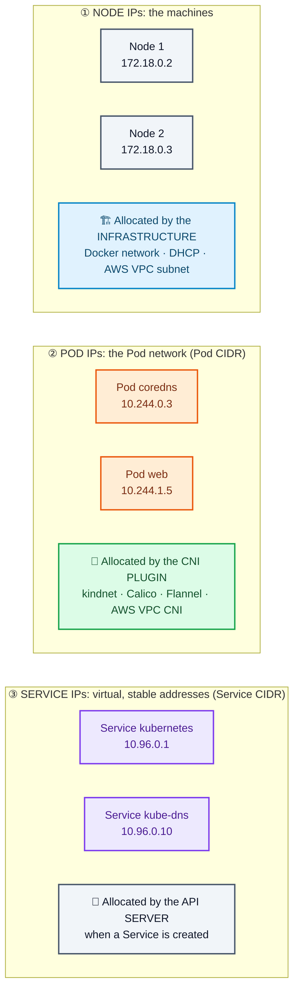
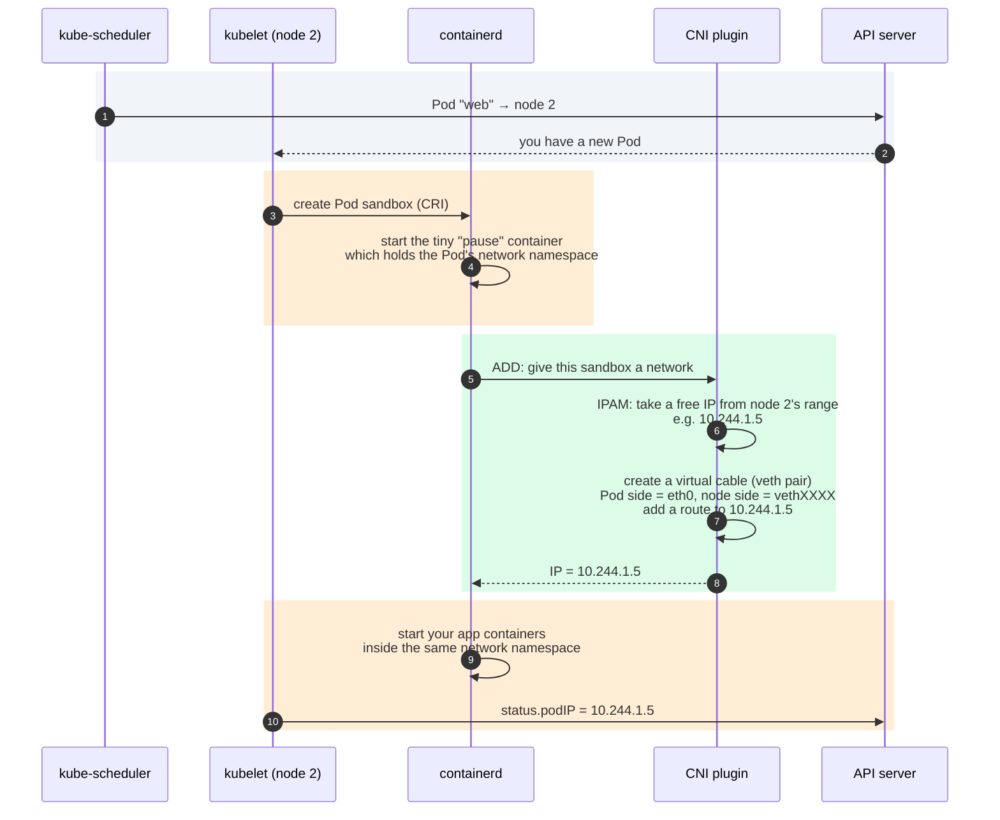
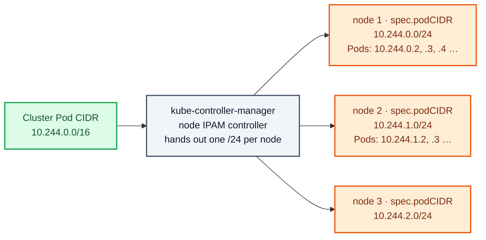
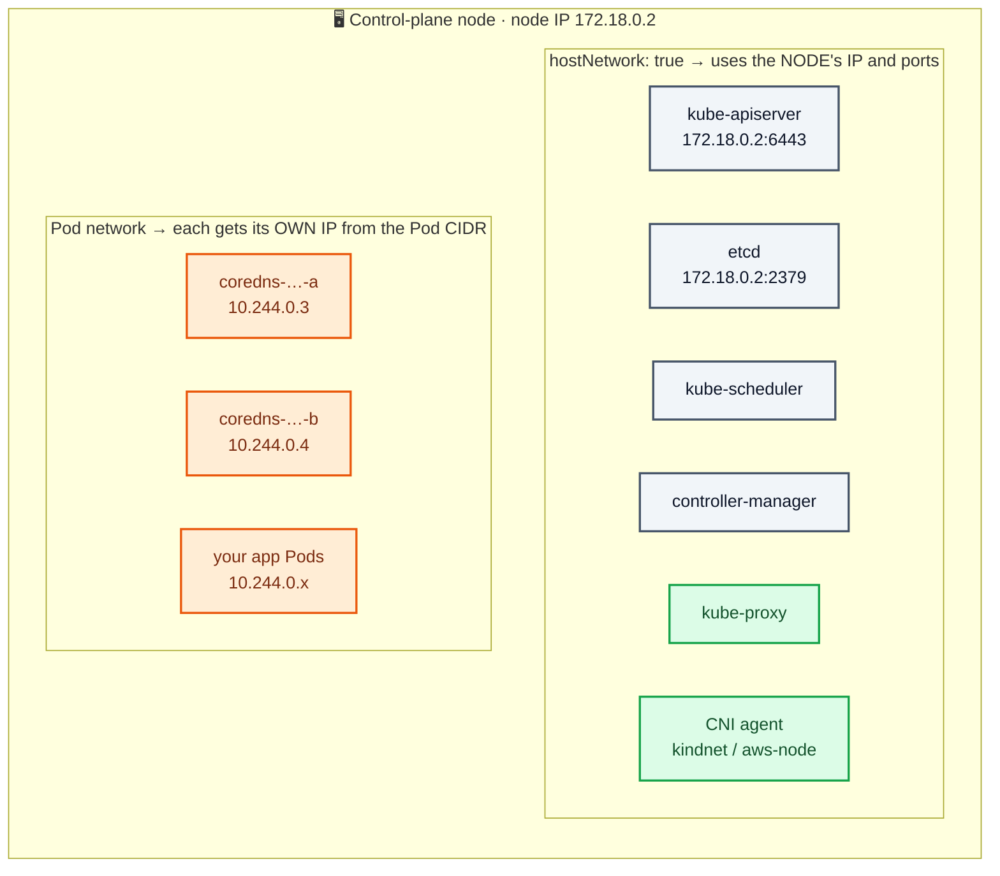
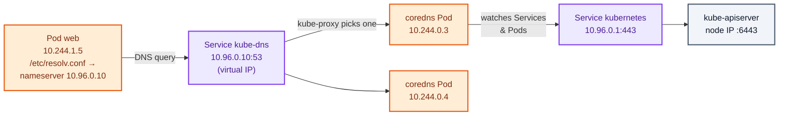
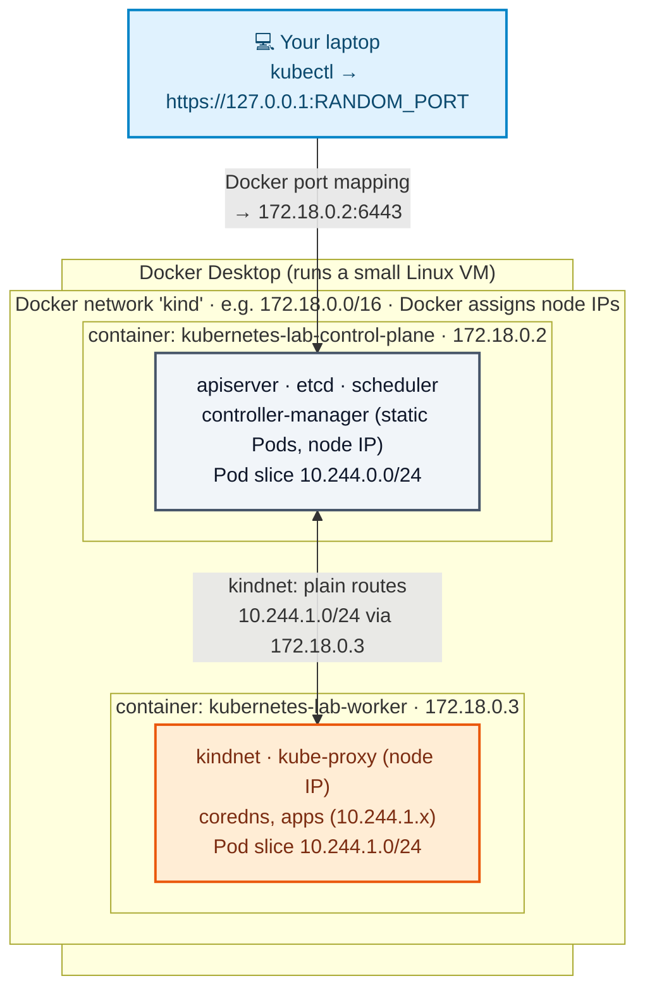
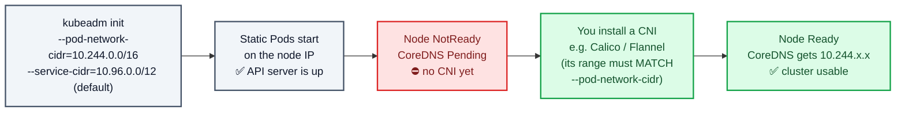
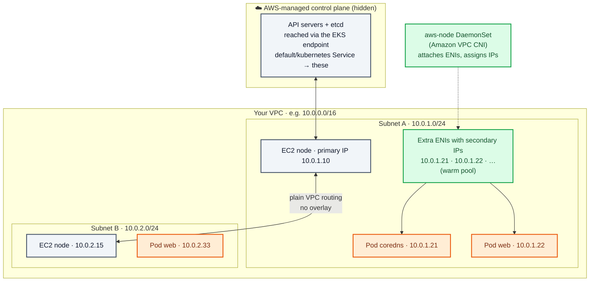

# 06 · Cluster Networking & IP Allocation Fundamentals

[⬅ Module 1](README.md) · Page 6 of 6 · [🏠 Reference home](../README.md)

[01 Fundamentals](01-kubernetes-fundamentals.md) › [02 Architecture](02-kubernetes-architecture.md) › [03 Images & Runtime](03-images-and-container-runtime.md) › [04 API Resources](04-api-resources-and-object-definitions.md) › [05 HA Control Plane](05-high-availability-control-plane.md) › **06 Networking & IPs**

---

## The problem: "where did that IP address come from?"

Run `kubectl get pods -A -o wide` on any cluster and you'll see something confusing:

```
NAMESPACE     NAME                                  IP            NODE
kube-system   coredns-7db6d8ff4d-8xk2p              10.244.0.3    kubernetes-lab-control-plane
kube-system   etcd-kubernetes-lab-control-plane     172.18.0.2    kubernetes-lab-control-plane
kube-system   kube-apiserver-kubernetes-lab-…       172.18.0.2    kubernetes-lab-control-plane
kube-system   kube-proxy-q7w9t                      172.18.0.2    kubernetes-lab-control-plane
default       web                                   10.244.0.7    kubernetes-lab-control-plane
```

Some Pods have a `10.244.x.x` address and others have `172.18.0.2`, and several Pods **share** the same IP. Then
`kubectl get svc -A` shows a third family of addresses: `10.96.0.1`, `10.96.0.10`. Who hands these out, and why are
they different?

This page answers that with **fundamentals only**: the three address ranges, who allocates each one, and how this
looks on **Kind (Docker Desktop)**, **kubeadm** and **EKS**. Traffic routing, Services in depth, Ingress and network
security are taught later, in the projects.

---

## The idea in one picture: three separate address ranges

Every Kubernetes cluster uses **three** distinct ranges of IP addresses, each owned by a different part of the
system:



| Range | What gets an address from it | Who allocates it | Real or virtual? |
|---|---|---|---|
| **① Node network** | Each node (VM, physical server, or Kind container) | The infrastructure, **outside** Kubernetes | Real: a network interface exists |
| **② Pod CIDR** | Each normal Pod | The **CNI plugin** (its IPAM part) | Real: each Pod gets its own interface |
| **③ Service CIDR** | Each Service of type ClusterIP | The **API server**, at the moment the Service is created | **Virtual**: no interface anywhere. kube-proxy rules translate it. |

> **Analogy:** a company campus. **Node IPs** are the street addresses of the buildings, given by the city.
> **Pod IPs** are the desk extensions inside the buildings, given by the company's phone system (the CNI).
> **Service IPs** are the reception numbers ("call 100 for IT"), which forward you to whichever desk is on duty.

> **Note:** **CIDR** notation (`10.244.0.0/16`) describes a range of addresses. The number after `/` says how many
> leading bits are fixed: `/16` ≈ 65,536 addresses, `/24` = 256 addresses.

---

## How it works, part 1: the Kubernetes network model

Kubernetes doesn't implement Pod networking itself. It sets **rules**, and a **CNI plugin** implements them:

| Rule | Meaning |
|---|---|
| Every Pod gets its **own unique IP** across the whole cluster | No two Pods share an IP (except host-network Pods, see part 3) |
| Pods can reach **all other Pods** directly, on any node, **without NAT** | The IP a Pod sees for itself is the IP others use to reach it |
| Agents on a node (e.g. the kubelet) can reach every Pod on that node | Needed for health checks and logs |

**CNI** (Container Network Interface) is a standard for network plugins, just as CRI is the standard for container
runtimes. Each CNI plugin has two jobs:

1. **IPAM** (IP Address Management): pick a free IP for each new Pod.
2. **Plumbing**: create the Pod's network interface and the routes that connect Pods across nodes.

---

## How it works, part 2: how a Pod gets its IP, step by step



Key facts hidden in this diagram:

| Fact | Consequence |
|---|---|
| The IP belongs to the **Pod sandbox** (held by a tiny `pause` container), not to your app container | All containers in a Pod share one IP, and a crashed container restarts with the **same** IP |
| A **new Pod** (e.g. one replaced by a Deployment) gets a **new** IP | Never hard-code Pod IPs. Use Service names. |
| The IP is reported in `status.podIP` by the kubelet | That's where `kubectl get pods -o wide` reads it |
| When the Pod is deleted, the CNI's `DEL` step releases the IP back to the pool | IPs are reused over time |

### Per-node ranges (the usual model)

With most CNI plugins, the big Pod CIDR is **sliced into one smaller range per node**:



- The **controller-manager** gives each node a slice and records it in the Node object's `spec.podCIDR`.
- The **CNI plugin on each node** hands out IPs only from its own node's slice. Nodes never need to coordinate per
  Pod.
- Because each slice belongs to one node, "which node is `10.244.1.5` on?" is a simple routing question.

> **Note:** Some plugins (Calico with its own IPAM, and the AWS VPC CNI) don't use `spec.podCIDR` and manage addresses
> their own way. The *idea* is the same: each node owns some addresses and hands them to its Pods.

---

## How it works, part 3: control-plane Pods vs normal Pods

This explains the mystery from the top of the page: why `etcd` and `kube-apiserver` show the **node's** IP.



| Pod | Network mode | IP it shows | Why |
|---|---|---|---|
| `kube-apiserver`, `etcd`, `kube-scheduler`, `kube-controller-manager` | `hostNetwork: true` | **Node IP** | They are **static Pods**: started by the kubelet from files in `/etc/kubernetes/manifests/` on kubeadm-style clusters. They must work **before** any CNI exists, because the CNI itself needs the API server. |
| `kube-proxy` | `hostNetwork: true` | **Node IP** | It programs the node's own network rules, so it must live in the node's network |
| CNI agent (`kindnet`, `calico-node`, `aws-node`) | `hostNetwork: true` | **Node IP** | It *builds* the Pod network, so it can't depend on it. This solves the chicken-and-egg problem. |
| **CoreDNS** | Normal Pod network | **Pod CIDR IP** | An ordinary Deployment. It stays `Pending` or `ContainerCreating` **until the CNI is ready**. |
| Your apps | Normal Pod network | **Pod CIDR IP** | Each Pod gets its own IP |

> 🎯 **Interview:** *"Why is CoreDNS Pending right after `kubeadm init`?"* Because kubeadm doesn't install a CNI
> plugin. Without one, there's no Pod network, so normal Pods like CoreDNS can't get an IP. Host-network control-plane
> Pods run fine. Install a CNI plugin and CoreDNS starts. The node also reports `NotReady` until then, with the reason
> *"network plugin not ready"*.

### The two Service IPs every cluster has

Service IPs come from the **Service CIDR**, and the API server assigns them. Two well-known Services exist in every
cluster:

| Service | Typical IP | What it's for |
|---|---|---|
| `default/kubernetes` | The **first** usable address of the Service CIDR, e.g. `10.96.0.1` | A stable in-cluster address for the **API server**. Pods (and CoreDNS itself) use it to talk to the control plane. It points at the API servers' node IPs on port 6443. |
| `kube-system/kube-dns` | Conventionally the **10th** address, e.g. `10.96.0.10` | Fronts the CoreDNS Pods. Every kubelet is configured with this IP and writes it into each Pod's `/etc/resolv.conf` as the `nameserver`. |

So DNS works like this for every normal Pod:



---

## How it works, part 4: the same ideas on three platforms

### At a glance

| | 🐳 **Kind on Docker Desktop** | 🛠️ **kubeadm** (your own VMs/servers) | ☁️ **AWS EKS** |
|---|---|---|---|
| **What a node is** | A Docker **container** | A VM or physical server | An EC2 instance |
| **Node IPs come from** | Docker's `kind` network (often `172.18.0.0/16`) | Your network (DHCP or static) | The **VPC subnet** |
| **Pod CIDR (default)** | `10.244.0.0/16` | **None by default.** You pass `--pod-network-cidr` to match your CNI. | No separate range: Pods get **VPC subnet IPs** |
| **Service CIDR (default)** | `10.96.0.0/16` | `10.96.0.0/12` | `10.100.0.0/16` or `172.20.0.0/16` (chosen at creation) |
| **kube-dns IP (typical)** | `10.96.0.10` | `10.96.0.10` | `10.100.0.10` or `172.20.0.10` |
| **CNI plugin** | **kindnet** (installed automatically) | **You choose and install one** (Calico, Flannel, Cilium…) | **Amazon VPC CNI** (`aws-node` DaemonSet), installed by default |
| **Who runs the control plane** | Static Pods in the control-plane container | Static Pods on your control-plane nodes | **AWS**, hidden from you. No API server/etcd Pods are visible. |
| **Where it's configured** | `networking:` in the Kind config file | `kubeadm init` flags / kubeadm config | `kubernetesNetworkConfig` + VPC subnets at cluster creation |
| **Changeable later?** | No, recreate the cluster | Difficult; plan up front | Service CIDR: no. Pod IPs: add subnets. |

Sources for the defaults: [kind configuration](https://kind.sigs.k8s.io/docs/user/configuration/),
[kubeadm init](https://kubernetes.io/docs/reference/setup-tools/kubeadm/kubeadm-init/), and
[EKS KubernetesNetworkConfigRequest](https://docs.aws.amazon.com/eks/latest/APIReference/API_KubernetesNetworkConfigRequest.html).

### 🐳 Kind on Docker Desktop



| Point | Detail |
|---|---|
| Nodes are containers | Kind runs each node as a Docker container. Inside, it runs systemd, the kubelet and containerd, so it behaves like a real machine. |
| Node IPs | Docker's own IPAM assigns them from the user-defined `kind` network (`docker network inspect kind`) |
| Reaching the API from your laptop | Docker publishes the control-plane container's port 6443 on `127.0.0.1:<random port>`. That's the `server:` in your kubeconfig. |
| Pod networking | **kindnet** is a deliberately simple CNI. Each node gets a `/24` slice, and kindnet adds a route per node ("to reach `10.244.1.0/24`, go via `172.18.0.3`"). This works because all nodes sit on the same Docker network. |
| Docker Desktop's built-in Kubernetes | Docker Desktop can also create a cluster itself using a **kind** or **kubeadm** provisioner (Settings → Kubernetes). With kind, the nodes are containers too, named like `desktop-control-plane`, and the same ideas apply. |

> 🧪 **Demo vs 🏭 production:** On Kind, every "node" shares your laptop's single network, and Pod IPs are reachable
> only from inside Docker's VM, not from your laptop. That's why you use `kubectl port-forward` locally.

### 🛠️ kubeadm (self-managed)



| Point | Detail |
|---|---|
| You own all three ranges | Node IPs come from your network. You choose the Pod CIDR and the Service CIDR. |
| **No overlap allowed** | Node network, Pod CIDR and Service CIDR must not overlap with each other, or with networks your nodes need to reach (office VPN, databases). Overlaps cause traffic to silently go to the wrong place. |
| The CNI must agree with kubeadm | Each CNI has a default range (e.g. Flannel `10.244.0.0/16`, Calico `192.168.0.0/16`). Make it match `--pod-network-cidr`. |
| Cross-node Pod traffic | Depends on the CNI: plain routes, **VXLAN** tunnels (Flannel's default: Pod packets wrapped inside node-to-node packets), or **BGP** routing (Calico) |
| Settings are recorded | `kubectl -n kube-system get configmap kubeadm-config -o yaml` shows `podSubnet` and `serviceSubnet` |

### ☁️ AWS EKS



| Point | Detail |
|---|---|
| Pods get **real VPC IPs** | The Amazon VPC CNI attaches extra network interfaces (**ENIs**) to each EC2 node and gives Pods **secondary IP addresses from the same subnet** as the node. There's no separate Pod CIDR and no overlay. |
| Warm pool | `aws-node` keeps some IPs pre-attached, so new Pods start fast |
| **Pods per node are limited by IPs** | Each instance type supports a fixed number of ENIs × IPs per ENI. A `t3.medium` allows about **17** Pods by default. *Prefix delegation* raises this limit (an advanced option). |
| **Subnet size matters** | Every Pod uses a subnet IP. A small subnet (e.g. `/24`) can run out of addresses, and new Pods stay `ContainerCreating` with IP-allocation errors. |
| Control plane is invisible | AWS runs the API servers and etcd. You won't see `kube-apiserver` or `etcd` Pods, but `default/kubernetes` still exists and points at the managed endpoint. |
| Service CIDR | Chosen once at creation (`10.100.0.0/16` or `172.20.0.0/16` by default, depending on your VPC). It can't be changed later. |

---

## Try it

> 🧪 **Try it on Kind** (the `kubernetes-lab` cluster from the [reference home](../README.md#what-you-need-to-follow-along)).
> For a richer picture, use a cluster with a worker:
> `printf 'kind: Cluster\napiVersion: kind.x-k8s.io/v1alpha4\nnodes:\n- role: control-plane\n- role: worker\n' | kind create cluster --name net-lab --config -`

**1. ① Node IPs, and where they come from:**

```bash
kubectl get nodes -o wide                                    # INTERNAL-IP column
docker network inspect kind -f '{{range .Containers}}{{.Name}} {{.IPv4Address}}{{"\n"}}{{end}}'
```

Expected: the same `172.18.x.x` addresses in both outputs. The **Docker network** assigned them.

**2. ② Each node's Pod slice:**

```bash
kubectl get nodes -o custom-columns=NODE:.metadata.name,POD_CIDR:.spec.podCIDR
```

Expected: `10.244.0.0/24` for the control plane, and `10.244.1.0/24` for the worker if you have one.

**3. Host-network Pods vs normal Pods:**

```bash
kubectl get pods -n kube-system -o custom-columns=NAME:.metadata.name,IP:.status.podIP,HOSTNET:.spec.hostNetwork
```

Expected: `etcd`, `kube-apiserver`, `kube-scheduler`, `kube-controller-manager`, `kube-proxy` and `kindnet` show the
**node IP** and `HOSTNET` = `true`. `coredns` shows a `10.244.x.x` IP and `<none>`.

**4. ③ Service IPs, and the two well-known Services:**

```bash
kubectl get svc -A
kubectl get endpointslices -n default -l kubernetes.io/service-name=kubernetes
```

Expected: `kubernetes` → `10.96.0.1`, `kube-dns` → `10.96.0.10`. The `kubernetes` EndpointSlice lists the **control
plane's node IP** on port `6443`.

**5. How a Pod finds DNS:**

```bash
kubectl run net-test --image=busybox:1.36 --restart=Never --rm -it -- sh -c 'cat /etc/resolv.conf; ip addr show eth0 | grep inet'
```

Expected: `nameserver 10.96.0.10`, a `search default.svc.cluster.local svc.cluster.local cluster.local` line, and the
Pod's own `10.244.x.x` address on `eth0`.

**6. A new Pod gets a new IP; a restarted container keeps it:**

```bash
kubectl run ipdemo --image=nginx:1.27-alpine
kubectl wait --for=condition=Ready pod/ipdemo --timeout=60s
kubectl get pod ipdemo -o jsonpath='{.status.podIP}{"\n"}'
kubectl exec ipdemo -- sh -c 'kill 1'                        # crash the container
sleep 5; kubectl get pod ipdemo -o jsonpath='{.status.podIP} restarts={.status.containerStatuses[0].restartCount}{"\n"}'
kubectl delete pod ipdemo
```

Expected: the **same** IP before and after the crash (restarts=1), because the IP belongs to the Pod sandbox.
A re-created Pod would get a different one.

**On kubeadm** (if you have one), see the configured ranges:

```bash
kubectl -n kube-system get configmap kubeadm-config -o jsonpath='{.data.ClusterConfiguration}' | grep -A3 networking
```

**On EKS** (if you have one), see VPC IPs on Pods and the CNI:

```bash
kubectl get pods -A -o wide | head                           # Pod IPs from your VPC subnets
kubectl get daemonset aws-node -n kube-system                # the Amazon VPC CNI
aws eks describe-cluster --name <cluster> --query cluster.kubernetesNetworkConfig
```

Clean up the optional cluster: `kind delete cluster --name net-lab`.

---

## Common mistakes

| Mistake | What you see | Reality / fix |
|---|---|---|
| Expecting the control-plane Pods to have Pod CIDR IPs | "Why do 5 Pods share one IP?" | They use `hostNetwork: true`, so they show the node's IP |
| Hard-coding a Pod IP | Works until the Pod is replaced | Pods get new IPs when re-created. Use Service names. |
| `ping` a Service IP to test it | No reply, even though the Service works | Service IPs are virtual. They answer only on the Service's ports. Test with `nc` or `wget`. |
| kubeadm: CNI range ≠ `--pod-network-cidr` | Pods get IPs but can't reach Pods on other nodes | Make the CNI configuration match the kubeadm Pod CIDR |
| Pod/Service CIDR overlaps the node or office network | Random timeouts to some destinations | Choose non-overlapping ranges **before** creating the cluster |
| EKS: tiny subnets | Pods stuck `ContainerCreating` (no free IPs) | Size subnets for Pods, not just nodes, or use prefix delegation |
| Trying to reach Kind Pod IPs from the laptop | Timeouts | Pod IPs live inside Docker's network. Use `kubectl port-forward`. |

---

## Quick recap

- A cluster has **three address ranges**: **node IPs** (infrastructure), **Pod IPs** (CNI plugin), and **Service
  IPs** (API server, virtual).
- The Kubernetes network model: every Pod has a unique IP, and Pods reach each other **without NAT**. A **CNI plugin**
  makes that true.
- A Pod's IP is assigned by the CNI's **IPAM** when the Pod sandbox is created. It survives container restarts, and
  changes when the Pod is re-created.
- Most CNIs give each node a **slice** of the Pod CIDR (`spec.podCIDR`), handed out by the controller-manager.
- Control-plane static Pods, kube-proxy and CNI agents use **`hostNetwork`**, so they show the **node IP**. CoreDNS
  and your apps get **Pod IPs**.
- `default/kubernetes` (first Service IP, e.g. `10.96.0.1`) → API server. `kube-system/kube-dns` (e.g. `10.96.0.10`)
  → CoreDNS, written into every Pod's `/etc/resolv.conf`.
- **Kind**: nodes are Docker containers, kindnet uses routes, Pods `10.244.0.0/16`, Services `10.96.0.0/16`.
  **kubeadm**: you choose the ranges and install the CNI. **EKS**: Pods get real **VPC IPs** via the VPC CNI, and AWS
  hides the control plane.

**🎉 Module 1 complete.** You know *what* Kubernetes is, *who* does what inside it, *how* containers start, *how* to
read any object, *how* the control plane survives failures, and *where* every IP address comes from. Now let's deploy
an app, the Kubernetes way. → [Module 2 · 01 Namespaces](../02-deploy-apps-the-kubernetes-way/01-namespaces.md)

---

## 📚 Official documentation

Everything above is self-contained. These links are for going deeper, not for filling gaps.

| Reference | What it adds |
|---|---|
| [Cluster Networking](https://kubernetes.io/docs/concepts/cluster-administration/networking/) | The official statement of the network model, and the IP ranges a cluster needs |
| [Network Plugins](https://kubernetes.io/docs/concepts/extend-kubernetes/compute-storage-net/network-plugins/) | How the container runtime calls CNI plugins |
| [Service ClusterIP allocation](https://kubernetes.io/docs/concepts/services-networking/cluster-ip-allocation/) | How the API server hands out Service IPs, including the `10.96.0.10` kube-dns example |
| [DNS for Services and Pods](https://kubernetes.io/docs/concepts/services-networking/dns-pod-service/) | The `resolv.conf` search list and DNS names |
| [kind: Configuration](https://kind.sigs.k8s.io/docs/user/configuration/) | `podSubnet`, `serviceSubnet` and the other Kind networking options |
| [Amazon EKS networking best practices](https://docs.aws.amazon.com/eks/latest/best-practices/networking.html) | How the VPC CNI assigns IPs, and subnet sizing |

*Links verified 2026-11-22.*

---

| ◀ Previous | ▲ Up | Next ▶ |
|---|:--:|---:|
| ◀ **[05 HA Control Plane](05-high-availability-control-plane.md)** | [Module 1](README.md) · [🏠 Reference home](../README.md) | **[Module 2 · 01 Namespaces](../02-deploy-apps-the-kubernetes-way/01-namespaces.md)** ▶ |
