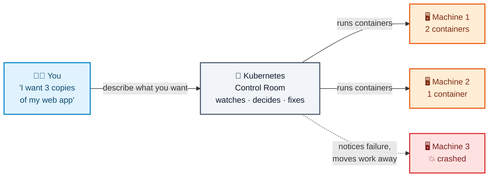

# Module 1 — Kubernetes: The Control Room for Containers

[🏠 Reference home](../README.md) · Module 1 of 2

**Module 1 — Control Room** › [Module 2 — Deploy Apps](../02-deploy-apps-the-kubernetes-way/README.md)

---

## The story of this module

Imagine an airport. Hundreds of planes land, take off, refuel and get repaired every day. No pilot decides on their
own which runway to use. A **control tower** watches everything, knows the plan, and gives instructions so the plan
actually happens. When a plane is delayed or a runway closes, the tower notices and re-routes traffic.

**Kubernetes is the control tower for your containers.**

- You don't tell it *"start container X on machine 3"*.
- You tell it *"I want 3 copies of my web app running, always"*.
- It decides where they go, starts them, watches them, and replaces them when they die.

## Pages in this module

| # | Page | Key question | Time |
|---|---|---|---|
| 01 | [Kubernetes Fundamentals](01-kubernetes-fundamentals.md) | Why do we need Kubernetes at all? | 25 min |
| 02 | [Kubernetes Architecture](02-kubernetes-architecture.md) | Which components exist, and how do they cooperate? | 35 min |
| 03 | [Images & Container Runtime](03-images-and-container-runtime.md) | How does an image become a running container on a node? | 25 min |
| 04 | [API Resources & Object Definitions](04-api-resources-and-object-definitions.md) | How do I read and write any Kubernetes YAML? | 30 min |
| 05 | [High-Availability (Multi-Master) Control Plane](05-high-availability-control-plane.md) | How do several control-plane nodes elect leaders and keep etcd consistent? | 40 min |
| 06 | [Cluster Networking & IP Allocation](06-cluster-networking-and-ip-allocation.md) | Who gives IPs to nodes, control-plane Pods, CoreDNS and Services, on Kind, kubeadm and EKS? | 35 min |

## By the end of this module you can…

- Explain in two sentences what Kubernetes does and why it exists.
- Draw the control plane and a worker node from memory, and name each component's job.
- Trace a `kubectl apply` from your terminal to a running container.
- Explain how an image is named, pulled and started, and what a container runtime is.
- Read any Kubernetes YAML file and recognise its four main parts.
- Use `kubectl api-resources` and `kubectl explain` to discover things on your own.
- Explain how a multi-master control plane works: active-active API servers, Lease-based leader election, and etcd
  quorum with Raft.
- Explain where node, Pod and Service IPs come from on Kind, kubeadm and EKS, and why control-plane Pods show the
  node's IP.

---

| ◀ Previous | ▲ Up | Next ▶ |
|---|:--:|---:|
| ◀ **[Reference home](../README.md)** | [Reference home](../README.md) | **[01 Fundamentals](01-kubernetes-fundamentals.md)** ▶ |
