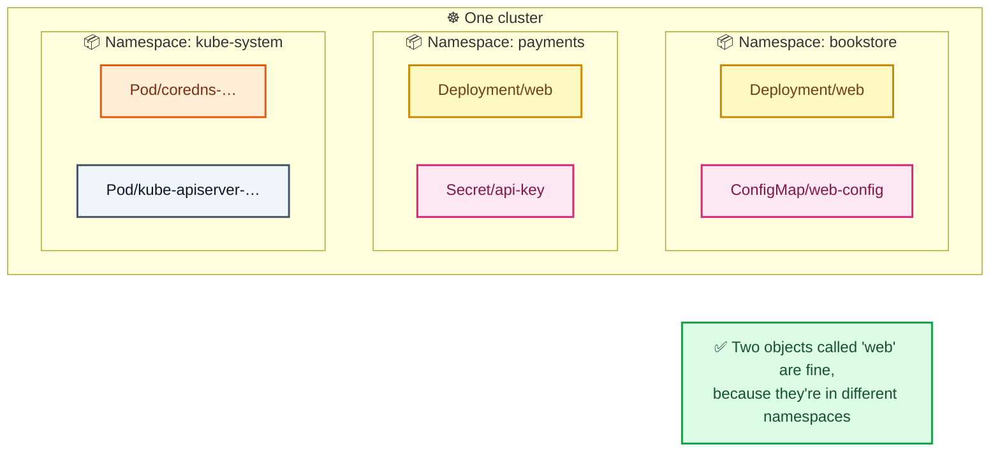
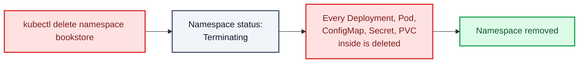

# 01 · Namespaces

[⬅ Module 2](README.md) · Page 1 of 6 · [🏠 Reference home](../README.md)

**01 Namespaces** › [02 Pods](02-pods.md) › [03 Deployments](03-deployments.md) › [04 ConfigMaps](04-configmaps.md) › [05 Secrets](05-secrets.md) › [06 StatefulSets](06-statefulsets.md)

---

## The problem: one big room, everyone's stuff mixed together

A new cluster puts everything you create into a namespace called `default`. That's fine for a five-minute
experiment. Now imagine three teams sharing one cluster:

| Problem | What actually happens |
|---|---|
| **Name collisions** | Team A and Team B both want a Deployment called `web`. Only one can exist in `default`. |
| **Noise** | `kubectl get pods` shows 200 Pods. Which ones are yours? |
| **Dangerous clean-up** | "Delete my test app" turns into hand-picking objects, and deleting someone else's by mistake. |
| **Environments** | `dev` and `staging` copies of the same app can't live side by side with the same names. |

You need **separate rooms** inside one cluster.

---

## The idea in one picture

A **Namespace** is a named, virtual "folder" inside a cluster. Objects in different namespaces can have the same
name, and you can list or delete a whole namespace's contents at once.



> **Analogy:** a cluster is an office building, and namespaces are the floors. Each floor can have a room called
> "Meeting Room 1". The building (cluster) is shared: same electricity, same lifts (nodes, network).

---

## How it works

### The namespaces every cluster starts with

| Namespace | What lives there | Should you put apps here? |
|---|---|---|
| `default` | Anything created without naming a namespace | Only quick experiments |
| `kube-system` | Kubernetes' own components: API server, scheduler, CoreDNS, kube-proxy… | ❌ **Never.** Leave it alone. |
| `kube-public` | Information readable by everyone, even unauthenticated users (rarely used) | ❌ No |
| `kube-node-lease` | Small "heartbeat" objects that each node updates to prove it's alive | ❌ No |

### What a namespace does, and what it doesn't

| ✅ A namespace **does** | ❌ A namespace does **not** |
|---|---|
| Give names their own scope (`web` can exist in many namespaces) | Put Pods on different machines. All namespaces share all nodes. |
| Let you list, manage and delete a group of objects together | Block network traffic between namespaces. By default, Pods can talk across namespaces. |
| Form the boundary for permissions and resource limits *(taught in later projects)* | Hide objects from someone who has cluster-wide access |

> ⚠️ **Warning:** A namespace is an **organisational** boundary, not a security wall by itself. Isolation needs
> extra objects (RBAC, NetworkPolicy, quotas) that are taught in the advanced projects.

### Not everything is namespaced

Some objects describe the whole cluster, so they live **outside** every namespace:

| Namespaced (inside a namespace) | Cluster-scoped (one per cluster) |
|---|---|
| Pod, Deployment, ReplicaSet, StatefulSet | Node |
| ConfigMap, Secret | Namespace itself |
| Service, PersistentVolumeClaim | PersistentVolume, StorageClass |

Check any kind yourself: `kubectl api-resources --namespaced=false`.

### Deleting a namespace deletes everything inside it



This is a great clean-up tool for learning, and a dangerous command in production. There is **no undo**.

---

## The manifest

```yaml
# namespace.yaml
# WHY: give every Bookstore object its own scope, so names never collide
#      and one command can clean everything up.
apiVersion: v1                     # Namespace is in the core group
kind: Namespace
metadata:
  name: bookstore                  # lowercase, digits, "-" only; max 63 characters
  labels:
    app.kubernetes.io/part-of: bookstore   # lets you find related namespaces later
```

| Field | Meaning |
|---|---|
| `apiVersion: v1` | Namespaces belong to the **core** API group, so there's no group prefix |
| `kind: Namespace` | The object type |
| `metadata.name` | The namespace's name. It must be a valid DNS label: lowercase, ≤ 63 characters, starting and ending with a letter or digit. |
| `metadata.labels` | Optional tags. Handy for selecting namespaces by team or environment. |

> **Note:** There's no `spec` to fill in. Creating the namespace is the whole job.

### Putting other objects into the namespace

There are two ways. Using both together is the safest.

```yaml
# Option 1: in the YAML itself (explicit, travels with the file)
metadata:
  name: web
  namespace: bookstore
```

```bash
# Option 2: on the command line
kubectl apply -f web.yaml -n bookstore
```

> ⚠️ **Warning:** If the YAML says `namespace: bookstore` and you pass `-n payments`, kubectl refuses with an error
> about the namespace mismatch. That's a safety feature, not a bug.

---

## Try it

> 🧪 **Try it:** Create the Bookstore's namespace and make it your default.

**1. Create the namespace from YAML.** Save the manifest above as `namespace.yaml`, then:

```bash
kubectl apply -f namespace.yaml
kubectl get namespaces
```

Expected: `bookstore   Active   5s` appears alongside `default`, `kube-system`, `kube-public` and `kube-node-lease`.

**2. Prove that names are scoped:**

```bash
kubectl create configmap hello --from-literal=team=bookstore -n bookstore
kubectl create configmap hello --from-literal=team=other     -n default
kubectl get configmap hello -n bookstore -o jsonpath='{.data.team}{"\n"}'   # → bookstore
kubectl get configmap hello -n default   -o jsonpath='{.data.team}{"\n"}'   # → other
```

Two objects with the same name exist happily, because they're in different namespaces.

**3. Stop typing `-n bookstore` every time:**

```bash
kubectl config set-context --current --namespace=bookstore
kubectl config view --minify -o jsonpath='{..namespace}{"\n"}'    # → bookstore
```

*What it does:* changes the default namespace stored in your kubeconfig for the current context. Every `kubectl`
command now targets `bookstore` unless you pass `-n`.

**4. Look across all namespaces at once:**

```bash
kubectl get configmaps --all-namespaces      # or the short form: -A
```

**5. Clean up the experiment** (keep the namespace, because later pages use it):

```bash
kubectl delete configmap hello -n bookstore
kubectl delete configmap hello -n default
```

---

## Common mistakes

| Mistake | Symptom | Fix |
|---|---|---|
| Forgetting which namespace you're in | `No resources found in default namespace.` | Add `-n bookstore`, or set the default as in step 3 |
| Creating objects before the namespace exists | `namespaces "bookstore" not found` | Apply the Namespace first. Name files `00-namespace.yaml` so they sort first. |
| Deploying apps into `kube-system` | Mixed with critical components; risky clean-ups | Always create your own namespace |
| Assuming namespaces isolate network traffic | Pods in other namespaces can still reach yours | Isolation needs NetworkPolicy (advanced projects) |
| Namespace stuck in `Terminating` | Delete never finishes | Usually an object inside is waiting on a *finalizer*. `kubectl get all -n <ns>` shows what remains. |

---

## Quick recap

- A **Namespace** is a virtual folder inside a cluster. Names must be unique **within** a namespace, not across them.
- Every cluster starts with `default`, `kube-system`, `kube-public` and `kube-node-lease`. Put your apps in **your
  own** namespace.
- All namespaces share the same nodes. A namespace is an organisational boundary, not a security wall by itself.
- Some objects (Node, Namespace, PersistentVolume) are **cluster-scoped**.
- `kubectl delete namespace X` deletes **everything** inside. There is no undo.
- `kubectl config set-context --current --namespace=X` sets your default namespace.

**Next problem:** we have an empty room. Now we need something *running* inside it. What's the smallest thing
Kubernetes can run? → [02 · Pods](02-pods.md)

---

## 📚 Official documentation

Everything above is self-contained. These links are for going deeper, not for filling gaps.

| Reference | What it adds |
|---|---|
| [Namespaces](https://kubernetes.io/docs/concepts/overview/working-with-objects/namespaces/) | Initial namespaces, when to use multiple namespaces, and namespace-scoped DNS names |
| [Object Names and IDs](https://kubernetes.io/docs/concepts/overview/working-with-objects/names/) | The exact naming rules (DNS label format) |
| [kubectl Quick Reference](https://kubernetes.io/docs/reference/kubectl/quick-reference/) | Context and namespace commands in one place |

*Links verified 2026-11-22.*

---

| ◀ Previous | ▲ Up | Next ▶ |
|---|:--:|---:|
| ◀ **[Module 2 overview](README.md)** | [Module 2](README.md) · [Reference home](../README.md) | **[02 Pods](02-pods.md)** ▶ |
