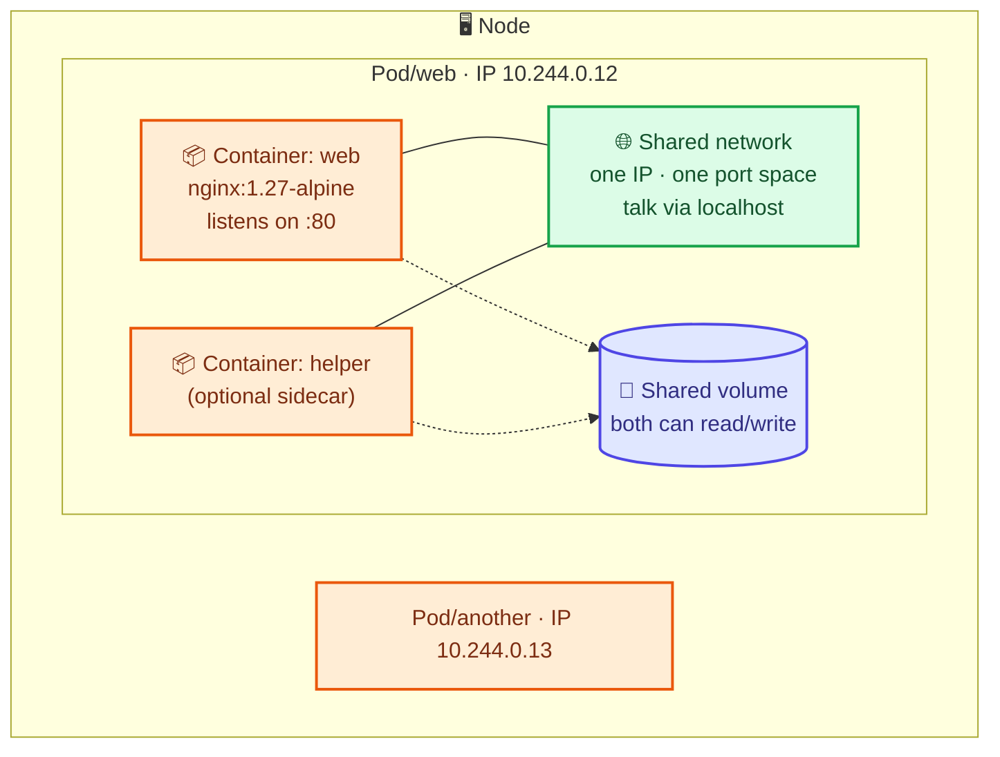
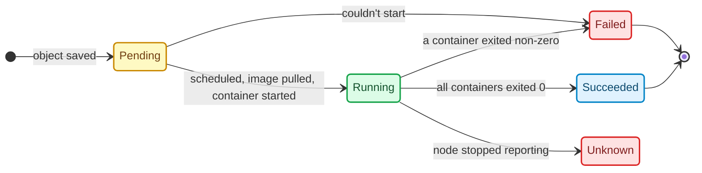
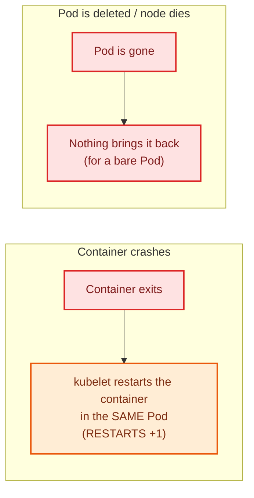

# 02 · Pods

[⬅ Module 2](README.md) · Page 2 of 6 · [🏠 Reference home](../README.md)

[01 Namespaces](01-namespaces.md) › **02 Pods** › [03 Deployments](03-deployments.md) › [04 ConfigMaps](04-configmaps.md) › [05 Secrets](05-secrets.md) › [06 StatefulSets](06-statefulsets.md)

---

## The problem: Kubernetes needs a unit to schedule

The scheduler has to place *something* on a node. "A container" sounds like the obvious answer, but real
applications sometimes need **a few containers that must always stay together**:

- a web server plus a small helper that refreshes its content,
- an app plus a log-shipper that reads its log files.

Such containers need to **run on the same machine**, **talk over `localhost`**, and **share files**. Kubernetes
needs a wrapper that represents "these containers belong together". That wrapper is the **Pod**.

---

## The idea in one picture

A **Pod** is the smallest deployable unit in Kubernetes: **one or more containers** that share a network identity and
storage, and are always scheduled together onto the same node.



> **Analogy:** a Pod is like a **shared apartment**. The containers are flatmates: they have one street address (IP),
> share the kitchen (volumes), and move house together. Different Pods are different apartments, each with its own
> address.

### What containers in the same Pod share

| Shared | Meaning | Consequence |
|---|---|---|
| **Network** | One IP address and one set of ports for the whole Pod | Containers reach each other on `localhost`. Two containers can't both listen on port 80. |
| **Volumes** | Any volume declared in the Pod can be mounted into any of its containers | One container writes a file, the other reads it |
| **Node** | All containers always land on the same node | They start, stop and move together |
| **Lifecycle** | The Pod is created and deleted as one unit | You never "move one container" out of a Pod |

> **Tip:** **One container per Pod is the normal case.** Add a second container only when it truly can't live without
> the first one (a *sidecar*). Never put your web app and your database in the same Pod: they need to scale and
> restart independently.

---

## How it works

### The Pod manifest

```yaml
# pod.yaml
# WHY: the smallest thing Kubernetes can run. Wraps our web server container.
apiVersion: v1                       # Pod is in the core group
kind: Pod
metadata:
  name: web
  namespace: bookstore
  labels:                            # labels let other objects find this Pod later
    app.kubernetes.io/name: web
    app.kubernetes.io/part-of: bookstore
spec:
  containers:                        # a LIST: a Pod can have several containers
    - name: web                      # container name, unique inside this Pod
      image: nginx:1.27-alpine       # always pin a version tag, never :latest
      ports:
        - containerPort: 80          # documents the port the app listens on
          name: http                 # a name other objects can refer to
  restartPolicy: Always              # restart containers whenever they exit (the default)
```

| Field | What it does | If you get it wrong |
|---|---|---|
| `spec.containers` | The list of containers in this Pod. At least one is required. | Missing → `spec.containers: Required value` |
| `containers[].name` | Identifies the container, e.g. for `kubectl logs -c web` | Duplicate names → rejected |
| `containers[].image` | Which image to run (see [Module 1 · 03](../01-control-room-for-containers/03-images-and-container-runtime.md)) | Typo → `ImagePullBackOff` |
| `containers[].ports[].containerPort` | **Informational.** It documents the port; it doesn't open or block anything. | A wrong number doesn't stop the app, but confuses readers and tools |
| `restartPolicy` | `Always` (default), `OnFailure`, or `Never`. Applies to **all** containers in the Pod. | `Never` on a web server → a crash stays dead |

### The Pod lifecycle: phases

Every Pod reports a **phase** in `status.phase`, a high-level summary of where it is in its life:



| Phase | Meaning |
|---|---|
| `Pending` | Accepted, but not running yet: waiting for a node, or still pulling the image |
| `Running` | Bound to a node, and at least one container is running (or starting/restarting) |
| `Succeeded` | Every container finished successfully and won't be restarted (typical for one-off tasks) |
| `Failed` | Every container has stopped, and at least one failed |
| `Unknown` | The node holding the Pod stopped reporting, often because the node is down |

### What `kubectl get pods` STATUS really means

The `STATUS` column is more detailed than the phase. It shows the most interesting container *reason*:

| STATUS | What's happening | First thing to check |
|---|---|---|
| `Pending` | Not scheduled yet, or not started | `kubectl describe pod` → Events (e.g. *Insufficient cpu*) |
| `ContainerCreating` | Scheduled; pulling the image or setting up volumes | Wait a little, then check Events |
| `Running` | Container process is up | `kubectl logs` if it's misbehaving |
| `Completed` | Container exited with code 0 | Expected for tasks; a problem for a web server |
| `Error` | Container exited with a non-zero code | `kubectl logs <pod>` |
| `CrashLoopBackOff` | It keeps crashing; Kubernetes waits longer between restarts (up to 5 minutes) | `kubectl logs <pod> --previous` (logs of the crashed run) |
| `ImagePullBackOff` / `ErrImagePull` | Image can't be pulled | Image name/tag, registry access |
| `CreateContainerConfigError` | A referenced ConfigMap or Secret is missing | `kubectl describe pod` → Events |
| `Terminating` | Being shut down gracefully | Normal for up to 30 s by default |

### Restart vs re-create: a very important difference



- The **kubelet** restarts crashed containers **inside** an existing Pod. That's local, node-level healing.
- If the **Pod itself** is deleted, evicted, or its node dies, a bare Pod is **never re-created**. Nothing is watching
  it. That job belongs to a controller such as a Deployment: the next page.

### Pods are disposable ("cattle, not pets")

| Property | Reality |
|---|---|
| Pod IP | Changes every time a Pod is re-created. Never hard-code it. |
| Pod name | Generated controllers give new random suffixes to replacements |
| Data written inside the container | Lost when the container is replaced |
| Manual changes made with `kubectl exec` | Lost when the Pod is replaced |

Design every application as if any Pod might disappear at any moment, because it will.

---

## Essential Pod commands

| Command | What it does |
|---|---|
| `kubectl get pods` | List Pods in the current namespace |
| `kubectl get pods -o wide` | …plus Pod IP and node |
| `kubectl get pod web -o yaml` | Full object, including `status` |
| `kubectl describe pod web` | Human-readable details + **Events** (the #1 debugging command) |
| `kubectl logs web` | The container's stdout/stderr |
| `kubectl logs web --previous` | Logs from the **previous** (crashed) run |
| `kubectl logs web -c helper` | Logs from a specific container in a multi-container Pod |
| `kubectl exec -it web -- sh` | Open a shell inside the container |
| `kubectl port-forward pod/web 8080:80` | Tunnel `localhost:8080` on your laptop to port 80 in the Pod |
| `kubectl delete pod web` | Delete the Pod (gracefully: SIGTERM, then SIGKILL after 30 s) |

---

## Try it

> 🧪 **Try it:** Run the Bookstore web server as a single Pod, then discover why a single Pod isn't enough.

**1. Create the Pod.** Save the manifest above as `pod.yaml`:

```bash
kubectl apply -f pod.yaml
kubectl get pods -n bookstore -o wide
```

Expected: `web   1/1   Running   0   …   10.244.x.x   kubernetes-lab-control-plane`. `1/1` means 1 of 1 containers
is ready.

**2. Reach it from your laptop:**

```bash
kubectl port-forward -n bookstore pod/web 8080:80
```

Open <http://localhost:8080> in a browser, or run `curl -s localhost:8080 | head -4` in a second terminal. Expected:
the *"Welcome to nginx!"* page. Press `Ctrl+C` to stop the tunnel.

**3. Look inside:**

```bash
kubectl exec -n bookstore -it web -- sh -c 'hostname; cat /etc/os-release | head -1'
kubectl logs -n bookstore web | tail -3
```

Expected: the hostname is the **Pod name**, the OS is Alpine, and the logs show the request you made in step 2.

**4. Read the events:**

```bash
kubectl describe pod -n bookstore web | sed -n '/Events:/,$p'
```

Expected: `Scheduled` → `Pulling` (or `Pulled`) → `Created` → `Started`.

**5. Now the real lesson: delete it.**

```bash
kubectl delete pod -n bookstore web
kubectl get pods -n bookstore
```

Expected: `No resources found in bookstore namespace.` The Pod is **gone, permanently**. If this were a node failure
at 3 a.m., your Bookstore would now be offline, and nothing would bring it back.

---

## Common mistakes

| Mistake | Why it hurts | Better |
|---|---|---|
| Running apps as bare Pods | Not re-created after deletion or node failure | Use a **Deployment** (next page) |
| Putting app + database in one Pod | Can't scale or restart them separately | One Pod per component |
| Two containers on the same port in one Pod | Second container fails: *address already in use* | They share one network. Use different ports. |
| Trying to edit most fields of a running Pod | `Forbidden: pod updates may not change fields other than…` | Delete and re-create, or let a Deployment roll it |
| Debugging with `kubectl get` only | Shows *what*, not *why* | `kubectl describe pod` → Events, then `kubectl logs` |

---

## Quick recap

- A **Pod** = one or more containers that share **one IP**, **volumes** and a **node**. It's the smallest unit
  Kubernetes schedules.
- One container per Pod is normal. Add a sidecar only for a tightly coupled helper.
- Phases: `Pending` → `Running` → `Succeeded`/`Failed` (or `Unknown`).
- The kubelet **restarts crashed containers**, but a **deleted bare Pod is never re-created**.
- Pods are disposable: IPs and names change, and local data is lost.
- Debug flow: `get` → `describe` (Events) → `logs` (`--previous` for crashes) → `exec`.

**Next problem:** our single Pod disappeared and nothing brought it back. There was also only **one** copy, so it
could never handle a node failure or more traffic. We need something that **watches** Pods and keeps the right number
alive. → [03 · Deployments](03-deployments.md)

---

## 📚 Official documentation

Everything above is self-contained. These links are for going deeper, not for filling gaps.

| Reference | What it adds |
|---|---|
| [Pods](https://kubernetes.io/docs/concepts/workloads/pods/) | The official definition, multi-container patterns, and why Pods are rarely created directly |
| [Pod Lifecycle](https://kubernetes.io/docs/concepts/workloads/pods/pod-lifecycle/) | Phases, container states, restart policy, and the exact restart back-off timing |
| [Workloads](https://kubernetes.io/docs/concepts/workloads/) | How Pods relate to Deployments, StatefulSets and other controllers |
| [kubectl Quick Reference](https://kubernetes.io/docs/reference/kubectl/quick-reference/) | Every `logs`, `exec` and `port-forward` variant |

*Links verified 2026-11-22.*

---

| ◀ Previous | ▲ Up | Next ▶ |
|---|:--:|---:|
| ◀ **[01 Namespaces](01-namespaces.md)** | [Module 2](README.md) · [Reference home](../README.md) | **[03 Deployments](03-deployments.md)** ▶ |
