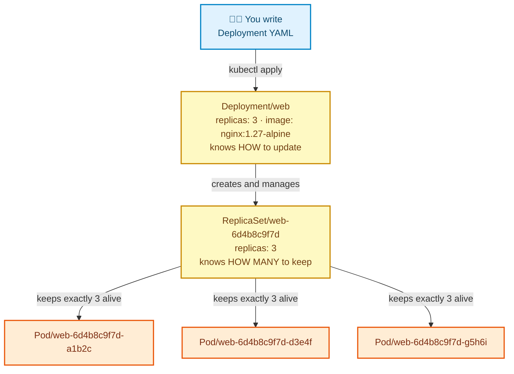
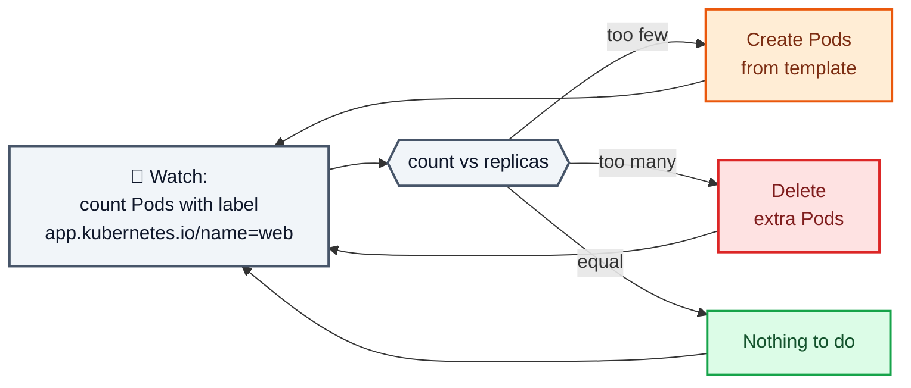
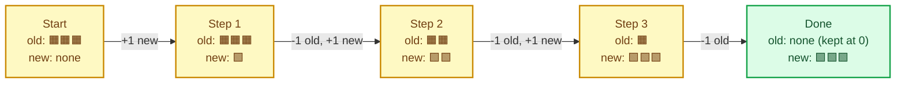
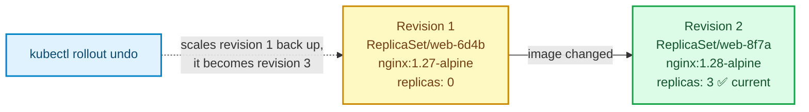

# 03 · Deployments

[⬅ Module 2](README.md) · Page 3 of 6 · [🏠 Reference home](../README.md)

[01 Namespaces](01-namespaces.md) › [02 Pods](02-pods.md) › **03 Deployments** › [04 ConfigMaps](04-configmaps.md) › [05 Secrets](05-secrets.md) › [06 StatefulSets](06-statefulsets.md)

---

## The problem: a bare Pod has nobody looking after it

On the last page, we deleted the `web` Pod and the Bookstore went offline for good. A real application needs:

| Need | A bare Pod gives you… |
|---|---|
| Survive Pod deletion or node failure | ❌ Nothing. It's gone. |
| Run several identical copies | ❌ You'd copy-paste YAML with different names |
| Scale up and down | ❌ Create and delete Pods by hand |
| Ship a new version without downtime | ❌ Delete old, create new, and hope |
| Undo a bad release | ❌ Remember what the old YAML was |

We need a **controller** that owns our Pods and constantly reconciles them. For stateless apps like a web server,
that controller is the **Deployment**.

---

## The idea in one picture: three layers of ownership



| Layer | Its one job | Do you create it? |
|---|---|---|
| **Deployment** | Manages **versions**: rolling updates, rollback, history | ✅ Yes, this is what you write |
| **ReplicaSet** | Keeps **N identical Pods** running, matching a label selector | ❌ No. The Deployment creates one per version. |
| **Pod** | Runs the containers | ❌ No. The ReplicaSet creates them from the template. |

> **Analogy:** the **Deployment** is the restaurant owner who decides the menu version. The **ReplicaSet** is the
> shift manager whose only rule is "always 3 cooks on the floor". The **Pods** are the cooks. When the owner
> changes the menu, a new shift manager is hired for the new menu, and cooks are swapped over gradually.

---

## How it works

### The manifest

```yaml
# deployment.yaml
# WHY: a bare Pod is never re-created. A Deployment keeps 3 copies alive,
#      replaces failed ones, and rolls out new versions without downtime.
apiVersion: apps/v1                    # Deployments live in the "apps" group
kind: Deployment
metadata:
  name: web
  namespace: bookstore
  labels:
    app.kubernetes.io/name: web
    app.kubernetes.io/part-of: bookstore
spec:
  replicas: 3                          # DESIRED number of Pods
  revisionHistoryLimit: 5              # how many old ReplicaSets to keep for rollback (default 10)
  selector:                            # WHICH Pods this Deployment owns...
    matchLabels:
      app.kubernetes.io/name: web      # ...must match template labels below EXACTLY
  strategy:
    type: RollingUpdate                # replace Pods gradually (the default)
    rollingUpdate:
      maxSurge: 1                      # at most 1 EXTRA Pod above 'replicas' during an update
      maxUnavailable: 0                # never drop below 'replicas' ready Pods
  template:                            # the Pod blueprint, a Pod spec without apiVersion/kind
    metadata:
      labels:
        app.kubernetes.io/name: web    # ✅ matches spec.selector.matchLabels
        app.kubernetes.io/part-of: bookstore
    spec:
      containers:
        - name: web
          image: nginx:1.27-alpine     # changing this triggers a rolling update
          ports:
            - containerPort: 80
              name: http
```

| Field | What it does | Watch out |
|---|---|---|
| `spec.replicas` | How many Pods should exist | Defaults to 1 if omitted |
| `spec.selector.matchLabels` | Tells the Deployment which Pods belong to it | **Can't be changed after creation.** Pick it carefully. |
| `spec.template.metadata.labels` | Labels stamped on every Pod created | **Must include** every selector label, or the API rejects the Deployment |
| `spec.template.spec` | Exactly the `spec` of a Pod (page 02) | Changing *anything* here creates a new ReplicaSet (a new revision) |
| `spec.strategy.type` | `RollingUpdate` (default) or `Recreate` | `Recreate` kills all old Pods first, which means downtime |
| `maxSurge` / `maxUnavailable` | Speed vs safety of updates (number or %; both default to 25%) | They can't both be 0 |
| `revisionHistoryLimit` | Old ReplicaSets kept for `rollout undo` | 0 = no rollback possible |

> ⚠️ **Warning, the selector rule:** `selector.matchLabels` ⊆ `template.metadata.labels`. If they don't match, the
> API rejects the Deployment with `selector does not match template labels`. This is the #1 beginner Deployment error.

### Self-healing and scaling: the ReplicaSet's loop



That single loop handles a deleted Pod, a dead node (its Pods are re-created elsewhere), `kubectl scale`, and changes
to `replicas:` in your YAML.

### Rolling updates: how a new version replaces the old one

When you change anything in `spec.template` (most commonly the image tag), the Deployment:

1. Creates a **new ReplicaSet** for the new template.
2. Scales the **new** ReplicaSet **up** and the **old** one **down**, a few Pods at a time.
3. Respects `maxSurge` (how many extra Pods are allowed) and `maxUnavailable` (how many can be missing).
4. Keeps the old ReplicaSet at 0 replicas, so you can roll back.

With `replicas: 3`, `maxSurge: 1`, `maxUnavailable: 0`:



There are always **at least 3** Pods serving, and never more than 4. Users see no downtime.

| Strategy | How it updates | Use when |
|---|---|---|
| `RollingUpdate` | Gradually, old and new running side by side for a while | Almost always (web apps, APIs) |
| `Recreate` | Delete **all** old Pods, then create new ones | Old and new versions must never run at the same time |

> **Note:** "Ready" here means the container started. Kubernetes can't yet tell whether your *application* inside is
> actually able to serve. Teaching it that is the job of **readiness probes**, covered in the projects. Without them,
> a rollout of a broken-but-running app still "succeeds".

### Rollout history and rollback



Rollback is fast because **the old ReplicaSet still exists**. Kubernetes simply rolls it back up, using the same
rolling-update rules.

| Command | What it does |
|---|---|
| `kubectl rollout status deployment/web` | Waits and reports progress until the rollout finishes (or fails) |
| `kubectl rollout history deployment/web` | Lists revisions |
| `kubectl rollout history deployment/web --revision=2` | Shows the Pod template of one revision |
| `kubectl rollout undo deployment/web` | Goes back to the previous revision |
| `kubectl rollout undo deployment/web --to-revision=1` | Goes back to a specific revision |
| `kubectl rollout restart deployment/web` | Re-creates all Pods gradually, with no spec change (e.g. to pick up new config) |
| `kubectl scale deployment/web --replicas=5` | Changes the replica count (imperatively) |
| `kubectl set image deployment/web web=nginx:1.28-alpine` | Changes the image (imperatively; triggers a rollout) |

> **Tip:** Add the annotation `kubernetes.io/change-cause: "upgrade nginx to 1.28"` to the Deployment's `metadata`.
> It appears in the `CHANGE-CAUSE` column of `rollout history`, so you can see *why* each revision exists.

> 🏭 **Production:** Change the YAML in Git and `kubectl apply` it, rather than using `kubectl set image` or
> `kubectl scale`. Otherwise the next `apply` from Git silently reverts your manual change.

---

## Try it

> 🧪 **Try it:** Self-healing, scaling, a good update, a bad update, and a rollback. Needs the `bookstore`
> namespace from page 01.

**1. Deploy.** Save the manifest above as `deployment.yaml`:

```bash
kubectl apply -f deployment.yaml
kubectl get deployment,replicaset,pods -n bookstore
```

Expected: `deployment.apps/web   3/3`, one ReplicaSet `web-<hash>` with `3  3  3`, and three Pods named
`web-<hash>-<random>`. Notice how the names chain: Deployment → ReplicaSet → Pod.

**2. Self-healing.** Delete every Pod at once:

```bash
kubectl delete pods -n bookstore -l app.kubernetes.io/name=web
kubectl get pods -n bookstore
```

Expected: three **new** Pods appear within seconds. Compare this with page 02, where nothing came back.

**3. Scale:**

```bash
kubectl scale deployment/web -n bookstore --replicas=5
kubectl get pods -n bookstore            # → 5 Pods
kubectl scale deployment/web -n bookstore --replicas=3
```

**4. A good update.** Watch the Pods in a second terminal with `kubectl get pods -n bookstore -w`, then:

```bash
kubectl set image deployment/web -n bookstore web=nginx:1.28-alpine
kubectl rollout status deployment/web -n bookstore
```

Expected: `deployment "web" successfully rolled out`. In the watch window, new Pods start *before* old ones stop.
Check the ReplicaSets:

```bash
kubectl get replicaset -n bookstore
```

Expected: two ReplicaSets. The old one has `0 0 0`, and the new one has `3 3 3`.

**5. A bad update.** Push a tag that doesn't exist:

```bash
kubectl set image deployment/web -n bookstore web=nginx:9.99-broken
kubectl get pods -n bookstore
```

Expected: **one** new Pod in `ErrImagePull`/`ImagePullBackOff`, and the **three old Pods still Running**. Because
`maxUnavailable: 0`, Kubernetes refuses to remove a working Pod until a new one is ready. The Bookstore stays up.

**6. Roll back:**

```bash
kubectl rollout history deployment/web -n bookstore
kubectl rollout undo deployment/web -n bookstore
kubectl rollout status deployment/web -n bookstore
kubectl get deployment web -n bookstore -o jsonpath='{.spec.template.spec.containers[0].image}{"\n"}'
```

Expected: the image is back to `nginx:1.28-alpine`, and the broken Pod is gone.

**7. Return to a known state from your file** (this is the declarative way):

```bash
kubectl apply -f deployment.yaml          # back to nginx:1.27-alpine, as written in Git
```

Keep this Deployment. The next page gives it configuration.

---

## Common mistakes

| Mistake | Symptom | Fix |
|---|---|---|
| Selector doesn't match template labels | `selector does not match template labels` | Make `template.metadata.labels` include every `selector.matchLabels` entry |
| Trying to change the selector later | `field is immutable` | Delete and re-create the Deployment (plan labels up front) |
| Deleting Pods to "stop" the app | They come straight back | `kubectl scale --replicas=0`, or delete the Deployment |
| Re-using the same image tag for new code | `apply` reports `unchanged`; no rollout | New tag per build. The template must change to trigger a rollout. |
| Using `Recreate` for a web app | Downtime on every deploy | Use `RollingUpdate` |
| Manual `scale`/`set image` in production | The next `apply` from Git undoes it | Change the YAML, then apply |
| Running a database as a Deployment | Data and identity problems | Use a StatefulSet (page 06) |

---

## Quick recap

- A **Deployment** manages **ReplicaSets**, which manage **Pods**. You write only the Deployment.
- `replicas` = desired copies. The ReplicaSet loop re-creates Pods that disappear: **self-healing**.
- `selector.matchLabels` must match `template.metadata.labels`, and the selector **can't be changed** later.
- Any change to `spec.template` → new ReplicaSet → **rolling update**, controlled by `maxSurge` / `maxUnavailable`.
- Old ReplicaSets are kept (scaled to 0), which makes `kubectl rollout undo` fast.
- A failing new version doesn't take down old Pods when `maxUnavailable: 0`.
- Deployments are for **stateless** apps. Databases need StatefulSets.

**Next problem:** our web server runs nginx's default page with default settings. To change a setting (the store
name, a feature flag, the HTML page itself) we'd have to **rebuild the image** for every environment. Configuration
needs to live *outside* the image. → [04 · ConfigMaps](04-configmaps.md)

---

## 📚 Official documentation

Everything above is self-contained. These links are for going deeper, not for filling gaps.

| Reference | What it adds |
|---|---|
| [Deployments](https://kubernetes.io/docs/concepts/workloads/controllers/deployment/) | Every field, rollout states, pausing/resuming, and proportional scaling |
| [ReplicaSet](https://kubernetes.io/docs/concepts/workloads/controllers/replicaset/) | How the ReplicaSet controller acquires and owns Pods by label |
| [Run a Stateless Application Using a Deployment](https://kubernetes.io/docs/tasks/run-application/run-stateless-application-deployment/) | The official step-by-step task |
| [Garbage Collection](https://kubernetes.io/docs/concepts/architecture/garbage-collection/) | How owner references make deleting a Deployment clean up its ReplicaSets and Pods |

*Links verified 2026-11-22.*

---

| ◀ Previous | ▲ Up | Next ▶ |
|---|:--:|---:|
| ◀ **[02 Pods](02-pods.md)** | [Module 2](README.md) · [Reference home](../README.md) | **[04 ConfigMaps](04-configmaps.md)** ▶ |
