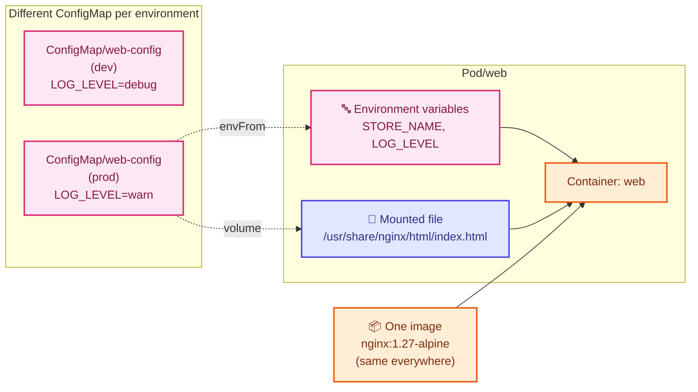
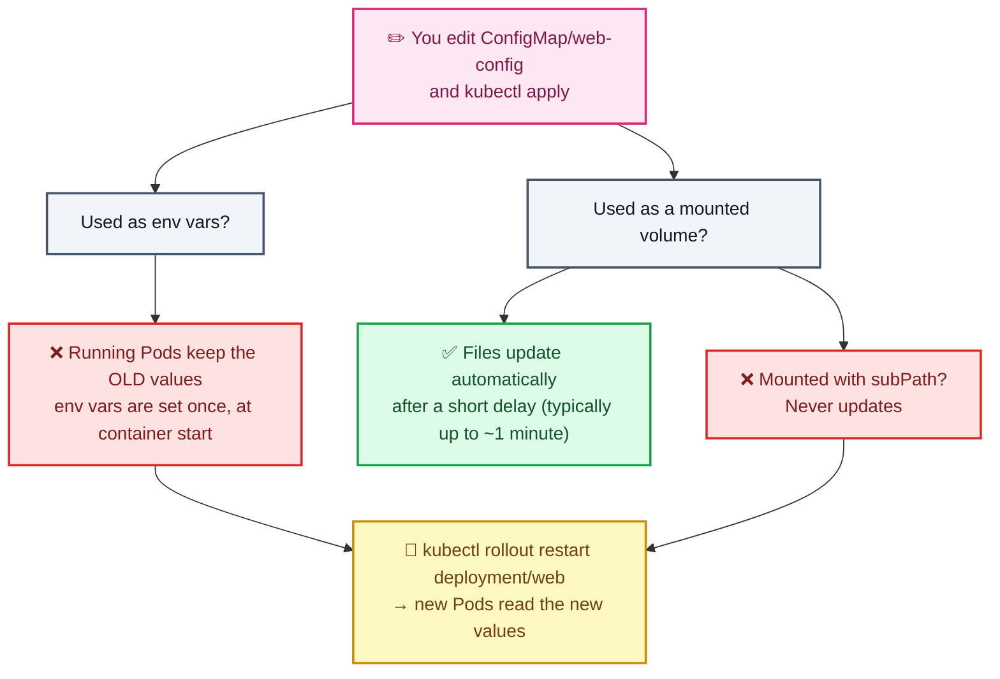

# 04 · ConfigMaps

[⬅ Module 2](README.md) · Page 4 of 6 · [🏠 Reference home](../README.md)

[01 Namespaces](01-namespaces.md) › [02 Pods](02-pods.md) › [03 Deployments](03-deployments.md) › **04 ConfigMaps** › [05 Secrets](05-secrets.md) › [06 StatefulSets](06-statefulsets.md)

---

## The problem: configuration baked into the image

Our Bookstore runs in three environments. Each one needs different settings:

| Setting | dev | staging | production |
|---|---|---|---|
| `STORE_NAME` | Bookstore (DEV) | Bookstore (STAGING) | Bookstore |
| `LOG_LEVEL` | debug | info | warn |
| Welcome page | "Test data only!" | "Release candidate" | the real page |

If those values live **inside the image**, you need **three different images** for the same code. Every settings
change becomes a rebuild, re-push and re-deploy, and the image you tested in staging is *not* the image you ship to
production.

The fix is a core principle of modern apps: **build the image once, and inject configuration at run time.**

---

## The idea in one picture

A **ConfigMap** stores non-sensitive configuration as key/value pairs, separately from the image. Pods read it as
**environment variables** or as **files**.



> **Analogy:** the image is a **TV**, the same model in every house. The ConfigMap is the **settings menu**: language,
> brightness, channel list. You don't build a new TV to change the language.

---

## How it works

### The ConfigMap manifest

```yaml
# configmap.yaml
# WHY: keep settings and the welcome page outside the image,
#      so the same image runs in every environment.
apiVersion: v1                  # ConfigMap is in the core group
kind: ConfigMap
metadata:
  name: web-config
  namespace: bookstore
  labels:
    app.kubernetes.io/name: web
data:                           # no "spec": a ConfigMap just holds data
  # --- simple key/value pairs → used as environment variables ---
  STORE_NAME: "Bookstore"
  LOG_LEVEL: "info"
  ITEMS_PER_PAGE: "20"          # values are ALWAYS strings, so quote numbers
  # --- a whole file as one value → used as a mounted file ---
  index.html: |
    <!doctype html>
    <html>
      <head><title>Bookstore</title></head>
      <body>
        <h1>📚 Welcome to the Bookstore</h1>
        <p>This page comes from a ConfigMap, not from the image.</p>
      </body>
    </html>
```

| Field | Meaning |
|---|---|
| `data` | Key/value pairs. Keys may contain letters, digits, `-`, `_` and `.`. Values are strings. |
| `|` (block scalar) | YAML for "a multi-line string follows". Perfect for whole config files. |
| `binaryData` | *(optional)* base64 values for non-text content |
| `immutable: true` | *(optional)* locks the ConfigMap so it can't be changed (see below) |

> ⚠️ **Warning:** A ConfigMap can hold at most **1 MiB** of data, and it is **not for passwords**. Anyone who can
> read the ConfigMap sees the values in plain text. Sensitive values go into a Secret (next page).

### Three ways a Pod can use a ConfigMap

| Method | YAML | Result inside the container | Best for |
|---|---|---|---|
| **One key → one env var** | `env[].valueFrom.configMapKeyRef` | `$LOG_LEVEL` | Picking a few specific values |
| **All keys → env vars** | `envFrom[].configMapRef` | One env var per key | Many simple settings |
| **Keys → files** | `volumes[].configMap` + `volumeMounts` | One file per key, contents = value | Config files (nginx.conf, app.yaml, HTML…) |

### The Deployment, now using the ConfigMap

Only the `template.spec` part of the Deployment from page 03 changes:

```yaml
# deployment.yaml (excerpt: spec.template.spec)
    spec:
      containers:
        - name: web
          image: nginx:1.27-alpine
          ports:
            - containerPort: 80
              name: http
          env:
            - name: STORE_NAME                 # method 1: one specific key
              valueFrom:
                configMapKeyRef:
                  name: web-config             # which ConfigMap
                  key: STORE_NAME              # which key inside it
          envFrom:
            - configMapRef:                    # method 2: every key becomes an env var
                name: web-config
          volumeMounts:
            - name: html                       # must match a volume name below
              mountPath: /usr/share/nginx/html # where nginx looks for its web pages
              readOnly: true
      volumes:
        - name: html                           # method 3: ConfigMap keys as files
          configMap:
            name: web-config
            items:                             # only project the keys we want as files
              - key: index.html
                path: index.html               # file name inside mountPath
```

> **Note:** `envFrom` takes **every** key, so it also tries to turn `index.html` into an environment variable.
> Depending on your Kubernetes version, that key is either skipped with a warning event or becomes an odd-looking
> variable. Neither breaks anything here, but in real projects keep env-style keys and file-style keys in **separate**
> ConfigMaps.

### What happens when you change a ConfigMap?

This is the part that surprises everyone:



> ⚠️ **Warning:** Even when the file updates, **your application must re-read it**. nginx serves the new
> `index.html` immediately, because it reads the file on every request. But an app that loads its config once at
> startup keeps the old values until restarted.

### Immutable ConfigMaps

```yaml
immutable: true          # top-level field, next to data:
```

| Benefit | Trade-off |
|---|---|
| Nobody can change it by accident and break running Pods | To change values, create a **new** ConfigMap (e.g. `web-config-v2`) and point the Deployment at it |
| The kubelet stops watching it, which reduces load on large clusters | You can't flip it back to mutable. You can only delete and re-create it. |

A new name per version also means changing config **triggers a normal rolling update**, with rollback, which many
teams prefer.

### Creating ConfigMaps from the command line

| Command | Creates |
|---|---|
| `kubectl create configmap app --from-literal=LOG_LEVEL=info` | One key from a literal value |
| `kubectl create configmap app --from-file=nginx.conf` | Key `nginx.conf` = the file's contents |
| `kubectl create configmap app --from-env-file=app.env` | One key per `KEY=value` line in the file |
| `… --dry-run=client -o yaml > configmap.yaml` | Prints YAML instead of creating it, ready to commit to Git |

---

## Try it

> 🧪 **Try it:** Give the Bookstore its own settings and welcome page. Needs the `web` Deployment from page 03.

**1. Create the ConfigMap.** Save it as `configmap.yaml`:

```bash
kubectl apply -f configmap.yaml
kubectl describe configmap web-config -n bookstore | head -20
```

**2. Update the Deployment.** Paste the excerpt above into `deployment.yaml` (replacing the old `template.spec`), then:

```bash
kubectl apply -f deployment.yaml
kubectl rollout status deployment/web -n bookstore
```

**3. Check the environment variables:**

```bash
kubectl exec -n bookstore deploy/web -- sh -c 'env | grep -E "STORE_NAME|LOG_LEVEL|ITEMS_PER_PAGE"'
```

Expected:

```
STORE_NAME=Bookstore
LOG_LEVEL=info
ITEMS_PER_PAGE=20
```

> **Tip:** `deploy/web` tells kubectl "pick any Pod of this Deployment", so you don't need to copy a random Pod name.

**4. Check the mounted file:**

```bash
kubectl port-forward -n bookstore deploy/web 8080:80
# in a second terminal:
curl -s localhost:8080 | grep h1
```

Expected: `<h1>📚 Welcome to the Bookstore</h1>`. The page came from the ConfigMap; the image didn't change.

**5. Watch the update behaviour.** Edit `configmap.yaml`: change `LOG_LEVEL` to `"debug"`, and change the `<h1>` text.
Then:

```bash
kubectl apply -f configmap.yaml
sleep 60
curl -s localhost:8080 | grep h1                                    # ✅ NEW heading (volume updated)
kubectl exec -n bookstore deploy/web -- sh -c 'echo $LOG_LEVEL'     # ❌ still "info" (env is fixed)
kubectl rollout restart deployment/web -n bookstore
kubectl rollout status deployment/web -n bookstore
kubectl exec -n bookstore deploy/web -- sh -c 'echo $LOG_LEVEL'     # ✅ now "debug"
```

**6. See what a missing ConfigMap does:**

```bash
kubectl run cm-test -n bookstore --image=busybox:1.36 --restart=Never \
  --overrides='{"spec":{"containers":[{"name":"cm-test","image":"busybox:1.36","command":["sleep","3600"],"envFrom":[{"configMapRef":{"name":"does-not-exist"}}]}]}}'
kubectl get pod cm-test -n bookstore                 # → CreateContainerConfigError
kubectl describe pod cm-test -n bookstore | tail -3  # → configmap "does-not-exist" not found
kubectl delete pod cm-test -n bookstore
```

---

## Common mistakes

| Mistake | Symptom | Fix |
|---|---|---|
| ConfigMap doesn't exist (or wrong name/namespace) | `CreateContainerConfigError` | Create it first, in the **same namespace** as the Pod |
| Expecting env vars to update live | App keeps old values | `kubectl rollout restart deployment/<name>` |
| Using `subPath` and expecting updates | File never changes | Mount the whole directory, or restart Pods |
| Unquoted numbers/booleans in `data` | `cannot unmarshal number into … string` | Quote every value: `"20"`, `"true"` |
| Passwords in a ConfigMap | Visible to anyone who can read ConfigMaps | Use a **Secret** |
| Mounting a ConfigMap over a directory that has other files | The other files "disappear", because the mount hides them | Mount at an empty path, or use `items` + `subPath` |

---

## Quick recap

- A **ConfigMap** holds **non-sensitive** settings as key/value strings (max 1 MiB), outside the image.
- **Build once, configure per environment**: same image, different ConfigMaps.
- Consume it as **one env var** (`configMapKeyRef`), **all env vars** (`envFrom`), or **files** (volume).
- Env vars are fixed at container start. Mounted files update after a short delay, **except** with `subPath`.
- `kubectl rollout restart` is the standard way to pick up changed config.
- `immutable: true` protects a ConfigMap. Change it by creating a new name.
- A missing ConfigMap → `CreateContainerConfigError`.

**Next problem:** the Bookstore needs a database password. Putting it in a ConfigMap means it's readable in plain text
by anyone who can see ConfigMaps, and it would end up committed to Git. Sensitive values need their own object. →
[05 · Secrets](05-secrets.md)

---

## 📚 Official documentation

Everything above is self-contained. These links are for going deeper, not for filling gaps.

| Reference | What it adds |
|---|---|
| [ConfigMaps](https://kubernetes.io/docs/concepts/configuration/configmap/) | Every way to consume a ConfigMap, update propagation details, and immutable ConfigMaps |
| [Configure a Pod to Use a ConfigMap](https://kubernetes.io/docs/tasks/configure-pod-container/configure-pod-configmap/) | Step-by-step examples for every `kubectl create configmap` variant |
| [Containers](https://kubernetes.io/docs/concepts/containers/) | How environment variables are set when a container starts |

*Links verified 2026-11-22.*

---

| ◀ Previous | ▲ Up | Next ▶ |
|---|:--:|---:|
| ◀ **[03 Deployments](03-deployments.md)** | [Module 2](README.md) · [Reference home](../README.md) | **[05 Secrets](05-secrets.md)** ▶ |
