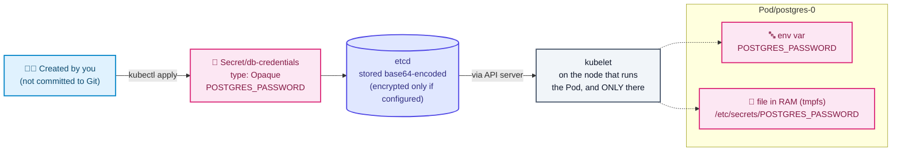

# 05 · Secrets

[⬅ Module 2](README.md) · Page 5 of 6 · [🏠 Reference home](../README.md)

[01 Namespaces](01-namespaces.md) › [02 Pods](02-pods.md) › [03 Deployments](03-deployments.md) › [04 ConfigMaps](04-configmaps.md) › **05 Secrets** › [06 StatefulSets](06-statefulsets.md)

---

## The problem: passwords have nowhere safe to go

The Bookstore is about to get a PostgreSQL database, and the database needs a password. Every place we've seen so far
is a bad home for it:

| Where | Why it's bad |
|---|---|
| Inside the image | Anyone who can pull the image can read it. Changing it means a rebuild. |
| Hard-coded in the Deployment YAML | It ends up in Git, in plain text, forever (Git remembers history) |
| In a ConfigMap | Same as plain text. ConfigMaps are designed to be read freely. |

Kubernetes has a dedicated object for sensitive values, the **Secret**, which the cluster handles more carefully than
ordinary configuration.

---

## The idea in one picture

A **Secret** is like a ConfigMap, but for **sensitive** data: passwords, API keys, tokens, certificates. Pods consume
it the same two ways, as **env vars** or **files**.



---

## How it works

### ⚠️ The most important fact: base64 is **not** encryption

Secret values in YAML are **base64-encoded**. Base64 is a way to write any bytes as plain text characters. It is
**not** a lock: anyone can reverse it instantly.

```bash
echo -n 'S3cr3t!' | base64        # → UzNjcjN0IQ==
echo 'UzNjcjN0IQ==' | base64 -d   # → S3cr3t!   (no key needed)
```

> ⚠️ **Warning:** By default, Kubernetes stores Secrets in etcd **unencrypted**. They're only base64-encoded.
> Encryption at rest is a cluster setting that administrators must turn on (managed services like EKS offer it).
> Source: [kubernetes.io: Secrets](https://kubernetes.io/docs/concepts/configuration/secret/) and
> [Encrypting Confidential Data at Rest](https://kubernetes.io/docs/tasks/administer-cluster/encrypt-data/).

So what makes a Secret better than a ConfigMap?

| Protection | ConfigMap | Secret |
|---|---|---|
| Marked as sensitive, so tools hide its values (e.g. `kubectl describe` shows only byte counts) | ❌ | ✅ |
| Sent only to nodes that run a Pod needing it | ❌ | ✅ |
| When mounted as files, kept in memory (**tmpfs**), never written to the node's disk | ❌ | ✅ |
| Can be encrypted at rest in etcd (when the cluster enables it) | ❌ | ✅ |
| Access can be restricted separately from ConfigMaps *(permissions are taught in later projects)* | — | ✅ |

> **Mental model:** a Secret is a **sealed envelope**, not a safe. It tells everyone "this is private, handle with
> care", and the cluster does. But anyone allowed to hold the envelope can open it.

### The Secret manifest

You can write values two ways. **`stringData`** is easier and less error-prone:

```yaml
# secret.yaml
# WHY: the database password must not live in the image, the Deployment YAML,
#      or a ConfigMap.
# ⚠️ NEVER commit a file like this with real values. This is a local demo password.
apiVersion: v1
kind: Secret
metadata:
  name: db-credentials
  namespace: bookstore
  labels:
    app.kubernetes.io/name: postgres
type: Opaque                         # generic, user-defined data
stringData:                          # plain text here; Kubernetes base64-encodes it for you
  POSTGRES_USER: bookstore
  POSTGRES_PASSWORD: change-me-local-only
  POSTGRES_DB: bookstore
```

The same Secret written with `data` (values you encode yourself):

```yaml
data:
  POSTGRES_USER: Ym9va3N0b3Jl                         # echo -n 'bookstore' | base64
  POSTGRES_PASSWORD: Y2hhbmdlLW1lLWxvY2FsLW9ubHk=     # echo -n 'change-me-local-only' | base64
  POSTGRES_DB: Ym9va3N0b3Jl
```

| Field | Meaning |
|---|---|
| `type` | What kind of secret this is. It tells Kubernetes (and tools) which keys to expect. |
| `stringData` | Write-only convenience: plain values, encoded for you when saved. Reading the Secret back shows them under `data`. |
| `data` | base64-encoded values. Use `echo -n` when encoding, or a hidden newline becomes part of the password. |

### Built-in Secret types

| `type` | Used for | Expected keys |
|---|---|---|
| `Opaque` | Anything (the default) | Any |
| `kubernetes.io/tls` | TLS certificate + private key | `tls.crt`, `tls.key` |
| `kubernetes.io/dockerconfigjson` | Credentials for a private image registry | `.dockerconfigjson` |
| `kubernetes.io/basic-auth` | Username + password | `username`, `password` |
| `kubernetes.io/ssh-auth` | SSH private key | `ssh-privatekey` |

### Using a Secret in a Pod

Exactly like a ConfigMap, with the word `secret` instead of `configMap`:

```yaml
containers:
  - name: postgres
    image: postgres:16-alpine
    env:
      - name: POSTGRES_PASSWORD          # one key → one env var
        valueFrom:
          secretKeyRef:
            name: db-credentials
            key: POSTGRES_PASSWORD
    envFrom:
      - secretRef:                       # every key → an env var
          name: db-credentials
    volumeMounts:
      - name: creds
        mountPath: /etc/secrets          # files: /etc/secrets/POSTGRES_PASSWORD, …
        readOnly: true
volumes:
  - name: creds
    secret:
      secretName: db-credentials         # note: secretName, not name
      defaultMode: 0400                  # file permissions: owner read-only
```

| Env var vs file | Env var | Mounted file |
|---|---|---|
| Updates when the Secret changes | ❌ Needs a Pod restart | ✅ After a short delay (not with `subPath`) |
| Risk of leaking | Higher: env vars can show up in crash dumps, debug output, or child processes | Lower |
| Stored on the node's disk | — | No, it's tmpfs (RAM) |
| Recommendation | Fine for learning and simple apps | Preferred in production when the app supports reading files |

> **Tip:** Many official images (postgres, mysql) accept a `*_FILE` variant, e.g.
> `POSTGRES_PASSWORD_FILE=/etc/secrets/POSTGRES_PASSWORD`, so the password never becomes an env var at all.

### Keeping Secrets out of Git

| Approach | How |
|---|---|
| 🧪 Learning | Create from the command line (`kubectl create secret …`) and never write the file |
| 🧪 Learning | Commit a `secret.example.yaml` with fake values, and list the real file in `.gitignore` |
| 🏭 Production | Store the real value in a secret manager (AWS Secrets Manager, HashiCorp Vault…) and sync it into the cluster with a tool. *Taught in advanced projects.* |

---

## Try it

> 🧪 **Try it:** Create the database credentials, prove base64 is reversible, and see how Kubernetes hides values.

**1. Create the Secret imperatively, so no file ever holds the password:**

```bash
kubectl create secret generic db-credentials -n bookstore \
  --from-literal=POSTGRES_USER=bookstore \
  --from-literal=POSTGRES_PASSWORD='change-me-local-only' \
  --from-literal=POSTGRES_DB=bookstore
```

**2. Look at it the "polite" way:**

```bash
kubectl describe secret db-credentials -n bookstore
```

Expected: values are hidden, and only sizes are shown:

```
Type:  Opaque

Data
====
POSTGRES_DB:        9 bytes
POSTGRES_PASSWORD:  20 bytes
POSTGRES_USER:      9 bytes
```

**3. Now prove it isn't encrypted:**

```bash
kubectl get secret db-credentials -n bookstore -o jsonpath='{.data.POSTGRES_PASSWORD}{"\n"}'
kubectl get secret db-credentials -n bookstore -o jsonpath='{.data.POSTGRES_PASSWORD}' | base64 -d; echo
```

Expected: first the base64 string `Y2hhbmdlLW1lLWxvY2FsLW9ubHk=`, then the real password. **Anyone who can `get`
Secrets can read them.** That's why access to Secrets is restricted in real clusters.

**4. Use it in a throw-away Pod:**

```bash
kubectl run secret-test -n bookstore --image=busybox:1.36 --restart=Never \
  --overrides='{"spec":{"containers":[{"name":"secret-test","image":"busybox:1.36","command":["sh","-c","echo user=$POSTGRES_USER db=$POSTGRES_DB; sleep 5"],"envFrom":[{"secretRef":{"name":"db-credentials"}}]}]}}'
sleep 8; kubectl logs secret-test -n bookstore
kubectl delete pod secret-test -n bookstore
```

Expected: `user=bookstore db=bookstore`. Keep the Secret, because the StatefulSet on the next page uses it.

**5. Generate YAML without creating anything** (useful for a `secret.example.yaml`):

```bash
kubectl create secret generic demo --from-literal=API_KEY=fake-value --dry-run=client -o yaml
```

---

## Common mistakes

| Mistake | Symptom / risk | Fix |
|---|---|---|
| Believing base64 = encrypted | Passwords leak from Git, screenshots, logs | Treat Secret YAML like the password itself |
| Committing real Secret files to Git | Password is in history forever, even after deletion | Never commit them. Rotate any leaked password immediately. |
| `echo` without `-n` when encoding | Login fails: the password has a hidden newline | `echo -n 'value' \| base64`, or use `stringData` |
| Secret in a different namespace from the Pod | `CreateContainerConfigError: secret "…" not found` | Secrets are namespaced. Create it where the Pod runs. |
| Using `name:` instead of `secretName:` in a volume | YAML is rejected | Secret volumes use `secretName` |
| Printing secrets in app logs | Leaks to every log system | Never log env vars or config wholesale |

---

## Quick recap

- A **Secret** holds **sensitive** values. It's consumed like a ConfigMap (env vars or files).
- **base64 is encoding, not encryption.** By default Secrets sit unencrypted in etcd unless encryption at rest is
  enabled.
- What Secrets do give you: hidden in `describe`, sent only to nodes that need them, tmpfs for files, optional
  encryption at rest, and separate access control.
- Prefer `stringData` when writing YAML, and `kubectl create secret` to avoid files entirely.
- Mounted files beat env vars for safety and live updates.
- **Never commit real Secrets to Git.**

**Next problem:** we have a password. Now we need a database that uses it. If we run PostgreSQL as a Deployment, its
Pod gets a random name, there's no stable place to keep its data, and a restart could lose every order. Databases
need **identity** and **their own storage**. → [06 · StatefulSets](06-statefulsets.md)

---

## 📚 Official documentation

Everything above is self-contained. These links are for going deeper, not for filling gaps.

| Reference | What it adds |
|---|---|
| [Secrets](https://kubernetes.io/docs/concepts/configuration/secret/) | Every Secret type, size limits, and immutable Secrets |
| [Good practices for Kubernetes Secrets](https://kubernetes.io/docs/concepts/security/secrets-good-practices/) | The official checklist for handling Secrets safely |
| [Distribute Credentials Securely Using Secrets](https://kubernetes.io/docs/tasks/inject-data-application/distribute-credentials-secure/) | Step-by-step env-var and volume examples |
| [Encrypting Confidential Data at Rest](https://kubernetes.io/docs/tasks/administer-cluster/encrypt-data/) | How administrators turn on etcd encryption |

*Links verified 2026-11-22.*

---

| ◀ Previous | ▲ Up | Next ▶ |
|---|:--:|---:|
| ◀ **[04 ConfigMaps](04-configmaps.md)** | [Module 2](README.md) · [Reference home](../README.md) | **[06 StatefulSets](06-statefulsets.md)** ▶ |
