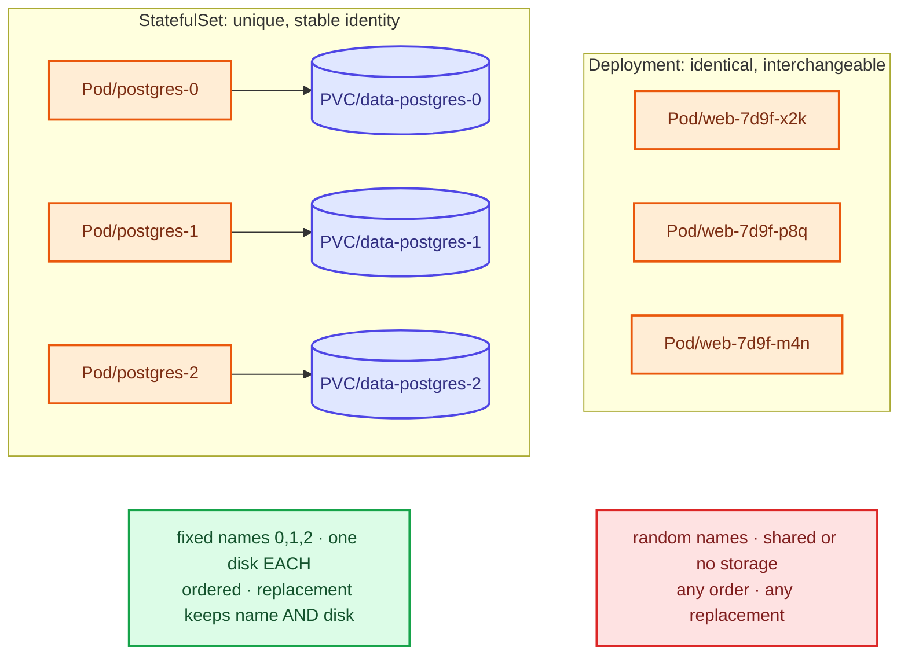
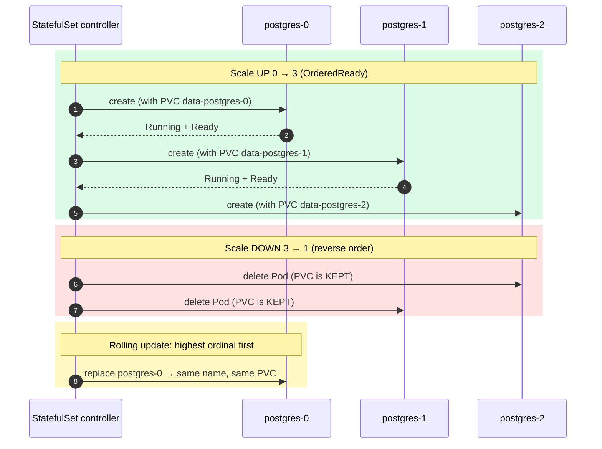

# 06 · StatefulSets

[⬅ Module 2](README.md) · Page 6 of 6 · [🏠 Reference home](../README.md)

[01 Namespaces](01-namespaces.md) › [02 Pods](02-pods.md) › [03 Deployments](03-deployments.md) › [04 ConfigMaps](04-configmaps.md) › [05 Secrets](05-secrets.md) › **06 StatefulSets**

---

## The problem: a database is not a web server

Deployments treat Pods as **identical and interchangeable**. That's perfect for our web server: any copy can serve
any request, and a replacement can be anyone. A database is the opposite. Run PostgreSQL as a Deployment and you hit
this:

| Deployment behaviour | Why it breaks a database |
|---|---|
| Pods get random names (`postgres-7d9f-x2k`) that change on every restart | Other members and clients can't find "the primary" by a stable name |
| Data lives in the container's writable layer | A restart **wipes every order and book** |
| Even with one shared volume, every replica mounts the **same** disk | Two database processes writing the same files corrupts them |
| All Pods start and stop at once, in any order | Clustered databases need member 0 up *before* member 1 joins |
| Rolling update: start new, then stop old | Briefly two processes touch the same data |

A database needs Pods that are **pets, not cattle**: each one with a **stable name**, **its own disk**, and a
**predictable order**. That's a **StatefulSet**.

---

## The idea in one picture



A StatefulSet guarantees three things that a Deployment doesn't:

| Guarantee | What it means |
|---|---|
| **1. Stable name** | Pods are named `<statefulset>-<ordinal>`: `postgres-0`, `postgres-1`… If `postgres-1` dies, its replacement is **also** `postgres-1`. |
| **2. Stable storage** | Each Pod gets its **own** PersistentVolumeClaim (`data-postgres-0`, …). A replacement Pod re-attaches to the **same** disk. |
| **3. Ordered operations** | Pods are created 0 → 1 → 2 (each waits for the previous one to be Ready), and removed 2 → 1 → 0. |

> **Analogy:** a Deployment is a **taxi rank**: take whichever car is first, because they're all the same. A
> StatefulSet is a **team roster**: player #1 is always #1, has their own locker (disk), and if they're replaced
> mid-season, the new #1 gets the same locker.

---

## How it works

### Two new ideas, kept basic

| Idea | Plain meaning | Why the StatefulSet needs it |
|---|---|---|
| **PersistentVolumeClaim (PVC)** | A Pod's **request for a disk**: "I need 1 GiB that survives restarts". The cluster finds or creates a real disk to satisfy it. | Data must outlive the container |
| **Headless Service** | A Service with `clusterIP: None`. Here, it just gives each Pod a **stable DNS name** like `postgres-0.postgres`. | Clients and peers need to find a *specific* Pod by name |

> **Note:** Storage and Services are big topics of their own, taught fully in the projects. For this page you only
> need: *a PVC is a disk request*, and *the headless Service is a name provider*.

### Stable DNS names

With a headless Service called `postgres` in namespace `bookstore`, every Pod gets a predictable address:

```
<pod-name>.<service-name>.<namespace>.svc.cluster.local
postgres-0.postgres.bookstore.svc.cluster.local
```

That name keeps working when `postgres-0` is re-created, even though its IP changes.

### The manifests

```yaml
# statefulset.yaml
# WHY: PostgreSQL needs a stable identity (postgres-0) and its OWN disk that
#      survives Pod restarts. A Deployment provides neither.
---
# 1) Headless Service: gives each Pod a stable DNS name. It is REQUIRED by spec.serviceName.
apiVersion: v1
kind: Service
metadata:
  name: postgres
  namespace: bookstore
  labels:
    app.kubernetes.io/name: postgres
spec:
  clusterIP: None                         # "headless": no virtual IP, just per-Pod DNS records
  selector:
    app.kubernetes.io/name: postgres
  ports:
    - name: postgres
      port: 5432
---
# 2) The StatefulSet itself
apiVersion: apps/v1                       # same group as Deployment
kind: StatefulSet
metadata:
  name: postgres
  namespace: bookstore
  labels:
    app.kubernetes.io/name: postgres
    app.kubernetes.io/part-of: bookstore
spec:
  serviceName: postgres                   # the headless Service above → postgres-0.postgres
  replicas: 1                             # ONE database Pod (see "What a StatefulSet does NOT do")
  selector:
    matchLabels:
      app.kubernetes.io/name: postgres    # must match template labels, exactly like a Deployment
  template:
    metadata:
      labels:
        app.kubernetes.io/name: postgres
        app.kubernetes.io/part-of: bookstore
    spec:
      containers:
        - name: postgres
          image: postgres:16-alpine       # pinned major + variant, never :latest
          ports:
            - containerPort: 5432
              name: postgres
          envFrom:
            - secretRef:
                name: db-credentials      # POSTGRES_USER / PASSWORD / DB from page 05
          env:
            - name: PGDATA                # keep data in a SUB-directory of the mount,
              value: /var/lib/postgresql/data/pgdata   # because some disks have a lost+found folder
          volumeMounts:
            - name: data                  # must match volumeClaimTemplates[].metadata.name
              mountPath: /var/lib/postgresql/data
  volumeClaimTemplates:                   # a PVC TEMPLATE: one PVC is created PER Pod
    - metadata:
        name: data                        # PVC name becomes: data-postgres-0, data-postgres-1, …
      spec:
        accessModes: ["ReadWriteOnce"]    # mountable read-write by one node at a time
        resources:
          requests:
            storage: 1Gi                  # how much disk to ask for
        # storageClassName omitted → the cluster's default (on Kind: "standard")
```

| Field | What it does | Compared to a Deployment |
|---|---|---|
| `serviceName` | Names the headless Service that provides per-Pod DNS | Deployments have no equivalent |
| `replicas` | How many **numbered** Pods to run (0 … N-1) | Same field, but here each replica is unique |
| `selector` / `template` | Exactly like a Deployment | Same rules: labels must match; selector is immutable |
| `volumeClaimTemplates` | Creates **one PVC per Pod**, named `<template>-<statefulset>-<ordinal>` | Deployments can't give each Pod its own disk |
| `accessModes: ReadWriteOnce` | The disk attaches to one node at a time | The usual mode for databases |
| `podManagementPolicy` *(optional)* | `OrderedReady` (default: one at a time, in order) or `Parallel` | Deployments are always "parallel" |
| `updateStrategy` *(optional)* | `RollingUpdate` (default: highest ordinal first, one at a time) or `OnDelete` | Similar, but strictly ordered |

### Ordered creation, scaling and updates



### What happens to the data

| Event | Pod | PVC (the data) |
|---|---|---|
| Container crashes | Restarted in place | ✅ Untouched |
| Pod deleted | Re-created with the **same name** | ✅ Re-attached, data intact |
| Scale down | Highest-ordinal Pods removed | ✅ **Kept** (by default), so scaling back up re-attaches the same data |
| StatefulSet deleted | All Pods removed | ✅ **Kept** (by default). You must delete PVCs yourself. |

> ⚠️ **Warning:** "Kept by default" is a safety feature: Kubernetes won't destroy your data just because you deleted
> or scaled a StatefulSet. It also means **leftover PVCs, and real disks, stay until you delete them**. On a cloud
> provider those disks cost money. Always check `kubectl get pvc` after clean-up.

### What a StatefulSet does **not** do

> 🎯 **Interview:** *"If I set `replicas: 3` on a PostgreSQL StatefulSet, do I get a replicated database cluster?"*
> **No.** You get three **independent** PostgreSQL servers with three separate, empty disks. A StatefulSet provides
> identity, storage and ordering, the *building blocks*. Replication (primary/replica, failover) must be configured
> **inside the database**, usually by an operator or a Helm chart built for that database. That's why we run
> `replicas: 1` here.

### Deployment vs StatefulSet: which one?

| Question | Deployment | StatefulSet |
|---|---|---|
| Can any copy handle any request? | ✅ Yes (stateless) | ❌ Each copy is different |
| Does each copy need its own persistent disk? | No | Yes |
| Do copies need stable names? | No | Yes |
| Does start/stop order matter? | No | Often |
| Examples | Web servers, REST APIs, frontends | PostgreSQL, MySQL, MongoDB, Kafka, Elasticsearch, Redis with persistence |

---

## Try it

> 🧪 **Try it:** Run the Bookstore database, write data, kill the Pod, and prove the data survived. Needs the
> `db-credentials` Secret from page 05.

**1. Deploy.** Save both manifests above as `statefulset.yaml`:

```bash
kubectl apply -f statefulset.yaml
kubectl get statefulset,pods,pvc -n bookstore -l app.kubernetes.io/name=postgres
```

Expected after ~30 s: `statefulset.apps/postgres 1/1`, `pod/postgres-0 1/1 Running`, and
`persistentvolumeclaim/data-postgres-0 Bound 1Gi RWO standard`. Notice the **predictable names**.

```bash
kubectl wait --for=condition=Ready pod/postgres-0 -n bookstore --timeout=120s
```

**2. Write some data:**

```bash
kubectl exec -n bookstore postgres-0 -- psql -U bookstore -d bookstore -c \
  "CREATE TABLE books (id serial PRIMARY KEY, title text); INSERT INTO books (title) VALUES ('The Pragmatic Programmer');"
```

Expected: `CREATE TABLE` and `INSERT 0 1`.

**3. Destroy the Pod:**

```bash
kubectl delete pod postgres-0 -n bookstore
kubectl get pods -n bookstore -l app.kubernetes.io/name=postgres -w
```

Expected: `postgres-0` goes `Terminating`, then a **new Pod with the same name** `postgres-0` appears. Press
`Ctrl+C` once it's `Running`.

**4. Prove the data survived:**

```bash
kubectl wait --for=condition=Ready pod/postgres-0 -n bookstore --timeout=120s
kubectl exec -n bookstore postgres-0 -- psql -U bookstore -d bookstore -c "SELECT * FROM books;"
```

Expected:

```
 id |          title
----+--------------------------
  1 | The Pragmatic Programmer
(1 row)
```

The replacement Pod re-attached the **same** PVC `data-postgres-0`.

**5. Resolve the stable DNS name from another Pod:**

```bash
kubectl run dns-test -n bookstore --image=busybox:1.36 --restart=Never --rm -it -- \
  nslookup postgres-0.postgres.bookstore.svc.cluster.local
```

Expected: an `Address:` line with `postgres-0`'s current IP.

**6. See that deleting the StatefulSet keeps the data:**

```bash
kubectl delete statefulset postgres -n bookstore
kubectl get pvc -n bookstore            # data-postgres-0 is still Bound
```

**7. Clean up the whole module** (this deletes the PVC and its data too):

```bash
kubectl delete namespace bookstore
kubectl get pv                          # should show nothing left from bookstore after a few seconds
```

---

## Common mistakes

| Mistake | Symptom | Fix |
|---|---|---|
| Expecting `replicas: 3` to replicate data | Three separate, inconsistent databases | Use a database operator or Helm chart for real replication |
| No default StorageClass in the cluster | PVC stuck `Pending`, Pod stuck `Pending` | Set `storageClassName`, or install/mark a default StorageClass |
| Forgetting `serviceName` or the headless Service | Validation error, or Pods without stable DNS names | Create the headless Service with `clusterIP: None` |
| Mounting PostgreSQL directly at the disk root | `initdb: directory … exists but is not empty` (because of `lost+found`) | Set `PGDATA` to a sub-directory, as above |
| Deleting the StatefulSet and assuming the disks are gone | Orphaned PVCs, and on cloud, billed disks | `kubectl get pvc`, then delete the PVCs you no longer need |
| Changing `volumeClaimTemplates` after creation | `Forbidden: updates to statefulset spec for fields other than …` | Most of `volumeClaimTemplates` is immutable. Plan sizes up front. |

---

## Quick recap

- A **StatefulSet** runs Pods with **stable names** (`name-0`, `name-1`…), **one PVC per Pod**, and **ordered**
  create/scale/update.
- A replacement Pod keeps its **name** and re-attaches its **own disk**.
- `serviceName` + a **headless Service** give each Pod a stable DNS name: `postgres-0.postgres.<ns>.svc.cluster.local`.
- `volumeClaimTemplates` creates `data-postgres-0`, `data-postgres-1`, …
- PVCs are **kept** on scale-down and on StatefulSet deletion. Clean them up yourself.
- A StatefulSet does **not** replicate data. It gives databases the building blocks they need.
- Rule of thumb: **stateless → Deployment, stateful → StatefulSet.**

**🎉 Module 2 complete.** You've deployed a Bookstore the Kubernetes way: its own namespace, a self-healing web tier
with rolling updates, configuration and credentials outside the image, and a database with its own persistent disk.
Revise any term in the [📖 Glossary](../GLOSSARY.md), or go back to the [🏠 Reference home](../README.md) to review
both modules.

---

## 📚 Official documentation

Everything above is self-contained. These links are for going deeper, not for filling gaps.

| Reference | What it adds |
|---|---|
| [StatefulSets](https://kubernetes.io/docs/concepts/workloads/controllers/statefulset/) | Every guarantee in detail, including PVC retention policy and partitioned rolling updates |
| [StatefulSet Basics](https://kubernetes.io/docs/tutorials/stateful-application/basic-stateful-set/) | The official hands-on tutorial: ordering, DNS, scaling and updates |
| [Persistent Volumes](https://kubernetes.io/docs/concepts/storage/persistent-volumes/) | What PVCs and PVs really are, access modes and reclaim policies |
| [Workloads](https://kubernetes.io/docs/concepts/workloads/) | Where StatefulSets fit among the other workload controllers |

*Links verified 2026-11-22.*

---

| ◀ Previous | ▲ Up | Next ▶ |
|---|:--:|---:|
| ◀ **[05 Secrets](05-secrets.md)** | [Module 2](README.md) · [Reference home](../README.md) | **[📖 Glossary](../GLOSSARY.md)** ▶ |
