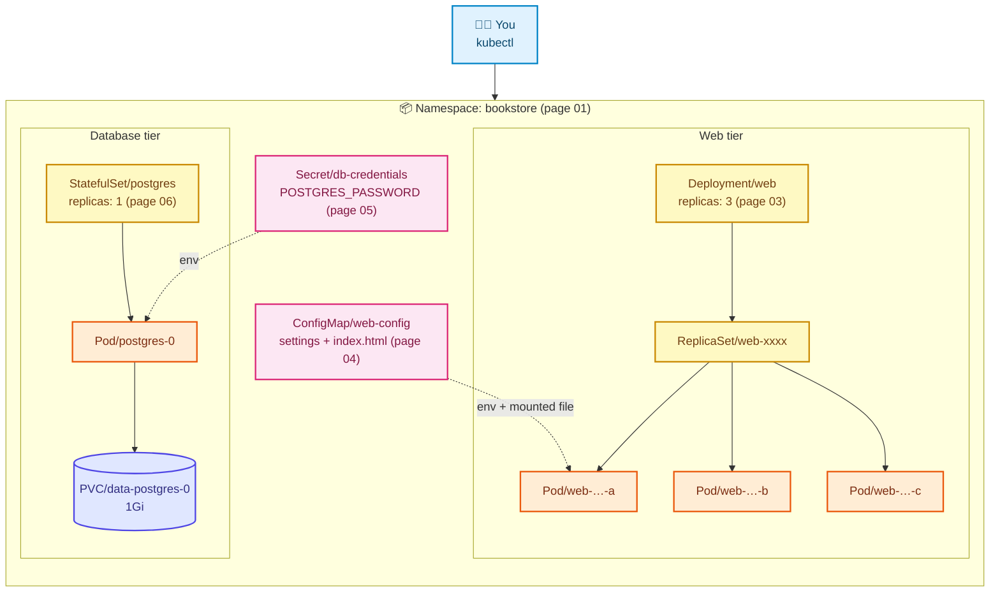

# Module 2 — Deploy Apps the Kubernetes Way

[🏠 Reference home](../README.md) · Module 2 of 2

[Module 1 — Control Room](../01-control-room-for-containers/README.md) › **Module 2 — Deploy Apps**

---

## The story of this module

In Module 1 you learned how Kubernetes *thinks*. Now you'll use it. Across these six pages we build one small
application, a **Bookstore**, one object at a time. Each page adds exactly one thing, because the previous step
left a real problem behind.

| Page | We add… | Because without it… |
|---|---|---|
| 01 | **Namespace** `bookstore` | Our objects are mixed in with everyone else's in `default` |
| 02 | **Pod** running the web server | *(starting point)* We need something running at all |
| 03 | **Deployment** for the web server | A deleted or crashed Pod is simply gone, and there's only one copy |
| 04 | **ConfigMap** with settings and the web page | Changing a setting means rebuilding the image |
| 05 | **Secret** with the database password | Passwords would sit in plain text in Git and ConfigMaps |
| 06 | **StatefulSet** running PostgreSQL | A database in a Deployment loses its identity and its data |

## What we build, piece by piece

## Pages in this module

| # | Page | Key question | Time |
|---|---|---|---|
| 01 | [Namespaces](01-namespaces.md) | How do I give my app its own space? | 15 min |
| 02 | [Pods](02-pods.md) | What is the smallest unit Kubernetes runs? | 30 min |
| 03 | [Deployments](03-deployments.md) | How do I get self-healing, scaling, updates and rollback? | 35 min |
| 04 | [ConfigMaps](04-configmaps.md) | How do I separate configuration from the image? | 25 min |
| 05 | [Secrets](05-secrets.md) | How do I handle passwords and keys? | 25 min |
| 06 | [StatefulSets](06-statefulsets.md) | How do I run a database that keeps its data and identity? | 30 min |

## The Kubernetes way, in one sentence each

1. **Group it**: every app gets its own namespace.
2. **Never run bare Pods**: let a controller (Deployment or StatefulSet) own them.
3. **Describe, don't command**: YAML in Git, `kubectl apply -f`.
4. **Build once, configure everywhere**: the same image, with different ConfigMaps per environment.
5. **Keep secrets out of images and Git**: use Secrets.
6. **Pin every image tag**: never `:latest`.
7. **Label everything**: labels are how objects find each other.

> 🧪 **Try it:** Every page's `Try it` builds on the previous one, all inside the `bookstore` namespace. To start over
> at any time, run `kubectl delete namespace bookstore`. That one command removes everything in this module.

---

| ◀ Previous | ▲ Up | Next ▶ |
|---|:--:|---:|
| ◀ **[Module 1 · 06 Networking & IPs](../01-control-room-for-containers/06-cluster-networking-and-ip-allocation.md)** | [Reference home](../README.md) | **[01 Namespaces](01-namespaces.md)** ▶ |
