# Kubernetes Document Reference

Plain-language reference notes for the **core ideas of Kubernetes**: what it is, how it works inside, and how you
deploy an application with it.

> **Who this is for:** anyone who knows basic Docker (images, containers, ports, environment variables) and has
> **never used Kubernetes before**. Every term is explained the first time it appears, and every command comes with
> what it does and what you should see.

> **Note:** This folder is **reference material**, and it is self-contained: every link here leads to another page
> inside this folder (plus official kubernetes.io references). The hands-on projects never require you to read these
> pages first. Read these pages to build a mental model before a
> session, or come back to them when a term confuses you.

---

## 🧭 Start Here

The material is split into **two learning modules**. Read them in order the first time.

```mermaid
flowchart LR
    S["👋 You know<br/>basic Docker"]:::external

    subgraph M1["Module 1 · Kubernetes: The Control Room for Containers"]
        direction TB
        A["01 · Fundamentals<br/>why Kubernetes exists"]:::control
        B["02 · Architecture<br/>who does what inside"]:::control
        C["03 · Images & Runtime<br/>how containers actually start"]:::pod
        D["04 · API Resources<br/>the shape of every object"]:::config
        HA["05 · HA Control Plane<br/>multi-master · leaders · etcd quorum"]:::storage
        NET["06 · Networking & IPs<br/>node · Pod · Service addresses"]:::network
        A --> B --> C --> D --> HA --> NET
    end

    subgraph M2["Module 2 · Deploy Apps the Kubernetes Way"]
        direction TB
        E["01 · Namespaces"]:::network
        F["02 · Pods"]:::pod
        G["03 · Deployments"]:::workload
        H["04 · ConfigMaps"]:::config
        I["05 · Secrets"]:::config
        J["06 · StatefulSets"]:::storage
        E --> F --> G --> H --> I --> J
    end

    P["📖 Glossary<br/>revise every term"]:::external

    S --> A
    NET --> E
    J --> P

    classDef external fill:#e0f2fe,stroke:#0284c7,stroke-width:2px,color:#0c4a6e
    classDef network  fill:#dcfce7,stroke:#16a34a,stroke-width:2px,color:#14532d
    classDef workload fill:#fef9c3,stroke:#ca8a04,stroke-width:2px,color:#713f12
    classDef pod      fill:#ffedd5,stroke:#ea580c,stroke-width:2px,color:#7c2d12
    classDef config   fill:#fce7f3,stroke:#db2777,stroke-width:2px,color:#831843
    classDef storage  fill:#e0e7ff,stroke:#4f46e5,stroke-width:2px,color:#312e81
    classDef control  fill:#f1f5f9,stroke:#475569,stroke-width:2px,color:#0f172a
```



---

## 📘 Module 1 — Kubernetes: The Control Room for Containers

**The big idea:** you stop *running containers yourself* and start *describing what you want*. Kubernetes is the
control room: it watches every machine and every container, and keeps fixing things until reality matches your
description.

| # | Page | You will be able to answer… | Time |
|---|---|---|---|
| 01 | [Kubernetes Fundamentals](01-control-room-for-containers/01-kubernetes-fundamentals.md) | Why isn't Docker alone enough? What does "desired state" mean? | 25 min |
| 02 | [Kubernetes Architecture](01-control-room-for-containers/02-kubernetes-architecture.md) | What happens, step by step, after I type `kubectl apply`? | 35 min |
| 03 | [Images & Container Runtime](01-control-room-for-containers/03-images-and-container-runtime.md) | Who actually pulls my image and starts my container? | 25 min |
| 04 | [API Resources & Object Definitions](01-control-room-for-containers/04-api-resources-and-object-definitions.md) | What are `apiVersion`, `kind`, `metadata`, `spec`, `status`? | 30 min |
| 05 | [High-Availability (Multi-Master) Control Plane](01-control-room-for-containers/05-high-availability-control-plane.md) | How do 3 control-plane nodes pick leaders, and how is etcd kept consistent? | 40 min |
| 06 | [Cluster Networking & IP Allocation](01-control-room-for-containers/06-cluster-networking-and-ip-allocation.md) | Where do node, Pod, CoreDNS and Service IPs come from on Kind, kubeadm and EKS? | 35 min |

Module overview: [01-control-room-for-containers/README.md](01-control-room-for-containers/README.md)

## 📗 Module 2 — Deploy Apps the Kubernetes Way

**The big idea:** take one small web application and run it the way Kubernetes expects. Give it its own space, wrap
it in a Pod, keep it alive with a Deployment, feed it settings with a ConfigMap and a Secret, and finally run a
database with a StatefulSet.

| # | Page | You will be able to answer… | Time |
|---|---|---|---|
| 01 | [Namespaces](02-deploy-apps-the-kubernetes-way/01-namespaces.md) | How do I keep my app's objects separate from everyone else's? | 15 min |
| 02 | [Pods](02-deploy-apps-the-kubernetes-way/02-pods.md) | What is the smallest thing Kubernetes runs, and why isn't it a container? | 30 min |
| 03 | [Deployments](02-deploy-apps-the-kubernetes-way/03-deployments.md) | How do I get self-healing, scaling, rolling updates and rollback? | 35 min |
| 04 | [ConfigMaps](02-deploy-apps-the-kubernetes-way/04-configmaps.md) | How do I change settings without rebuilding the image? | 25 min |
| 05 | [Secrets](02-deploy-apps-the-kubernetes-way/05-secrets.md) | Where do passwords go, and why is base64 *not* encryption? | 25 min |
| 06 | [StatefulSets](02-deploy-apps-the-kubernetes-way/06-statefulsets.md) | Why does a database need something different from a Deployment? | 30 min |

Module overview: [02-deploy-apps-the-kubernetes-way/README.md](02-deploy-apps-the-kubernetes-way/README.md)

📖 Stuck on a word? → [Glossary](GLOSSARY.md)

---

## How Each Page Is Written

Every topic page follows the same shape, so you always know where to look:

| Section | What it gives you |
|---|---|
| **The problem** | A real situation where life is painful *without* this concept |
| **The idea in one picture** | A colored diagram you can redraw on a whiteboard |
| **How it works** | The mechanism: what Kubernetes actually does behind the scenes |
| **Try it** | Copy-paste commands with the output you should expect |
| **Common mistakes** | What goes wrong for beginners, and how to spot it |
| **Quick recap** | Five-to-eight bullet summary for revision |
| **📚 Official documentation** | Verified links to kubernetes.io for going deeper |

### Colors mean the same thing on every page

| Color | Layer | Examples |
|---|---|---|
| 🔵 Light blue | External / user | You, your laptop, the internet, a container registry |
| 🟢 Green | Networking / grouping | Namespaces, DNS names |
| 🟡 Yellow | Workload controllers | Deployment, ReplicaSet, StatefulSet |
| 🟠 Orange | Pods and containers | Pod, container, container runtime |
| 🩷 Pink | Configuration | ConfigMap, Secret, environment variables |
| 🟣 Indigo | Storage | Volumes, PersistentVolumeClaims |
| ⚪ Slate grey | Control plane | API server, scheduler, controller manager, etcd, kubelet |
| 🔴 Red | Failure / problem | Something broke, or something to avoid |

---

## What You Need To Follow Along

| Tool | Check it works | Why |
|---|---|---|
| Docker | `docker version` | Builds and runs container images; Kind runs on top of it |
| kubectl | `kubectl version --client` | The command-line tool you use to talk to Kubernetes |
| Kind | `kind version` | Creates a small Kubernetes cluster inside Docker on your laptop |

Create a practice cluster (one command, no config file needed):

```bash
kind create cluster --name kubernetes-lab
kubectl get nodes
```

Expected output, which means you are ready:

```
NAME                           STATUS   ROLES           AGE   VERSION
kubernetes-lab-control-plane   Ready    control-plane   40s   v1.xx.x
```

> 🧪 **Try it:** Every `Try it` block in these pages works on this one cluster. When you are finished for the day,
> run `kind delete cluster --name kubernetes-lab` to remove everything.

---

## What Is Deliberately *Not* Here (Yet)

These pages cover **foundations only**. The following topics are taught later, inside the projects, when a real
problem needs them:

| Topic | Where it is taught |
|---|---|
| Services in depth, Ingress, NetworkPolicy | Projects 01–04 |
| Storage classes and volumes in depth | Projects 02–03 |
| Probes, resource limits, autoscaling | Projects 02, 05 |
| RBAC, ServiceAccounts, security contexts | Project 07 |
| Cloud-specific topics (EKS, IAM, load balancers) | Projects 03, 10 |

---

| ◀ Previous | ▲ Up | Next ▶ |
|---|:--:|---:|
| ◀ *(start)* | [📖 Glossary](GLOSSARY.md) | **[Module 1 · 01 Fundamentals](01-control-room-for-containers/01-kubernetes-fundamentals.md)** ▶ |
