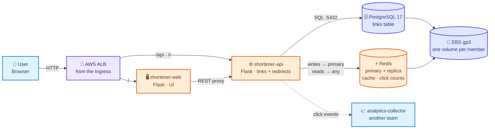

# Project 03 — URL Shortener on EKS

> **Difficulty:** 🟡 Intermediate
> **Estimated time:** 4–5 hours
> **Cluster required:** **AWS EKS** — [`clusters/eks-lab.yaml`](../clusters/eks-lab.yaml) (eksctl). **This project does not run on Kind.**
> **Cost:** ~**$0.25/hour** while the cluster exists (control plane, 2 × t3.medium, an ALB, three 1 GiB EBS volumes). Budget **~$1–2** for the whole project if you clean up the same day.
> **Assumes:** you can run a stateful, multi-tier app with Services, ConfigMaps, Secrets and PVCs (Project 02, or equivalent)

---

## 1. What Are We Building?

A URL shortener: paste a long URL, get `http://<alb>/r/bx16eH`, share it, count the clicks.

| Component | Technology | Responsibility | Port |
|---|---|---|---|
| `shortener-web` | Python 3.13 · Flask · gunicorn | UI; proxies `/api` and `/r` for port-forward sessions | 8080 |
| `shortener-api` | Python 3.13 · Flask · psycopg 3 · redis-py | Create links, follow links, count clicks, send click events | 8080 |
| `postgres` | PostgreSQL 17.5 | **Source of truth** — every link is a row | 5432 |
| `redis` | Redis 8.2.9 — **primary + replica** | **Fast path** — link cache and click counters | 6379 |
| `analytics-collector` | Python · Flask — in **another team's namespace** | Receives one event per click | 8080 |

**Two datastores with genuinely different jobs.** Lose PostgreSQL and the product is down. Lose Redis and every
link still redirects — slower, and uncounted. That asymmetry decides readiness, error handling, storage and
replication, and it is why this project exists.

**Why EKS?** Everything taught here behaves differently on a real cloud cluster, and the differences are the
lessons: a new EKS cluster has **no default StorageClass**; an EBS volume lives in **one availability zone**; an
Ingress creates a **real ALB** that health-checks pod IPs on its own; pod IPs are **VPC addresses**; the DNS
search list ends in `ec2.internal`. Simulating those on a laptop would teach the wrong failure modes.

---

## 2. Why This Project?

Most tutorials show a headless Service, say "it gives each pod a DNS name", and move on. You never learn *when you
would need one*. Here you will need one, because you will lose half your writes without it.

The story runs on **names**:

- Stage 03 configures everything by hostname — `postgres`, `redis`, `analytics` — and gets **NXDOMAIN**. A
  Deployment registers nothing in DNS.
- Stage 04 makes names exist, dissects the **search list** and `ndots`, and gives a dependency in another
  namespace a local alias with **ExternalName**.
- Stage 05 edits a live ConfigMap and watches the same short link **work, 404, work, 404** as two replicas
  disagree — then makes that drift impossible with **immutable, versioned ConfigMaps**.
- Stage 08 replicates Redis and watches **exactly half** of all click writes fail with `READONLY` — until writes
  address `redis-0` by its **per-pod DNS name**.

**Every resource arrives as the answer to a failure you just watched happen on a real EKS cluster.**

---

## 3. Learning Objectives

By the end you will be able to:

- [ ] Explain why a Deployment's name is not a DNS name, and what a Service actually registers
- [ ] Read a pod's `/etc/resolv.conf` and predict which names resolve from which namespace, including `ndots:5`
- [ ] Use an **ExternalName** Service as an alias, and explain what it does *not* do (ports, Host header, TLS)
- [ ] Explain why editing a mutable ConfigMap is a partial, random rollout — and fix it with **immutable, versioned** config
- [ ] Use a `checksum/config` annotation, then replace it with a Kustomize **configMapGenerator**
- [ ] Keep passwords out of ConfigMaps *and* out of process command lines
- [ ] Diagnose a PVC stuck `Pending` on a cluster with **no default StorageClass**
- [ ] Explain `WaitForFirstConsumer`, EBS availability-zone pinning, and why `ReadWriteOnce` is per **node**
- [ ] Say what a StatefulSet gives (identity, per-pod storage, ordering) and what it does not (failover)
- [ ] Choose between a ClusterIP, a headless Service and a **per-pod** name for reads versus writes
- [ ] Explain how the AWS Load Balancer Controller turns an Ingress into an ALB, and read ALB 404/502/503
- [ ] Gate readiness on hard dependencies only, run migrations in an init container, and use **ALB readiness gates**
- [ ] Clean up an EKS project **in the right order** so no load balancer or EBS volume is orphaned

---

## 4. Technologies Used

| Layer | Choice | Why |
|---|---|---|
| Cluster | **Amazon EKS 1.36** via **eksctl 0.230** | Managed control plane; the add-ons below are first-class |
| Nodes | Managed node group, 2 × t3.medium, 2 AZs | Real zones for real EBS zonal behaviour |
| Pod networking | Amazon VPC CNI | Pods get VPC IPs — the ALB targets them directly |
| DNS | CoreDNS EKS add-on | The thing this project takes apart |
| Storage | **EBS CSI driver** add-on, gp3, encrypted | Dynamic, zonal block storage |
| AWS identity | **EKS Pod Identity** | Controllers get IAM roles without static keys or OIDC wiring |
| Ingress | **AWS Load Balancer Controller v3.5.0** (Helm chart 3.5.0) | Ingress → ALB. ingress-nginx was retired in March 2026 |
| App | Python 3.13, Flask 3.1, gunicorn 26, psycopg 3.3, redis-py 8.1 | The app is never the hard part |
| Datastores | `postgres:17.5-alpine`, `redis:8.2.9-alpine` | Real data directories, real replication |
| Config | Kustomize (built into kubectl) | `configMapGenerator` in stage 19 |

---

## 5. Prerequisites

| Tool | Version tested | Verify |
|---|---|---|
| AWS CLI v2 | 2.34 | `aws sts get-caller-identity` |
| eksctl | 0.230.0 | `eksctl version` |
| kubectl | 1.35+ | `kubectl version --client` |
| Helm | 3.14+ (tested with 4.3.0) | `helm version` |
| Docker | 24+ | `docker version` |

**AWS permissions:** enough to create an EKS cluster with eksctl (CloudFormation, EC2, EKS, IAM roles). An
administrator-level lab account is the realistic choice; do not use a production account.

```bash
# From the repository root — 15–20 minutes
eksctl create cluster --config-file clusters/eks-lab.yaml
kubectl config current-context        # …@kubernetes-lab.us-east-1.eksctl.io
kubectl get nodes -L topology.kubernetes.io/zone
kubectl get storageclass              # only gp2, and NOT default — stage 07 depends on noticing this
```

> ⚠️ **Check your kube-context before every session.** If your kubeconfig also contains a production cluster,
> `kubectl` will act on whichever context is current, without asking. `scripts/deploy.sh` refuses to run unless the
> context names `kubernetes-lab` and the nodes are EC2 instances.

The one-time cluster software (the AWS Load Balancer Controller) is installed in
[`scripts/manual-steps.md` Part 1](scripts/manual-steps.md#part-1--cluster-setup).

---

## 6. Application Architecture — HLD

*What the application is, ignoring Kubernetes entirely.*



**Writes and reads to Redis take different paths.** That one arrow label is why this project needs per-pod DNS.

---

## 7. Kubernetes Architecture — LLD

*Every object in the final state, plus what the controllers create in AWS. Come back here when something breaks.*

```mermaid
flowchart TB
    U["👤 User<br/>http://&lt;alb-hostname&gt;"]:::external

    subgraph AWS["☁️ AWS account (created by controllers)"]
        ALB["ALB k8s-urlshort-…<br/>listener :80 · inbound-cidrs"]:::external
        EBS0["EBS vol-… gp3 · AZ a/b<br/>one per PVC"]:::storage
    end

    subgraph KS["📦 Namespace: kube-system (cluster software)"]
        LBC["Deployment/aws-load-balancer-controller<br/>Pod Identity → IAM"]:::gateway
        CSI["Deployment/ebs-csi-controller<br/>Pod Identity → IAM"]:::storage
        DNS["Deployment/coredns<br/>Service kube-dns 10.100.0.10"]:::network
    end

    ICLASS["IngressClass/alb"]:::gateway
    SC["StorageClass/url-shortener-gp3<br/>ebs.csi.aws.com · WaitForFirstConsumer"]:::storage

    subgraph NS["📦 Namespace: url-shortener  (pod-readiness-gate-inject: enabled)"]
        direction TB

        ING["Ingress/url-shortener-ingress<br/>/ → web · /api,/r → api · target-type ip"]:::gateway

        SVCW["Service/shortener-web<br/>ClusterIP :80"]:::network
        DEPW["Deployment/shortener-web<br/>replicas 2"]:::workload
        PW["Pod/shortener-web-…<br/>probes · readiness gate"]:::pod

        SVCA["Service/shortener-api<br/>ClusterIP :8080"]:::network
        DEPA["Deployment/shortener-api<br/>replicas 2 · maxUnavailable 0"]:::workload
        PA["Pod/shortener-api-…<br/>init: migrate · probes"]:::pod

        SVCR["Service/redis<br/>ClusterIP — READS"]:::network
        SVCRH["Service/redis-headless<br/>clusterIP None"]:::network
        STSR["StatefulSet/redis<br/>replicas 2 · OrderedReady"]:::workload
        R0["Pod/redis-0<br/>primary"]:::pod
        R1["Pod/redis-1<br/>replicaof redis-0.redis-headless"]:::pod
        PVCR0["PVC/redis-data-redis-0"]:::storage
        PVCR1["PVC/redis-data-redis-1"]:::storage

        SVCP["Service/postgres<br/>ClusterIP :5432"]:::network
        SVCPH["Service/postgres-headless<br/>clusterIP None"]:::network
        STSP["StatefulSet/postgres<br/>replicas 1"]:::workload
        P0["Pod/postgres-0<br/>exec pg_isready"]:::pod
        PVCP0["PVC/postgres-data-postgres-0"]:::storage

        EXT["Service/analytics<br/>ExternalName → CNAME"]:::network

        CM["ConfigMap/shortener-config-&lt;hash&gt;<br/>immutable · generated"]:::config
        CMR["ConfigMap/redis-config-&lt;hash&gt;<br/>redis.conf"]:::config
        SECP["Secret/postgres-secret"]:::config
        SECR["Secret/redis-secret"]:::config
    end

    subgraph ANS["📦 Namespace: analytics (another team)"]
        SVCC["Service/analytics-collector<br/>ClusterIP :80"]:::network
        PC["Pod/analytics-collector-…"]:::pod
    end

    U -->|"HTTP :80"| ALB
    ING -.->|"ingressClassName"| ICLASS
    LBC -.->|"reconciles"| ING
    LBC -->|"creates + registers pod IPs"| ALB
    ALB -->|"/ → pod IPs"| PW
    ALB -->|"/api /r → pod IPs"| PA

    SVCW --> PW
    DEPW --> PW
    PW -->|"SHORTENER_API_URL"| SVCA
    SVCA --> PA
    DEPA --> PA

    PA -->|"writes → redis-0.redis-headless"| R0
    PA -->|"reads"| SVCR
    SVCR --> R0 & R1
    R1 -->|"replication"| R0
    SVCRH -.->|"per-pod A records"| R0 & R1
    STSR --> R0 & R1
    R0 --> PVCR0
    R1 --> PVCR1

    PA -->|"SQL"| SVCP --> P0
    SVCPH -.-> P0
    STSP --> P0 --> PVCP0

    PA -->|"http://analytics/events"| EXT
    EXT -.->|"CNAME"| SVCC --> PC

    PA -.->|"resolves every name"| DNS

    CM -.->|"envFrom"| PA
    CM -.->|"configMapKeyRef"| PW & P0
    CMR -.->|"subPath"| R0 & R1
    SECP -.-> PA & P0
    SECR -.-> PA & R0 & R1

    SC -.->|"provisions via"| CSI
    CSI -->|"CreateVolume"| EBS0
    PVCR0 & PVCR1 & PVCP0 -.-> EBS0

    classDef external fill:#e0f2fe,stroke:#0284c7,stroke-width:2px,color:#0c4a6e
    classDef gateway  fill:#ede9fe,stroke:#7c3aed,stroke-width:2px,color:#4c1d95
    classDef network  fill:#dcfce7,stroke:#16a34a,stroke-width:2px,color:#14532d
    classDef workload fill:#fef9c3,stroke:#ca8a04,stroke-width:2px,color:#713f12
    classDef pod      fill:#ffedd5,stroke:#ea580c,stroke-width:2px,color:#7c2d12
    classDef config   fill:#fce7f3,stroke:#db2777,stroke-width:2px,color:#831843
    classDef storage  fill:#e0e7ff,stroke:#4f46e5,stroke-width:2px,color:#312e81
```



**Legend** — colours mean the same thing in every project in this repository:

| Colour | Layer | Colour | Layer |
|---|---|---|---|
| 🟦 blue | External / AWS / user | 🩷 pink | Config / Secrets |
| 🟪 purple | Ingress / gateway / controller | 🟪 indigo | Storage (PVC, StorageClass, EBS) |
| 🟩 green | Networking (Service, DNS) | 🟧 orange | Pods / containers |
| 🟨 yellow | Workload controllers | | |

Diagram source: [`architecture/architecture.mmd`](architecture/architecture.mmd) · Design record:
[`architecture/architecture.md`](architecture/architecture.md)

---

## 8. Request Flow

One click on `http://<alb>/r/bx16eH`:

| # | Hop | What happens | Fails when |
|---|---|---|---|
| 1 | Browser → ALB | Security group allows only `inbound-cidrs` | Your IP not allowed ⇒ **timeout**, not an error code |
| 2 | Listener rule | `/r*` → target group for `shortener-api` | No rule ⇒ ALB **404** |
| 3 | → pod IP | Directly to a **healthy** pod (`target-type: ip`) | No healthy target ⇒ **503**; wrong port ⇒ **502** |
| 4 | API → CoreDNS | `redis.url-shortener.svc.cluster.local` → ClusterIP | Name/namespace wrong ⇒ `failed to resolve host` |
| 5 | Cache read | `GET link:bx16eH` on **any** Redis member | Redis down ⇒ `X-Cache: MISS`, fall back to PostgreSQL — **still redirects** |
| 6 | Cache miss | `SELECT … FROM links` on `postgres-0` | PostgreSQL down ⇒ **503** JSON naming the host |
| 7 | Count | `INCR clicks:bx16eH` on **`redis-0.redis-headless…`** | Writes to a replica ⇒ `X-Click-Counted: false`, `READONLY` |
| 8 | Event | async `POST http://analytics/events` → CNAME → other namespace | ExternalName wrong ⇒ only `stats.analytics_failed` rises |
| 9 | Response | `302 Location: …` + `X-Served-By`, `X-Cache`, `X-Click-Counted` | — |

Full sequence diagrams and the status-code table: [`architecture/request-flow.md`](architecture/request-flow.md)

---

## 9. Kubernetes Resources Used

| Resource | Why We Need It | Application Usage | Stage |
|---|---|---|---|
| Namespace ×2 | Scope, cleanup, and an honest other-owner boundary | `url-shortener`, `analytics` | [00](manifests/00-namespace/README.md) |
| Deployment | Self-healing, rolling updates | API, web, collector (and both datastores, at first) | [03](manifests/03-deployments/README.md) |
| Service (ClusterIP) | **Puts a name in DNS**; stable VIP; load balancing | `postgres`, `redis`, `shortener-api`, `shortener-web`, collector | [04](manifests/04-services/README.md) |
| CoreDNS / search list | How short names become FQDNs | Every connection | [04](manifests/04-services/README.md) |
| **ExternalName Service** | A local alias for someone else's endpoint | `analytics` → collector in `analytics` | [04](manifests/04-services/README.md) |
| ConfigMap (env, keyRef, file + subPath) | Config outside workloads | App config; `redis.conf` | [05](manifests/05-configmaps/README.md) |
| **Immutable ConfigMap** | Config that cannot drift | `shortener-config-v1`, `-v2` | [05](manifests/05-configmaps/README.md) |
| **`checksum/config`** | A file change becomes a rollout | Redis | [05](manifests/05-configmaps/README.md) |
| Secret ×2 | Credentials, least exposure | PostgreSQL, Redis passwords | [06](manifests/06-secrets/README.md) |
| emptyDir (Memory) | Rendered config off disk | Redis `requirepass` | [06](manifests/06-secrets/README.md) |
| securityContext | Non-root Redis, writable EBS via `fsGroup` | Redis | [06](manifests/06-secrets/README.md), [07](manifests/07-storage/README.md) |
| StorageClass (EBS gp3) | Dynamic, encrypted, AZ-aware volumes | `url-shortener-gp3` | [07](manifests/07-storage/README.md) |
| PVC / PV | Data outlives pods | Both datastores | [07](manifests/07-storage/README.md) |
| **StatefulSet** ×2 | Identity, per-pod disks, ordering | Redis primary + replica; PostgreSQL | [08](manifests/08-statefulsets/README.md) |
| **Headless Service** ×2 | **Per-pod DNS** | `redis-0.redis-headless…` for writes and replication | [08](manifests/08-statefulsets/README.md) |
| `volumeClaimTemplates` | A PVC per ordinal, retained on delete | `redis-data-redis-N` | [08](manifests/08-statefulsets/README.md) |
| Pod anti-affinity (preferred) | Members on different nodes / AZs | Redis | [08](manifests/08-statefulsets/README.md) |
| IngressClass + Ingress → **ALB** | HTTP routing by path, one entry point | `/`, `/api`, `/r` | [09](manifests/09-ingress/README.md) |
| Probes (HTTP + exec) | Ready ≠ Running | All workloads | [11](manifests/11-health-checks/README.md) |
| **Init container** | Schema migration as a precondition | `migrate` | [11](manifests/11-health-checks/README.md) |
| **ALB pod readiness gate** | Rollouts wait for the load balancer | Namespace label | [11](manifests/11-health-checks/README.md) |
| Kustomize **configMapGenerator** | Hash-named, immutable, auto-referenced config | Final state | [19](manifests/19-final/README.md) |

---

## 10. Deployment Journey

Each stage introduces **one** idea, motivated by the failure in the stage before it. Every arrow below is a failure
you will see on your own EKS cluster.

```mermaid
flowchart TB
    S0["**Stage 00 · Namespaces**<br/>your scope + another team's"]:::stage
    F0(["❌ nothing runs yet"]):::fail
    S3["**Stage 03 · Deployments**<br/>five components by hostname"]:::stage
    F3(["❌ postgres, redis, analytics →<br/>NXDOMAIN"]):::fail
    S4["**Stage 04 · Services + DNS**<br/>ClusterIP · search list · ExternalName"]:::stage
    F4(["❌ config copied everywhere;<br/>CODE_LENGTH can drift"]):::fail
    S5["**Stage 05 · ConfigMaps**<br/>mutable → drift outage → immutable"]:::stage
    F5(["❌ passwords in plaintext;<br/>Redis open to every pod"]):::fail
    S6["**Stage 06 · Secrets**<br/>no password in ConfigMaps or argv"]:::stage
    F6(["❌ pod replaced →<br/>every link and click gone"]):::fail
    S7["**Stage 07 · Storage**<br/>gp3 EBS · no default class · AZ pinning"]:::stage
    F7(["❌ 2 Redis replicas share<br/>one volume, counts diverge"]):::fail
    S8["**Stage 08 · StatefulSets**<br/>headless · per-pod DNS · READONLY"]:::stage
    F8(["❌ port-forward is not<br/>a front door"]):::fail
    S9["**Stage 09 · Ingress → ALB**<br/>AWS Load Balancer Controller"]:::stage
    F9(["❌ traffic before ready;<br/>schema tied to app start"]):::fail
    S11["**Stage 11 · Probes**<br/>init migrate · readiness gates"]:::stage
    F11(["❌ final state spread over<br/>nine directories"]):::fail
    S19["**Stage 19 · Final**<br/>configMapGenerator"]:::stage
    NEXT["▶ Project 04<br/>microservices · NetworkPolicy"]:::next

    S0 --> F0 --> S3 --> F3 --> S4 --> F4 --> S5 --> F5 --> S6
    S6 --> F6 --> S7 --> F7 --> S8 --> F8 --> S9 --> F9 --> S11
    S11 --> F11 --> S19 --> NEXT

    classDef stage fill:#fef9c3,stroke:#ca8a04,stroke-width:2px,color:#713f12
    classDef fail  fill:#fee2e2,stroke:#dc2626,stroke-width:2px,color:#7f1d1d
    classDef next  fill:#e0f2fe,stroke:#0284c7,stroke-width:2px,color:#0c4a6e
```



| Stage | Problem it solves | The failure that motivates the next stage |
|---|---|---|
| [00 — Namespaces](manifests/00-namespace/README.md) | Scope, cleanup, ownership | Nothing runs yet |
| [03 — Deployments](manifests/03-deployments/README.md) | Five components running and self-healing | **Every dependency name is NXDOMAIN** |
| [04 — Services & DNS](manifests/04-services/README.md) | Names exist; cross-namespace alias | **Config duplicated; `CODE_LENGTH` can drift** |
| [05 — ConfigMaps](manifests/05-configmaps/README.md) | Config out of workloads; drift made impossible | **Passwords in plaintext; Redis unauthenticated** |
| [06 — Secrets](manifests/06-secrets/README.md) | Credentials handled apart | **A replaced pod loses every link** |
| [07 — Storage](manifests/07-storage/README.md) | Data on EBS, outliving pods | **Two Redis replicas on one volume diverge** |
| [08 — StatefulSets](manifests/08-statefulsets/README.md) | Per-member identity, disks and DNS | **`port-forward` is not a front door** |
| [09 — Ingress](manifests/09-ingress/README.md) | One ALB, path routing, locked to your IP | **Traffic before ready; migrations tied to app start** |
| [11 — Probes](manifests/11-health-checks/README.md) | Ready means ready — to the kubelet *and* the ALB | **Final state spread across nine directories** |
| [19 — Final](manifests/19-final/README.md) | One declarative end state, generated config | → Project 04 |

> Stages 01, 02, 10 and 12–18 are absent. Pods and ReplicaSets belong to Project 01; a `type: LoadBalancer`
> Service on EKS creates an NLB, a separate hourly cost and Project 10's subject; resources, autoscaling,
> security, jobs and scheduling are later projects. **Numbers are identities, not positions.**

### Two ways to run this project

| Path | Use it | Start here |
|---|---|---|
| **Manual (do this first)** | Every command typed and explained | [`scripts/manual-steps.md`](scripts/manual-steps.md) |
| **Scripted** | After you have done it once, or to reset | `./scripts/build-images.sh && ./scripts/deploy.sh && ./scripts/validate.sh` |

### Reading order

| # | Do this | Where | Time |
|---|---|---|---|
| 1 | Read sections 1–9 | this file | 20 min |
| 2 | Create the EKS cluster and install the load balancer controller | [`manual-steps.md`](scripts/manual-steps.md) Part 1 | 25 min (mostly waiting) |
| 3 | Build and push the images (optional — they are already public) | [`manual-steps.md`](scripts/manual-steps.md) Part 2 | 10 min |
| 4 | **Walk the stages in order**, running every command | [Stage 00 ▶](manifests/00-namespace/README.md) | 2.5 h |
| 5 | Run the failure labs | [`failure-labs/labs.md`](failure-labs/labs.md) | 45 min |
| 6 | Exercises, before opening solutions | [`exercises/`](exercises/) | 40 min+ |
| 7 | Interview questions | [`interview-questions/questions.md`](interview-questions/questions.md) | 25 min |
| 8 | **Clean up — same day** | [`manual-steps.md`](scripts/manual-steps.md) Part 5 | 20 min |

---

## 11. Validation

```bash
./scripts/validate.sh
```

| Check | Expected |
|---|---|
| Workloads | `postgres` 1/1, `redis` 2/2, `shortener-api` 2/2, `shortener-web` 2/2, collector 1/1 |
| Storage | 3 PVCs `Bound` |
| Pods Ready | including ALB readiness gates `1/1` |
| Endpoints | every Service, including `redis-headless` and the collector |
| Redis roles | `redis-0` master; `redis-1` `master_link_status:up` |
| DNS from the API pod | `postgres`, `redis`, `redis-0.redis-headless`, `analytics`, `analytics-collector.analytics` resolve; per-pod name = `redis-0`'s IP |
| Schema | `schema_migrations` has 2 versions |
| End to end | create → follow → `302` and `X-Click-Counted: true` |
| ALB | `http://<alb>/api/info` answered by the API |

---

## 12. Testing

```bash
ALB=$(kubectl get ingress url-shortener-ingress -n url-shortener -o jsonpath='{.status.loadBalancer.ingress[0].hostname}')
open "http://$ALB/"          # xdg-open on Linux
```

Shorten a URL, click it a few times, and watch the **meta box**: which API pod answered, the config version, and
which Redis member each Service name reached. Then do the things that matter:

```bash
kubectl delete pod redis-0 -n url-shortener         # redirects keep working; clicks pause
kubectl delete pod postgres-0 -n url-shortener      # ~30 s of 503; nothing lost afterwards
curl -sI "http://$ALB/r/<code>" | grep -iE '^x-'    # read the data path from the headers
```

---

## 13. Failure Simulation

Twelve labs in [`failure-labs/labs.md`](failure-labs/labs.md), each **break → observe → investigate → fix**:

| # | You break | You see | You learn |
|---|---|---|---|
| 1 | A hostname's namespace | `failed to resolve host` | The search list is per namespace |
| 2 | A mutable ConfigMap under a live fleet | `404 302 404 302` | Why config must be immutable and versioned |
| 3 | Redis writes through the ClusterIP | 50% `READONLY` | Reads and writes need different names |
| 4 | `serviceName` → a non-headless Service | Replica `master_link_status:down` | Per-pod DNS needs a headless governing Service |
| 5 | A PVC with no class | `Pending`, `no storage class is set` | EKS has no default StorageClass |
| 6 | The volume's AZ | `volume node affinity conflict` | EBS is zonal |
| 7 | Service `targetPort`, replicas, health path | ALB 502 / 503 | Which layer sends which code |
| 8 | Liveness → `/healthz` | Restart storm, exit 137 | Liveness never checks dependencies |
| 9 | Migration target | `Init:0/1` → `Init:Error` | An init failure blocks start, not traffic |
| 10 | The ExternalName target | `analytics_failed` climbs | An alias moves with no rollout |
| 11 | A row in PostgreSQL | Stale redirect until TTL | Cache/DB consistency is your job |
| 12 | Cleanup order (observed, not executed) | Finalizer on the Ingress | How ALBs get orphaned |

---

## 14. Troubleshooting

Full tables: [`troubleshooting/common-errors.md`](troubleshooting/common-errors.md)

| Symptom | First command | Likely cause |
|---|---|---|
| `failed to resolve host '…'` | `kubectl exec deploy/shortener-api -- python -c "import socket;print(socket.gethostbyname('…'))"` | No Service, wrong namespace, headless typo |
| PVC `Pending` | `kubectl describe pvc` | No class named / no default class — or `WaitForFirstConsumer`, which is correct |
| Pod `Pending`: `volume node affinity conflict` | `kubectl get pv -o yaml \| grep -A5 nodeAffinity` | No schedulable node in the EBS volume's AZ |
| `X-Click-Counted: false` + `READONLY` | `curl …/api/info` → `redis_write` | Writes going to a replica |
| Replica `master_link_status:down` | `kubectl logs redis-1` | Primary name NXDOMAIN, or `masterauth` wrong |
| Ingress has no ADDRESS | `kubectl describe ingress` | Controller missing, wrong class, subnets untagged |
| Curl to the ALB **times out** | `curl https://checkip.amazonaws.com` | Your IP is not in `inbound-cidrs` |
| ALB 503 | `aws elbv2 describe-target-health …` | No healthy targets — probe path or no ready pods |
| `Init:0/1` | `kubectl logs <pod> -c migrate` | Waiting for PostgreSQL |
| Namespace stuck `Terminating` | `kubectl get ns url-shortener -o jsonpath='{.status.conditions}'` | Ingress finalizer with no controller |

---

## 15. Production Considerations

> 🧪 **DEMO / LEARNING CONFIGURATION**
> Public node subnets and no NAT, Secrets in Git, plain HTTP on a generated hostname, one PostgreSQL, Redis without
> failover, no backups, no NetworkPolicy, Docker Hub images, and requests but (mostly) no limits.

> 🏭 **PRODUCTION CONSIDERATIONS**
> - **Managed datastores first:** RDS for PostgreSQL (Multi-AZ, backups, PITR) and ElastiCache for Redis/Valkey
>   (replicas across AZs with automatic failover). An ExternalName Service keeps the app config unchanged when you
>   move.
> - **If datastores stay in-cluster:** operators (CloudNativePG; Redis with Sentinel/operator), EBS snapshots, tested
>   restores, `reclaimPolicy: Retain`, topology spread across AZs, PDBs.
> - **Network:** private node subnets with NAT or VPC endpoints; VPC CNI network policies so only the API reaches
>   the datastores (Project 04).
> - **Edge:** ACM certificate + HTTPS, Route53 + ExternalDNS, AWS WAF with rate limiting — a public shortener is an
>   abuse target. Share ALBs with `group.name`.
> - **Secrets:** AWS Secrets Manager + External Secrets Operator, authorised with Pod Identity; ideally IAM auth to
>   RDS/ElastiCache instead of passwords.
> - **Config and delivery:** Kustomize overlays per environment, GitOps with pruning, images in ECR by digest
>   (Project 10).
> - **Rollouts:** `preStop` + termination grace for zero-drop rollouts behind an ALB (Project 05).
> - **Observability:** CloudWatch Container Insights or Prometheus; alert on replication link status, cache hit
>   ratio, EBS free space, ALB 5xx (Project 08).

---

## 16. Security Considerations

| Area | This project | Production |
|---|---|---|
| Public exposure | ALB restricted to **your /32** via `inbound-cidrs` | HTTPS, WAF, rate limits, validated redirect targets |
| Credentials | Two Secrets in Git; base64 only | Secrets Manager + ESO; IAM auth to managed stores |
| Password in process list | ✅ avoided (config rendered to tmpfs) | Same pattern, or no password at all |
| Encryption at rest | EBS encrypted (AWS-managed key); EKS etcd encrypted by AWS | Customer-managed KMS keys |
| Datastore reachability | Any pod in the cluster | NetworkPolicy default-deny + explicit allows |
| Container user | ✅ app images UID 10001; Redis UID 999 | Also `readOnlyRootFilesystem`, drop capabilities, PSS `restricted` (Project 07) |
| AWS permissions | Controllers via **Pod Identity** — no static keys | Same; scoped roles; audit with CloudTrail |
| Nodes | Public subnets, no NAT (cost) | Private subnets |
| Kube-context safety | `deploy.sh` refuses non-EKS or non-`kubernetes-lab` contexts | Separate AWS accounts per environment |

---

## 17. Interview Questions

Full set with model answers: [`interview-questions/questions.md`](interview-questions/questions.md)

> 🎯 A pod cannot resolve `postgres` but `kubectl get pods` shows PostgreSQL running. Walk me through it.
> 🎯 What is `ndots:5`, and what does it cost?
> 🎯 When would you use an ExternalName Service, and what are its limits?
> 🎯 I edited a ConfigMap and nothing happened. Then a week later half my pods changed behaviour. Why?
> 🎯 When do you need a headless Service, and what exactly does it publish?
> 🎯 Why did half our Redis writes fail after we added a replica?
> 🎯 A PVC is `Pending` on a new EKS cluster. What do you check first?
> 🎯 How does an Ingress become an ALB, and what happens if you delete the controller first?

---

## 18. Exercises

| Level | File |
|---|---|
| Beginner | [`exercises/beginner.md`](exercises/beginner.md) |
| Intermediate | [`exercises/intermediate.md`](exercises/intermediate.md) |
| Advanced | [`exercises/advanced.md`](exercises/advanced.md) |

Solutions in [`exercises/solutions/`](exercises/solutions/) — try first.

---

## 19. Cleanup

**Do this the same day.** Order matters on EKS:

```bash
./scripts/cleanup.sh
```

1. Delete the **Ingress first** and wait — the controller deletes the ALB, then removes the finalizer.
2. Delete both namespaces — PVCs go, and the EBS CSI driver deletes the volumes.
3. Delete the cluster-scoped StorageClass.
4. Check AWS for orphaned **EBS volumes** and **load balancers** by tag.

Then, if you are finished with the cluster:

```bash
kubectl get ingress,svc -A | grep -Ei 'alb|LoadBalancer' || echo "no load balancers left"
eksctl delete cluster --config-file clusters/eks-lab.yaml --disable-nodegroup-eviction
```

> ⚠️ **Deleting the cluster is not cleanup on its own.** An Ingress or `LoadBalancer` Service still present when the
> controller disappears leaves its load balancer behind — billing, with nothing left that knows it exists.

---

## 📚 Further Reading — official documentation

Each stage README ends with references specific to that resource. *(All links verified 2026-09-13.)*

| Topic | Official reference |
|---|---|
| Services & DNS | [Service](https://kubernetes.io/docs/concepts/services-networking/service/) · [DNS for Services and Pods](https://kubernetes.io/docs/concepts/services-networking/dns-pod-service/) · [Debugging DNS](https://kubernetes.io/docs/tasks/administer-cluster/dns-debugging-resolution/) |
| Config | [ConfigMaps](https://kubernetes.io/docs/concepts/configuration/configmap/) · [Secrets](https://kubernetes.io/docs/concepts/configuration/secret/) · [configMapGenerator](https://kubectl.docs.kubernetes.io/references/kustomize/kustomization/configmapgenerator/) |
| Stateful workloads | [StatefulSets](https://kubernetes.io/docs/concepts/workloads/controllers/statefulset/) · [Persistent Volumes](https://kubernetes.io/docs/concepts/storage/persistent-volumes/) · [Storage Classes](https://kubernetes.io/docs/concepts/storage/storage-classes/) |
| EKS | [What is Amazon EKS?](https://docs.aws.amazon.com/eks/latest/userguide/what-is-eks.html) · [EBS CSI driver](https://docs.aws.amazon.com/eks/latest/userguide/ebs-csi.html) · [Pod Identity](https://docs.aws.amazon.com/eks/latest/userguide/pod-identities.html) · [eksctl](https://eksctl.io/usage/creating-and-managing-clusters/) |
| Ingress on EKS | [AWS Load Balancer Controller](https://kubernetes-sigs.github.io/aws-load-balancer-controller/latest/) · [Ingress annotations](https://kubernetes-sigs.github.io/aws-load-balancer-controller/latest/guide/ingress/annotations/) · [Pod readiness gate](https://kubernetes-sigs.github.io/aws-load-balancer-controller/latest/deploy/pod_readiness_gate/) |
| Reliability | [Probes](https://kubernetes.io/docs/tasks/configure-pod-container/configure-liveness-readiness-startup-probes/) · [Init containers](https://kubernetes.io/docs/concepts/workloads/pods/init-containers/) |
| Redis | [Replication](https://redis.io/docs/latest/operate/oss_and_stack/management/replication/) · [Configuration](https://redis.io/docs/latest/operate/oss_and_stack/management/config/) |

---

## 20. What's Next

You can run a two-datastore application on EKS, explain every name it resolves, give each member of a replicated
store its own disk and identity, keep configuration from drifting, and put a real load balancer in front of it.

The gaps this project leaves on purpose:

- **Any pod can reach PostgreSQL.** Nothing restricts east-west traffic.
- **One service.** Real platforms have many teams' services calling each other, sharing one entry point, and
  failing in cascades.
- **One path per backend.** Host- and path-based routing across many services has its own failure modes.

Project 04 is e-commerce microservices: east-west traffic, Ingress routing at scale, EndpointSlices, and
**NetworkPolicy** with the DNS-egress trap.

→ **[Project 04 — E-Commerce Microservices](../docs/ROADMAP.md#project-04--e-commerce-microservices)**
