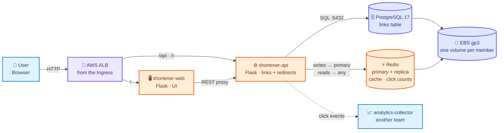

# Architecture — Project 03, URL Shortener on EKS

Design record. Written **before** the stage READMEs, as
[CONTRIBUTING §2](../../CONTRIBUTING.md#2-design-before-you-write-yaml) requires.

---

## 1. Design decisions

| Decision | Why |
|---|---|
| **EKS, not Kind** | Everything this project teaches behaves differently on a real cloud cluster: EBS volumes live in one availability zone, an Ingress creates a real ALB that health-checks pod IPs itself, a new cluster has **no default StorageClass**, and the DNS search list ends in `ec2.internal`. Simulating those locally would teach the wrong failure modes. |
| **Two datastores with different jobs** | PostgreSQL is the source of truth; Redis is a cache plus click counters. Losing Redis must *degrade* the product, not break it. That asymmetry decides readiness (PostgreSQL only), error handling (every Redis call may fail) and storage (both persist, for different reasons). |
| **Redis primary + replica, roles chosen by ordinal** | This is what makes per-pod DNS *required* rather than decorative. The replica must replicate from `redis-0` by a stable name, and writes must reach `redis-0` specifically — a load-balanced Service sends half of them to a read-only replica. |
| **Dependencies addressed by name from the very first stage** | Stage 03 deploys everything with `postgres`, `redis`, `shortener-api` and `analytics` as hostnames. Nothing registers those names, so the opening failure is `NXDOMAIN`. That turns a Service from "a load balancer" into "the thing that puts a name in DNS". |
| **An analytics collector in another namespace, reached through ExternalName** | A genuine other-owner dependency. The shortener's config says `analytics`; an ExternalName Service in `url-shortener` owns where that alias points. Re-pointing it needs no config change and no rollout. |
| **`CODE_LENGTH` validated on every redirect** | Rejecting malformed codes before touching a datastore is reasonable on its own, and it makes config drift an *outage you can see*: two replicas with different values reject each other's links. |
| **Mutable ConfigMap first, then immutable + versioned** | The drift failure is only visible if the learner edits a live, mutable ConfigMap first. Versioned immutable names then make a config change a rollout — and make `rollout undo` restore the old config. Stage 19 automates exactly this with a `configMapGenerator`. |
| **Redis password injected at start-up into an in-memory file** | Redis reads its password from its config file, which is a ConfigMap. Passing it on the command line would print it in `ps` and `kubectl describe`. The start-up script appends it from the Secret into a `medium: Memory` emptyDir. |
| **Migrations with an advisory lock, then an init container** | Every replica migrates on start-up through stage 09; the lock makes that safe. Stage 11 moves migration into an init container and is explicit that init containers run *per pod* — the lock is still what prevents the race. |
| **Short-lived connections to both datastores** | A pool would stick to one backend and hide misrouting. One connection per call means every request goes back through DNS and the Service, so the READONLY failure shows up on roughly half of all requests immediately. |
| **ALB with `target-type: ip`** | The VPC CNI gives pods VPC addresses, so the ALB targets pods directly. That makes the ALB's own health checks and the pod readiness gate part of the lesson. |
| **No `host:` on the Ingress** | The learner owns no DNS name; the ALB's generated hostname is the address. Project 10 adds Route53, ExternalDNS and ACM. |
| **Stage 10 (LoadBalancer) omitted** | On EKS a `type: LoadBalancer` Service creates an NLB. It is real, but it is a different lesson from this project's, costs another hourly load balancer, and belongs with Project 10. |

---

## 2. High-Level Design (HLD)

### Component responsibilities

| Component | Responsibility | If it disappears |
|---|---|---|
| `shortener-web` | Serve the UI; proxy `/api` and `/r` for port-forward sessions | UI down; links still redirect through the ALB |
| `shortener-api` | Create links; follow links; count clicks; send click events | Total outage |
| `postgres` | Durable `code → URL` mapping | **Total outage** — readiness withdraws every API pod |
| `redis-0` (primary) | Cache writes and click counters | Redirects still work (cache miss → PostgreSQL); clicks go uncounted |
| `redis-1` (replica) | Serves reads through `Service/redis` | Reads fall back to `redis-0` through the same Service |
| `analytics-collector` | Receives click events | Nothing user-visible; the API records failures in `/api/info` |

### Configuration contract

| Variable | Consumed by | Source, by stage |
|---|---|---|
| `POSTGRES_HOST` | api, init container | 03 literal `postgres` (NXDOMAIN) → 04 resolvable → 05 ConfigMap FQDN |
| `REDIS_WRITE_HOST` | api | 03 `redis` → 05 ConfigMap → **08 `redis-0.redis-headless…`** |
| `REDIS_READ_HOST` | api | 03 `redis` → 05 ConfigMap (unchanged in 08) |
| `ANALYTICS_URL` | api | 03 `http://analytics/events` → 04 ExternalName makes it resolve → 05 ConfigMap |
| `CODE_LENGTH`, `CACHE_TTL_SECONDS`, `PUBLIC_BASE_URL` | api | 03 literal → 05 mutable ConfigMap (drift!) → 05 immutable `-v1` |
| `CONFIG_VERSION` | api | Set by the ConfigMap itself — `mutable`, `v1`, `v2`, `final` |
| `SHORTENER_API_URL` | web | 03 literal → 05 ConfigMap |
| `POSTGRES_PASSWORD`, `REDIS_PASSWORD` | api, postgres, redis | 03 plaintext → 06 two separate Secrets |
| `RUN_MIGRATIONS` | api | default `true` → 11 `false` (the init container migrates) |
| `POD_NAME` | api, web, collector | Downward API |

---

## 3. Low-Level Design (LLD)

The full diagram is in [`../README.md` §7](../README.md#7-kubernetes-architecture--lld); its source is
[`architecture.mmd`](architecture.mmd).

### Object inventory (final state)

| Kind | Name | Namespace | Stage |
|---|---|---|---|
| Namespace | `url-shortener` (with ALB readiness-gate label) | — | 00, 11 |
| Namespace | `analytics` | — | 00 |
| StorageClass | `url-shortener-gp3` | *cluster-scoped* | 07 |
| Secret | `postgres-secret`, `redis-secret` | url-shortener | 06 |
| ConfigMap | `shortener-config-<hash>`, `redis-config-<hash>` (generated, immutable) | url-shortener | 05 → 19 |
| Service (ClusterIP) | `postgres`, `redis`, `shortener-api`, `shortener-web` | url-shortener | 04 |
| Service (headless) | `postgres-headless`, `redis-headless` | url-shortener | 08 |
| Service (ExternalName) | `analytics` → `analytics-collector.analytics.svc.cluster.local` | url-shortener | 04 |
| Service (ClusterIP) | `analytics-collector` | analytics | 04 |
| StatefulSet | `postgres` (1), `redis` (2) | url-shortener | 08, 11 |
| PVC *(generated)* | `postgres-data-postgres-0`, `redis-data-redis-0`, `redis-data-redis-1` | url-shortener | 08 |
| Deployment | `shortener-api` (2, init container), `shortener-web` (2) | url-shortener | 03 → 11 |
| Deployment | `analytics-collector` (1) | analytics | 03, 11 |
| Ingress | `url-shortener-ingress` → one ALB | url-shortener | 09 |

**Created in AWS by controllers, not by you:** one EBS volume per PVC (EBS CSI driver), one ALB with three
listener rules, two target groups and security groups (AWS Load Balancer Controller). These are what cleanup must
remove, and they are why cleanup order matters.

**Cluster software, installed separately:** EKS add-ons (VPC CNI, CoreDNS, kube-proxy, EBS CSI driver, Pod
Identity agent) from `clusters/eks-lab.yaml`, and the AWS Load Balancer Controller from Helm.

**Teaching artifacts, applied then removed:** the mutable `shortener-config`, `shortener-config-v1/v2`, the
stand-alone `postgres-data` / `redis-data` PVCs and the Deployment versions of both datastores.

---

## 4. Failure domains

| Failure | Blast radius | Recovery |
|---|---|---|
| One API or web pod | None | ReplicaSet recreates; the ALB readiness gate keeps it out until healthy |
| `postgres-0` | **Total** | Pod recreated on a node **in the same AZ as its EBS volume**; ~30–60 s |
| `redis-0` | Degraded: clicks not counted, cache writes fail, redirects still work | Recreated with its volume; AOF replayed |
| `redis-1` | None visible | Recreated; resyncs from `redis-0` |
| An entire AZ | Any datastore whose EBS volume is in that AZ **cannot move** — pods stay `Pending` with a volume node-affinity conflict | Wait for the AZ, or restore from backup in another AZ. EBS is zonal. |
| The ALB controller | Existing ALB keeps serving; changes are not reconciled | Its Deployment recreates it |
| CoreDNS | New connections to any Service name fail; existing connections survive | Its Deployment recreates it |

---

## 5. What this architecture is not

- **Not highly available.** No Redis failover (no Sentinel), one PostgreSQL instance, volumes pinned to single AZs.
- **Not backed up.** EBS snapshots and PostgreSQL dumps are absent.
- **Not secure.** Secrets in Git, plain HTTP, no NetworkPolicy, default ServiceAccounts, and an internet-facing
  ALB that is only as restricted as the `inbound-cidrs` you set.
- **Not resource-managed or observable.** Requests only (plus Redis's memory limit); no HPA, PDB, metrics or
  alerts.

Each gap belongs to a later project. This one is about **service discovery, per-member identity, and
configuration that cannot drift**.
