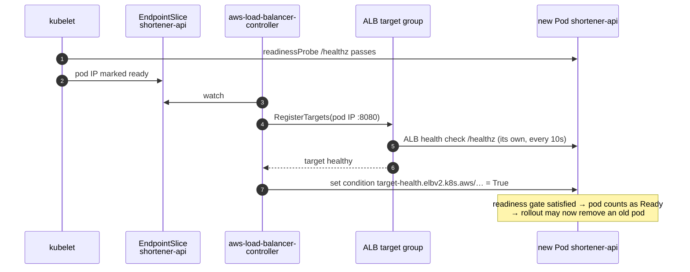

# Request Flow — Project 03

[⬅ Project 03](../README.md)

One click on a short link, traced from the browser to both datastores and back, with the failure point of every
hop named. Open this page when something "just doesn't work": find the hop, run the command.

---

## 1. External request: browser → ALB → API → Redis / PostgreSQL

`GET http://<alb-hostname>/r/Fh6Ip1`

```mermaid
sequenceDiagram
    autonumber
    participant B as 👤 Browser
    participant R53 as AWS DNS
    participant ALB as ALB<br/>(from the Ingress)
    participant A as Pod shortener-api<br/>(a VPC IP)
    participant DNS as CoreDNS<br/>10.100.0.10
    participant RR as Service redis<br/>(ClusterIP, reads)
    participant R0 as Pod redis-0<br/>(primary)
    participant PG as Pod postgres-0
    participant AN as analytics-collector<br/>(namespace analytics)

    B->>R53: resolve k8s-urlshort-….elb.amazonaws.com
    R53-->>B: ALB node IPs (one per AZ)
    B->>ALB: GET /r/Fh6Ip1 (source IP checked against inbound-cidrs)
    ALB->>ALB: rule /r* → target group for shortener-api
    ALB->>A: HTTP straight to a HEALTHY pod IP (target-type ip)
    A->>DNS: A? redis.url-shortener.svc.cluster.local
    DNS-->>A: 10.100.220.41 (ClusterIP)
    A->>RR: GET link:Fh6Ip1
    RR-->>A: cache HIT → target URL (from redis-0 OR redis-1)
    A->>DNS: A? redis-0.redis-headless.url-shortener.svc.cluster.local
    DNS-->>A: 192.168.6.124 (that pod, and only that pod)
    A->>R0: INCR clicks:Fh6Ip1
    R0-->>A: 19
    A--)AN: POST http://analytics/events (async; CNAME → analytics-collector.analytics)
    A-->>ALB: 302 Location: … · X-Cache: HIT · X-Click-Counted: true
    ALB-->>B: 302
```

On a **cache miss** the API reads `SELECT target_url FROM links WHERE code = …` from `postgres-0` through
`Service/postgres`, then `SET link:Fh6Ip1 … EX 300` on `redis-0`.

---

## 2. What the ALB actually targets



▸ **There is no kube-proxy and no ClusterIP in the ALB's path.** The controller reads the Service's
EndpointSlices and registers pod IPs directly. The Service is how the controller *finds* pods; it is not how
traffic *reaches* them.

▸ **Two independent health checks.** The kubelet's readiness probe decides EndpointSlice membership; the ALB's
own health check decides whether it sends traffic. The readiness gate (stage 11) ties the two together.

---

## 3. Hop-by-hop, with the failure at each one

| # | Hop | Fails when | You see | First command |
|---|---|---|---|---|
| 1 | Browser → ALB hostname | Ingress has no address yet (2–3 min), or the controller never reconciled it | DNS failure / no `ADDRESS` | `kubectl describe ingress url-shortener-ingress -n url-shortener` |
| 2 | ALB security group | Your IP is not in `inbound-cidrs` | Connection **times out** (no response at all) | `curl -s https://checkip.amazonaws.com` vs the annotation |
| 3 | Listener rule | No rule matches the path | ALB **404** (plain body) | `kubectl get ingress -o yaml` |
| 4 | Target group | No healthy targets | ALB **503** `Service Temporarily Unavailable` | `kubectl get endpointslices`, `aws elbv2 describe-target-health` |
| 5 | → pod IP | Wrong port / app not listening | ALB **502** `Bad Gateway` | `kubectl get svc shortener-api -o yaml` (targetPort) |
| 6 | API → CoreDNS | Name does not exist, wrong namespace, headless name typo | `failed to resolve host …` in the JSON body | `kubectl exec deploy/shortener-api -- python -c "import socket;print(socket.gethostbyname('redis'))"` |
| 7 | API → `Service/redis` (read) | No Redis endpoint ready | `clicks: null`, `X-Cache: MISS` — **redirect still works** | `kubectl get endpointslices -l kubernetes.io/service-name=redis` |
| 8 | API → `redis-0` (write) | Write host is load-balanced / points at a replica | `X-Click-Counted: false`, `X-Click-Error: You can't write against a read only replica.` | `curl …/api/info` → `redis_write.role` |
| 9 | API → PostgreSQL | Pod down, schema missing, password mismatch | **503** JSON `cannot reach postgres at …` / `relation "links" does not exist` | `kubectl logs statefulset/postgres`, `kubectl logs <api-pod> -c migrate` |
| 10 | PostgreSQL → EBS | Volume in another AZ from any schedulable node | `postgres-0` **Pending**: `volume node affinity conflict` | `kubectl describe pod postgres-0`, `kubectl get pv -o yaml` (nodeAffinity) |
| 11 | API → analytics | ExternalName target wrong / collector down | Nothing user-visible; `stats.analytics_failed` climbs | `curl …/api/info` → `stats` |

---

## 4. Reading the failure from the response alone

| You get | From | It means |
|---|---|---|
| **Timeout**, no response | the ALB security group | Your source IP is not allowed (`inbound-cidrs`) — or the ALB does not exist |
| **404** plain HTML, no JSON | the ALB | No listener rule matched |
| **404** JSON `is not a valid code` + `expected_length` | the API | Config drift: this pod's `CODE_LENGTH` differs |
| **404** JSON `no such link` | the API | Everything works; the code really is unknown |
| **502** `Bad Gateway` | the ALB | Target registered but refused / wrong port |
| **502** text `cannot reach the shortener API at …` | `shortener-web` | The web tier cannot resolve or reach `shortener-api` |
| **503** `Service Temporarily Unavailable` | the ALB | No healthy targets in the target group |
| **503** JSON `cannot reach postgres at …` | the API | The API is up; PostgreSQL is not reachable |
| **302** with `X-Click-Counted: false` | the API | Redirect fine; the Redis write failed — read `X-Click-Error` |

**The pattern:** every tier names what *it* could not reach. Read the body and headers, not just the code.

---

## 5. DNS names in this project (EKS)

`/etc/resolv.conf` inside every pod:

```
search url-shortener.svc.cluster.local svc.cluster.local cluster.local ec2.internal
nameserver 10.100.0.10
options ndots:5
```

| Name, as typed in the `url-shortener` namespace | Resolves to | Why |
|---|---|---|
| `postgres` | ClusterIP `10.100.x.x` | Search list appends `url-shortener.svc.cluster.local` |
| `postgres.url-shortener` | ClusterIP | Search list appends `svc.cluster.local` |
| `postgres.url-shortener.svc.cluster.local` | ClusterIP | Fully qualified — works from any namespace |
| `analytics` | CNAME → `analytics-collector.analytics.svc.cluster.local` → ClusterIP | ExternalName Service |
| `analytics-collector` | **NXDOMAIN** | It lives in `analytics`; the search list only completes *your* namespace |
| `analytics-collector.analytics` | ClusterIP | Partially qualified with the right namespace |
| `redis` | One ClusterIP | Normal Service — hides which member you get |
| `redis-headless` | **Both pod IPs** | Headless: no virtual IP |
| `redis-0.redis-headless` | **Only `redis-0`'s IP** | Per-pod record, created because `serviceName: redis-headless` |
| `redis-0.redis` | **NXDOMAIN** | Per-pod records exist only under the *headless* Service |

> ⚠️ **Test DNS with the resolver the application uses.** busybox `nslookup` does not apply the search list to
> names that contain a dot, so it reports `analytics-collector.analytics` as NXDOMAIN while the application
> resolves it fine. From inside an application pod:
>
> ```bash
> kubectl exec deploy/shortener-api -n url-shortener -- \
>   python -c "import socket; print(socket.gethostbyname('analytics-collector.analytics'))"
> ```
