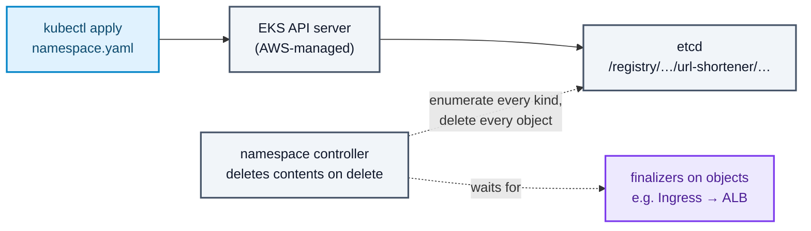
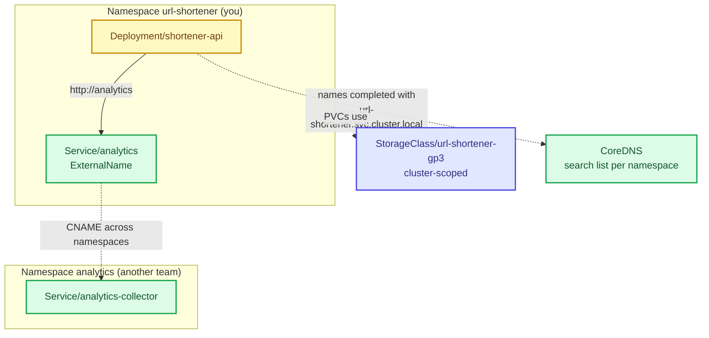

# Stage 00 — Namespaces

[⬅ Project 03](../../README.md) · Stage 1 of 10

**00 Namespace** › [03 Deployments](../03-deployments/README.md) › [04 Services](../04-services/README.md) › [05 ConfigMaps](../05-configmaps/README.md) › [06 Secrets](../06-secrets/README.md) › [07 Storage](../07-storage/README.md) › [08 StatefulSets](../08-statefulsets/README.md) › [09 Ingress](../09-ingress/README.md) › [11 Probes](../11-health-checks/README.md) › [19 Final](../19-final/README.md)

> **The problem:** you are about to put a URL shortener on a shared EKS cluster — two Deployments, two
> datastores, six Services, two Secrets, an ALB and three EBS volumes. It also depends on an analytics service
> that belongs to *another team*. Put everything in `default` and you cannot delete just this project, cannot
> tell your objects from theirs, and your `Service/redis` collides with the next team's `Service/redis`.

---

## 1. WHY does this resource exist?

A cluster is one API shared by many applications and many people. Without partitions:

| Problem | What it looks like on a shared EKS cluster |
|---|---|
| **Name collisions** | Names are unique *per namespace*. Two applications that both want `Service/redis` cannot share one. |
| **No ownership boundary** | Nothing distinguishes the shortener's collector from the analytics team's — except a naming convention someone will break. |
| **No cleanup story** | "Remove this project" means remembering every kind you created. Miss one Ingress and its ALB bills forever. |
| **No policy boundary** | RBAC Roles, ResourceQuotas, LimitRanges and NetworkPolicies are all *namespaced*. No namespace, nothing to attach them to. |

This project creates **two** namespaces, on purpose:

| Namespace | Owner | Contains |
|---|---|---|
| `url-shortener` | you | web, API, PostgreSQL, Redis, the Ingress |
| `analytics` | "another team" | the analytics collector the shortener sends click events to |

The second one is what makes stage 04's cross-namespace DNS and ExternalName lesson honest: the shortener cannot
reach the collector by a short name, and it should not have to know where the collector lives.

### When do you use one — and when not?

| Use a namespace | Don't |
|---|---|
| Per application or team | As a hard security boundary — it is a **soft** one until RBAC and NetworkPolicy make it harder |
| Per environment on a shared cluster (`shortener-dev`, `shortener-prod`) | To separate every microservice of one app — it only lengthens DNS names |
| Wherever you need quota, RBAC or policy to attach | For cluster-scoped objects — they have no namespace to go in |

> **Not everything is namespaced.** Nodes, PersistentVolumes, StorageClasses, IngressClasses, ClusterRoles —
> and namespaces themselves — are cluster-scoped. This project creates one cluster-scoped object of its own
> (`StorageClass/url-shortener-gp3`, stage 07) and causes three more to exist (the PVs). That is why its cleanup
> has more than one step. Check any kind:
>
> ```bash
> kubectl api-resources --namespaced=false | head -20
> ```

---

## 2. WHAT is it?

A Namespace is **a named scope for Kubernetes objects, and the unit that policy attaches to.**

> **Analogy:** a folder. `/url-shortener/redis` and `/payments/redis` are different files with the same name, and
> you can delete one folder without touching the other.
>
> **Technically:** a Namespace scopes *object names* and nothing else. It is **not** a network boundary (a pod in
> `url-shortener` can connect to a pod in `analytics` right now), **not** a resource boundary (until a
> ResourceQuota exists) and **not** an access boundary (until RBAC is scoped to it).

### Namespaces are part of every DNS name

This is the reason namespaces matter more in *this* project than anywhere so far:

```
<service>.<namespace>.svc.cluster.local

postgres.url-shortener.svc.cluster.local
analytics-collector.analytics.svc.cluster.local
```

Every pod gets a DNS **search list** built from its own namespace. A pod in `url-shortener` can say `postgres`
and mean `postgres.url-shortener.svc.cluster.local`. It **cannot** say `analytics-collector` and reach the
`analytics` namespace. Stage 04 takes that apart.

### What every EKS cluster starts with

```bash
kubectl get namespaces
```

| Namespace | Contains |
|---|---|
| `default` | Where objects go if you do not say otherwise |
| `kube-system` | CoreDNS, kube-proxy, the VPC CNI (`aws-node`), the EBS CSI driver, the Pod Identity agent, and — once installed — the AWS Load Balancer Controller |
| `kube-public` | World-readable cluster info |
| `kube-node-lease` | One Lease per node: the heartbeat the control plane uses to notice a dead EC2 instance |

On EKS you never see the control plane itself — the API server and etcd run in an AWS-managed account. What you
see in `kube-system` is only what runs **on your nodes**.

---

## 3. HOW does it work?



1. A Namespace is an ordinary API object stored in etcd.
2. Namespaced objects are **keyed by namespace** in etcd. That is the whole mechanism behind "names are unique
   per namespace".
3. Deleting a namespace sets it to `Terminating` and hands the work to the **namespace controller**, which lists
   every namespaced API type, deletes every object it finds, and only then removes the namespace.
4. Objects with **finalizers** are not removed until something clears the finalizer. On EKS that matters a lot:
   the Ingress you create in stage 09 carries `ingress.k8s.aws/resources`, which the AWS Load Balancer Controller
   clears only **after** it has deleted the real ALB. If that controller is not running, the namespace hangs in
   `Terminating` — and the ALB keeps billing.

---

## 4. Manifest

Two files: [`01-url-shortener-namespace.yaml`](01-url-shortener-namespace.yaml) and
[`02-analytics-namespace.yaml`](02-analytics-namespace.yaml).

```yaml
apiVersion: v1
kind: Namespace
metadata:
  name: url-shortener
  labels:
    app.kubernetes.io/name: url-shortener
    app.kubernetes.io/part-of: url-shortener
    app.kubernetes.io/managed-by: kubectl
  annotations:
    kubernetes.io/description: "URL Shortener — web, API, PostgreSQL and Redis"
---
apiVersion: v1
kind: Namespace
metadata:
  name: analytics
  labels:
    app.kubernetes.io/part-of: analytics      # a different owner
```

---

## 5. Manifest breakdown

| Field | Value | What it does | What breaks if it's wrong |
|---|---|---|---|
| `metadata.name` | `url-shortener` | The scope, and the middle of every DNS name | Must be a DNS label: lowercase, ≤63 chars, no dots. A typo here means every FQDN in later ConfigMaps is wrong |
| `metadata.name` | `analytics` | The other team's scope | Rename it and the ExternalName target in stage 04 no longer exists |
| `labels` | `app.kubernetes.io/*` | Lets you select namespaces: `kubectl get ns -l app.kubernetes.io/part-of=url-shortener` | Nothing breaks — you just lose the ability to find them by label |
| `labels.part-of` | different per namespace | Records **ownership** | Nothing technical; the separation is organisational and that is the point |
| `annotations.kubernetes.io/description` | one line | What the namespace is for | Nothing; required by this repository's conventions |

> Stage 11 adds one more label to `url-shortener`: `elbv2.k8s.aws/pod-readiness-gate-inject: enabled`. Labels on
> a namespace can change controller behaviour for every pod inside it — a namespace is not *only* a name.

---

## 6. Apply

From the project directory, with `kubectl` pointed at your EKS cluster:

```bash
kubectl config current-context        # must be the lab cluster — never a production context
kubectl apply -f manifests/00-namespace/
```

▸ **What it does:** `apply` is declarative — create if missing, update if different, no-op if identical. Pointing
it at a directory applies every `.yaml` in it, in filename order.

▸ **Expected output:**

```
namespace/url-shortener created
namespace/analytics created
```

> ⚠️ **Check the context first, every time.** An engineer's kubeconfig often holds a production EKS context next
> to the lab. `kubectl` acts on whichever is *current*, and it will not ask.

---

## 7. Validate

```bash
kubectl get namespaces url-shortener analytics --show-labels
```

```
NAME            STATUS   AGE   LABELS
url-shortener   Active   10s   app.kubernetes.io/instance=url-shortener,…,kubernetes.io/metadata.name=url-shortener
analytics       Active   10s   app.kubernetes.io/instance=analytics,…,kubernetes.io/metadata.name=analytics
```

| What you see | Means |
|---|---|
| `Active` | ✅ ready to hold objects |
| `kubernetes.io/metadata.name=…` | ✅ added automatically by the API server — you did not write it. NetworkPolicies select namespaces by it |
| `Terminating` | A previous delete is still waiting on a finalizer — see §9 |

---

## 8. Observe the mechanism

### Names are scoped; the same name can exist twice

```bash
kubectl create configmap demo --from-literal=owner=shortener -n url-shortener
kubectl create configmap demo --from-literal=owner=analytics -n analytics
kubectl get configmap demo -A
kubectl delete configmap demo -n url-shortener
kubectl delete configmap demo -n analytics
```

▸ Two objects called `demo`, no conflict. `-A` (`--all-namespaces`) shows both with a NAMESPACE column.

### A namespace is not a network boundary

```bash
kubectl run probe --rm -i --restart=Never --image=busybox:1.36 -n url-shortener -- \
  sh -c 'cat /etc/resolv.conf'
```

```
search url-shortener.svc.cluster.local svc.cluster.local cluster.local ec2.internal
nameserver 10.100.0.10
options ndots:5
```

▸ The **search list starts with the pod's own namespace**. That line is the entire reason `postgres` will work
as a hostname in stage 04 and `analytics-collector` will not. The trailing `ec2.internal` comes from the VPC's
DHCP options — an EKS detail you will not see on a laptop cluster. `10.100.0.10` is CoreDNS's ClusterIP on EKS.

### The objects you did not create

```bash
kubectl get pods -n kube-system
```

▸ `aws-node` (the VPC CNI) on every node, `coredns`, `kube-proxy`, `ebs-csi-controller` / `ebs-csi-node`,
`eks-pod-identity-agent`. Every one of them will matter before this project is over.

---

## 9. Break it

### Break 1 — the wrong namespace, silently

```bash
kubectl config set-context --current --namespace=analytics
kubectl get pods
kubectl config set-context --current --namespace=default     # undo
```

**Symptom:** `No resources found in analytics namespace.` — or, worse, somebody else's pods.

**Root cause:** every command without `-n` uses the context's default namespace. It is invisible state.

**Fix / habit:** this repository passes `-n` explicitly in every command, and every manifest sets
`metadata.namespace`. Never rely on the context default in anything you write down.

### Break 2 — a namespace that will not die

This one you will meet for real during cleanup if you get the order wrong:

```bash
kubectl get namespace url-shortener -o jsonpath='{.status.conditions}' | python3 -m json.tool
```

**Symptom (after deleting the load balancer controller before the Ingress):** the namespace stays `Terminating`,
and the conditions say `Some resources are remaining: ingresses.networking.k8s.io has 1 resource instances` with
`Some content in the namespace has finalizers remaining: ingress.k8s.aws/resources`.

**Root cause:** the finalizer is a promise — "the controller will delete the ALB, then remove me". The controller
that made the promise is gone.

**Fix:** reinstall the controller and let it finish. Removing the finalizer by hand
(`kubectl patch ingress … -p '{"metadata":{"finalizers":null}}' --type=merge`) unblocks the namespace **and
orphans the ALB**, which you must then delete in the EC2 console. Stage 09 and `scripts/cleanup.sh` avoid this by
deleting the Ingress first.

---

## 10. How it interacts



---

## 11. Production notes

> 🧪 **DEMO / LEARNING CONFIGURATION**
> Two namespaces with labels and nothing else: no RBAC, no quotas, no NetworkPolicy, no Pod Security labels.
> "Another team" is you.

> 🏭 **PRODUCTION CONSIDERATIONS**
> - **Attach policy, or the namespace is just a folder.** RoleBindings scoped to the namespace, a ResourceQuota,
>   a LimitRange, a default-deny NetworkPolicy (Projects 04, 07).
> - **Pod Security Standards** via namespace labels — `pod-security.kubernetes.io/enforce: restricted` (Project 07).
> - **On EKS, map IAM to namespaces** with EKS access entries so a team's IAM role can only act in its own
>   namespace.
> - **Cost allocation:** label namespaces with team and cost-centre; EKS split cost allocation data can then
>   attribute EC2 spend to them.
> - **Hard multi-tenancy needs separate clusters or accounts.** A namespace shares nodes, kernel and the API
>   server with everyone else.

---

## 12. The next problem

The scopes exist and are empty. Deploy the application into them the way most people would — each component as
a Deployment, each dependency addressed by an obvious hostname: `postgres`, `redis`, `shortener-api`,
`analytics`.

Nothing in the cluster answers to any of those names yet. Find out what the pods do about that.

→ **[Stage 03 — Deployments](../03-deployments/README.md)**

---

## 📚 Official documentation

Everything above is self-contained — these are for going deeper, not for filling gaps.
*(All links verified 2026-09-13.)*

| Reference | What it adds |
|---|---|
| [Namespaces](https://kubernetes.io/docs/concepts/overview/working-with-objects/namespaces/) | Which objects are namespaced, and namespaces' role in DNS |
| [DNS for Services and Pods](https://kubernetes.io/docs/concepts/services-networking/dns-pod-service/) | How the namespace becomes part of every name and every search list |
| [What is Amazon EKS?](https://docs.aws.amazon.com/eks/latest/userguide/what-is-eks.html) | What AWS manages (control plane) versus what runs on your nodes |
| [Amazon EKS add-ons](https://docs.aws.amazon.com/eks/latest/userguide/eks-add-ons.html) | Where the `kube-system` components on your cluster come from |

---

| ◀ Previous | ▲ Up | Next ▶ |
|---|:--:|---:|
| ◀ *(first stage)* | [Project 03](../../README.md) · [Manual steps](../../scripts/manual-steps.md) | **[03 Deployments](../03-deployments/README.md)** ▶ |
