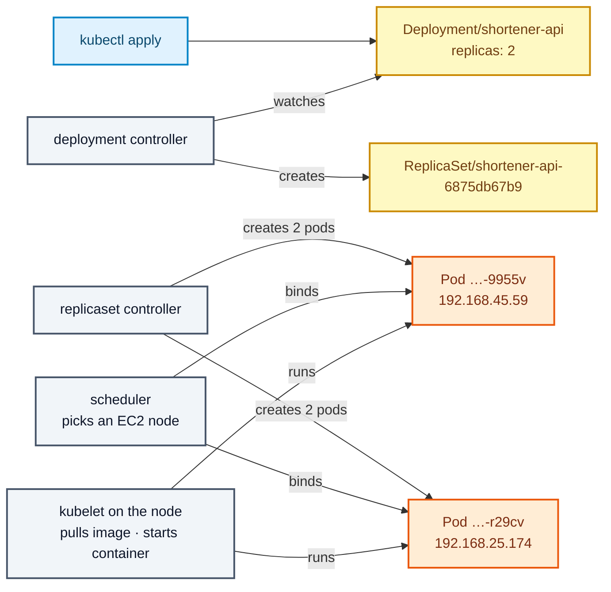
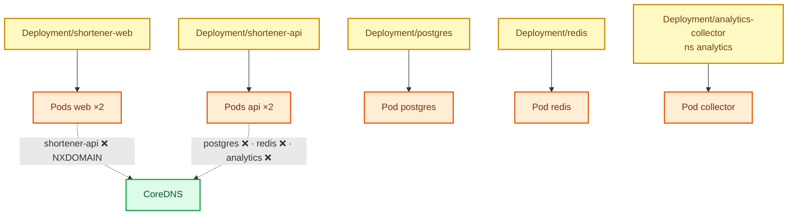

# Stage 03 — Deployments

[⬅ Project 03](../../README.md) · Stage 2 of 10

[00 Namespace](../00-namespace/README.md) › **03 Deployments** › [04 Services](../04-services/README.md) › [05 ConfigMaps](../05-configmaps/README.md) › [06 Secrets](../06-secrets/README.md) › [07 Storage](../07-storage/README.md) › [08 StatefulSets](../08-statefulsets/README.md) › [09 Ingress](../09-ingress/README.md) › [11 Probes](../11-health-checks/README.md) › [19 Final](../19-final/README.md)

> **The problem:** two empty namespaces. The shortener has five components — a UI, an API, PostgreSQL, Redis and
> (in the other namespace) an analytics collector — and nothing is running. Pods on their own would not come back
> when an EC2 node is replaced, and could not be updated without downtime.

---

## 1. WHY does this resource exist?

A bare Pod is bound to one node for its whole life. On EKS nodes are EC2 instances, and they go away: the managed
node group replaces them on AMI updates, Spot reclaims them, AZ rebalancing terminates them. A bare Pod on a
terminated instance is simply gone.

A **Deployment** declares *"keep N copies of this pod template running, and change them gradually"*:

| Without a Deployment | With one |
|---|---|
| A pod on a terminated node is gone | The ReplicaSet notices fewer than N pods and creates a replacement on a surviving node |
| Changing the image means deleting and recreating | A rolling update: new pods up, old pods down, a few at a time |
| A bad release has no undo | `kubectl rollout undo` returns to the previous ReplicaSet |
| Scaling means creating pods by hand | `replicas: 2`, reconciled forever |

### When do you use one — and when not?

| Deployment | Not a Deployment |
|---|---|
| Stateless tiers: `shortener-api`, `shortener-web`, `analytics-collector` | Workloads whose replicas need distinct identities or their own disks — **StatefulSet** (stage 08) |
| Anything where "replace any replica with a fresh one" is safe | Work that runs to completion — Job (Project 06) |
|  | One pod per node — DaemonSet (Project 08) |

> This stage deploys **PostgreSQL and Redis as Deployments too**, deliberately. It works today and fails in two
> different, instructive ways later (stages 06 and 07). You will replace both with StatefulSets once you have felt
> why.

---

## 2. WHAT is it?

A Deployment is **a controller object that manages ReplicaSets, which manage Pods, to converge on a declared pod
template and replica count.**

> **Analogy:** a shift supervisor with a roster. The roster says "two cashiers, uniform version 3". If a cashier
> leaves, someone is hired. When the uniform changes, the supervisor swaps people over one at a time so the tills
> are never all closed.
>
> **Technically:** the Deployment owns ReplicaSets; each ReplicaSet corresponds to one *version* of the pod
> template, identified by the `pod-template-hash` label. A rollout scales a new ReplicaSet up while scaling the old
> one down.

### Every dependency is a hostname

The single most important thing in this stage's manifests is not a Deployment field. It is these values:

```yaml
- name: POSTGRES_HOST
  value: "postgres"
- name: REDIS_WRITE_HOST
  value: "redis"
- name: ANALYTICS_URL
  value: "http://analytics/events"
```

and in the web tier, `SHORTENER_API_URL: "http://shortener-api:8080"`. That is how every real application is
configured — by **name**. Nothing in Kubernetes turns a Deployment's name into a DNS name. Whether those names
resolve is the question this stage leaves open.

### The five components

| Deployment | Namespace | Image | Replicas | Why that many |
|---|---|---|---|---|
| `shortener-api` | url-shortener | `cloudprakhargupta/url-shortener:api-1.0.0` | 2 | Stateless — any replica can serve any request |
| `shortener-web` | url-shortener | `…:web-1.0.0` | 2 | Stateless |
| `postgres` | url-shortener | `postgres:17.5-alpine` | 1 | Two would be two unrelated databases |
| `redis` | url-shortener | `redis:8.2.9-alpine` | 1 | Same, for now |
| `analytics-collector` | **analytics** | `…:collector-1.0.0` | 1 | Counts in memory (a stand-in) |

---

## 3. HOW does it work?



1. `apply` stores the Deployment. The **deployment controller** hashes the pod template and creates a ReplicaSet
   named after that hash.
2. The **replicaset controller** creates pods until the count matches.
3. The **scheduler** picks a node for each pod — on EKS, one of the managed node group's EC2 instances.
4. The **kubelet** on that node asks the container runtime to **pull the image from the registry**. There is no
   other way for an image to reach an EKS node.
5. The **VPC CNI** (`aws-node`) gives the pod an IP address from the node's subnet — a **real VPC address**
   (`192.168.x.x` here), not an overlay IP. Stage 09's ALB will send traffic straight to these.

**Where in AWS is my pod?** On an EC2 instance in one availability zone:

```bash
kubectl get pods -n url-shortener -o wide
kubectl get nodes -L topology.kubernetes.io/zone
```

---

## 4. Manifest

Five files: [`shortener-api-deployment.yaml`](shortener-api-deployment.yaml),
[`shortener-web-deployment.yaml`](shortener-web-deployment.yaml), [`postgres-deployment.yaml`](postgres-deployment.yaml),
[`redis-deployment.yaml`](redis-deployment.yaml), [`analytics-collector-deployment.yaml`](analytics-collector-deployment.yaml).

The API, trimmed:

```yaml
apiVersion: apps/v1
kind: Deployment
metadata:
  name: shortener-api
  namespace: url-shortener
spec:
  replicas: 2
  selector:
    matchLabels:
      app.kubernetes.io/name: shortener-api
      app.kubernetes.io/instance: shortener-api
  template:
    metadata:
      labels: { … same two labels, plus component/part-of/version … }
    spec:
      containers:
        - name: shortener-api
          image: cloudprakhargupta/url-shortener:api-1.0.0
          imagePullPolicy: IfNotPresent
          ports:
            - name: http
              containerPort: 8080
          env:
            - name: POSTGRES_HOST
              value: "postgres"             # ← a name. Does it exist?
            - name: REDIS_WRITE_HOST
              value: "redis"
            - name: ANALYTICS_URL
              value: "http://analytics/events"
            - name: POSTGRES_PASSWORD       # ⚠️ plaintext until stage 06
              value: "dev-password-not-for-production"
            - name: CODE_LENGTH
              value: "6"
            - name: POD_NAME                # Downward API
              valueFrom:
                fieldRef:
                  fieldPath: metadata.name
          resources:
            requests: { cpu: "50m", memory: "96Mi" }
```

---

## 5. Manifest breakdown

| Field | Value | What it does | What breaks if it's wrong |
|---|---|---|---|
| `spec.replicas` | `2` | Desired pod count | `0` = deliberately stopped. Two PostgreSQL replicas = two unrelated empty databases |
| `spec.selector.matchLabels` | name + instance | Which pods this Deployment owns | **Immutable.** Must match the template labels or the API server rejects the object |
| `template.metadata.labels` | 5 labels | Stamped on every pod | Remove `name`/`instance` and the selector matches nothing |
| `image` | `…:api-1.0.0` | What the kubelet pulls | A tag never pushed ⇒ `ErrImagePull` → `ImagePullBackOff` |
| `imagePullPolicy` | `IfNotPresent` | Pull only if the node lacks this tag | `Always` adds a registry call per start; with `:latest` it hides which version runs |
| `ports[].name` | `http` | Names the port | Services and probes refer to the **name**; renaming it breaks them |
| `env[].value` | `postgres`, `redis`… | Plain literals | Values are fixed into the pod at start — changing them is a rollout |
| `env[].valueFrom.fieldRef` | `metadata.name` | Downward API: the pod's own name | Wrong `fieldPath` ⇒ the pod is rejected |
| `resources.requests` | small | What the scheduler reserves on a node | Too large ⇒ `Pending` with `Insufficient cpu` on a 2 × t3.medium cluster |
| `namespace` (collector) | `analytics` | Places it with its owner | Put it in `url-shortener` and stage 04's cross-namespace lesson disappears |

---

## 6. Apply

```bash
kubectl apply -f manifests/03-deployments/
kubectl rollout status deployment/postgres -n url-shortener --timeout=180s
kubectl rollout status deployment/redis -n url-shortener --timeout=180s
kubectl get pods -n url-shortener -o wide
kubectl get pods -n analytics
```

▸ **What it does:** creates five Deployments. `rollout status` blocks until the desired replicas are available —
the right way to wait, instead of `sleep`. `-o wide` adds pod IP and node.

▸ **Expected output:** seven pods in `url-shortener`, one in `analytics`, all `Running`, spread across both nodes,
with `192.168.x.x` VPC addresses.

▸ **If it fails:** `ImagePullBackOff` — the image tag is not in the registry (`docker manifest inspect <image>`).
`Pending` — `kubectl describe pod` shows the scheduler's reason.

---

## 7. Validate

```bash
kubectl get deployments,replicasets -n url-shortener
```

```
NAME                            READY   UP-TO-DATE   AVAILABLE
deployment.apps/postgres        1/1     1            1
deployment.apps/redis           1/1     1            1
deployment.apps/shortener-api   2/2     2            2
deployment.apps/shortener-web   2/2     2            2
```

Everything says `Running`, `READY`. **Now ask the application:**

```bash
kubectl logs deployment/shortener-api -n url-shortener --tail=3
```

```
level=WARNING pod=shortener-api-6875db67b9-9955v logger=migrations msg=database not reachable attempt=16/30 err=failed to resolve host 'postgres': [Errno -2] Name or service not known
level=WARNING pod=shortener-api-6875db67b9-9955v logger=migrations msg=database not reachable attempt=17/30 err=failed to resolve host 'postgres': [Errno -2] Name or service not known
```

| What you see | Means |
|---|---|
| `READY 2/2` | The **containers** started. Kubernetes knows nothing more yet — no probes exist until stage 11 |
| `failed to resolve host 'postgres'` | The name does not exist in DNS. The database is running two metres away and cannot be found |
| `Name or service not known` | The resolver got **NXDOMAIN** for every search-list expansion of `postgres` |

---

## 8. Observe the mechanism

### Try the product

```bash
kubectl port-forward -n url-shortener deployment/shortener-web 8080:8080 &
sleep 3
curl -s -X POST localhost:8080/api/links -H 'Content-Type: application/json' -d '{"url":"https://kubernetes.io"}'
kill %1
```

```
502 — cannot reach the shortener API at http://shortener-api:8080

HTTPConnectionPool(host='shortener-api', port=8080): … Failed to resolve 'shortener-api' ([Errno -2] Name or service not known)
```

▸ `port-forward` to a **Deployment** picks one of its pods and tunnels through the API server. It works without
any Service — which is exactly why it cannot tell you whether the pods can find *each other*.

### The pods do have addresses — they just have no names

```bash
kubectl get pod -n url-shortener -l app.kubernetes.io/name=postgres -o jsonpath='{.items[0].status.podIP}{"\n"}'
kubectl exec -n url-shortener deployment/shortener-api -- \
  python -c "import socket; print(socket.gethostbyname('postgres'))"
```

▸ The first prints a VPC IP. The second fails with `socket.gaierror: [Errno -2] Name or service not known`. A pod
IP is not published in DNS, and it changes every time the pod is recreated — hardcoding it would break on the
first node replacement.

### A Deployment heals — watch it

```bash
kubectl delete pod -n url-shortener -l app.kubernetes.io/name=shortener-web --wait=false
kubectl get pods -n url-shortener -l app.kubernetes.io/name=shortener-web -w     # Ctrl-C
```

▸ Two replacements appear with new names and new IPs. The ReplicaSet counted fewer than 2 and acted.

### The API keeps trying, then gives up

`application/api/migrations.py` retries 30 times, two seconds apart. After a minute the API logs
`giving up: database never became reachable` and serves requests anyway, each one failing with a JSON 503 that
names `postgres`. A *bounded* retry is deliberate: an unreachable dependency must eventually be loud.

---

## 9. Break it

### Break 1 — an image tag that does not exist

```bash
kubectl set image deployment/shortener-web shortener-web=cloudprakhargupta/url-shortener:web-9.9.9 -n url-shortener
kubectl get pods -n url-shortener -l app.kubernetes.io/name=shortener-web
```

**Symptom:** one new pod `ErrImagePull` → `ImagePullBackOff`; the two old pods stay `Running`.

**Investigate:** `kubectl describe pod <new-pod> -n url-shortener | tail -5` — `manifest unknown`.

**Root cause:** the kubelet on the EC2 node asked Docker Hub for a tag that was never pushed. The old pods keep
serving because a rolling update only removes old pods once new ones are available.

**Fix:** `kubectl rollout undo deployment/shortener-web -n url-shortener`

### Break 2 — "just use the pod IP"

```bash
PG_IP=$(kubectl get pod -n url-shortener -l app.kubernetes.io/name=postgres -o jsonpath='{.items[0].status.podIP}')
kubectl set env deployment/shortener-api -n url-shortener POSTGRES_HOST="$PG_IP"
kubectl rollout status deployment/shortener-api -n url-shortener
kubectl delete pod -n url-shortener -l app.kubernetes.io/name=postgres
sleep 20
kubectl logs deployment/shortener-api -n url-shortener --tail=2
```

**Symptom:** it works — until the PostgreSQL pod is recreated with a new VPC IP, and the API is connecting to an
address that no longer belongs to anything (`connection timed out`).

**Root cause:** pod IPs are ephemeral by design. Anything that caches one is broken by the next reschedule.

**Fix:** `kubectl apply -f manifests/03-deployments/shortener-api-deployment.yaml` — back to the name.

---

## 10. How it interacts



---

## 11. Production notes

> 🧪 **DEMO / LEARNING CONFIGURATION**
> Plaintext passwords in env, databases as Deployments with no storage, no probes, no limits, images on Docker Hub.

> 🏭 **PRODUCTION CONSIDERATIONS**
> - **Images in ECR**, in the cluster's region, pinned by digest; Docker Hub rate-limits anonymous pulls per IP,
>   and a node group behind one NAT gateway shares one IP.
> - **Probes on every container** (stage 11) — `READY 2/2` here meant nothing.
> - **Requests *and* limits**, sized from real usage (Project 05).
> - **Spread replicas across AZs** with topology spread constraints (Project 09). Two replicas on one node are one
>   EC2 failure from an outage.
> - **Never run a database as a Deployment** — you will see why in the next four stages.

---

## 12. The next problem

Every pod is `Running`. The application does not work, because its whole configuration is a list of names —
`postgres`, `redis`, `shortener-api`, `analytics` — and a Deployment registers **nothing** in DNS. The only
addresses that exist are pod IPs, and those change every time a pod is replaced.

The pods need names that exist, stay stable while pods come and go, and spread traffic across replicas — and the
analytics collector needs a name *in this namespace* even though it lives in another one.

→ **[Stage 04 — Services](../04-services/README.md)**

---

## 📚 Official documentation

Everything above is self-contained — these are for going deeper, not for filling gaps.
*(All links verified 2026-09-13.)*

| Reference | What it adds |
|---|---|
| [Deployments](https://kubernetes.io/docs/concepts/workloads/controllers/deployment/) | Rollout mechanics, `maxSurge`/`maxUnavailable`, rollback |
| [Images](https://kubernetes.io/docs/concepts/containers/images/) | Pull policies and how the kubelet resolves image names |
| [Expose pod information through environment variables](https://kubernetes.io/docs/tasks/inject-data-application/environment-variable-expose-pod-information/) | The Downward API used for `POD_NAME` |
| [Amazon EKS managed node groups](https://docs.aws.amazon.com/eks/latest/userguide/managed-node-groups.html) | Why and when EKS replaces your nodes |
| [Pod networking (Amazon VPC CNI)](https://docs.aws.amazon.com/eks/latest/userguide/pod-networking.html) | Why EKS pod IPs are real VPC addresses |

---

| ◀ Previous | ▲ Up | Next ▶ |
|---|:--:|---:|
| ◀ **[00 Namespace](../00-namespace/README.md)** | [Project 03](../../README.md) · [Manual steps](../../scripts/manual-steps.md) | **[04 Services](../04-services/README.md)** ▶ |
