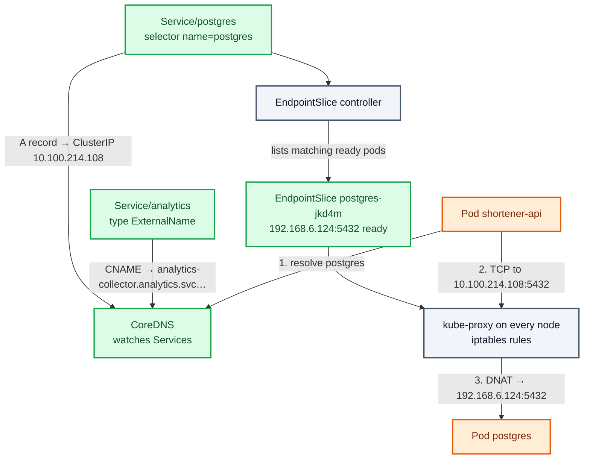
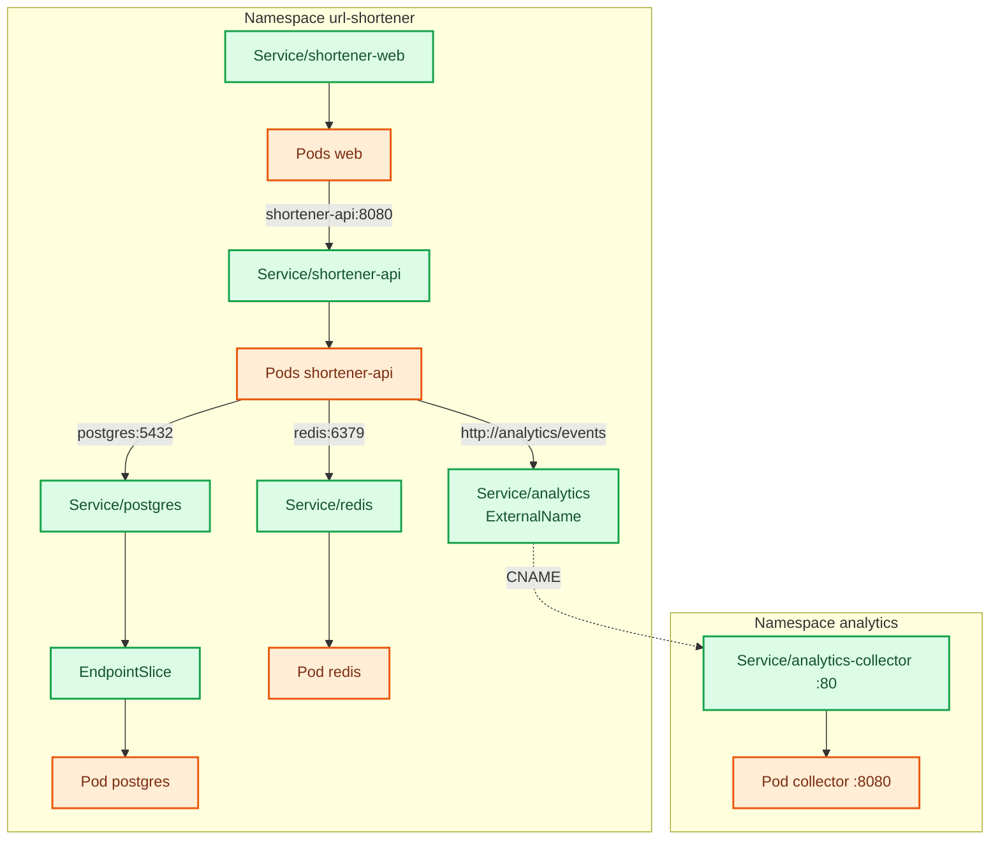

# Stage 04 — Services, CoreDNS and ExternalName

[⬅ Project 03](../../README.md) · Stage 3 of 10

[00 Namespace](../00-namespace/README.md) › [03 Deployments](../03-deployments/README.md) › **04 Services** › [05 ConfigMaps](../05-configmaps/README.md) › [06 Secrets](../06-secrets/README.md) › [07 Storage](../07-storage/README.md) › [08 StatefulSets](../08-statefulsets/README.md) › [09 Ingress](../09-ingress/README.md) › [11 Probes](../11-health-checks/README.md) › [19 Final](../19-final/README.md)

> **The problem:** `failed to resolve host 'postgres'`. Every pod is running; nothing can find anything. The
> application is configured with names, a Deployment registers none, and pod IPs change on every reschedule. And
> `analytics` — the collector — lives in another team's namespace, where a short name could never reach it.

---

## 1. WHY does this resource exist?

Pods are ephemeral and anonymous. A client needs three things pods cannot provide:

| Need | Pods alone | A Service |
|---|---|---|
| **A name in DNS** | None | `postgres.url-shortener.svc.cluster.local` |
| **An address that outlives pods** | Pod IP changes on every recreation | A ClusterIP that exists as long as the Service does |
| **Load balancing across replicas** | Client must know every IP | kube-proxy spreads connections over ready pods |

This stage uses **two different kinds** of Service, because the dependencies are genuinely different:

| Dependency | Where it runs | Service type | What it gives |
|---|---|---|---|
| `postgres`, `redis`, `shortener-api`, `shortener-web` | This namespace | **ClusterIP** | A name, a virtual IP, load balancing |
| `analytics` | Another team's namespace — maybe a SaaS host tomorrow | **ExternalName** | A name in *our* namespace that is a **DNS alias** for wherever *they* are |

### When do you use which?

| Use | For |
|---|---|
| **ClusterIP** | Anything in-cluster that clients reach by name. The default. |
| **ExternalName** | An alias for a DNS name you do not control: another namespace, an RDS endpoint, a SaaS API. |
| **Headless** (`clusterIP: None`) | When clients need the *individual* pod IPs — stage 08. |
| **NodePort / LoadBalancer** | Traffic from outside the cluster. On EKS a LoadBalancer Service creates an NLB; this project uses an Ingress/ALB instead (stage 09). |

---

## 2. WHAT is it?

A Service is **a stable name and virtual IP in front of a set of pods chosen by a label selector** — or, for
`ExternalName`, **a DNS CNAME with no pods at all.**

> **Analogy:** a company switchboard number. Callers dial one number; the switchboard rings whichever employee is
> at a desk. An ExternalName is a speed-dial entry that says "for analytics, dial this *other* company's number" —
> no switchboard, just a lookup.
>
> **Technically:** a ClusterIP Service is (1) an A record in CoreDNS, (2) a virtual IP that **nothing listens on**,
> and (3) packet-rewriting rules programmed on every node by kube-proxy that DNAT that IP to a ready pod. An
> ExternalName Service is only a CNAME record in CoreDNS.

### DNS names, and the search list that completes them

Every pod's `/etc/resolv.conf` on this EKS cluster:

```
search url-shortener.svc.cluster.local svc.cluster.local cluster.local ec2.internal
nameserver 10.100.0.10
options ndots:5
```

| Line | Meaning |
|---|---|
| `nameserver 10.100.0.10` | CoreDNS's own ClusterIP (EKS uses `10.100.0.0/16` for Services) |
| `search …` | Suffixes the resolver tries appending, **in order**, starting with *your* namespace |
| `ndots:5` | A name with **fewer than 5 dots** is tried with every search suffix *first*, then as typed |

That produces the rules this whole project runs on:

| Typed in `url-shortener` | First successful lookup | Result |
|---|---|---|
| `postgres` | `postgres.url-shortener.svc.cluster.local` | ✅ |
| `postgres.url-shortener` | `postgres.url-shortener.svc.cluster.local` | ✅ |
| `postgres.url-shortener.svc.cluster.local` | itself (after the search attempts fail) | ✅ from any namespace |
| `analytics-collector` | — tries `.url-shortener.svc…`, `.svc…`, `.cluster.local`, `.ec2.internal` | ❌ NXDOMAIN — it is in `analytics` |
| `analytics-collector.analytics` | `analytics-collector.analytics.svc.cluster.local` | ✅ |
| `analytics` | `analytics.url-shortener.svc.cluster.local` → **CNAME** | ✅ via ExternalName |

---

## 3. HOW does it work?



**ClusterIP, step by step:**

1. The API server allocates a ClusterIP from the Service range.
2. The **EndpointSlice controller** finds pods matching the selector and writes their IPs and readiness into
   EndpointSlices.
3. **CoreDNS** (an EKS add-on in `kube-system`) watches Services and answers `postgres.url-shortener.svc.cluster.local`
   with the ClusterIP.
4. **kube-proxy** on each node watches EndpointSlices and programs iptables rules: traffic to
   `10.100.214.108:5432` is rewritten to one ready pod IP.
5. The client connects to an IP no process listens on; the kernel on the client's own node rewrites the packet.
   **Load balancing is per connection**, chosen when the connection opens.

**ExternalName, step by step:**

1. No ClusterIP, no EndpointSlice, no kube-proxy rules — nothing at all on the nodes.
2. CoreDNS answers `analytics.url-shortener.svc.cluster.local` with a **CNAME** to `externalName`.
3. The client's resolver follows the CNAME and connects to whatever it finally resolves to, **on the port in the
   client's URL**. Nothing rewrites the port or the HTTP `Host` header.

---

## 4. Manifest

Six files. Four ordinary ClusterIP Services in `url-shortener`, one in `analytics`, and the alias:

```yaml
# postgres-service.yaml (same shape for redis, shortener-api, shortener-web)
apiVersion: v1
kind: Service
metadata:
  name: postgres
  namespace: url-shortener
spec:
  type: ClusterIP
  selector:
    app.kubernetes.io/name: postgres
    app.kubernetes.io/instance: postgres
  ports:
    - name: postgres
      port: 5432
      targetPort: postgres        # the container's named port
```

```yaml
# analytics-collector-service.yaml — owned by the analytics team
apiVersion: v1
kind: Service
metadata:
  name: analytics-collector
  namespace: analytics
spec:
  selector: { app.kubernetes.io/name: analytics-collector, … }
  ports:
    - name: http
      port: 80
      targetPort: http
```

```yaml
# analytics-externalname-service.yaml — owned by US
apiVersion: v1
kind: Service
metadata:
  name: analytics
  namespace: url-shortener
spec:
  type: ExternalName
  externalName: analytics-collector.analytics.svc.cluster.local
```

**Notice what did not change: the Deployments.** Stage 03 already asked for `postgres`, `redis`, `shortener-api`
and `analytics`. Creating Services with exactly those names is the entire fix.

---

## 5. Manifest breakdown

| Field | Value | What it does | What breaks if it's wrong |
|---|---|---|---|
| `metadata.name` | `postgres` | **Becomes the DNS name** | Name it `postgres-svc` and the app's `postgres` still gets NXDOMAIN |
| `spec.type` | `ClusterIP` | Internal virtual IP | — |
| `spec.selector` | name + instance | Which pods are backends | A typo ⇒ Service exists, DNS resolves, **EndpointSlice is empty**, connections refused |
| `ports[].port` | `5432` / `80` | What clients connect to | Client uses a different port ⇒ refused |
| `ports[].targetPort` | `postgres` / `http` | The container's **named** port | A number the container does not listen on ⇒ refused, with endpoints present |
| `shortener-web` `port: 80 → targetPort: http` | — | Port mapping: 80 on the Service, 8080 in the pod | — |
| `type: ExternalName` | — | A CNAME, nothing else | — |
| `externalName` | an FQDN | The CNAME target | **Must be a DNS name**, never an IP. A wrong name ⇒ NXDOMAIN at the client |
| *(no `ports` on ExternalName)* | — | Ports would be ignored | Believing they remap ⇒ connecting to the wrong port (§9) |

---

## 6. Apply

```bash
kubectl apply -f manifests/04-services/
kubectl get services,endpointslices -n url-shortener
kubectl get services -n analytics
```

▸ **What it does:** creates six Services. The EndpointSlice listing is the check that matters — it is the
Service's real backend set.

▸ **Expected output:**

```
NAME                    TYPE           CLUSTER-IP       EXTERNAL-IP                                       PORT(S)
service/analytics       ExternalName   <none>           analytics-collector.analytics.svc.cluster.local   <none>
service/postgres        ClusterIP      10.100.214.108   <none>                                            5432/TCP
service/redis           ClusterIP      10.100.220.41    <none>                                            6379/TCP
service/shortener-api   ClusterIP      10.100.53.244    <none>                                            8080/TCP
service/shortener-web   ClusterIP      10.100.6.178     <none>                                            80/TCP

NAME                                                 ADDRESSTYPE   PORTS   ENDPOINTS
endpointslice.discovery.k8s.io/postgres-jkd4m        IPv4          5432    192.168.6.124
endpointslice.discovery.k8s.io/redis-hj47t           IPv4          6379    192.168.1.43
endpointslice.discovery.k8s.io/shortener-api-xv4d6   IPv4          8080    192.168.45.59,192.168.25.174
endpointslice.discovery.k8s.io/shortener-web-8qrtr   IPv4          8080    192.168.24.8,192.168.62.92
```

▸ The ExternalName shows its target under `EXTERNAL-IP` and has **no EndpointSlice** — there are no backends to
list.

---

## 7. Validate

The API's migration loop is still retrying from stage 03. Within a few seconds:

```bash
kubectl logs deployment/shortener-api -n url-shortener --tail=3
```

```
level=INFO … logger=migrations msg=applying migration version=001_create_links
level=INFO … logger=migrations msg=applying migration version=002_links_created_at_idx
level=INFO … logger=migrations msg=schema up to date versions=2
```

▸ **No restart, no redeploy.** The pods were retrying a name; the name started to exist.

> **Only one of the two API pods applies the migrations.** The other logs `migration already applied`. Both tried
> at once; a PostgreSQL advisory lock in `migrations.py` made them queue. Stage 11 returns to this.

Use the product:

```bash
kubectl port-forward -n url-shortener svc/shortener-web 8080:80 &
sleep 3
curl -s -X POST localhost:8080/api/links -H 'Content-Type: application/json' \
  -d '{"url":"https://kubernetes.io/docs/concepts/services-networking/dns-pod-service/"}'
curl -sI localhost:8080/r/<code-from-above> | grep -iE '^(HTTP|x-)'
kill %1
```

```
{"code":"Fh6Ip1", … "short_url":"http://localhost:8080/r/Fh6Ip1", …}
HTTP/1.1 302 FOUND
X-Served-By: shortener-api-6875db67b9-r29cv
X-Cache: HIT
X-Click-Counted: true
```

▸ `X-Cache: HIT` — the link was cached in Redis when it was created; the redirect never touched PostgreSQL.

---

## 8. Observe the mechanism

### Resolve names the way the application does

```bash
kubectl exec -n url-shortener deployment/shortener-api -- python -c '
import socket
for n in ["postgres", "postgres.url-shortener", "postgres.url-shortener.svc.cluster.local",
          "analytics", "analytics-collector", "analytics-collector.analytics"]:
    try:    print(f"{n:45} -> {socket.gethostbyname(n)}")
    except OSError as e: print(f"{n:45} -> {e}")'
```

```
postgres                                      -> 10.100.214.108
postgres.url-shortener                        -> 10.100.214.108
postgres.url-shortener.svc.cluster.local      -> 10.100.214.108
analytics                                     -> 10.100.100.70
analytics-collector                           -> [Errno -2] Name or service not known
analytics-collector.analytics                 -> 10.100.100.70
```

▸ `analytics` and `analytics-collector.analytics` land on the **same** ClusterIP — the collector's, in the other
namespace. One through an alias you own; one by knowing where they live.

### See the CNAME

```bash
kubectl run dns-test --rm -i --restart=Never --image=busybox:1.36 -n url-shortener -- \
  nslookup analytics.url-shortener.svc.cluster.local
```

```
analytics.url-shortener.svc.cluster.local	canonical name = analytics-collector.analytics.svc.cluster.local
Name:	analytics-collector.analytics.svc.cluster.local
Address: 10.100.100.70
```

> ⚠️ **busybox `nslookup` is a poor DNS test for partial names.** It does not apply the search list to names that
> contain a dot, so `nslookup analytics-collector.analytics` reports NXDOMAIN even though the application resolves
> it. Use fully qualified names with `nslookup`, and the application's own resolver (as above) for everything else.

### The ClusterIP is not a machine

```bash
kubectl exec -n url-shortener deployment/shortener-api -- python -c \
  "import socket; s=socket.socket(); s.settimeout(3); s.connect(('10.100.214.108', 22)); print('open')"
```

▸ `timed out` / refused: nothing listens on the ClusterIP. Only port 5432 is rewritten, and only to a pod.

### Endpoints follow pods, not the other way round

```bash
kubectl scale deployment/shortener-api --replicas=3 -n url-shortener
kubectl get endpointslices -n url-shortener -l kubernetes.io/service-name=shortener-api -w   # Ctrl-C
kubectl scale deployment/shortener-api --replicas=2 -n url-shortener
```

▸ A third IP appears within seconds, and disappears on scale-down. Nobody edited the Service.

### Click events really cross the namespace boundary

```bash
kubectl port-forward -n analytics svc/analytics-collector 8081:80 &
sleep 2; curl -s localhost:8081/events; echo; kill %1
```

```json
{"by_code":{"Fh6Ip1":1},"host_headers_seen":{"analytics":1},"total":1, …}
```

▸ `host_headers_seen: {"analytics": 1}` — the collector received a request whose `Host` header is the **alias**.
ExternalName rewrote nothing; the client never knew the real name.

---

## 9. Break it

### Break 1 — a selector that matches nothing

```bash
kubectl patch service redis -n url-shortener -p '{"spec":{"selector":{"app.kubernetes.io/name":"rediss"}}}'
kubectl get endpointslices -n url-shortener -l kubernetes.io/service-name=redis
```

**Symptom:** the EndpointSlice has no endpoints. DNS still resolves `redis` perfectly. Redirects still return
`302` (PostgreSQL fallback) but `X-Cache: MISS`, `X-Click-Counted: false`, and `X-Click-Error` names the timeout.

**Root cause:** a Service with an empty backend set is not an error anywhere — it is the most silent failure in
Kubernetes. The application degrades instead of failing, because it was written to (Redis is optional).

**Fix:** `kubectl apply -f manifests/04-services/redis-service.yaml`

### Break 2 — the wrong namespace in a name

```bash
kubectl set env deployment/shortener-api -n url-shortener ANALYTICS_URL=http://analytics-collector/events
kubectl rollout status deployment/shortener-api -n url-shortener
# follow a short link a few times, then:
kubectl port-forward -n url-shortener svc/shortener-api 8082:8080 &
sleep 2; curl -s localhost:8082/api/info | python3 -m json.tool | grep -A6 '"stats"'; kill %1
```

**Symptom:** redirects still work; `analytics_failed` climbs and `analytics_last_error` says
`Failed to resolve 'analytics-collector'`.

**Root cause:** the search list only completes names in the **caller's** namespace.

**Fix:** `kubectl apply -f manifests/03-deployments/shortener-api-deployment.yaml`

### Break 3 — ExternalName does not map ports

```bash
kubectl set env deployment/shortener-api -n url-shortener ANALYTICS_URL=http://analytics:8080/events
kubectl rollout status deployment/shortener-api -n url-shortener
```

**Symptom:** `analytics_last_error: … Connection refused` / timed out.

**Root cause:** the collector's **Service** listens on 80; 8080 is its *container* port. An ExternalName only
changes the name — the client dials `analytics-collector.analytics…:8080`, a port that Service does not expose.
Adding `ports:` to the ExternalName would not help; they are ignored.

**Fix:** re-apply `manifests/03-deployments/shortener-api-deployment.yaml` (port 80, implied).

### Break 4 — point the alias somewhere else (and see why that is the feature)

```bash
kubectl patch service analytics -n url-shortener -p '{"spec":{"externalName":"nowhere.invalid"}}'
# follow a link, check stats.analytics_failed rise, then:
kubectl apply -f manifests/04-services/analytics-externalname-service.yaml
```

▸ The API was **not restarted** in either direction. Every new connection re-resolves the name. That is how the
analytics team — or you — can move the dependency with zero rollouts of this application.

---

## 10. How it interacts



---

## 11. Production notes

> 🧪 **DEMO / LEARNING CONFIGURATION**
> Short names in env vars, no NetworkPolicy (any pod may connect to PostgreSQL), and an ExternalName pointing at an
> in-cluster Service.

> 🏭 **PRODUCTION CONSIDERATIONS**
> - **ExternalName for managed AWS endpoints.** `postgres` → `mydb.cluster-abc.us-east-1.rds.amazonaws.com` lets
>   you move from an in-cluster database to RDS without touching application config. For **HTTPS** targets
>   remember the client still presents the *alias* in SNI and `Host` — the certificate must match what the client
>   dials, so ExternalName suits TCP protocols (PostgreSQL, Redis) better than HTTPS APIs.
> - **Mind `ndots:5`.** Every lookup of `api.stripe.com` first tries four in-cluster suffixes. At scale that is
>   real CoreDNS load; use a trailing dot (`api.stripe.com.`) or `dnsConfig.options: ndots: "2"` for pods that call
>   many external names, and scale CoreDNS (the EKS add-on supports autoscaling).
> - **NodeLocal DNSCache** on busy clusters removes a network hop and conntrack races from every lookup.
> - **Default-deny NetworkPolicy** so only `shortener-api` may reach PostgreSQL and Redis — the EKS VPC CNI can
>   enforce policies when its network policy agent is enabled (Project 04).
> - **Topology-aware routing** (`service.kubernetes.io/topology-mode: Auto`) keeps traffic in-AZ, which on AWS is
>   also a data-transfer cost saving.

---

## 12. The next problem

It works. Now look at what "configured" means: fourteen literal environment variables copied into the API
Deployment, the same database name and user repeated in the PostgreSQL Deployment, the API's address in the web
Deployment, and Redis tuned with a command-line flag.

And one of those values — `CODE_LENGTH` — **must be identical on every API replica**, or replicas reject each
other's links. Right now it sits in one Deployment's env block, where nothing stops the next edit from reaching
half the fleet.

→ **[Stage 05 — ConfigMaps](../05-configmaps/README.md)**

---

## 📚 Official documentation

Everything above is self-contained — these are for going deeper, not for filling gaps.
*(All links verified 2026-09-13.)*

| Reference | What it adds |
|---|---|
| [Service](https://kubernetes.io/docs/concepts/services-networking/service/) | All Service types including ExternalName, and its HTTP/HTTPS caveats |
| [DNS for Services and Pods](https://kubernetes.io/docs/concepts/services-networking/dns-pod-service/) | Record formats, search lists, `ndots`, `dnsConfig` |
| [Debugging DNS resolution](https://kubernetes.io/docs/tasks/administer-cluster/dns-debugging-resolution/) | The official checklist when names do not resolve |
| [Manage CoreDNS for DNS in Amazon EKS clusters](https://docs.aws.amazon.com/eks/latest/userguide/managing-coredns.html) | The CoreDNS add-on, its versions and autoscaling on EKS |
| [EndpointSlices](https://kubernetes.io/docs/concepts/services-networking/endpoint-slices/) | How backends and readiness are tracked |
| [Service ClusterIP allocation](https://kubernetes.io/docs/concepts/services-networking/cluster-ip-allocation/) | Where the `10.100.x.x` addresses come from |

---

| ◀ Previous | ▲ Up | Next ▶ |
|---|:--:|---:|
| ◀ **[03 Deployments](../03-deployments/README.md)** | [Project 03](../../README.md) · [Manual steps](../../scripts/manual-steps.md) | **[05 ConfigMaps](../05-configmaps/README.md)** ▶ |
