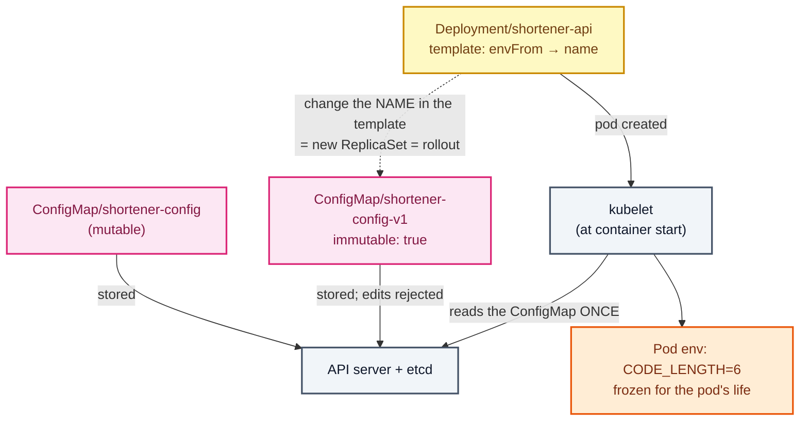
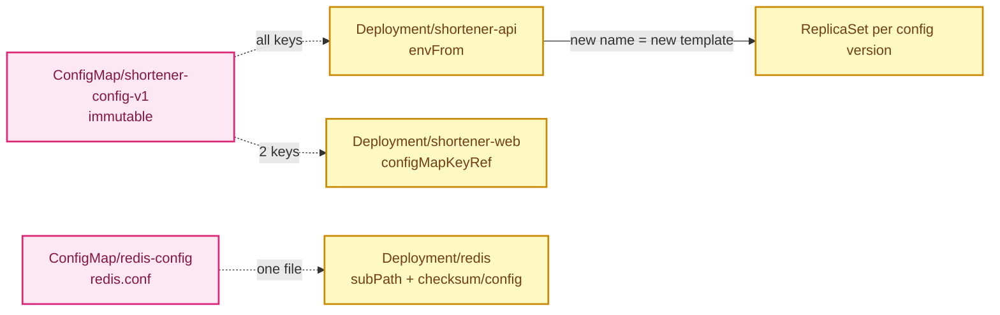

# Stage 05 — ConfigMaps, immutability and config-triggered rollouts

[⬅ Project 03](../../README.md) · Stage 4 of 10

[00 Namespace](../00-namespace/README.md) › [03 Deployments](../03-deployments/README.md) › [04 Services](../04-services/README.md) › **05 ConfigMaps** › [06 Secrets](../06-secrets/README.md) › [07 Storage](../07-storage/README.md) › [08 StatefulSets](../08-statefulsets/README.md) › [09 Ingress](../09-ingress/README.md) › [11 Probes](../11-health-checks/README.md) › [19 Final](../19-final/README.md)

> **The problem:** configuration is scattered through workload specs — fourteen literals in the API, duplicates in
> PostgreSQL, the API URL in the web tier, Redis tuned with a flag. Changing one value means editing the right
> Deployment and hoping you found every copy. And `CODE_LENGTH`, which every API replica *must* agree on, has no
> protection at all.

This stage has two halves, because ConfigMaps come with a trap. **Part A** moves config into ConfigMaps — the
normal way, mutable. **§9** springs the trap. **Part B** (`06`–`08`) is the fix: immutable, versioned ConfigMaps
and rollouts triggered by the config change itself.

---

## 1. WHY does this resource exist?

| Config in the Deployment | Config in a ConfigMap |
|---|---|
| Duplicated in every workload that needs it | One object, many consumers |
| Changing it means editing a workload spec | Changing it means editing config |
| Dev and prod differ by copy-pasted manifests | Same Deployment, different ConfigMap per environment |
| A whole file (`redis.conf`) cannot be an env var | A key can hold an entire file, mounted where the software expects it |

### …and why *immutable* ConfigMaps exist

A mutable ConfigMap and a fleet of pods are two separate things with two separate lifecycles:

- **Environment variables** are read once, when a container starts. Edit the ConfigMap and running pods keep the
  old value; **any pod that restarts later picks up the new one.** Restarts happen whenever EKS replaces a node.
- **Mounted files** are updated eventually (about a minute) — **except with `subPath`**, which is never updated.

So editing a live ConfigMap does not change your application. It schedules a *partial, random, unannounced*
change for whenever pods happen to restart. For most keys that is merely confusing. For `CODE_LENGTH` it is an
outage (§9).

**Immutable ConfigMaps** (`immutable: true`) cannot be edited at all. A change is a **new object with a new
name**, and moving workloads to it is an edit to their pod template — which is a **rollout**: all pods, in order,
gated by readiness, with a revision you can undo.

### When do you use one — and when not?

| ConfigMap | Not a ConfigMap |
|---|---|
| Hostnames, ports, feature flags, tuning, whole config files | Passwords, tokens, keys — **Secret** (stage 06) |
| Values under ~1 MiB total | Large data — a volume or object storage |
| **Immutable** for anything that must change fleet-wide, atomically | Mutable only when you truly want pods to converge lazily |

---

## 2. WHAT is it?

A ConfigMap is **a namespaced object holding key/value pairs of non-confidential configuration, consumed by pods
as environment variables or as files.**

> **Analogy:** a printed settings sheet pinned to a noticeboard. Env vars are workers who read it once on their
> first day. A mounted file is a sheet they re-read every so often. An immutable, versioned ConfigMap is a *laminated*
> sheet with an edition number — to change it you print edition 2 and tell everyone to switch.
>
> **Technically:** `data` (strings) and `binaryData` (base64), ≤ 1 MiB, stored in etcd. With `immutable: true` the
> API server rejects any update to `data`/`binaryData`, and the kubelet **stops watching** the object — less load
> on the API server for clusters with thousands of pods.

### Three ways to consume it — all used in this stage

| Consumer | Style | Used for | Updates in a running pod? |
|---|---|---|---|
| `envFrom: configMapRef` | every key becomes an env var | `shortener-api` | ❌ never |
| `env[].valueFrom.configMapKeyRef` | one named key | `shortener-web`, `postgres` | ❌ never |
| `volumes: configMap` + `subPath` | one key as one file | `redis.conf` | ❌ never (subPath) |

### Config that triggers its own rollout

The Redis pod template carries:

```yaml
annotations:
  checksum/config: "70c9fca75d98218f7c9fd9d482705a571dd8228a4976695c95447a85503d5369"
```

a SHA-256 of `redis.conf`. Change the file, update the hash, and the **pod template** has changed — so the
Deployment rolls. Helm charts compute this automatically; Kustomize does the equivalent with a hash in the
ConfigMap's *name* (stage 19). Here you do it by hand once, so you know what those tools are doing.

---

## 3. HOW does it work?



1. When the kubelet **starts a container**, it reads the referenced ConfigMap keys from the API server and builds
   the environment. After that the process owns a copy; Kubernetes never touches it again.
2. If the ConfigMap or key does not exist, the container is not started: `CreateContainerConfigError`.
3. Editing a mutable ConfigMap changes etcd **and nothing else**. There is no controller that restarts consumers.
4. Changing *which* ConfigMap a Deployment references edits `spec.template`, which the deployment controller hashes
   into a new ReplicaSet — a normal, readiness-gated rolling update. **That** is the only mechanism that changes
   config across a fleet atomically.

---

## 4. Manifest

Eight files, applied in two groups.

**Part A — mutable** ([`01`](01-shortener-config.yaml)–[`05`](05-redis-deployment.yaml)):

```yaml
apiVersion: v1
kind: ConfigMap
metadata:
  name: shortener-config
  namespace: url-shortener
data:
  CONFIG_VERSION: "mutable"
  POSTGRES_HOST: "postgres.url-shortener.svc.cluster.local"
  REDIS_WRITE_HOST: "redis.url-shortener.svc.cluster.local"
  REDIS_READ_HOST: "redis.url-shortener.svc.cluster.local"
  CODE_LENGTH: "6"
  CACHE_TTL_SECONDS: "300"
  ANALYTICS_URL: "http://analytics.url-shortener.svc.cluster.local/events"
  SHORTENER_API_URL: "http://shortener-api.url-shortener.svc.cluster.local:8080"
  # … 16 keys in total
```

```yaml
apiVersion: v1
kind: ConfigMap
metadata:
  name: redis-config
data:
  redis.conf: |
    bind 0.0.0.0
    protected-mode no
    dir /data
    appendonly yes
    appendfsync everysec
    maxmemory 100mb
    maxmemory-policy volatile-lru
```

```yaml
# 05-redis-deployment.yaml (excerpt)
template:
  metadata:
    annotations:
      checksum/config: "70c9fca7…5369"
  spec:
    containers:
      - name: redis
        args: ["redis-server", "/usr/local/etc/redis/redis.conf"]
        volumeMounts:
          - name: config
            mountPath: /usr/local/etc/redis/redis.conf
            subPath: redis.conf
        resources:
          limits:
            memory: "256Mi"          # must stay above maxmemory 100mb
    volumes:
      - name: config
        configMap:
          name: redis-config
```

**Part B — immutable** ([`06`](06-shortener-config-v1.yaml)–[`08`](08-shortener-web-deployment-v1.yaml)):

```yaml
apiVersion: v1
kind: ConfigMap
metadata:
  name: shortener-config-v1          # the version is in the NAME
immutable: true                      # top-level field
data:
  CONFIG_VERSION: "v1"
  # … same keys
```

```yaml
envFrom:
  - configMapRef:
      name: shortener-config-v1      # the Deployments now point here
```

---

## 5. Manifest breakdown

| Field | Value | What it does | What breaks if it's wrong |
|---|---|---|---|
| `data.*` | strings | The configuration | Numbers must be quoted (`"6"`) — YAML `6` is an integer and the object is rejected |
| `data.POSTGRES_HOST` | FQDN | Works from any namespace | A wrong namespace in the FQDN ⇒ NXDOMAIN with a healthy database |
| `data.CONFIG_VERSION` | `mutable` / `v1` | Shown in `/api/info` | Nothing — it is how you *see* which config a pod runs |
| `data.redis.conf` | a whole file | One key, one file | Indentation of the literal block is part of the file content |
| `maxmemory` + `limits.memory` | 100mb / 256Mi | Redis evicts before the kernel kills | `maxmemory` ≥ limit ⇒ `OOMKilled` instead of eviction |
| `maxmemory-policy` | `volatile-lru` | Evicts only keys with a TTL (cached links) | `allkeys-lru` silently evicts **click counters** under memory pressure |
| `protected-mode no` | — | Accept remote clients with no password | Omitted ⇒ Redis refuses the API's connections until stage 06 sets a password |
| `envFrom.configMapRef.name` | `shortener-config` | All keys → env | Missing ConfigMap ⇒ `CreateContainerConfigError` |
| `configMapKeyRef.key` | `SHORTENER_API_URL` | One key | Missing key ⇒ `CreateContainerConfigError` naming the key |
| `subPath` | `redis.conf` | Mount one file without hiding the directory | Without it, the whole `/usr/local/etc/redis/` is replaced. **With it, updates never arrive** |
| `checksum/config` | sha256 | Template change when the file changes | Forgotten ⇒ ConfigMap edited, Redis runs the old file forever |
| `immutable` | `true` | Edits to `data` rejected; kubelet stops watching | Can never be set back to `false`; only delete and recreate |

---

## 6. Apply

**Part A:**

```bash
kubectl apply -f manifests/05-configmaps/01-shortener-config.yaml \
              -f manifests/05-configmaps/02-redis-config.yaml
kubectl apply -f manifests/05-configmaps/03-shortener-api-deployment.yaml \
              -f manifests/05-configmaps/04-shortener-web-deployment.yaml \
              -f manifests/05-configmaps/05-redis-deployment.yaml
kubectl rollout status deployment/shortener-api -n url-shortener
kubectl rollout status deployment/shortener-web -n url-shortener
kubectl rollout status deployment/redis -n url-shortener
```

▸ **ConfigMaps first.** A pod that references a ConfigMap which does not exist yet will not start.

▸ The Redis Deployment restarts with no volume — **its in-memory data (click counters) is lost.** Remember that;
it is stage 07's problem.

**Part B** comes after §9. Do §9 first.

---

## 7. Validate

```bash
kubectl exec -n url-shortener deployment/shortener-api -- printenv | grep -E 'CONFIG_VERSION|CODE_LENGTH|REDIS_'
kubectl exec -n url-shortener deployment/redis -- redis-cli config get maxmemory-policy
```

```
CONFIG_VERSION=mutable
CODE_LENGTH=6
REDIS_WRITE_HOST=redis.url-shortener.svc.cluster.local
REDIS_READ_HOST=redis.url-shortener.svc.cluster.local
REDIS_PORT=6379

maxmemory-policy
volatile-lru
```

▸ `volatile-lru` came from the mounted file — Redis's own default is `noeviction`. The file was read.

---

## 8. Observe the mechanism

### The checksum is just a hash of the key

```bash
kubectl get configmap redis-config -n url-shortener -o jsonpath='{.data.redis\.conf}' | sha256sum
kubectl get deployment redis -n url-shortener -o jsonpath='{.spec.template.metadata.annotations.checksum/config}{"\n"}'
```

▸ Same value. The annotation means nothing to Kubernetes — it is a string in the template. Its only job is to make
the template *different* when the file is different.

### Editing a mutable ConfigMap changes nothing that is running

```bash
kubectl patch configmap shortener-config -n url-shortener --type merge -p '{"data":{"LOG_LEVEL":"debug"}}'
kubectl exec -n url-shortener deployment/shortener-api -- printenv LOG_LEVEL
```

▸ Still `info`. The object changed; the process did not. Put it back before continuing:

```bash
kubectl patch configmap shortener-config -n url-shortener --type merge -p '{"data":{"LOG_LEVEL":"info"}}'
```

---

## 9. Break it — the drift outage

This is the failure the rest of the stage exists to prevent. Somebody decides codes should be longer and edits the
ConfigMap. Nothing happens, so nobody notices. Later, one pod is replaced — a node rotation, an eviction, a crash.

```bash
kubectl patch configmap shortener-config -n url-shortener --type merge -p '{"data":{"CODE_LENGTH":"10"}}'
kubectl exec -n url-shortener deployment/shortener-api -- printenv CODE_LENGTH     # still 6

# "a node was replaced":
POD=$(kubectl get pods -n url-shortener -l app.kubernetes.io/name=shortener-api -o jsonpath='{.items[0].metadata.name}')
kubectl delete pod "$POD" -n url-shortener
sleep 20

for p in $(kubectl get pods -n url-shortener -l app.kubernetes.io/name=shortener-api -o name); do
  echo "$p CODE_LENGTH=$(kubectl exec -n url-shortener "$p" -- printenv CODE_LENGTH)"
done
```

```
pod/shortener-api-5d56486484-cslwf CODE_LENGTH=10
pod/shortener-api-5d56486484-ljpnt CODE_LENGTH=6
```

**Now use a link that existed before the change:**

```bash
CODE=$(kubectl exec -n url-shortener deployment/postgres -- psql -U shortener -d shortener -tAc 'SELECT code FROM links LIMIT 1')
kubectl run curl-loop --rm -i --restart=Never --quiet --image=curlimages/curl:8.10.1 -n url-shortener -- \
  sh -c "for i in 1 2 3 4 5 6 7 8; do curl -s -o /dev/null -w '%{http_code} ' http://shortener-api:8080/r/$CODE; done; echo"
```

```
404 302 404 302 404 302 302 404
```

**Symptom:** the same short link works or 404s depending on which pod answered. Links created on the new pod are
10 characters and 404 on the old one. Nothing is `CrashLoopBackOff`; every probe you could write passes.

**Investigate:**

```bash
kubectl run curl-one --rm -i --restart=Never --quiet --image=curlimages/curl:8.10.1 -n url-shortener -- \
  curl -s http://shortener-api:8080/r/$CODE
```

```json
{"error":"'Fh6Ip1' is not a valid code","expected_length":10,"pod":"shortener-api-5d56486484-cslwf"}
```

**Root cause:** a mutable ConfigMap was edited under a running fleet. The edit reached exactly the pods that
happened to restart afterwards. There was no rollout, no readiness gate, no revision — and `rollout undo` cannot
help, because the Deployment never changed.

### The fix — Part B: immutable, versioned config

```bash
kubectl apply -f manifests/05-configmaps/06-shortener-config-v1.yaml
kubectl apply -f manifests/05-configmaps/07-shortener-api-deployment-v1.yaml \
              -f manifests/05-configmaps/08-shortener-web-deployment-v1.yaml
kubectl rollout status deployment/shortener-api -n url-shortener
kubectl rollout status deployment/shortener-web -n url-shortener
```

▸ Changing `configMapRef.name` edited the pod template — **every** API pod was replaced, in order. Run the loop again:

```
302 302 302 302 302 302
```

**Try to drift it again:**

```bash
kubectl patch configmap shortener-config-v1 -n url-shortener --type merge -p '{"data":{"CODE_LENGTH":"10"}}'
```

```
The ConfigMap "shortener-config-v1" is invalid: data: Forbidden: field is immutable when `immutable` is set
```

▸ The drift is now **impossible**, not merely discouraged. A real change is a `shortener-config-v2` plus an edit to
the Deployments — which you will do for real in stage 08.

**And rollback now includes config:**

```bash
kubectl rollout history deployment/shortener-api -n url-shortener
```

▸ Each revision references a specific, unchangeable ConfigMap. `rollout undo` restores the old image **and** the
old config, because the old ConfigMap still exists exactly as it was.

The mutable ConfigMap has no consumers left:

```bash
kubectl delete configmap shortener-config -n url-shortener
```

### Break 2 — a subPath mount that never updates

```bash
kubectl get configmap redis-config -n url-shortener -o yaml > /tmp/redis-config.yaml
kubectl patch configmap redis-config -n url-shortener --type merge \
  -p '{"data":{"redis.conf":"bind 0.0.0.0\nprotected-mode no\ndir /data\nappendonly yes\nmaxmemory 50mb\nmaxmemory-policy volatile-lru\n"}}'
sleep 90
kubectl exec -n url-shortener deployment/redis -- redis-cli config get maxmemory
```

**Symptom:** still `104857600` (100 MB) after 90 seconds.

**Root cause:** `subPath` mounts are a bind mount of one file, resolved once at container start. The kubelet's
ConfigMap refresh updates a symlink in the volume directory, which a subPath mount never follows.

**Fix:** put the original back — and the lesson is the `checksum/config` annotation: whoever changes the file must
change the hash, so the change *is* a rollout.

```bash
kubectl apply -f manifests/05-configmaps/02-redis-config.yaml
```

---

## 10. How it interacts



---

## 11. Production notes

> 🧪 **DEMO / LEARNING CONFIGURATION**
> Versions numbered by hand, a checksum computed by hand, and the old immutable ConfigMaps never garbage-collected.

> 🏭 **PRODUCTION CONSIDERATIONS**
> - **Let tooling version config.** Kustomize `configMapGenerator` appends a content hash to the name and rewrites
>   every reference (stage 19); Helm charts put `checksum/config` in templates. Nobody should type a SHA by hand.
> - **Garbage-collect old versions** — but keep enough for `rollout undo` (at least `revisionHistoryLimit`).
> - **Config in Git, reviewed like code.** A config change *is* a deployment; it deserves the same pipeline.
> - **On EKS, AWS AppConfig or Parameter Store** can hold config outside the cluster, synced in by the External
>   Secrets Operator or the Secrets Store CSI driver — same consumption model, different source of truth.
> - **Immutable ConfigMaps reduce API-server load** — the kubelet stops watching them. On a large cluster with
>   thousands of pods, that is measurable.

---

## 12. The next problem

Configuration is now safe from drift. Look at what is still in the manifests:

```yaml
- name: POSTGRES_PASSWORD
  value: "dev-password-not-for-production"
```

in **two** Deployments, readable by anyone who can `kubectl get deployment -o yaml`. And Redis has no password at
all: `protected-mode no`, open to every pod in the cluster — any of them can `FLUSHALL` the cache and every click
count.

→ **[Stage 06 — Secrets](../06-secrets/README.md)**

---

## 📚 Official documentation

Everything above is self-contained — these are for going deeper, not for filling gaps.
*(All links verified 2026-09-13.)*

| Reference | What it adds |
|---|---|
| [ConfigMaps](https://kubernetes.io/docs/concepts/configuration/configmap/) | Consumption styles, update behaviour, and immutable ConfigMaps |
| [Configure a Pod to use a ConfigMap](https://kubernetes.io/docs/tasks/configure-pod-container/configure-pod-configmap/) | Every consumption pattern, step by step |
| [Volumes — ConfigMap and subPath](https://kubernetes.io/docs/concepts/storage/volumes/) | The documented rule that subPath mounts do not receive updates |
| [Redis configuration](https://redis.io/docs/latest/operate/oss_and_stack/management/config/) | `redis.conf`, and changing config at runtime |
| [kubectl rollout](https://kubernetes.io/docs/reference/kubectl/generated/kubectl_rollout/) | `history`, `undo` and `restart` |

---

| ◀ Previous | ▲ Up | Next ▶ |
|---|:--:|---:|
| ◀ **[04 Services](../04-services/README.md)** | [Project 03](../../README.md) · [Manual steps](../../scripts/manual-steps.md) | **[06 Secrets](../06-secrets/README.md)** ▶ |
