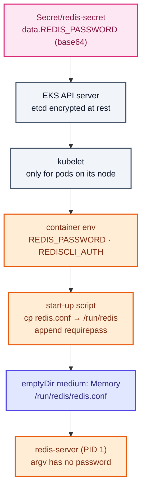
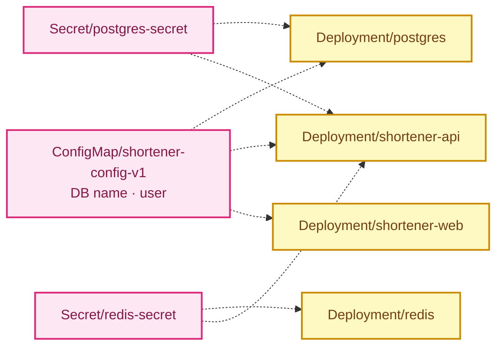

# Stage 06 — Secrets

[⬅ Project 03](../../README.md) · Stage 5 of 10

[00 Namespace](../00-namespace/README.md) › [03 Deployments](../03-deployments/README.md) › [04 Services](../04-services/README.md) › [05 ConfigMaps](../05-configmaps/README.md) › **06 Secrets** › [07 Storage](../07-storage/README.md) › [08 StatefulSets](../08-statefulsets/README.md) › [09 Ingress](../09-ingress/README.md) › [11 Probes](../11-health-checks/README.md) › [19 Final](../19-final/README.md)

> **The problem:** the PostgreSQL password is a literal in two Deployments, printed by
> `kubectl get deployment -o yaml` to anyone who can read workloads. Redis has no password at all — any pod in the
> cluster can connect and `FLUSHALL`.

---

## 1. WHY does this resource exist?

Credentials need handling that ordinary configuration does not:

| Need | Env literal / ConfigMap | Secret |
|---|---|---|
| Separate **RBAC** — people who deploy need not read passwords | Same permission as reading the workload | Grant `get secrets` separately |
| Not printed by routine commands | Shown by `describe` / `get -o yaml` of the workload | `describe secret` shows only byte counts |
| Encryption at rest | Plain in etcd | EKS encrypts all of etcd at rest; KMS envelope encryption available |
| Kept out of node disk | — | Secret volumes are tmpfs on the node |
| **One place** for a value two components must agree on | Copy in each | One object, many `secretKeyRef`s |

### This project needs two, not one

| Secret | Consumed by | Not by |
|---|---|---|
| `postgres-secret` | `postgres` (creates the user), `shortener-api` (logs in) | web, Redis |
| `redis-secret` | `redis` (requires the password), `shortener-api` | web, PostgreSQL |

Every consumer gets exactly the credentials it uses. Least exposure is a habit you start with two Secrets or you
never start.

> ⚠️ **A Secret is not encryption.** `data` is **base64**, an encoding anyone reverses with one command (§8).
> What protects a Secret is RBAC, etcd encryption and keeping it out of Git — this lab does only the first two.

---

## 2. WHAT is it?

A Secret is **a namespaced object for small amounts of confidential data, consumed like a ConfigMap but handled
more carefully by the API server and the kubelet.**

> **Analogy:** the same noticeboard as a ConfigMap, but the sheet is in a locked cabinet. The lock is RBAC. The
> sheet itself is written in a trivial cipher (base64) that stops only a glance.
>
> **Technically:** `data` holds base64-encoded values; `stringData` accepts plain text on write and is merged into
> `data`. `type: Opaque` means arbitrary keys. The kubelet only fetches Secrets for pods scheduled to its node, and
> mounts Secret volumes on tmpfs.

### Redis reads its password from a file — which is a ConfigMap

Redis has no environment variable for its password; it wants `requirepass` in `redis.conf`, and `redis.conf` is a
ConfigMap where a password must never go. The options:

| Option | Problem |
|---|---|
| Put `requirepass` in the ConfigMap | A password in a ConfigMap, in Git, readable by everyone |
| `args: ["redis-server", "--requirepass", "$(REDIS_PASSWORD)"]` | Kubernetes expands it — **into the process's command line**, visible in `ps` and every node process listing |
| **Build the config at start-up** | ✅ Copy the ConfigMap file into an in-memory emptyDir, append `requirepass` from the env var, `exec redis-server` |

That is what [`04-redis-deployment.yaml`](04-redis-deployment.yaml) does. Replacing the image's entrypoint means
it no longer drops from root to the `redis` user for us, so the pod now sets `runAsUser: 999` explicitly.

---

## 3. HOW does it work?



1. `apply` sends `stringData`; the API server stores base64 `data` in etcd. On EKS, etcd volumes are encrypted at
   rest by AWS.
2. When a pod referencing the Secret is scheduled, **that node's** kubelet fetches it.
3. `secretKeyRef` values are placed in the container's environment at start — exactly like a ConfigMap, and with
   the same rule: **editing the Secret does not change running pods.**
4. For Redis, the shell script runs first, writes the real config to tmpfs, then `exec`s Redis so Redis becomes
   PID 1 and receives SIGTERM directly.

---

## 4. Manifest

```yaml
# 01-postgres-secret.yaml
apiVersion: v1
kind: Secret
metadata:
  name: postgres-secret
  namespace: url-shortener
type: Opaque
stringData:
  POSTGRES_PASSWORD: "dev-password-not-for-production"
```

```yaml
# 04-redis-deployment.yaml (excerpt)
spec:
  securityContext:
    runAsUser: 999
    runAsGroup: 1000
    fsGroup: 1000
  containers:
    - name: redis
      command: ["sh", "-c"]
      args:
        - |
          set -eu
          cp /usr/local/etc/redis/redis.conf /run/redis/redis.conf
          printf 'requirepass %s\nmasterauth %s\n' "$REDIS_PASSWORD" "$REDIS_PASSWORD" >> /run/redis/redis.conf
          exec redis-server /run/redis/redis.conf
      env:
        - name: REDIS_PASSWORD
          valueFrom: { secretKeyRef: { name: redis-secret, key: REDIS_PASSWORD } }
        - name: REDISCLI_AUTH
          valueFrom: { secretKeyRef: { name: redis-secret, key: REDIS_PASSWORD } }
      volumeMounts:
        - { name: runtime-config, mountPath: /run/redis }
  volumes:
    - name: runtime-config
      emptyDir: { medium: Memory, sizeLimit: 1Mi }
```

```yaml
# 05-shortener-api-deployment.yaml (excerpt) — no literal credentials remain
env:
  - name: POSTGRES_PASSWORD
    valueFrom: { secretKeyRef: { name: postgres-secret, key: POSTGRES_PASSWORD } }
  - name: REDIS_PASSWORD
    valueFrom: { secretKeyRef: { name: redis-secret, key: REDIS_PASSWORD } }
```

`03-postgres-deployment.yaml` also moves `POSTGRES_DB` and `POSTGRES_USER` to `configMapKeyRef` on
`shortener-config-v1`, so the database and the API read the name and user from the *same* object.

---

## 5. Manifest breakdown

| Field | Value | What it does | What breaks if it's wrong |
|---|---|---|---|
| `type` | `Opaque` | Arbitrary keys | Typed Secrets (`kubernetes.io/tls`, `dockerconfigjson`) validate required keys |
| `stringData` | plain text | Convenience on write | Read back, it only ever appears as base64 in `data` |
| `secretKeyRef.name/key` | `redis-secret` / `REDIS_PASSWORD` | One value into env | Missing object or key ⇒ `CreateContainerConfigError` naming it |
| `REDISCLI_AUTH` | same value | `redis-cli` authenticates without `-a` | Omitted ⇒ every `kubectl exec … redis-cli` and every probe gets `NOAUTH` |
| `masterauth` | same value | What a *replica* presents to the primary | Irrelevant with one Redis — essential in stage 08 |
| `command: ["sh","-c"]` | — | Replaces the image entrypoint | …which also stops the entrypoint dropping root privileges |
| `runAsUser` / `runAsGroup` | `999` / `1000` | Run as the image's `redis` user | Omitted ⇒ Redis runs as **root** |
| `fsGroup` | `1000` | Volumes made group-writable for GID 1000 | Matters in stage 07: a new EBS filesystem is root-owned |
| `emptyDir.medium: Memory` | tmpfs | Rendered config never touches a disk | Omitted ⇒ the password lands on the node's root volume |
| `exec redis-server` | — | Redis replaces the shell as PID 1 | Without `exec`, SIGTERM goes to `sh`, Redis is SIGKILLed after the grace period |

---

## 6. Apply

```bash
kubectl apply -f manifests/06-secrets/01-postgres-secret.yaml \
              -f manifests/06-secrets/02-redis-secret.yaml
kubectl apply -f manifests/06-secrets/03-postgres-deployment.yaml \
              -f manifests/06-secrets/04-redis-deployment.yaml \
              -f manifests/06-secrets/05-shortener-api-deployment.yaml
kubectl rollout status deployment/postgres -n url-shortener
kubectl rollout status deployment/redis -n url-shortener
kubectl rollout status deployment/shortener-api -n url-shortener
```

▸ **Secrets before workloads**, same rule as ConfigMaps.

> ⚠️ **Watch what this rollout costs.** The PostgreSQL Deployment gets a new pod — with **no volume**. Every link
> you created is gone, and so is every click count in Redis. Try a link you made earlier:
>
> ```bash
> kubectl port-forward -n url-shortener svc/shortener-web 8080:80 &
> sleep 3; curl -s localhost:8080/r/<an-old-code>; echo; kill %1
> ```
>
> `{"error":"no such link", …}`. The API still works because it re-ran its migrations against the empty database
> on start-up. Hold that thought — it is the next stage.

---

## 7. Validate

```bash
kubectl get secrets -n url-shortener
kubectl describe secret redis-secret -n url-shortener | tail -3
```

```
NAME              TYPE     DATA   AGE
postgres-secret   Opaque   1      40s
redis-secret      Opaque   1      40s

Data
====
REDIS_PASSWORD:  37 bytes
```

▸ `describe` shows **byte counts**, never values.

```bash
kubectl exec -n url-shortener deployment/redis -- sh -c 'ps -o args | head -2; redis-cli ping; REDISCLI_AUTH= redis-cli ping'
```

```
COMMAND
redis-server 0.0.0.0:6379
PONG
AUTH failed: WRONGPASS invalid username-password pair or user is disabled.
NOAUTH Authentication required.
```

| Line | Means |
|---|---|
| `redis-server 0.0.0.0:6379` | ✅ PID 1 is Redis, and its command line carries **no password** |
| `PONG` | ✅ `REDISCLI_AUTH` from the Secret authenticates |
| `NOAUTH Authentication required.` | ✅ without the password, Redis refuses |

---

## 8. Observe the mechanism

### base64 is not encryption

```bash
kubectl get secret postgres-secret -n url-shortener -o jsonpath='{.data.POSTGRES_PASSWORD}'; echo
kubectl get secret postgres-secret -n url-shortener -o jsonpath='{.data.POSTGRES_PASSWORD}' | base64 -d; echo
```

▸ One command to decode. Anyone with `get secrets` in this namespace has every password in it — which is why RBAC
on Secrets is the actual control.

### Who can read it?

```bash
kubectl auth can-i get secrets -n url-shortener
kubectl auth can-i get secrets -n url-shortener --as=system:serviceaccount:url-shortener:default
```

▸ You: `yes` (you created the cluster). The namespace's default ServiceAccount — which every pod here runs as:
`no`. Pods receive the values they reference through the kubelet, not by reading the Secret through the API.

### The rendered config lives only in memory

```bash
kubectl exec -n url-shortener deployment/redis -- sh -c 'df -h /run/redis; tail -2 /run/redis/redis.conf | sed "s/ .*/ <redacted>/"'
```

▸ `tmpfs` — and the last two lines are `requirepass` and `masterauth`, appended at start-up.

---

## 9. Break it

### Break 1 — the Secret and the initialised database disagree

```bash
kubectl patch secret postgres-secret -n url-shortener --type merge -p '{"stringData":{"POSTGRES_PASSWORD":"a-new-password"}}'
kubectl rollout restart deployment/shortener-api -n url-shortener
kubectl rollout status deployment/shortener-api -n url-shortener
kubectl logs deployment/shortener-api -n url-shortener --tail=2
```

**Symptom:** `password authentication failed for user "shortener"`, and every API call returns a 503 naming
PostgreSQL — while the PostgreSQL pod is perfectly healthy.

**Root cause:** `POSTGRES_PASSWORD` is only used by the image's entrypoint **the first time it initialises an empty
data directory**. Changing the Secret does not change the password inside the database. (Right now there is no
volume, so restarting PostgreSQL would re-initialise it with the new password — after stage 07 it will not.)

**Fix:**

```bash
kubectl apply -f manifests/06-secrets/01-postgres-secret.yaml
kubectl rollout restart deployment/shortener-api -n url-shortener
```

▸ A real rotation is `ALTER USER shortener PASSWORD '…'` in the database **and** a Secret update **and** a
restart of every consumer, in an order that avoids an outage.

### Break 2 — a key name typo

```bash
kubectl patch deployment shortener-api -n url-shortener --type=json \
  -p '[{"op":"replace","path":"/spec/template/spec/containers/0/env/1/valueFrom/secretKeyRef/key","value":"REDIS_PASS"}]'
kubectl get pods -n url-shortener -l app.kubernetes.io/name=shortener-api
```

**Symptom:** the new pod is `CreateContainerConfigError`; old pods keep serving.

**Investigate:** `kubectl describe pod <new-pod> -n url-shortener | grep -A2 Warning` —
`couldn't find key REDIS_PASS in Secret url-shortener/redis-secret`.

**Fix:** `kubectl apply -f manifests/06-secrets/05-shortener-api-deployment.yaml`

---

## 10. How it interacts



`shortener-web` receives no Secret at all.

---

## 11. Production notes

> 🧪 **DEMO / LEARNING CONFIGURATION**
> Secrets in Git, one static password each, no rotation, no audit, default ServiceAccounts.

> 🏭 **PRODUCTION CONSIDERATIONS**
> - **Secrets never live in Git.** On EKS the source of truth is **AWS Secrets Manager** (or SSM Parameter Store),
>   synced in by the **External Secrets Operator**, or mounted by the **Secrets Store CSI Driver** with the AWS
>   provider. Pods are authorised with **EKS Pod Identity** — no static AWS keys (Project 10).
> - **Envelope encryption with your own KMS key** for Secrets in etcd, and CloudTrail + EKS audit logs to see who
>   read them.
> - **Managed credentials remove the problem.** RDS for PostgreSQL and ElastiCache for Redis both support IAM
>   authentication — short-lived tokens instead of passwords.
> - **Rotation is a procedure, not a field edit** (§9 Break 1). Automate it or it will not happen.
> - **Least privilege on reads:** no human needs `get secrets` in production namespaces day to day.

---

## 12. The next problem

Look back at §6. Applying this stage **deleted every short link and every click count**, and nothing reported an
error. PostgreSQL wrote its data inside the container's own filesystem; Redis kept its counters in memory with an
append-only file in `/data` — also inside the container. A new pod is a new, empty container.

On EKS pods are replaced for reasons you do not control — node group updates, Spot interruptions, AZ rebalancing.
A URL shortener whose links vanish on the next AMI rollout is not a URL shortener.

→ **[Stage 07 — Storage](../07-storage/README.md)**

---

## 📚 Official documentation

Everything above is self-contained — these are for going deeper, not for filling gaps.
*(All links verified 2026-09-13.)*

| Reference | What it adds |
|---|---|
| [Secrets](https://kubernetes.io/docs/concepts/configuration/secret/) | Types, consumption, and the explicit warning that base64 is not encryption |
| [Good practices for Kubernetes Secrets](https://kubernetes.io/docs/concepts/security/secrets-good-practices/) | RBAC, encryption at rest, external stores |
| [Use AWS Secrets Manager secrets in Amazon EKS](https://docs.aws.amazon.com/secretsmanager/latest/userguide/integrating_csi_driver.html) | The Secrets Store CSI Driver with the AWS provider |
| [Configure a security context](https://kubernetes.io/docs/tasks/configure-pod-container/security-context/) | `runAsUser`, `runAsGroup`, `fsGroup` |

---

| ◀ Previous | ▲ Up | Next ▶ |
|---|:--:|---:|
| ◀ **[05 ConfigMaps](../05-configmaps/README.md)** | [Project 03](../../README.md) · [Manual steps](../../scripts/manual-steps.md) | **[07 Storage](../07-storage/README.md)** ▶ |
