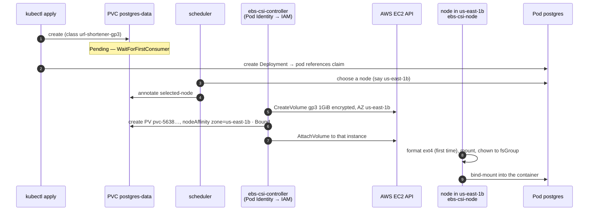
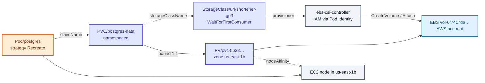

# Stage 07 — Storage on EKS: StorageClass, PVC and EBS

[⬅ Project 03](../../README.md) · Stage 6 of 10

[00 Namespace](../00-namespace/README.md) › [03 Deployments](../03-deployments/README.md) › [04 Services](../04-services/README.md) › [05 ConfigMaps](../05-configmaps/README.md) › [06 Secrets](../06-secrets/README.md) › **07 Storage** › [08 StatefulSets](../08-statefulsets/README.md) › [09 Ingress](../09-ingress/README.md) › [11 Probes](../11-health-checks/README.md) › [19 Final](../19-final/README.md)

> **The problem:** applying stage 06 replaced the PostgreSQL and Redis pods, and every link and every click count
> disappeared. Both datastores wrote to the container's own filesystem, which is created with the container and
> deleted with it. On EKS, pods are replaced whenever nodes are — AMI updates, Spot interruptions, scale-in.

---

## 1. WHY does this resource exist?

A container's writable layer lives on the node and belongs to that container. Kubernetes needs a way to give a pod
storage that:

| Requirement | Container filesystem | `emptyDir` | **PersistentVolumeClaim → EBS** |
|---|---|---|---|
| Survives a container restart | ❌ | ✅ | ✅ |
| Survives the pod being deleted | ❌ | ❌ | ✅ |
| Survives the node being terminated | ❌ | ❌ | ✅ — the EBS volume detaches and reattaches elsewhere |
| Survives the **AZ** failing | ❌ | ❌ | ❌ — an EBS volume lives in **one** availability zone |

And it needs to do that **without the application author knowing anything about AWS**. The manifest asks for
"1 GiB, one writer, the `url-shortener-gp3` class"; the cluster decides it means an encrypted gp3 EBS volume in
`us-east-1b`.

### The two datastores need persistence for different reasons

| Store | What is lost without a volume | How bad |
|---|---|---|
| PostgreSQL | **Every link.** It is the source of truth. | Catastrophic |
| Redis | Cached links (rebuilt from PostgreSQL on the next miss) **and click counters** (no other copy) | Degraded, but real data loss |

### When do you use which?

| Use | For |
|---|---|
| **PVC + EBS (gp3)** | Databases, queues, anything one pod writes that must outlive it |
| **PVC + EFS** | Many pods on many nodes sharing files (`ReadWriteMany`) — not a database |
| `emptyDir` | Scratch space and pod-lifetime caches — you used one in stage 06 for the rendered Redis config |
| Neither — a managed service | RDS, ElastiCache: storage, backups and failover are AWS's problem |

---

## 2. WHAT is it?

Three objects, split so that **the application asks** and **the platform provides**:

| Object | Scope | Who writes it | What it is |
|---|---|---|---|
| **StorageClass** | cluster | platform team | A *recipe*: which CSI driver, which volume type, encryption, reclaim policy, when to create |
| **PersistentVolumeClaim** | namespace | application | A *request*: size, access mode, class |
| **PersistentVolume** | cluster | the driver, automatically | The *fulfilment*: "this claim is EBS volume `vol-0f74c7da…` in `us-east-1b`" |

> **Analogy:** a restaurant order. The PVC is the order ("one medium, well done"). The StorageClass is the menu
> item that says which kitchen makes it and how. The PV is the plate that arrives with your table number on it.
>
> **Technically:** the PVC binds 1:1 to a PV. With dynamic provisioning the **EBS CSI driver** creates both the
> EBS volume and the PV object when a claim needs one. The pod references **only the claim**.

### What EKS gives you — and what it does not

```bash
kubectl get storageclass
```

```
NAME   PROVISIONER             RECLAIMPOLICY   VOLUMEBINDINGMODE      ALLOWVOLUMEEXPANSION
gp2    kubernetes.io/aws-ebs   Delete          WaitForFirstConsumer   false
```

A new EKS cluster has exactly one class, `gp2`, and it is **not marked `(default)`**. So a PVC that names no class
is fulfilled by nothing (§9). That is why this project creates its own class — and gp3 is also the better volume:
baseline 3000 IOPS regardless of size, and cheaper per GiB than gp2.

### Access modes, honestly

| Mode | Meaning | EBS? |
|---|---|---|
| `ReadWriteOnce` (RWO) | Mounted read-write by **one node** | ✅ the only mode EBS supports |
| `ReadWriteOncePod` | Mounted by **one pod** | ✅ |
| `ReadWriteMany` (RWX) | Many nodes | ❌ — EFS |

`ReadWriteOnce` is per **node**, not per pod. Two pods **on the same node** can both mount it. Remember that in
§12.

---

## 3. HOW does it work?



The EKS-specific points, in order of how often they bite:

1. **`WaitForFirstConsumer` is not optional on multi-AZ clusters.** The volume must be created in the AZ the pod
   lands in. Create it first and the scheduler may have no node in that AZ.
2. **The PV carries node affinity** — `topology.kubernetes.io/zone In [us-east-1b]`. From then on, any pod using
   this claim can **only** be scheduled in `us-east-1b`. Forever.
3. **Attach is an AWS API call** by a controller with IAM permissions. That is why `clusters/eks-lab.yaml` gives
   the EBS CSI driver an IAM role through Pod Identity; without it every claim sits `Pending` with an
   `UnauthorizedOperation` event.
4. **One EC2 instance at a time.** A rolling update that starts the new pod on a different node before the old one
   stops waits on `Multi-Attach error` — so both Deployments here switch to `strategy: Recreate`.
5. **A fresh ext4 filesystem is owned by root** and contains `lost+found`. Hence `fsGroup: 1000` for Redis and
   `PGDATA=/var/lib/postgresql/data/pgdata` for PostgreSQL.

---

## 4. Manifest

```yaml
# 01-url-shortener-gp3-storageclass.yaml
apiVersion: storage.k8s.io/v1
kind: StorageClass
metadata:
  name: url-shortener-gp3
provisioner: ebs.csi.aws.com
parameters:
  type: gp3
  encrypted: "true"
reclaimPolicy: Delete
volumeBindingMode: WaitForFirstConsumer
allowVolumeExpansion: true
```

```yaml
# 02-postgres-data-pvc.yaml   (03-redis-data-pvc.yaml is identical but for the name)
apiVersion: v1
kind: PersistentVolumeClaim
metadata:
  name: postgres-data
  namespace: url-shortener
spec:
  storageClassName: url-shortener-gp3
  accessModes: [ReadWriteOnce]
  resources:
    requests:
      storage: 1Gi
```

```yaml
# 04-postgres-deployment.yaml (excerpt)
spec:
  strategy:
    type: Recreate
  template:
    spec:
      containers:
        - name: postgres
          env:
            - name: PGDATA
              value: /var/lib/postgresql/data/pgdata
          volumeMounts:
            - name: data
              mountPath: /var/lib/postgresql/data
      volumes:
        - name: data
          persistentVolumeClaim:
            claimName: postgres-data
```

`05-redis-deployment.yaml` mounts `redis-data` at `/data` — where `redis.conf` already told Redis to keep its
append-only file — with `strategy: Recreate` and the existing `fsGroup: 1000`.

---

## 5. Manifest breakdown

| Field | Value | What it does | What breaks if it's wrong |
|---|---|---|---|
| `provisioner` | `ebs.csi.aws.com` | Which driver fulfils claims | `kubernetes.io/aws-ebs` is the in-tree name, migrated to the same driver; a typo ⇒ claims `Pending` forever, `waiting for a volume to be created` |
| `parameters.type` | `gp3` | EBS volume type | `io2` works and costs far more; an invalid type ⇒ `ProvisioningFailed` |
| `parameters.encrypted` | `"true"` | Encrypt with the AWS-managed KMS key | Quoted: parameters are strings |
| `reclaimPolicy` | `Delete` | Delete the EBS volume when the claim is deleted | `Retain` leaves volumes (and bills) after cleanup |
| `volumeBindingMode` | `WaitForFirstConsumer` | Create the volume in the pod's AZ | `Immediate` ⇒ volume in a random AZ, pod unschedulable |
| `allowVolumeExpansion` | `true` | Grow a claim online | `false` ⇒ `kubectl patch pvc` to grow is rejected |
| PVC `accessModes` | `ReadWriteOnce` | One node | `ReadWriteMany` on EBS ⇒ `ProvisioningFailed` |
| PVC `resources.requests.storage` | `1Gi` | Volume size | gp3 minimum is 1 GiB |
| `strategy.type` | `Recreate` | Old pod stops before the new one starts | `RollingUpdate` ⇒ `Multi-Attach error` when the new pod lands on another node |
| `PGDATA` | `…/data/pgdata` | A subdirectory of the mount | The mount point itself ⇒ `initdb: directory … exists but is not empty` (`lost+found`) |
| `fsGroup` | `1000` | kubelet chowns the volume to GID 1000 | Omitted ⇒ Redis (UID 999) cannot write `/data` — `Permission denied` on AOF |

---

## 6. Apply

```bash
kubectl apply -f manifests/07-storage/01-url-shortener-gp3-storageclass.yaml
kubectl apply -f manifests/07-storage/02-postgres-data-pvc.yaml \
              -f manifests/07-storage/03-redis-data-pvc.yaml
kubectl get pvc -n url-shortener
kubectl describe pvc postgres-data -n url-shortener | tail -2
```

```
NAME            STATUS    VOLUME   CAPACITY   ACCESS MODES   STORAGECLASS
postgres-data   Pending                                      url-shortener-gp3
redis-data      Pending                                      url-shortener-gp3

Normal  WaitForFirstConsumer  7s  persistentvolume-controller  waiting for first consumer to be created before binding
```

▸ **`Pending` is correct here.** Nothing has been created in AWS yet, because nothing needs the volume yet.

```bash
kubectl apply -f manifests/07-storage/04-postgres-deployment.yaml \
              -f manifests/07-storage/05-redis-deployment.yaml
kubectl rollout status deployment/postgres -n url-shortener --timeout=300s
kubectl rollout status deployment/redis -n url-shortener --timeout=300s
kubectl rollout restart deployment/shortener-api -n url-shortener     # re-run migrations on the new, empty DB
kubectl rollout status deployment/shortener-api -n url-shortener
```

▸ The first rollout takes longer: an EBS volume is created, attached and formatted.

▸ **Why restart the API?** The new PostgreSQL starts on an **empty** volume. The API only migrates at start-up,
so without a restart it keeps answering `relation "links" does not exist`. That coupling is removed in stage 11.

---

## 7. Validate

```bash
kubectl get pvc,pv -n url-shortener
```

```
NAME                                  STATUS   VOLUME                                     CAPACITY   ACCESS MODES   STORAGECLASS
persistentvolumeclaim/postgres-data   Bound    pvc-563849d5-2fad-4e61-ab5b-f71ea34f38e1   1Gi        RWO            url-shortener-gp3
persistentvolumeclaim/redis-data      Bound    pvc-613cb914-de42-4edf-8350-98fa436d4b42   1Gi        RWO            url-shortener-gp3

NAME                                                        CAPACITY   RECLAIM POLICY   STATUS   CLAIM
persistentvolume/pvc-563849d5-2fad-4e61-ab5b-f71ea34f38e1   1Gi        Delete           Bound    url-shortener/postgres-data
persistentvolume/pvc-613cb914-de42-4edf-8350-98fa436d4b42   1Gi        Delete           Bound    url-shortener/redis-data
```

**Find the real disk and its AZ:**

```bash
PV=$(kubectl get pvc postgres-data -n url-shortener -o jsonpath='{.spec.volumeName}')
kubectl get pv "$PV" -o jsonpath='{.spec.csi.volumeHandle}{"  "}{.spec.nodeAffinity.required.nodeSelectorTerms[0].matchExpressions}{"\n"}'
```

```
vol-0f74c7dadabfa69f6  [{"key":"topology.kubernetes.io/zone","operator":"In","values":["us-east-1b"]}]
```

```bash
aws ec2 describe-volumes --volume-ids vol-0f74c7dadabfa69f6 \
  --query 'Volumes[0].[VolumeType,Size,Encrypted,AvailabilityZone,State]' --output text
```

▸ `gp3  1  True  us-east-1b  in-use` — a real, encrypted, billed EBS volume.

**The permissions `fsGroup` produced:**

```bash
kubectl exec -n url-shortener deployment/redis -- ls -ld /data
```

```
drwxrwsr-x    4 root     redis         4096 Sep 13 04:50 /data
```

▸ Owner root, **group `redis` (1000), group-writable, setgid** — the kubelet did that on mount.

---

## 8. Observe the mechanism

### Data now survives pod deletion

```bash
kubectl port-forward -n url-shortener svc/shortener-web 8080:80 &
sleep 3
CODE=$(curl -s -X POST localhost:8080/api/links -H 'Content-Type: application/json' \
  -d '{"url":"https://aws.amazon.com/ebs/"}' | python3 -c 'import json,sys;print(json.load(sys.stdin)["code"])')
for i in 1 2 3; do curl -s -o /dev/null localhost:8080/r/$CODE; done
kill %1

kubectl delete pod -n url-shortener -l app.kubernetes.io/name=postgres
kubectl delete pod -n url-shortener -l app.kubernetes.io/name=redis
kubectl rollout status deployment/postgres -n url-shortener
kubectl rollout status deployment/redis -n url-shortener

kubectl exec -n url-shortener deployment/postgres -- psql -U shortener -d shortener -tAc "SELECT count(*) FROM links WHERE code='$CODE'"
kubectl exec -n url-shortener deployment/redis -- redis-cli get clicks:$CODE
```

```
1
3
```

▸ The link and all three clicks survived. The new pods mounted the same EBS volumes.

### The volume pins the pod to its AZ

```bash
kubectl get pods -n url-shortener -l app.kubernetes.io/name=redis -o wide
kubectl get nodes -L topology.kubernetes.io/zone
```

▸ However many times you delete it, the Redis pod lands on the node in the volume's AZ. With two nodes in two AZs,
that is **always the same node**.

---

## 9. Break it

### Break 1 — a claim with no StorageClass

```bash
kubectl apply -f - <<'EOF'
apiVersion: v1
kind: PersistentVolumeClaim
metadata: {name: no-class-demo, namespace: url-shortener}
spec: {accessModes: [ReadWriteOnce], resources: {requests: {storage: 1Gi}}}
EOF
kubectl get pvc no-class-demo -n url-shortener
kubectl describe pvc no-class-demo -n url-shortener | tail -2
```

**Symptom:**

```
no-class-demo   Pending
Normal  FailedBinding  persistentvolume-controller  no persistent volumes available for this claim and no storage class is set
```

**Root cause:** no `storageClassName`, and **no default class** on this EKS cluster — so the only thing that
could satisfy the claim is a hand-made PV, and there is none. This is the most common "my database won't start"
on a brand-new EKS cluster.

**Fix:** name a class explicitly (as this project does), or mark one default:
`kubectl annotate storageclass url-shortener-gp3 storageclass.kubernetes.io/is-default-class=true`.

```bash
kubectl delete pvc no-class-demo -n url-shortener
```

### Break 2 — a rolling update across nodes

```bash
kubectl patch deployment redis -n url-shortener -p '{"spec":{"strategy":{"type":"RollingUpdate","rollingUpdate":null}}}'
kubectl cordon "$(kubectl get pod -n url-shortener -l app.kubernetes.io/name=redis -o jsonpath='{.items[0].spec.nodeName}')"
kubectl rollout restart deployment/redis -n url-shortener
kubectl get pods -n url-shortener -l app.kubernetes.io/name=redis -o wide
```

**Symptom:** the new pod is `Pending` — the only node in the volume's AZ is cordoned, and the other node is in the
wrong AZ:

```bash
kubectl describe pod -n url-shortener -l app.kubernetes.io/name=redis | grep -A3 FailedScheduling
```

`0/2 nodes are available: 1 node(s) had volume node affinity conflict, 1 node(s) were unschedulable.`

**Root cause:** the EBS volume is in one AZ; the PV's node affinity says so; the scheduler obeys. On a real
cluster the same thing happens when an AZ has no capacity — the pod waits, it does not move.

**Fix:**

```bash
kubectl uncordon --all
kubectl apply -f manifests/07-storage/05-redis-deployment.yaml
kubectl rollout status deployment/redis -n url-shortener
```

---

## 10. How it interacts



---

## 11. Production notes

> 🧪 **DEMO / LEARNING CONFIGURATION**
> `reclaimPolicy: Delete`, 1 GiB, AWS-managed encryption key, no snapshots, no backups.

> 🏭 **PRODUCTION CONSIDERATIONS**
> - **`reclaimPolicy: Retain`** for anything you cannot recreate — and a process for deleting volumes on purpose.
> - **Backups are not persistence.** Take EBS snapshots (VolumeSnapshot + the CSI snapshot controller, or AWS
>   Backup) and logical dumps, and **test restores**.
> - **AZ failure is real.** An EBS-backed database is unavailable while its AZ is. For the durable store that
>   usually means **RDS Multi-AZ**; for a cache, ElastiCache with replicas in other AZs.
> - **Customer-managed KMS key** (`kmsKeyId` parameter) for encryption you control and audit.
> - **Tag volumes** (`tagSpecification_N` parameters) so cost and orphan reports can attribute them.
> - **Size for IOPS as well as GiB**: gp3 lets you set `iops` and `throughput` independently of size.
> - **Monitor free space.** A full volume stops PostgreSQL and makes Redis refuse writes.

---

## 12. The next problem

Data survives. Now the product team wants Redis to handle more read traffic, so somebody scales it:

```bash
kubectl scale deployment/redis -n url-shortener --replicas=2
kubectl get pods -n url-shortener -l app.kubernetes.io/name=redis -o wide
```

Both pods go `Running` — **on the same node**, because the volume's AZ has only one node, and `ReadWriteOnce`
means one *node*, not one pod. Two Redis processes now share one append-only-file directory:

```bash
for p in $(kubectl get pods -n url-shortener -l app.kubernetes.io/name=redis -o name); do
  kubectl exec -n url-shortener "$p" -- redis-cli incr demo:counter >/dev/null
done
P1=$(kubectl get pods -n url-shortener -l app.kubernetes.io/name=redis -o name | head -1)
kubectl exec -n url-shortener "$P1" -- redis-cli incr demo:counter >/dev/null
for p in $(kubectl get pods -n url-shortener -l app.kubernetes.io/name=redis -o name); do
  echo "$p demo:counter=$(kubectl exec -n url-shortener "$p" -- redis-cli get demo:counter)"
done
```

```
pod/redis-8c65fdf8c-fchpc demo:counter=2
pod/redis-8c65fdf8c-hpbhm demo:counter=1
```

Two unrelated Redis servers, each with its own counts, both appending to the same files on one disk, behind a
Service that picks one at random. No error anywhere. (Had the scheduler chosen a node in the other AZ, you would
have got `Pending` on a volume node-affinity conflict instead — a louder failure, but no better.)

A Deployment has **one** pod template naming **one** claim. It cannot give replicas their own disks, their own
roles, or names you could use to tell them apart. Scale back down before moving on:

```bash
kubectl scale deployment/redis -n url-shortener --replicas=1
```

→ **[Stage 08 — StatefulSets](../08-statefulsets/README.md)**

---

## 📚 Official documentation

Everything above is self-contained — these are for going deeper, not for filling gaps.
*(All links verified 2026-09-13.)*

| Reference | What it adds |
|---|---|
| [Persistent Volumes](https://kubernetes.io/docs/concepts/storage/persistent-volumes/) | Binding, access modes (per node!), reclaim policies |
| [Storage Classes](https://kubernetes.io/docs/concepts/storage/storage-classes/) | `volumeBindingMode`, default classes, expansion |
| [Store Kubernetes volumes with Amazon EBS](https://docs.aws.amazon.com/eks/latest/userguide/ebs-csi.html) | Installing and authorising the EBS CSI driver add-on |
| [EBS CSI driver StorageClass parameters](https://github.com/kubernetes-sigs/aws-ebs-csi-driver/blob/master/docs/parameters.md) | `type`, `iops`, `throughput`, `encrypted`, `kmsKeyId`, tags |
| [Storage classes on Amazon EKS](https://docs.aws.amazon.com/eks/latest/userguide/storage-classes.html) | What EKS creates by default and how to change it |

---

| ◀ Previous | ▲ Up | Next ▶ |
|---|:--:|---:|
| ◀ **[06 Secrets](../06-secrets/README.md)** | [Project 03](../../README.md) · [Manual steps](../../scripts/manual-steps.md) | **[08 StatefulSets](../08-statefulsets/README.md)** ▶ |
