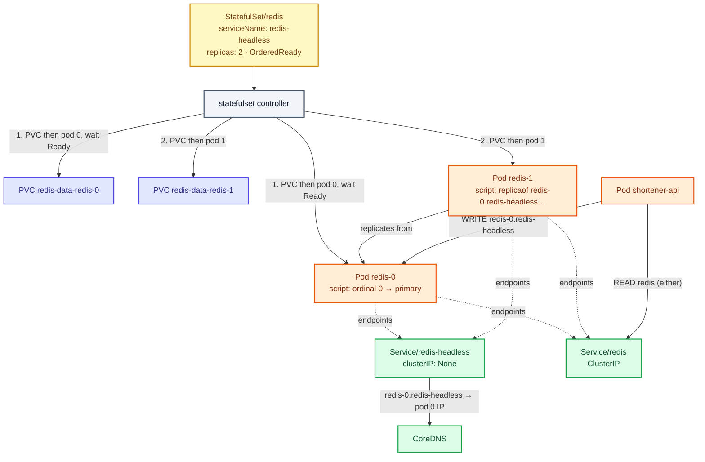
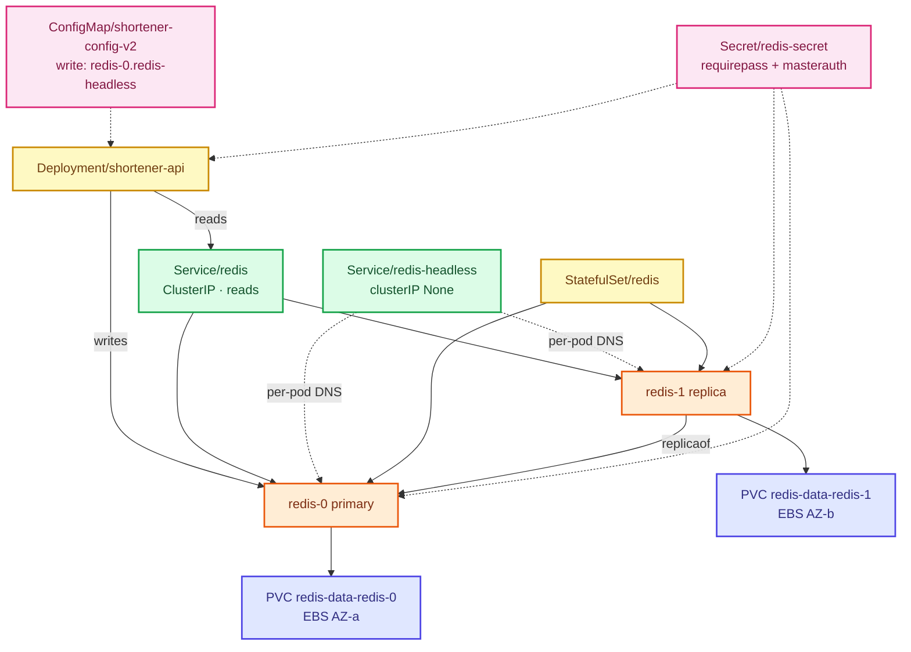

# Stage 08 — StatefulSets, headless Services and per-pod DNS

[⬅ Project 03](../../README.md) · Stage 7 of 10

[00 Namespace](../00-namespace/README.md) › [03 Deployments](../03-deployments/README.md) › [04 Services](../04-services/README.md) › [05 ConfigMaps](../05-configmaps/README.md) › [06 Secrets](../06-secrets/README.md) › [07 Storage](../07-storage/README.md) › **08 StatefulSets** › [09 Ingress](../09-ingress/README.md) › [11 Probes](../11-health-checks/README.md) › [19 Final](../19-final/README.md)

> **The problem:** scaling Redis to two replicas produced two unrelated servers sharing one volume, each with its
> own counters, behind a Service that picks one at random. A Deployment has one pod template naming one claim: it
> cannot give replicas their own disks, different roles, or names that tell them apart.

---

## 1. WHY does this resource exist?

What we actually want from two Redis pods is replication: **one primary** that takes writes and **one replica**
that copies it and serves reads. That design needs three things a Deployment cannot give:

| Need | Deployment | **StatefulSet** |
|---|---|---|
| **A disk per replica** | One claim shared by all | `volumeClaimTemplates` → `redis-data-redis-0`, `redis-data-redis-1` |
| **A role per replica** | Replicas are interchangeable by definition | Ordinal `0` is the primary; others replicate — decided from the pod's stable name |
| **A name for one specific replica** | Random suffixes that change on every recreation | `redis-0`, forever, with a DNS record of its own |
| **Start-up order** | All at once | `redis-1` only after `redis-0` is Ready |

And the clients need something new too. The replica must connect to **the primary specifically**, and the API's
**writes** must go to the primary specifically. A ClusterIP Service is built to hide which pod you reach. That
calls for a **headless Service**, which publishes a DNS record **per pod**.

### When do you use one — and when not?

| StatefulSet | Deployment |
|---|---|
| Replicated datastores: Redis, PostgreSQL, Kafka, etcd, Elasticsearch | API and web tiers |
| Anything whose members find each other by name | Anything where "replace any replica" is safe |
| Per-replica volumes | Stateless or shared-nothing work |

> **A StatefulSet is not a database cluster.** It provides identity, ordering and storage. Replication here comes
> from Redis's own `replicaof`. Failover — promoting `redis-1` if `redis-0` dies — comes from **nothing** in this
> project (Redis Sentinel, an operator, or ElastiCache do that). Believing otherwise is the most common
> misunderstanding in this area.

---

## 2. WHAT is it?

A StatefulSet is **a workload controller for pods with stable ordinal identities, stable per-pod DNS names and
per-pod persistent storage, created and updated in order.**

> **Analogy:** a Deployment staffs a call centre with temps — any headset, any desk. A StatefulSet assigns named
> desks: desk 0 is the supervisor, desk 1 the deputy, each with a locked drawer that is still theirs after a day
> off, and a direct-dial extension that always rings that desk.
>
> **Technically:** the ordinal is the identity, and everything derives from it:
>
> | Derived from ordinal `N` | Value |
> |---|---|
> | Pod name / hostname | `redis-N` |
> | DNS record | `redis-N.redis-headless.url-shortener.svc.cluster.local` |
> | PVC | `redis-data-redis-N` |
> | Order | created 0→1, deleted and updated 1→0 |

### Headless versus ClusterIP, for the same pods

This stage keeps **both** Services on the Redis pods, because they answer different questions:

| Name | Service | DNS answer | Use it for |
|---|---|---|---|
| `redis` | ClusterIP | one virtual IP → kube-proxy picks a pod **per connection** | **Reads** — any member will do |
| `redis-headless` | headless | **every** pod IP | Discovering the member list |
| `redis-0.redis-headless` | headless, per pod | **only `redis-0`'s IP** | **Writes**, and the replica's `replicaof` |

### What happens to storage

PVCs created by `volumeClaimTemplates` are **not** deleted when the StatefulSet is deleted or scaled down. Recreate
the StatefulSet and `redis-0` reattaches to `redis-data-redis-0` with its data intact (§8).

---

## 3. HOW does it work?



1. The controller creates `redis-data-redis-0`, then pod `redis-0` with `hostname: redis-0` and
   `subdomain: redis-headless`. The claim is `WaitForFirstConsumer`, so its EBS volume is created in whichever AZ
   `redis-0` is scheduled to.
2. It waits until `redis-0` is **Ready**, then does the same for ordinal 1. (There are no readiness probes until
   stage 11, so "Ready" currently means "container started" — stage 11 fixes that.)
3. Because the pods' `subdomain` names a **headless** Service, CoreDNS publishes an A record per pod:
   `redis-0.redis-headless.url-shortener.svc.cluster.local`.
4. The start-up script reads `$HOSTNAME`, strips everything up to the last `-`, and gets the ordinal. Ordinal `1`
   appends `replicaof redis-0.redis-headless.url-shortener.svc.cluster.local 6379` to its config.
5. The replica resolves that name, authenticates with `masterauth` (from the Secret), and does a full sync.
6. The pod-level anti-affinity **prefers** different nodes — so on this two-AZ cluster, the two members and their
   EBS volumes end up in different AZs.

---

## 4. Manifest

Six files, in the order the story needs them:

| File | What |
|---|---|
| [`01-redis-headless-service.yaml`](01-redis-headless-service.yaml) | `redis-headless`, `clusterIP: None` |
| [`02-redis-statefulset.yaml`](02-redis-statefulset.yaml) | Primary + replica, one EBS volume each |
| [`03-shortener-config-v2.yaml`](03-shortener-config-v2.yaml) | Immutable config v2: writes → `redis-0.redis-headless…` |
| [`04-shortener-api-deployment.yaml`](04-shortener-api-deployment.yaml) | The API on config v2 |
| [`05-postgres-headless-service.yaml`](05-postgres-headless-service.yaml) | `postgres-headless` |
| [`06-postgres-statefulset.yaml`](06-postgres-statefulset.yaml) | PostgreSQL, one member, templated claim |

```yaml
apiVersion: v1
kind: Service
metadata:
  name: redis-headless
spec:
  clusterIP: None                  # ← headless
  publishNotReadyAddresses: true   # members resolve each other while starting
  selector: { app.kubernetes.io/name: redis, app.kubernetes.io/instance: redis }
  ports:
    - { name: redis, port: 6379, targetPort: redis }
```

```yaml
apiVersion: apps/v1
kind: StatefulSet
metadata:
  name: redis
spec:
  serviceName: redis-headless      # ← owns the per-pod DNS names
  replicas: 2
  podManagementPolicy: OrderedReady
  template:
    spec:
      securityContext: { runAsUser: 999, runAsGroup: 1000, fsGroup: 1000 }
      affinity:
        podAntiAffinity:
          preferredDuringSchedulingIgnoredDuringExecution:
            - weight: 100
              podAffinityTerm:
                topologyKey: kubernetes.io/hostname
                labelSelector: { matchLabels: { app.kubernetes.io/name: redis } }
      containers:
        - name: redis
          command: ["sh", "-c"]
          args:
            - |
              set -eu
              cp /usr/local/etc/redis/redis.conf /run/redis/redis.conf
              printf 'requirepass %s\nmasterauth %s\n' "$REDIS_PASSWORD" "$REDIS_PASSWORD" >> /run/redis/redis.conf
              ORDINAL="${HOSTNAME##*-}"
              if [ "$ORDINAL" != "0" ]; then
                printf 'replicaof %s 6379\n' "redis-0.${HEADLESS_SERVICE}.${POD_NAMESPACE}.svc.cluster.local" >> /run/redis/redis.conf
              fi
              exec redis-server /run/redis/redis.conf
          volumeMounts:
            - { name: redis-data, mountPath: /data }   # ← the claim template, by name
  volumeClaimTemplates:
    - metadata:
        name: redis-data
      spec:
        storageClassName: url-shortener-gp3
        accessModes: ["ReadWriteOnce"]
        resources: { requests: { storage: 1Gi } }
```

```yaml
# 03-shortener-config-v2.yaml — the only keys that changed from v1
immutable: true
data:
  CONFIG_VERSION: "v2"
  REDIS_WRITE_HOST: "redis-0.redis-headless.url-shortener.svc.cluster.local"
  REDIS_READ_HOST: "redis.url-shortener.svc.cluster.local"
```

---

## 5. Manifest breakdown

| Field | Value | What it does | What breaks if it's wrong |
|---|---|---|---|
| `clusterIP: None` | — | Headless: DNS returns pod IPs, per-pod records exist | Omitted ⇒ a ClusterIP and **no** per-pod records ⇒ replica cannot find `redis-0.redis-headless` |
| `publishNotReadyAddresses` | `true` | Records exist before pods are Ready | `false` ⇒ with probes (stage 11), a restarting primary disappears from DNS and replicas cannot reconnect |
| `serviceName` | `redis-headless` | Which Service owns per-pod DNS | A name that is not a headless Service ⇒ pods run, per-pod names are NXDOMAIN |
| `replicas` | `2` | Ordinals 0 and 1 | Scaling to 3 adds another replica of `redis-0` — valid, and another EBS volume |
| `podManagementPolicy` | `OrderedReady` | One at a time, in order | `Parallel` starts the replica alongside the primary. **Immutable** |
| `HOSTNAME` → `ORDINAL` | `${HOSTNAME##*-}` | Role from identity | Works only because StatefulSet pod names are stable |
| `masterauth` | from Secret | Replica authenticates to primary | Missing ⇒ replica logs `-NOAUTH`, `master_link_status:down` |
| `podAntiAffinity` (preferred) | hostname | Members on different nodes / AZs | `required` on a one-node cluster ⇒ `redis-1` Pending forever |
| `volumeClaimTemplates[].metadata.name` | `redis-data` | PVC prefix and `volumeMounts` name | Renaming it orphans the old PVCs and provisions new empty volumes |
| `REDIS_WRITE_HOST` | `redis-0.redis-headless…` | Writes to the primary by name | `redis` (ClusterIP) ⇒ ~50% of writes hit the replica: `READONLY` |
| `REDIS_READ_HOST` | `redis…` | Reads from either member | A per-pod name ⇒ every read on one pod, no load spreading |
| no `strategy: Recreate` | — | A StatefulSet never runs two pods with one ordinal | — |

---

## 6. Apply

### 6.1 Redis: replace the Deployment with a StatefulSet

```bash
kubectl delete deployment redis -n url-shortener
kubectl wait --for=delete pod -l app.kubernetes.io/name=redis -n url-shortener --timeout=90s

kubectl apply -f manifests/08-statefulsets/01-redis-headless-service.yaml \
              -f manifests/08-statefulsets/02-redis-statefulset.yaml
kubectl rollout status statefulset/redis -n url-shortener --timeout=300s
kubectl get pods,pvc -n url-shortener -l app.kubernetes.io/name=redis -o wide
```

```
NAME          READY   STATUS    NODE
pod/redis-0   1/1     Running   ip-192-168-18-0.ec2.internal
pod/redis-1   1/1     Running   ip-192-168-48-247.ec2.internal

NAME                                       STATUS   VOLUME
persistentvolumeclaim/redis-data           Bound    pvc-613cb914-…     ← stage 07's claim, now unused
persistentvolumeclaim/redis-data-redis-0   Bound    pvc-075c4126-…
persistentvolumeclaim/redis-data-redis-1   Bound    pvc-3f8508f6-…
```

▸ **Delete the Deployment first.** Both create pods with the same labels; running both puts three Redis pods behind
one Service.

▸ `redis-0` and `redis-1` are on **different nodes** — anti-affinity — which on this cluster means different AZs.

▸ The StatefulSet made **new** claims. Stage 07's click counters are still on the orphaned `redis-data` volume. A
real migration would copy the AOF or `MIGRATE` the keys; here, let it go (§6.3 deletes it).

### 6.2 See the new failure, then fix it with config v2

The API is still on config **v1**: writes go to `redis` — the ClusterIP, which now fronts a primary **and** a
replica.

```bash
kubectl rollout restart deployment/shortener-api -n url-shortener
kubectl rollout status deployment/shortener-api -n url-shortener

CODE=$(kubectl exec -n url-shortener deployment/postgres -- psql -U shortener -d shortener -tAc 'SELECT code FROM links LIMIT 1')
kubectl run curl-loop --rm -i --restart=Never --quiet --image=curlimages/curl:8.10.1 -n url-shortener -- \
  sh -c "for i in \$(seq 1 12); do curl -s -o /dev/null -D - http://shortener-api:8080/r/$CODE | grep -i x-click-counted | tr -d '\r'; done" \
  | sort | uniq -c
```

```
      6 X-Click-Counted: false
      6 X-Click-Counted: true
```

▸ **Half of all clicks were lost.** `curl -sI` one of them and read `X-Click-Error: You can't write against a read
only replica.` Every request opens a new connection, kube-proxy picks a pod per connection, and half of them are
`redis-1`.

Fix — the write host becomes a per-pod name. v1 is immutable, so it is a new version:

```bash
kubectl apply -f manifests/08-statefulsets/03-shortener-config-v2.yaml \
              -f manifests/08-statefulsets/04-shortener-api-deployment.yaml
kubectl rollout status deployment/shortener-api -n url-shortener
# run the same loop again
```

```
     12 X-Click-Counted: true
```

### 6.3 PostgreSQL: same move, one member

```bash
kubectl delete deployment postgres -n url-shortener
kubectl wait --for=delete pod -l app.kubernetes.io/name=postgres -n url-shortener --timeout=120s
kubectl apply -f manifests/08-statefulsets/05-postgres-headless-service.yaml \
              -f manifests/08-statefulsets/06-postgres-statefulset.yaml
kubectl rollout status statefulset/postgres -n url-shortener --timeout=300s
kubectl rollout restart deployment/shortener-api -n url-shortener     # migrate the new, empty database
kubectl rollout status deployment/shortener-api -n url-shortener

kubectl delete pvc postgres-data redis-data -n url-shortener           # stage 07's orphaned claims
```

> ⚠️ **The links are gone again**, and without that `rollout restart` every API call would fail with
> `relation "links" does not exist` — the new PostgreSQL has a new, empty volume, and the API only migrates when it
> starts. Moving data between claims is **your** job (`pg_dump | psql`, or a snapshot restored into the new claim).
> Needing to remember to restart the API is the problem stage 11 removes.

---

## 7. Validate

```bash
kubectl get statefulsets -n url-shortener
kubectl exec -n url-shortener redis-0 -- redis-cli info replication | grep -E '^role|connected_slaves'
kubectl exec -n url-shortener redis-1 -- redis-cli info replication | grep -E '^role|master_host|master_link_status'
kubectl logs redis-1 -n url-shortener | grep -E 'ordinal|sync: Finished'
```

```
NAME       READY
postgres   1/1
redis      2/2

role:master
connected_slaves:1

role:slave
master_host:redis-0.redis-headless.url-shortener.svc.cluster.local
master_link_status:up

ordinal 1 → replica of redis-0.redis-headless.url-shortener.svc.cluster.local
* MASTER <-> REPLICA sync: Finished with success
```

| What you see | Means |
|---|---|
| `master_host:redis-0.redis-headless…` | ✅ the replica follows the primary **by name**, not IP |
| `master_link_status:up` | ✅ connected and authenticated with `masterauth` |
| `master_link_status:down` | Name did not resolve, or wrong password — `kubectl logs redis-1` |

`/api/info` through the UI now shows `redis (write): redis-0.redis-headless… role=master` and
`redis (read): redis… role=master|slave` depending on which member answered.

---

## 8. Observe the mechanism

### Three kinds of answer from DNS

```bash
kubectl exec -n url-shortener deployment/shortener-api -- python -c '
import socket
for n in ["redis", "redis-headless", "redis-0.redis-headless", "redis-1.redis-headless.url-shortener.svc.cluster.local"]:
    print(f"{n:55}", sorted({a[4][0] for a in socket.getaddrinfo(n, 6379, proto=socket.IPPROTO_TCP)}))'
kubectl get pods -n url-shortener -l app.kubernetes.io/name=redis -o custom-columns=NAME:.metadata.name,IP:.status.podIP
```

```
redis                                                   ['10.100.220.41']
redis-headless                                          ['192.168.45.59', '192.168.6.124']
redis-0.redis-headless                                  ['192.168.6.124']
redis-1.redis-headless.url-shortener.svc.cluster.local  ['192.168.45.59']

NAME      IP
redis-0   192.168.6.124
redis-1   192.168.45.59
```

▸ One VIP; the member list; exactly one member. Same pods, three questions.

### Identity survives; the address does not

```bash
kubectl get pod redis-0 -n url-shortener -o jsonpath='{.status.podIP}{"\n"}'
kubectl delete pod redis-0 -n url-shortener
kubectl wait --for=condition=Ready pod/redis-0 -n url-shortener --timeout=180s
kubectl get pod redis-0 -n url-shortener -o jsonpath='{.status.podIP}{"\n"}'
kubectl exec -n url-shortener redis-1 -- redis-cli info replication | grep master_link_status
```

▸ New IP, same name, same volume — and the replica reconnects on its own, because it follows the **name**.

### PVCs outlive the StatefulSet

```bash
kubectl delete statefulset redis -n url-shortener
kubectl get pvc -n url-shortener
kubectl apply -f manifests/08-statefulsets/02-redis-statefulset.yaml
kubectl rollout status statefulset/redis -n url-shortener
kubectl exec -n url-shortener redis-0 -- redis-cli get clicks:$CODE
```

```
NAME                       STATUS
postgres-data-postgres-0   Bound
redis-data-redis-0         Bound
redis-data-redis-1         Bound

18
```

▸ The workload was deleted; the counters were not. `redis-0` reattached `redis-data-redis-0`.

---

## 9. Break it

### Break 1 — `serviceName` points at a ClusterIP Service

```bash
kubectl delete statefulset redis -n url-shortener
sed 's/serviceName: redis-headless/serviceName: redis/' manifests/08-statefulsets/02-redis-statefulset.yaml \
  | kubectl apply -f -
sleep 30
kubectl logs redis-1 -n url-shortener --tail=3
```

**Symptom:** both pods `1/1 Running` (the ping probe does not care about replication); `redis-1` logs

```
* Connecting to MASTER redis-0.redis-headless.url-shortener.svc.cluster.local:6379
# Unable to connect to MASTER: Invalid argument
```

and `master_link_status:down`. `Invalid argument` is how Redis reports the failed DNS lookup.

**Root cause:** per-pod records are published under the Service named in `serviceName`, **and only if that Service
is headless**. `redis` is a ClusterIP Service, so no per-pod records exist — under either name. Nothing validates
this; `serviceName` is just a string.

**Fix:**

```bash
kubectl delete statefulset redis -n url-shortener
kubectl apply -f manifests/08-statefulsets/02-redis-statefulset.yaml
```

### Break 2 — reads through the headless Service

```bash
kubectl set env deployment/shortener-api -n url-shortener REDIS_READ_HOST=redis-headless.url-shortener.svc.cluster.local
```

**Symptom:** it works — but `/api/info` shows the read member barely changes. A headless Service returns *all* IPs
and leaves the choice to the client; most resolvers take the first answer, so there is no real load balancing and
no kube-proxy health filtering.

**Root cause:** headless is for member discovery, not traffic distribution. Use the ClusterIP for "any member".

**Fix:** `kubectl apply -f manifests/08-statefulsets/04-shortener-api-deployment.yaml`

### Break 3 — the primary dies

```bash
kubectl delete pod redis-0 -n url-shortener --wait=false
# during the ~15s it is gone, follow a link a few times
```

**Symptom:** redirects still `302`, with `X-Click-Counted: false`. Nothing promotes `redis-1`.

**Root cause:** a StatefulSet recreates the pod; it does not fail over. Clicks during the gap are lost — which the
API was designed to tolerate.

---

## 10. How it interacts



---

## 11. Production notes

> 🧪 **DEMO / LEARNING CONFIGURATION**
> Replication without failover, one PostgreSQL member, roles hardcoded to ordinals, no PodDisruptionBudget.

> 🏭 **PRODUCTION CONSIDERATIONS**
> - **On AWS, prefer managed stores.** ElastiCache for Redis/Valkey gives Multi-AZ replicas *and* automatic
>   failover with a stable primary endpoint; RDS gives PostgreSQL the same. Run datastores in EKS when you have a
>   specific reason.
> - **If you run them in-cluster, use an operator** — for Redis, Sentinel or an operator that updates the primary
>   endpoint on failover; for PostgreSQL, CloudNativePG. "Ordinal 0 is primary" breaks the moment 0 is down.
> - **Zonal EBS + StatefulSets:** a member whose AZ is impaired cannot move. Spread members with topology spread
>   constraints (Project 09), and put a **PodDisruptionBudget** in front of node-group upgrades (Project 05).
> - `persistentVolumeClaimRetentionPolicy` can delete PVCs on scale-down or deletion; keep the default `Retain`
>   for anything you care about.
> - **Client-side topology:** real Redis clients discover the primary through Sentinel or cluster mode rather than
>   a hardcoded per-pod name.

---

## 12. The next problem

The data tier is correct: durable, replicated, addressable by name. And the only way anybody can create or follow
a short link is:

```bash
kubectl port-forward -n url-shortener svc/shortener-web 8080:80
```

— a tunnel through the EKS API server, from one laptop, with cluster credentials, that dies with the terminal. A
short link printed on a poster has to work for a stranger's phone. And the application needs `/` to go to the UI
while `/api` and `/r/<code>` go to the API — routing by **URL path**, which no Service can do.

→ **[Stage 09 — Ingress](../09-ingress/README.md)**

---

## 📚 Official documentation

Everything above is self-contained — these are for going deeper, not for filling gaps.
*(All links verified 2026-09-13.)*

| Reference | What it adds |
|---|---|
| [StatefulSets](https://kubernetes.io/docs/concepts/workloads/controllers/statefulset/) | Guarantees, ordering, update strategies, PVC retention policy |
| [StatefulSet basics](https://kubernetes.io/docs/tutorials/stateful-application/basic-stateful-set/) | Identity, DNS and ordering, demonstrated step by step |
| [DNS for Services and Pods](https://kubernetes.io/docs/concepts/services-networking/dns-pod-service/) | Per-pod records, `hostname`/`subdomain`, headless Services |
| [Redis replication](https://redis.io/docs/latest/operate/oss_and_stack/management/replication/) | `replicaof`, `masterauth`, read-only replicas, and what replication does not do |
| [Assigning Pods to Nodes](https://kubernetes.io/docs/concepts/scheduling-eviction/assign-pod-node/) | Pod anti-affinity, preferred vs required |

---

| ◀ Previous | ▲ Up | Next ▶ |
|---|:--:|---:|
| ◀ **[07 Storage](../07-storage/README.md)** | [Project 03](../../README.md) · [Manual steps](../../scripts/manual-steps.md) | **[09 Ingress](../09-ingress/README.md)** ▶ |
