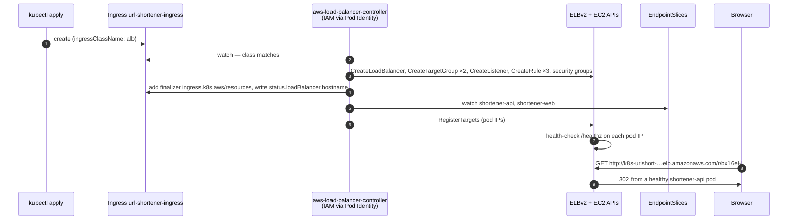
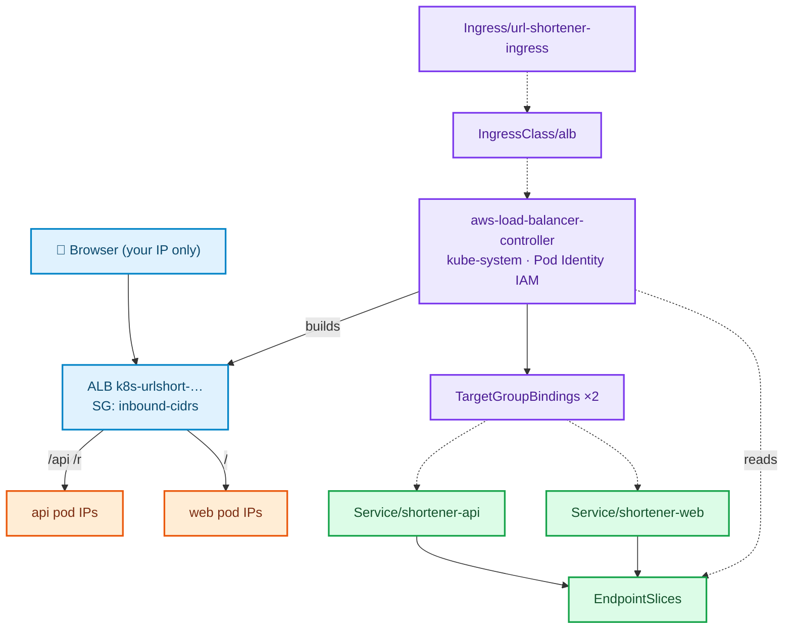

# Stage 09 — Ingress on EKS: the AWS Load Balancer Controller and an ALB

[⬅ Project 03](../../README.md) · Stage 8 of 10

[00 Namespace](../00-namespace/README.md) › [03 Deployments](../03-deployments/README.md) › [04 Services](../04-services/README.md) › [05 ConfigMaps](../05-configmaps/README.md) › [06 Secrets](../06-secrets/README.md) › [07 Storage](../07-storage/README.md) › [08 StatefulSets](../08-statefulsets/README.md) › **09 Ingress** › [11 Probes](../11-health-checks/README.md) › [19 Final](../19-final/README.md)

> **The problem:** the only way to use the shortener is `kubectl port-forward` — a tunnel through the EKS API
> server, from one laptop, with cluster credentials. Short links must work for anyone, at one address, with `/`
> going to the UI and `/api` and `/r/<code>` going to the API. Services route by port, not by URL path.

---

## 1. WHY does this resource exist?

| Option | What you get on EKS | Why not |
|---|---|---|
| `kubectl port-forward` | A tunnel for one person | Not a front door |
| `type: NodePort` per Service | A port on every node's IP | Nodes change; ugly ports; security groups per port; no paths |
| `type: LoadBalancer` per Service | **One NLB per Service**, ~$0.02/h each | Layer 4 — cannot route `/api` vs `/`; two load balancers for one app |
| **Ingress** | **One ALB**, HTTP routing by host and path, TLS in one place | ✅ |

An **Ingress** is a set of HTTP routing rules. It does nothing on its own: an **Ingress controller** watches Ingress
objects and makes them real. On EKS the standard controller is the **AWS Load Balancer Controller**, and "real"
means it calls AWS APIs to build an **Application Load Balancer** in your account.

> **Why not ingress-nginx?** It was the default choice for years and is still in older tutorials. The Kubernetes
> project announced its **retirement in March 2026**
> ([Ingress NGINX Retirement: What You Need to Know](https://kubernetes.io/blog/2025/11/11/ingress-nginx-retirement/)).
> On EKS the ALB controller is also the native answer: no load balancer pods to run, AWS WAF and ACM integration,
> pods as direct targets.

### When do you use which?

| Use | For |
|---|---|
| **Ingress + ALB** | HTTP/HTTPS apps: path and host routing, TLS termination, WAF |
| `Service type: LoadBalancer` → NLB | TCP/UDP, gRPC without HTTP routing, static IPs, extreme throughput |
| Gateway API | The successor to Ingress for richer routing; the ALB controller supports it too |

---

## 2. WHAT is it?

An Ingress is **a namespaced object of HTTP routing rules, implemented by whichever controller its
`ingressClassName` names.**

> **Analogy:** the Ingress is the building directory in the lobby ("floor 2: API, floor 1: reception"). The
> controller is the facilities team that actually builds the doors and hallways the directory describes. Without
> them the directory is just a sign.
>
> **Technically:** three layers, three owners:
>
> | Layer | Object | Owner |
> |---|---|---|
> | The rules | `Ingress/url-shortener-ingress` | you (this stage) |
> | Which implementation | `IngressClass/alb` | the controller's Helm chart |
> | The implementation | `Deployment/aws-load-balancer-controller` in `kube-system` + an **IAM role** (Pod Identity) | the platform (`clusters/eks-lab.yaml` + Helm) |

### What the controller builds from one Ingress

| AWS resource | From |
|---|---|
| Application Load Balancer, **internet-facing**, in the public subnets | `scheme: internet-facing` + subnet tag `kubernetes.io/role/elb=1` (eksctl adds it) |
| Listener on port 80 | the rule set |
| Listener rules: `/api*`, `/r*`, `/*` | `spec.rules[].http.paths` |
| **Target groups**, one per backend Service, **type `ip`** | `target-type: ip` |
| Registered targets = **pod IPs** from the EndpointSlices | the Services' selectors |
| A security group allowing only `inbound-cidrs` on port 80 | `inbound-cidrs` |
| `TargetGroupBinding` objects in the namespace | the controller's own bookkeeping |

`target-type: ip` is possible because the **VPC CNI gives pods real VPC IPs** (stage 03). The ALB talks to pods
directly — no NodePort, no kube-proxy, no extra hop.

---

## 3. HOW does it work?



1. The controller reconciles the Ingress into AWS resources — a few seconds of API calls.
2. It writes the ALB's DNS name into `status.loadBalancer.ingress[0].hostname` almost immediately.
3. **The ALB is not usable yet.** AWS provisions it (state `provisioning` → `active`), DNS propagates, and targets
   must pass the ALB's **own** health checks. Measured on this project: hostname after ~10 s, first `200` after
   ~150 s.
4. From then on the controller keeps the target groups equal to the Services' **ready** endpoints. Pods come and
   go; the ALB follows.
5. The finalizer means `kubectl delete ingress` blocks until the controller has **deleted the ALB**. This is the
   property cleanup depends on.

---

## 4. Manifest

[`01-url-shortener-ingress.yaml`](01-url-shortener-ingress.yaml):

```yaml
apiVersion: networking.k8s.io/v1
kind: Ingress
metadata:
  name: url-shortener-ingress
  namespace: url-shortener
  annotations:
    alb.ingress.kubernetes.io/scheme: internet-facing
    alb.ingress.kubernetes.io/target-type: ip
    alb.ingress.kubernetes.io/healthcheck-path: /healthz
    alb.ingress.kubernetes.io/healthcheck-interval-seconds: "10"
    alb.ingress.kubernetes.io/healthy-threshold-count: "2"
    alb.ingress.kubernetes.io/target-group-attributes: deregistration_delay.timeout_seconds=20
    alb.ingress.kubernetes.io/inbound-cidrs: 0.0.0.0/0      # replaced with YOUR IP in §6
    alb.ingress.kubernetes.io/tags: project=url-shortener,managed-by=aws-load-balancer-controller
spec:
  ingressClassName: alb
  rules:
    - http:                          # no host: match any Host header
        paths:
          - path: /api
            pathType: Prefix
            backend: { service: { name: shortener-api, port: { number: 8080 } } }
          - path: /r
            pathType: Prefix
            backend: { service: { name: shortener-api, port: { number: 8080 } } }
          - path: /
            pathType: Prefix
            backend: { service: { name: shortener-web, port: { number: 80 } } }
```

---

## 5. Manifest breakdown

| Field | Value | What it does | What breaks if it's wrong |
|---|---|---|---|
| `ingressClassName` | `alb` | Hands the Ingress to the ALB controller | Wrong/missing (no default class) ⇒ accepted, **no ALB, no event, no error** |
| `scheme` | `internet-facing` | Public ALB in public subnets | `internal` ⇒ reachable only inside the VPC; no public subnets tagged ⇒ `couldn't auto-discover subnets` event |
| `target-type` | `ip` | Pod IPs are targets | `instance` ⇒ targets are nodes' NodePorts; requires `NodePort` Services |
| `healthcheck-path` | `/healthz` | The ALB's own health check | A path returning 404 ⇒ every target `unhealthy` ⇒ **503** |
| `healthcheck-interval-seconds` / `healthy-threshold-count` | `10` / `2` | ~20 s to healthy | AWS defaults (15 s × 5) ⇒ 75 s before a new pod gets traffic |
| `target-group-attributes` | `deregistration_delay…=20` | How long a leaving target still receives in-flight requests | Default 300 s ⇒ slow rollouts and slow cleanup |
| `inbound-cidrs` | your `/32` | The **only** source allowed by the ALB security group | `0.0.0.0/0` ⇒ an open redirector on the internet |
| `tags` | project | Tags every AWS resource created | Nothing breaks — orphans are just harder to find |
| `rules[].host` | *(absent)* | Match any `Host` | Set `short.local` ⇒ the ALB hostname returns **404** unless you send `Host: short.local` |
| `path` + `pathType: Prefix` | `/api`, `/r`, `/` | ALB conditions `/api`, `/api/*`, … | `Exact` ⇒ `/r/bx16eH` matches nothing specific and falls to `/` → the web tier's 404 |
| `backend.service.port.number` | `8080` / `80` | The **Service** port | Container port instead ⇒ controller error event, no targets |

---

## 6. Apply

### 6.1 Prerequisite — the controller (once per cluster)

`clusters/eks-lab.yaml` already created the ServiceAccount `kube-system/aws-load-balancer-controller` and bound
an IAM role to it with EKS Pod Identity. Install the controller with Helm:

```bash
VPC_ID=$(aws eks describe-cluster --region us-east-1 --name kubernetes-lab \
           --query cluster.resourcesVpcConfig.vpcId --output text)
helm repo add eks https://aws.github.io/eks-charts
helm repo update eks
helm upgrade --install aws-load-balancer-controller eks/aws-load-balancer-controller \
  --version 3.5.0 --namespace kube-system \
  --set clusterName=kubernetes-lab \
  --set serviceAccount.create=false --set serviceAccount.name=aws-load-balancer-controller \
  --set region=us-east-1 --set vpcId="$VPC_ID" \
  --wait
kubectl get deployment aws-load-balancer-controller -n kube-system
kubectl get ingressclass
```

```
NAME                           READY   UP-TO-DATE   AVAILABLE
aws-load-balancer-controller   2/2     2            2
NAME   CONTROLLER            PARAMETERS   AGE
alb    ingress.k8s.aws/alb   <none>       21s
```

▸ `serviceAccount.create=false` — the ServiceAccount already exists, **with** its Pod Identity association. Let
Helm create a fresh one and the controller has no AWS permissions.

### 6.2 The Ingress, locked to your IP

```bash
kubectl apply -f manifests/09-ingress/01-url-shortener-ingress.yaml

MY_IP=$(curl -s https://checkip.amazonaws.com)
kubectl annotate ingress url-shortener-ingress -n url-shortener \
  alb.ingress.kubernetes.io/inbound-cidrs="${MY_IP}/32" --overwrite
```

▸ **Do the annotate immediately.** A URL shortener open to the internet is an open redirector — exactly what
phishing campaigns look for.

```bash
kubectl get ingress -n url-shortener -w          # Ctrl-C once ADDRESS appears
```

```
NAME                    CLASS   HOSTS   ADDRESS                                                                  PORTS
url-shortener-ingress   alb     *       k8s-urlshort-urlshort-bd06273c71-696005385.us-east-1.elb.amazonaws.com   80
```

```bash
ALB=$(kubectl get ingress url-shortener-ingress -n url-shortener -o jsonpath='{.status.loadBalancer.ingress[0].hostname}')
until curl -s -o /dev/null -m 5 -w '%{http_code}' "http://$ALB/healthz" | grep -q 200; do echo waiting…; sleep 10; done
```

▸ Two to three minutes the first time. `Could not resolve host` means DNS has not propagated yet.

---

## 7. Validate

```bash
curl -s -X POST "http://$ALB/api/links" -H 'Content-Type: application/json' \
  -d '{"url":"https://aws.amazon.com/elasticloadbalancing/"}'
curl -sI "http://$ALB/r/<code>" | grep -iE '^(HTTP|location|x-)'
curl -s -o /dev/null -w 'ui %{http_code}\n' "http://$ALB/"
```

```
{"code":"bx16eH", …, "short_url":"http://k8s-urlshort-…elb.amazonaws.com/r/bx16eH", …}
HTTP/1.1 302 FOUND
Location: https://aws.amazon.com/elasticloadbalancing/
X-Served-By: shortener-api-54b67f5f4d-t9fpc
X-Cache: HIT
X-Click-Counted: true
ui 200
```

▸ `short_url` uses the **ALB hostname** — `PUBLIC_BASE_URL` is blank, so the API builds it from the `Host` header
the ALB forwarded. Open `http://$ALB/` in your browser.

**What the controller made:**

```bash
kubectl get targetgroupbindings -n url-shortener
kubectl describe ingress url-shortener-ingress -n url-shortener | tail -3
```

```
NAME                               SERVICE-NAME    SERVICE-PORT   TARGET-TYPE
k8s-urlshort-shortene-81ee85f442   shortener-api   8080           ip
k8s-urlshort-shortene-c957111cd1   shortener-web   80             ip

Normal  SuccessfullyReconciled  7s  ingress  Successfully reconciled
```

---

## 8. Observe the mechanism

### Targets are pod IPs

```bash
for tg in $(aws elbv2 describe-target-groups --query "TargetGroups[?contains(TargetGroupName,'urlshort')].TargetGroupArn" --output text); do
  aws elbv2 describe-target-health --target-group-arn "$tg" \
    --query 'TargetHealthDescriptions[].[Target.Id,TargetHealth.State]' --output text
done
kubectl get pods -n url-shortener -l 'app.kubernetes.io/name in (shortener-api,shortener-web)' -o custom-columns=NAME:.metadata.name,IP:.status.podIP
```

```
192.168.39.34    healthy
192.168.10.166   healthy
192.168.62.92    healthy
192.168.25.174   healthy
```

▸ Every target ID is a **pod IP** from the second command. Scale a Deployment and watch the list follow.

### Only your IP gets in

```bash
kubectl run outside-test --rm -i --restart=Never --image=curlimages/curl:8.10.1 -n url-shortener -- \
  curl -s -o /dev/null -m 8 -w '%{http_code}\n' "http://$ALB/api/info"
```

▸ The pod's traffic leaves through a **node's** public IP, which is not in `inbound-cidrs`: curl **times out**
(exit 28). A security group drops packets; it does not answer with an error code.

### The status codes, and who sends them

```bash
curl -s -o /dev/null -w '/api/nope -> %{http_code}\n' "http://$ALB/api/nope"          # 404 from the API
kubectl scale deployment/shortener-web -n url-shortener --replicas=0; sleep 25
curl -s "http://$ALB/" | head -3                                                       # 503 from the ALB
kubectl scale deployment/shortener-web -n url-shortener --replicas=2
```

```
/api/nope -> 404
<html>
<head><title>503 Service Temporarily Unavailable</title></head>
```

---

## 9. Break it

### Break 1 — 502: a target that refuses

```bash
kubectl patch service shortener-api -n url-shortener --type=json \
  -p '[{"op":"replace","path":"/spec/ports/0/targetPort","value":9999}]'
sleep 45
curl -s -o /dev/null -w '%{http_code}\n' "http://$ALB/api/info"
```

**Symptom:** `502`.

**Root cause:** the controller registered pod IP **:9999** as the target; nothing listens there. The ALB's
connection is refused → `502 Bad Gateway`. (Health checks on 9999 fail too, and after a while targets go
`unhealthy` → `503`.)

**Fix:** `kubectl apply -f manifests/04-services/shortener-api-service.yaml` — `200` again within ~40 s.

### Break 2 — the Ingress nobody implements

```bash
kubectl patch ingress url-shortener-ingress -n url-shortener --type merge -p '{"spec":{"ingressClassName":"nginx"}}'
kubectl describe ingress url-shortener-ingress -n url-shortener | tail -3
```

**Symptom:** the object updates happily. The ALB controller no longer owns it and **deletes the ALB**; nothing
creates a replacement; no event says why. `curl` stops resolving.

**Root cause:** an Ingress is just data. The class is the contract with a controller, and there is no `nginx`
controller.

**Fix:** re-apply the manifest and re-run the `annotate` from §6.2. A brand-new ALB — with a **new hostname** —
is created. Anything that stored the old hostname is now broken; that is why real setups put a DNS name you own
in front (Route53 + ExternalDNS, Project 10).

### Break 3 — the health check path

```bash
kubectl annotate ingress url-shortener-ingress -n url-shortener \
  alb.ingress.kubernetes.io/healthcheck-path=/health --overwrite
sleep 60
curl -s -o /dev/null -w '%{http_code}\n' "http://$ALB/"
```

**Symptom:** `503` on every path, while every pod is `Running` and `Ready`.

**Investigate:** `aws elbv2 describe-target-health …` → `unhealthy`, reason `Target.ResponseCodeMismatch`.

**Root cause:** the ALB's health check is independent of Kubernetes probes. `/health` returns 404.

**Fix:** `kubectl annotate ingress url-shortener-ingress -n url-shortener alb.ingress.kubernetes.io/healthcheck-path=/healthz --overwrite`

---

## 10. How it interacts



---

## 11. Production notes

> 🧪 **DEMO / LEARNING CONFIGURATION**
> Plain HTTP on a generated hostname, one IP allowed, no WAF, no access logs, one ALB per Ingress.

> 🏭 **PRODUCTION CONSIDERATIONS**
> - **HTTPS only:** an ACM certificate (`alb.ingress.kubernetes.io/certificate-arn`), `listen-ports` for 443, and
>   `ssl-redirect`. Real DNS via Route53 + ExternalDNS so the hostname survives ALB recreation (Project 10).
> - **AWS WAF** (`wafv2-acl-arn`) — a public URL shortener needs rate limiting and bot protection.
> - **Share one ALB** across Ingresses with `alb.ingress.kubernetes.io/group.name` instead of paying for one per
>   application.
> - **Access logs to S3** (`load_balancer_attributes: access_logs.s3.enabled=true`).
> - **Never delete the controller before its Ingresses.** The ALB is orphaned and keeps billing. `cleanup.sh`
>   deletes the Ingress first and waits for the finalizer.
> - Validate the shortener's targets (no redirects to internal addresses, allow/deny lists) — an open redirector is
>   an application-level risk no load balancer removes.

---

## 12. The next problem

It works from the internet. Now roll out a change — any change — while traffic flows, and look closely at the
start of every pod's life:

- A new API pod is added to the target group as soon as its **container starts**, because nothing tells anyone
  whether it is ready. With no probes, "Running" is all Kubernetes knows.
- The Deployment then deletes an old pod — whether or not the **ALB** has finished health-checking the new one.
- Every API replica still creates the database schema from inside the serving process, at start-up, and the only
  thing stopping two of them colliding is a lock you have to trust. When PostgreSQL moved in stage 08 the schema
  vanished and the API returned `relation "links" does not exist` until someone restarted it by hand.

→ **[Stage 11 — Probes and init containers](../11-health-checks/README.md)**

---

## 📚 Official documentation

Everything above is self-contained — these are for going deeper, not for filling gaps.
*(All links verified 2026-09-13.)*

| Reference | What it adds |
|---|---|
| [Ingress](https://kubernetes.io/docs/concepts/services-networking/ingress/) | Rules, `pathType`, IngressClass, and why a controller is required |
| [Route internet traffic with AWS Load Balancer Controller](https://docs.aws.amazon.com/eks/latest/userguide/aws-load-balancer-controller.html) | Installing and authorising the controller on EKS |
| [AWS Load Balancer Controller](https://kubernetes-sigs.github.io/aws-load-balancer-controller/latest/) | The controller's own documentation |
| [Ingress annotations](https://kubernetes-sigs.github.io/aws-load-balancer-controller/latest/guide/ingress/annotations/) | Every `alb.ingress.kubernetes.io/*` annotation used above, and many more |
| [Ingress NGINX Retirement](https://kubernetes.io/blog/2025/11/11/ingress-nginx-retirement/) | The primary source for the retirement cited in §1 |

---

| ◀ Previous | ▲ Up | Next ▶ |
|---|:--:|---:|
| ◀ **[08 StatefulSets](../08-statefulsets/README.md)** | [Project 03](../../README.md) · [Manual steps](../../scripts/manual-steps.md) | **[11 Probes](../11-health-checks/README.md)** ▶ |
