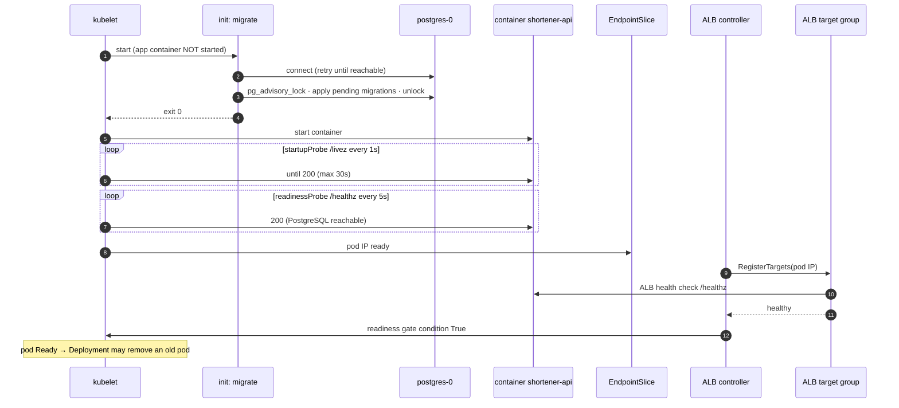
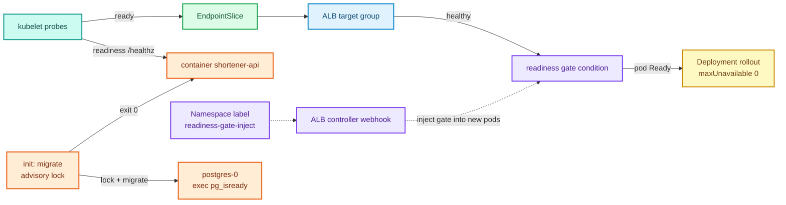

# Stage 11 — Probes, init containers and ALB readiness gates

[⬅ Project 03](../../README.md) · Stage 9 of 10

[00 Namespace](../00-namespace/README.md) › [03 Deployments](../03-deployments/README.md) › [04 Services](../04-services/README.md) › [05 ConfigMaps](../05-configmaps/README.md) › [06 Secrets](../06-secrets/README.md) › [07 Storage](../07-storage/README.md) › [08 StatefulSets](../08-statefulsets/README.md) › [09 Ingress](../09-ingress/README.md) › **11 Probes** › [19 Final](../19-final/README.md)

> **The problem:** nothing tells Kubernetes — or the ALB — whether a pod can actually serve. "Running" means only
> that a process started. A new API pod receives traffic before its database connection works; a Redis replica is
> "Ready" while still loading; and every API replica migrates the schema from inside its serving process, so a
> moved or restarted database leaves the API returning `relation "links" does not exist` until a human restarts
> it.

---

## 1. WHY does this resource exist?

Kubernetes can observe exactly one thing about a container on its own: whether the process is alive. Every other
question needs the application's help:

| Question | Without it | Mechanism |
|---|---|---|
| "Has it finished starting?" | Liveness kills slow starters mid-boot | **startupProbe** |
| "Can it serve traffic **now**?" | Traffic hits pods that cannot answer; rollouts proceed on broken pods | **readinessProbe** → Service endpoints |
| "Is it stuck and needs restarting?" | A deadlocked process runs forever | **livenessProbe** → container restart |
| "Is the ALB sending it traffic yet?" | The Deployment deletes old pods before the ALB trusts the new ones | **pod readiness gate** (ALB controller) |
| "Is the precondition for starting met?" | The app starts against a missing or old schema | **init container** |

### Why the schema moves into an init container

Through stage 09 the API migrated from inside `app.py` at start-up. That made "schema is current" something the
**serving** process discovered while already running, with three consequences you have seen or will see:

1. A new PostgreSQL (stage 08) had no schema until somebody restarted the API.
2. Without probes, a pod still waiting on the migration lock was already receiving traffic.
3. A failed migration looked like an application full of 500s, not like a failed deployment step.

An **init container** runs to completion **before** the app container starts. If it fails, the app never starts
and the pod says so: `Init:Error`, `Init:CrashLoopBackOff`, or `Init:0/1` while it waits.

> ⚠️ **What it does *not* fix:** init containers run **once per pod**. Two replicas still run two migrators at the
> same moment. The PostgreSQL **advisory lock** in `migrations.py` is what makes that safe. Moving the migration
> changes *where* the race happens, not *whether*. For migrations that must run exactly once per release, a Job
> run before the rollout is the stronger pattern (Project 06).

---

## 2. WHAT is it?

**Probes** are checks the kubelet runs against a container, periodically, with thresholds. **Init containers** are
containers in the pod spec that run sequentially to completion before the app containers. A **readiness gate** is
an extra pod condition, set by an outside controller, that must be `True` before the pod counts as Ready.

> **Analogy:** a restaurant opening. The init container is the prep cook — nobody seats guests until prep is done.
> The startup probe is "doors unlocked yet?". Readiness is the host deciding whether to seat people at a table
> *right now*. Liveness is the manager checking whether a waiter has collapsed. The readiness gate is the
> reservations system confirming the table is actually in the booking list before the host counts it.

### Three probe types, and which one each workload uses

| Workload | Startup | Readiness | Liveness | Check |
|---|---|---|---|---|
| `shortener-api` | `/livez` | `/healthz` — **PostgreSQL only** | `/livez` | HTTP |
| `shortener-web` | `/livez` | `/healthz` — shallow | `/livez` | HTTP |
| `analytics-collector` | — | `/healthz` | `/livez` | HTTP |
| `postgres` | `pg_isready` | `pg_isready` | `pg_isready` | exec |
| `redis` | `redis-cli ping` | `redis-cli ping` | `redis-cli ping` | exec |

Two choices here are the whole lesson:

- **The API's readiness checks PostgreSQL and deliberately not Redis.** Redis is optional to this API — it degrades
  without it. Gate readiness on Redis and one Redis restart removes every API pod from the ALB: a degraded service
  becomes a total outage.
- **Liveness never checks a dependency.** A PostgreSQL blip must not restart every API pod at once.

---

## 3. HOW does it work?



1. **Init containers** run one at a time; each must exit 0. On failure the kubelet restarts it with back-off,
   following the pod's `restartPolicy`. The pod's status reads `Init:N/M`.
2. **startupProbe** runs first; while it has not succeeded, readiness and liveness are **not run**.
3. **readinessProbe** runs for the life of the container. Failing ⇒ the pod leaves every Service's EndpointSlice
   (and so the ALB target group). **The container is not restarted.**
4. **livenessProbe** failing `failureThreshold` times ⇒ the kubelet kills the container (exit 137) and restarts it.
5. **Readiness gate:** the namespace label `elbv2.k8s.aws/pod-readiness-gate-inject: enabled` makes the controller's
   webhook add `readinessGates` to **new** pods. The pod's `Ready` condition stays `False` until the controller
   sets `target-health.elbv2.k8s.aws/<target-group>` to `True`, which it does only when the ALB reports the target
   healthy. `maxUnavailable: 0` then means "never fewer than 2 pods the **ALB** considers healthy".

---

## 4. Manifest

Six files. The API, excerpted:

```yaml
# 04-shortener-api-deployment.yaml
spec:
  strategy:
    rollingUpdate: { maxSurge: 1, maxUnavailable: 0 }
  template:
    spec:
      initContainers:
        - name: migrate
          image: cloudprakhargupta/url-shortener:api-1.0.0   # same image as the app
          command: ["python", "migrate.py"]
          envFrom: [{ configMapRef: { name: shortener-config-v2 } }]
          env:
            - name: POSTGRES_PASSWORD
              valueFrom: { secretKeyRef: { name: postgres-secret, key: POSTGRES_PASSWORD } }
      containers:
        - name: shortener-api
          env:
            - name: RUN_MIGRATIONS
              value: "false"            # env beats envFrom
          startupProbe:
            httpGet: { path: /livez, port: http }
            periodSeconds: 1
            failureThreshold: 30
          readinessProbe:
            httpGet: { path: /healthz, port: http }
            periodSeconds: 5
            timeoutSeconds: 2
            failureThreshold: 3
          livenessProbe:
            httpGet: { path: /livez, port: http }
            periodSeconds: 10
            timeoutSeconds: 2
            failureThreshold: 3
```

```yaml
# 03-redis-statefulset.yaml (probes)
startupProbe:
  exec: { command: ["sh", "-c", "redis-cli ping | grep -q PONG"] }
  periodSeconds: 2
  failureThreshold: 60
readinessProbe:
  exec: { command: ["sh", "-c", "redis-cli ping | grep -q PONG"] }
  periodSeconds: 5
livenessProbe:
  exec: { command: ["sh", "-c", "redis-cli ping | grep -q PONG"] }
  periodSeconds: 10
  failureThreshold: 6
```

```yaml
# 01-url-shortener-namespace.yaml
metadata:
  name: url-shortener
  labels:
    elbv2.k8s.aws/pod-readiness-gate-inject: enabled
```

---

## 5. Manifest breakdown

| Field | Value | What it does | What breaks if it's wrong |
|---|---|---|---|
| `initContainers[].command` | `python migrate.py` | Migrate, exit 0/1 | Non-zero forever ⇒ `Init:CrashLoopBackOff`; the app never starts |
| init image = app image | `api-1.0.0` | Migrations ship with the code that needs them | A different tag ⇒ new code against an old schema |
| `RUN_MIGRATIONS` | `"false"` | App skips its own migration | `true` ⇒ harmless (lock + already applied) but redundant |
| `startupProbe` budget | 30 × 1 s | Max boot time before liveness can act | Too short ⇒ a slow node kills pods mid-boot: `CrashLoopBackOff` |
| readiness `path` | `/healthz` | PostgreSQL reachable | Pointing at a Redis check ⇒ Redis restart empties the ALB |
| readiness `failureThreshold` | 3 × 5 s | ~15 s of failure before traffic stops | 1 ⇒ one slow query flaps pods in and out |
| liveness `path` | `/livez` | Process only | `/healthz` ⇒ a database blip restarts every API pod (exit 137) |
| `maxUnavailable` | `0` | Never below desired ready count during rollout | `25%` default ⇒ one of two pods removed immediately |
| `pg_isready -h 127.0.0.1` | exec | TCP check inside the pod | Without `-h`, it tests a Unix socket path |
| `redis-cli ping \| grep -q PONG` | exec | Authenticated via `REDISCLI_AUTH` | Missing env ⇒ `NOAUTH`, probe fails, pods never Ready |
| Postgres liveness `failureThreshold` | 6 × 10 s | A minute of silence before restart | Aggressive ⇒ a long checkpoint restarts the database |
| namespace label | `pod-readiness-gate-inject` | Gates injected into **new** pods | Existing pods are not changed — roll them |

---

## 6. Apply

```bash
kubectl apply -f manifests/11-health-checks/01-url-shortener-namespace.yaml
kubectl apply -f manifests/11-health-checks/02-postgres-statefulset.yaml \
              -f manifests/11-health-checks/03-redis-statefulset.yaml
kubectl rollout status statefulset/postgres -n url-shortener --timeout=300s
kubectl rollout status statefulset/redis -n url-shortener --timeout=300s

kubectl apply -f manifests/11-health-checks/04-shortener-api-deployment.yaml \
              -f manifests/11-health-checks/05-shortener-web-deployment.yaml \
              -f manifests/11-health-checks/06-analytics-collector-deployment.yaml
kubectl rollout status deployment/shortener-api -n url-shortener --timeout=300s
kubectl rollout status deployment/shortener-web -n url-shortener --timeout=300s
```

▸ **Namespace label first**, so the new pods created by the Deployment updates get readiness gates.

▸ The Redis rollout goes **replica first** (`redis-1`, then `redis-0`); each waits for the new pod to pass
readiness before the next.

▸ `shortener-config-v1` now has no consumers: `kubectl delete configmap shortener-config-v1 redis-config -n url-shortener`
is safe **after** stage 19 (which replaces `redis-config`); leave them until then.

---

## 7. Validate

```bash
kubectl get pods -n url-shortener -o wide
```

```
NAME                             READY   STATUS    RESTARTS   AGE   …   READINESS GATES
shortener-api-587b45c89f-wsjlz   1/1     Running   0          45s   …   1/1
shortener-api-587b45c89f-x7hm9   1/1     Running   0          24s   …   1/1
```

▸ **`READINESS GATES 1/1`** — the ALB has confirmed the target healthy.

```bash
POD=$(kubectl get pods -n url-shortener -l app.kubernetes.io/name=shortener-api -o jsonpath='{.items[0].metadata.name}')
kubectl get pod "$POD" -n url-shortener -o jsonpath='{.spec.readinessGates}{"\n"}'
kubectl logs "$POD" -n url-shortener -c migrate
kubectl describe pod "$POD" -n url-shortener | grep -E 'Liveness|Readiness|Startup'
```

```
[{"conditionType":"target-health.elbv2.k8s.aws/k8s-urlshort-shortene-81ee85f442"}]

level=INFO … logger=migrations msg=waiting for migration lock id=73032026
level=INFO … logger=migrations msg=migration already applied version=001_create_links
level=INFO … logger=migrations msg=migration already applied version=002_links_created_at_idx
level=INFO … logger=migrations msg=schema up to date versions=2
```

▸ `-c migrate` is required to read an **init** container's logs.

---

## 8. Observe the mechanism

### Init container waiting — not crashing

```bash
kubectl scale statefulset/postgres -n url-shortener --replicas=0
kubectl rollout restart deployment/shortener-api -n url-shortener
sleep 30
kubectl get pods -n url-shortener -l app.kubernetes.io/name=shortener-api
curl -s -o /dev/null -w '%{http_code}\n' "http://$ALB/r/<code>"
```

```
NAME                             READY   STATUS     RESTARTS   AGE
shortener-api-587b45c89f-wsjlz   0/1     Running    0          3m1s
shortener-api-587b45c89f-x7hm9   0/1     Running    0          2m40s
shortener-api-7dd48bc6f7-lvvpj   0/1     Init:0/1   0          31s

503
```

Read each line:

| Pod | State | Means |
|---|---|---|
| old pods `0/1 Running` | readiness failing | PostgreSQL gone ⇒ `/healthz` 503 ⇒ out of the ALB. **Not restarted** — liveness is fine |
| new pod `Init:0/1` | `migrate` retrying | Waiting for a precondition, not broken |
| ALB `503` | no healthy targets | A clean, immediate error instead of timeouts |

```bash
kubectl logs -n url-shortener -l app.kubernetes.io/name=shortener-api -c migrate --tail=2
kubectl scale statefulset/postgres -n url-shortener --replicas=1
kubectl rollout status deployment/shortener-api -n url-shortener --timeout=300s
```

▸ The rollout completes on its own once PostgreSQL returns — nobody restarts anything.

### A rollout under load, measured

```bash
( for i in $(seq 1 90); do curl -s -o /dev/null -m 3 -w '%{http_code}\n' "http://$ALB/r/<code>"; sleep 1; done ) > codes.txt &
kubectl rollout restart deployment/shortener-api -n url-shortener
kubectl rollout status deployment/shortener-api -n url-shortener
wait; sort codes.txt | uniq -c
```

Measured on this project's cluster while stage 11 was applied:

```
     88 302
      1 502
      1 000
```

▸ **Honest result: close, not zero.** The readiness gate protects the *start* of a pod's life — no new pod gets
ALB traffic before it is healthy, and no old pod is removed before that. The two failures are the *end* of a pod's
life: the old pod receives SIGTERM at the same moment the controller starts deregistering it, and the ALB can
still send it a request or two. Closing that gap takes a `preStop` sleep longer than the ALB's deregistration
propagation, and a `terminationGracePeriodSeconds` to match — **Project 05** builds exactly that.

---

## 9. Break it

### Break 1 — liveness pointed at a dependency

```bash
kubectl patch deployment shortener-api -n url-shortener --type=json \
  -p '[{"op":"replace","path":"/spec/template/spec/containers/0/livenessProbe/httpGet/path","value":"/healthz"}]'
kubectl rollout status deployment/shortener-api -n url-shortener
kubectl scale statefulset/postgres -n url-shortener --replicas=0
sleep 60
kubectl get pods -n url-shortener -l app.kubernetes.io/name=shortener-api
```

**Symptom:** `RESTARTS` climbing on **every** API pod; `describe` shows `Liveness probe failed: HTTP probe failed
with statuscode: 503` and `Last State: Terminated, Exit Code: 137`.

**Root cause:** a dependency failure became a restart storm. Restarting the API cannot fix PostgreSQL, and when
PostgreSQL returns every pod is in back-off.

**Fix:**

```bash
kubectl scale statefulset/postgres -n url-shortener --replicas=1
kubectl apply -f manifests/11-health-checks/04-shortener-api-deployment.yaml
```

### Break 2 — readiness that includes Redis

Imagine `/healthz` also pinged Redis. Delete `redis-0`:

```bash
kubectl delete pod redis-0 -n url-shortener
```

▸ With the real manifest: redirects keep working, `X-Click-Counted: false` for a few seconds. With a Redis-aware
readiness check, **every** API pod would leave the ALB for those seconds — `503` for all users because the
*optional* store blinked. Readiness must reflect what the pod genuinely cannot work without.

### Break 3 — a migration that can never succeed

```bash
kubectl set env deployment/shortener-api -n url-shortener -c migrate POSTGRES_HOST=postgres.wrong-namespace.svc.cluster.local
kubectl get pods -n url-shortener -l app.kubernetes.io/name=shortener-api -w      # Ctrl-C after ~3 min
```

**Symptom:** the new pod sits in `Init:0/1` for two minutes (60 retries × 2 s); then `migrate` exits 1, the kubelet
restarts it, and the pod shows `Init:Error` briefly, then `Init:0/1` again with a growing restart count and back-off
(`Init:CrashLoopBackOff`). The **old pods keep serving** — `maxUnavailable: 0`.

**Investigate:** `kubectl logs <new-pod> -c migrate -n url-shortener` —
`failed to resolve host 'postgres.wrong-namespace.svc.cluster.local'`.

**Fix:** `kubectl apply -f manifests/11-health-checks/04-shortener-api-deployment.yaml`

---

## 10. How it interacts



---

## 11. Production notes

> 🧪 **DEMO / LEARNING CONFIGURATION**
> Probes tuned for fast feedback, no `preStop`, migrations that are trivially fast, and no PodDisruptionBudget.

> 🏭 **PRODUCTION CONSIDERATIONS**
> - **Graceful termination on ALB targets:** `preStop` sleep (commonly 15–30 s) plus a matching
>   `terminationGracePeriodSeconds`, so pods stop receiving ALB traffic before they stop serving — the gap measured
>   in §8 (Project 05).
> - **Migrations as a release step** — a Job (or a pipeline stage) that must succeed before the Deployment
>   changes, with backward-compatible "expand/contract" migrations so old and new pods can run side by side.
> - **Tune probes from real latency data**, not guesses; a readiness timeout below your p99 flaps pods.
> - **Enable readiness gates on every namespace fronted by the ALB controller.**
> - **PodDisruptionBudgets** so node-group upgrades cannot take all replicas at once (Project 05/09).

---

## 12. The next problem

The platform is now correct end to end. Rebuilding it, though, means knowing that the final `shortener-api` is
the file in stage 11, the final Redis is stage 11 but its config is stage 05, the Secrets are stage 06, the
Services are 04 **and** 08, the StorageClass is 07, the Ingress is 09 plus an annotation you typed by hand — and
that three ConfigMaps (`shortener-config-v1`, `-v2`, `redis-config`) are versioned by names **you** invented and
hashes **you** computed.

→ **[Stage 19 — The complete manifest](../19-final/README.md)**

---

## 📚 Official documentation

Everything above is self-contained — these are for going deeper, not for filling gaps.
*(All links verified 2026-09-13.)*

| Reference | What it adds |
|---|---|
| [Configure liveness, readiness and startup probes](https://kubernetes.io/docs/tasks/configure-pod-container/configure-liveness-readiness-startup-probes/) | Every probe field and its timing semantics |
| [Init containers](https://kubernetes.io/docs/concepts/workloads/pods/init-containers/) | Ordering, restart behaviour, resource accounting |
| [Pod readiness gate (AWS Load Balancer Controller)](https://kubernetes-sigs.github.io/aws-load-balancer-controller/latest/deploy/pod_readiness_gate/) | How the gate is injected and when it turns True |
| [Deployments — rolling update](https://kubernetes.io/docs/concepts/workloads/controllers/deployment/) | `maxSurge`, `maxUnavailable`, and how readiness gates a rollout |

---

| ◀ Previous | ▲ Up | Next ▶ |
|---|:--:|---:|
| ◀ **[09 Ingress](../09-ingress/README.md)** | [Project 03](../../README.md) · [Manual steps](../../scripts/manual-steps.md) | **[19 Final](../19-final/README.md)** ▶ |
