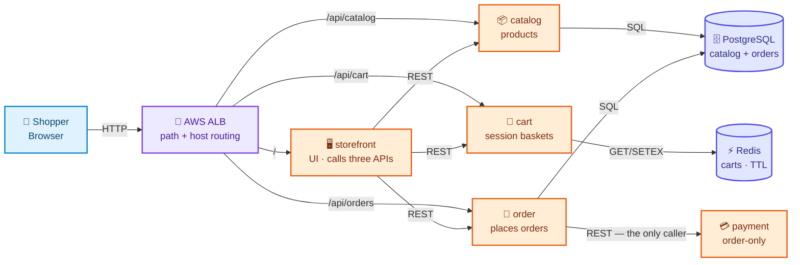

# Project 04 — E-Commerce Microservices on EKS

> **Difficulty:** 🟡 Intermediate
> **Estimated time:** 5–6 hours
> **Cluster required:** **AWS EKS** — [`clusters/eks-advanced.yaml`](../clusters/eks-advanced.yaml) (eksctl; VPC CNI with **network policy enforcement on**). **This project does not run on Kind.**
> **Cost:** ~**$0.25/hour** while the cluster exists (control plane, 3 × t3.medium, an ALB, two 1 GiB EBS volumes). Budget **~$2** if you clean up the same day. The same cluster serves Project 05.
> **Assumes:** you can run a multi-tier app with Services, ConfigMaps, Secrets and PVCs (Projects 01–03, or equivalent)

---

## 1. What Are We Building?

A small online shop, split the way real shops are: a storefront, a product catalogue, a basket, checkout, and a
payment service — five services calling each other over the cluster network.

| Component | Technology | Responsibility | Port |
|---|---|---|---|
| `storefront` | Python 3.13 · Flask · gunicorn | UI; fans out to catalog, cart and order | 8080 |
| `catalog` | Flask · psycopg 3 | Products — owns the `catalog` database | 8080 |
| `cart` | Flask · redis-py | Session baskets in Redis, with a TTL | 8080 |
| `order` | Flask · psycopg 3 · requests | Checkout — owns the `orders` database; **the only caller of `payment`** | 8080 |
| `payment` | Flask | Authorises payments (simulated; can be made slow or flaky) | 8080 |
| `postgres` | PostgreSQL 17.5 | Two databases: `catalog`, `orders` | 5432 |
| `redis` | Redis 8.2.9 | Baskets | 6379 |

**This is the first project with real east-west traffic.** One click on *Checkout* crosses four services and both
datastores — and that call graph is what every stage is about.

---

## 2. Why This Project?

Two questions only a microservice system forces:

1. **How does traffic get *in*?** Four services are public; each could have its own load balancer — four NLBs, four
   bills, four hostnames, no path routing. Stage 09 routes by **path and host** on **one ALB**, and leaves `payment`
   off the internet entirely.
2. **Who may talk to whom *inside*?** Stage 04 proves that a throwaway pod can authorise a **$9,999.99 payment**,
   because a Service is discovery, not access control and the pod network is flat. Stage 15 builds a **default-deny
   NetworkPolicy** and re-opens exactly the edges of the call graph — and walks straight into the **DNS egress
   trap** on the way.

Along the way: **shared vs owned configuration** (one ConfigMap for what services agree on, per-Deployment values
for what each owns), and a **cascading failure** — one slow dependency making unrelated endpoints return 503.

---

## 3. Learning Objectives

By the end you will be able to:

- [ ] Explain why a Deployment registers no DNS name, and wire five services together by Service name
- [ ] Prove that a Service is not access control
- [ ] Separate **shared**, **owned** and **secret** configuration — and explain why `POSTGRES_DB` must not be shared
- [ ] Route one ALB by **path** and by **host**, and read ALB 404 / 502 / 503
- [ ] Choose what each service's **readiness** should depend on, and demonstrate a cascading readiness failure
- [ ] Explain why NetworkPolicy needs an enforcing CNI, and prove enforcement on EKS
- [ ] Write a default-deny, allow **DNS egress**, and open a call graph edge by edge — egress **and** ingress
- [ ] Explain AND vs OR in selectors, and why a denial looks like a **timeout**
- [ ] State what NetworkPolicy cannot do (authenticate a workload)

---

## 4. Technologies Used

| Layer | Choice | Why |
|---|---|---|
| Cluster | **Amazon EKS 1.36** via eksctl 0.230 | Managed control plane; add-ons below are first-class |
| Nodes | 3 × t3.medium managed node group | Room for 12 app pods plus system pods; Project 05's drains need 3 |
| Pod networking | Amazon VPC CNI **with `enableNetworkPolicy: "true"`** | Pod IPs are VPC IPs, and NetworkPolicy is **enforced** (eBPF) |
| Ingress | AWS Load Balancer Controller 3.5.0 (Helm) | Ingress → ALB, pods as direct targets |
| Storage | EBS CSI driver, gp3 | Durable datastores |
| Metrics | Metrics Server (EKS community add-on) | `kubectl top`; used by Project 05 |
| App | Python 3.13, Flask 3.1, gunicorn 26, psycopg 3.3, redis-py 8.1 | The app is never the hard part |
| Config | Kustomize (built into kubectl) | Hash-named, immutable config in stage 19 |

---

## 5. Prerequisites

| Tool | Version tested | Verify |
|---|---|---|
| AWS CLI v2 | 2.34 | `aws sts get-caller-identity` |
| eksctl | 0.230.0 | `eksctl version` |
| kubectl | 1.35+ | `kubectl version --client` |
| Helm | 3.14+ (tested 4.3.0) | `helm version` |
| Docker | 24+ | `docker version` |

```bash
# From the repository root — about 17 minutes
eksctl create cluster --config-file clusters/eks-advanced.yaml
kubectl get daemonset aws-node -n kube-system -o jsonpath='{.spec.template.spec.containers[*].name}{"\n"}'
# → aws-node aws-eks-nodeagent      (no nodeagent = policies will be ignored)
```

> ⚠️ **Check your kube-context before every session.** `scripts/deploy.sh` refuses to run unless the context names
> `kubernetes-lab` and the nodes are EC2 instances. Consider `eksctl … --kubeconfig ~/.kube/lab.yaml` to keep the lab
> out of your default kubeconfig entirely.

---

## 6. Application Architecture — HLD

*What the application is, ignoring Kubernetes entirely.*



**The one arrow that defines this project:** `order → payment`, and nothing else pointing at `payment`. Stage 15
makes the network agree with this diagram.

---

## 7. Kubernetes Architecture — LLD

*Every object in the final state, plus what the controllers create in AWS.*

```mermaid
flowchart TB
    U["👤 Shopper<br/>http://&lt;alb-hostname&gt;"]:::external

    subgraph AWS["☁️ AWS account (created by controllers)"]
        ALB["ALB k8s-ecommerce-…<br/>listener :80 · host + path rules"]:::external
        EBS["EBS vol-… gp3<br/>one per PVC"]:::storage
    end

    subgraph KS["📦 Namespace: kube-system (cluster software)"]
        LBC["Deployment/aws-load-balancer-controller<br/>Pod Identity → IAM"]:::gateway
        CSI["Deployment/ebs-csi-controller<br/>Pod Identity → IAM"]:::storage
        DNS["Deployment/coredns<br/>Service kube-dns 10.100.0.10"]:::network
        CNI["DaemonSet/aws-node<br/>VPC CNI + network policy agent<br/>enableNetworkPolicy: true"]:::security
    end

    ICLASS["IngressClass/alb"]:::gateway
    SC["StorageClass/ecommerce-gp3<br/>ebs.csi.aws.com · WaitForFirstConsumer"]:::storage

    subgraph NS["📦 Namespace: ecommerce  (pod-readiness-gate-inject: enabled)"]
        direction TB

        ING["Ingress/ecommerce-ingress<br/>/ → storefront · /api/catalog · /api/cart · /api/orders<br/>Host admin.shop.local → order"]:::gateway

        SVCSF["Service/storefront<br/>ClusterIP :8080"]:::network
        DEPSF["Deployment/storefront<br/>replicas 2"]:::workload
        PSF["Pod/storefront-…<br/>readiness: shallow"]:::pod

        SVCCAT["Service/catalog<br/>ClusterIP :8080"]:::network
        DEPCAT["Deployment/catalog<br/>replicas 2"]:::workload
        PCAT["Pod/catalog-…<br/>init: migrate"]:::pod

        SVCCART["Service/cart<br/>ClusterIP :8080"]:::network
        DEPCART["Deployment/cart<br/>replicas 2"]:::workload
        PCART["Pod/cart-…"]:::pod

        SVCORD["Service/order<br/>ClusterIP :8080"]:::network
        DEPORD["Deployment/order<br/>replicas 2"]:::workload
        PORD["Pod/order-…<br/>init: migrate"]:::pod

        SVCPAY["Service/payment<br/>ClusterIP :8080"]:::network
        DEPPAY["Deployment/payment<br/>replicas 2"]:::workload
        PPAY["Pod/payment-…"]:::pod

        SVCPG["Service/postgres<br/>ClusterIP :5432"]:::network
        SVCPGH["Service/postgres-headless<br/>clusterIP None"]:::network
        STSPG["StatefulSet/postgres<br/>replicas 1 · db: catalog + orders"]:::workload
        PPG["Pod/postgres-0<br/>exec pg_isready"]:::pod
        PVCPG["PVC/postgres-data-postgres-0"]:::storage

        SVCRD["Service/redis<br/>ClusterIP :6379"]:::network
        SVCRDH["Service/redis-headless<br/>clusterIP None"]:::network
        STSRD["StatefulSet/redis<br/>replicas 1"]:::workload
        PRD["Pod/redis-0"]:::pod
        PVCRD["PVC/redis-data-redis-0"]:::storage

        CM["ConfigMap/ecommerce-config-&lt;hash&gt;<br/>immutable · generated"]:::config
        SECP["Secret/postgres-secret"]:::config
        SECR["Secret/redis-secret"]:::config

        subgraph NP["🔒 NetworkPolicies (stage 15)"]
            NP0["default-deny-all<br/>ingress + egress"]:::security
            NP1["allow-dns-egress<br/>UDP/TCP 53 → kube-system"]:::security
            NP2["allow-internet-to-public-services<br/>:8080 to the 4 ALB-exposed services"]:::security
            NP3["allow-*-egress ×4<br/>each service → exactly its upstreams"]:::security
            NP4["allow-order-to-payment"]:::security
            NP5["allow-apps-to-postgres<br/>catalog + order only"]:::security
            NP6["allow-cart-to-redis<br/>cart only"]:::security
        end
    end

    U -->|"HTTP :80"| ALB
    ING -.->|"ingressClassName"| ICLASS
    LBC -.->|"reconciles"| ING
    LBC -->|"creates + registers pod IPs"| ALB
    ALB -->|"/"| PSF
    ALB -->|"/api/catalog"| PCAT
    ALB -->|"/api/cart"| PCART
    ALB -->|"/api/orders"| PORD

    SVCSF --> PSF
    DEPSF --> PSF
    SVCCAT --> PCAT
    DEPCAT --> PCAT
    SVCCART --> PCART
    DEPCART --> PCART
    SVCORD --> PORD
    DEPORD --> PORD
    SVCPAY --> PPAY
    DEPPAY --> PPAY

    PSF -->|"east-west"| SVCCAT & SVCCART & SVCORD
    PORD -->|"the ONLY caller"| SVCPAY
    PCAT -->|"SQL db=catalog"| SVCPG
    PORD -->|"SQL db=orders"| SVCPG
    SVCPG --> PPG
    SVCPGH -.-> PPG
    STSPG --> PPG --> PVCPG
    PCART -->|":6379"| SVCRD --> PRD
    SVCRDH -.-> PRD
    STSRD --> PRD --> PVCRD

    PSF & PCAT & PCART & PORD & PPAY -.->|"resolve every name"| DNS

    CM -.->|"envFrom"| PSF & PCAT & PCART & PORD & PPAY
    SECP -.-> PCAT & PORD & PPG
    SECR -.-> PCART & PRD

    SC -.->|"provisions via"| CSI
    CSI -->|"CreateVolume"| EBS
    PVCPG & PVCRD -.-> EBS

    CNI -.->|"ENFORCES every policy below"| NP
    NP0 -.->|"denies everything first"| PSF
    NP1 -.->|"without this, every name fails"| DNS
    NP4 -.->|"guards"| PPAY
    NP5 -.->|"guards"| PPG
    NP6 -.->|"guards"| PRD

    classDef external fill:#e0f2fe,stroke:#0284c7,stroke-width:2px,color:#0c4a6e
    classDef gateway  fill:#ede9fe,stroke:#7c3aed,stroke-width:2px,color:#4c1d95
    classDef network  fill:#dcfce7,stroke:#16a34a,stroke-width:2px,color:#14532d
    classDef workload fill:#fef9c3,stroke:#ca8a04,stroke-width:2px,color:#713f12
    classDef pod      fill:#ffedd5,stroke:#ea580c,stroke-width:2px,color:#7c2d12
    classDef config   fill:#fce7f3,stroke:#db2777,stroke-width:2px,color:#831843
    classDef storage  fill:#e0e7ff,stroke:#4f46e5,stroke-width:2px,color:#312e81
    classDef security fill:#fee2e2,stroke:#dc2626,stroke-width:2px,color:#7f1d1d
```



**Legend** — colours mean the same thing in every project in this repository:

| Colour | Layer | Colour | Layer |
|---|---|---|---|
| 🟦 blue | External / AWS / user | 🩷 pink | Config / Secrets |
| 🟪 purple | Ingress / controller | 🟪 indigo | Storage |
| 🟩 green | Networking (Service, DNS) | 🟧 orange | Pods |
| 🟨 yellow | Workload controllers | 🟥 red | Security (NetworkPolicy, policy agent) |

Diagram source: [`architecture/architecture.mmd`](architecture/architecture.mmd) · Design record:
[`architecture/architecture.md`](architecture/architecture.md)

---

## 8. Request Flow

One checkout:

| # | Hop | What happens | Fails when |
|---|---|---|---|
| 1 | Browser → ALB | Security group allows only `inbound-cidrs` | Your IP not allowed ⇒ **timeout** |
| 2 | Listener rule | `/api/orders` → `order` target group | No rule ⇒ ALB **404** |
| 3 | → pod IP | A **healthy** `order` pod | None healthy ⇒ **503**; wrong port ⇒ **502** |
| 4 | `order` → CoreDNS | `payment` → ClusterIP | DNS egress denied ⇒ every name fails |
| 5 | `order` → `payment` | Allowed by `allow-order-egress` **and** `allow-order-to-payment` | Either missing ⇒ **timeout** |
| 6 | `payment` responds | After `PAYMENT_LATENCY_MS` | Slow ⇒ bounded by `UPSTREAM_TIMEOUT_SECONDS` |
| 7 | `order` → PostgreSQL | `INSERT` into `orders` | ⇒ JSON **503** naming postgres |

Full sequence diagrams and the status-code table: [`architecture/request-flow.md`](architecture/request-flow.md)

---

## 9. Kubernetes Resources Used

| Resource | Why We Need It | Application Usage | Stage |
|---|---|---|---|
| Namespace | Scope, cleanup, **the blast radius of a default-deny** | `ecommerce` | [00](manifests/00-namespace/README.md) |
| Deployment ×7 | Self-healing, rolling updates | 5 services (+ datastores at first) | [03](manifests/03-deployments/README.md) |
| ConfigMap as a file | A second database at first `initdb` | `postgres-init` | [03](manifests/03-deployments/README.md) |
| Service (ClusterIP) ×7 | Names in DNS; **not** access control | every component | [04](manifests/04-services/README.md) |
| EndpointSlice | The real backend set | every Service | [04](manifests/04-services/README.md) |
| ConfigMap (shared) | What every service agrees on | `ecommerce-config` | [05](manifests/05-configmaps/README.md) |
| Secret ×2 | Credentials, least exposure | PostgreSQL, Redis | [06](manifests/06-secrets/README.md) |
| StorageClass, PVC *(recap)* | Orders and baskets survive | `ecommerce-gp3` | [07](manifests/07-storage/README.md) |
| StatefulSet + headless Service *(recap)* | Per-member identity and disk | PostgreSQL, Redis | [08](manifests/08-statefulsets/README.md) |
| Ingress → ALB | **Path and host routing**, one entry point | 4 public services + admin host | [09](manifests/09-ingress/README.md) |
| Probes, init container, readiness gate | Ready means ready; schema as a precondition | all services | [11](manifests/11-health-checks/README.md) |
| **NetworkPolicy** ×10 | **Default-deny east-west**, then the call graph | every pod | [15](manifests/15-security/README.md) |
| Kustomize configMapGenerator | Immutable, hash-named config | final state | [19](manifests/19-final/README.md) |

---

## 10. Deployment Journey

```mermaid
flowchart TB
    S0["**Stage 00 · Namespace**<br/>the scope policy will attach to"]:::stage
    F0(["❌ nothing runs yet"]):::fail
    S3["**Stage 03 · Deployments**<br/>seven workloads, configured by name"]:::stage
    F3(["❌ twelve pods Running,<br/>zero working edges — NXDOMAIN"]):::fail
    S4["**Stage 04 · Services**<br/>names, EndpointSlices"]:::stage
    F4(["❌ config copied everywhere;<br/>a rogue pod authorises a payment"]):::fail
    S5["**Stage 05 · ConfigMaps**<br/>shared vs owned"]:::stage
    F5(["❌ passwords in plaintext"]):::fail
    S6["**Stage 06 · Secrets**"]:::stage
    F6(["❌ a rollout deletes every order"]):::fail
    S7["**Stage 07 · Storage** (recap)"]:::stage
    F7(["❌ one claim, no identity"]):::fail
    S8["**Stage 08 · StatefulSets** (recap)"]:::stage
    F8(["❌ port-forward is not a front door"]):::fail
    S9["**Stage 09 · Ingress → ALB**<br/>path + host routing"]:::stage
    F9(["❌ traffic before ready;<br/>a slow service takes down others"]):::fail
    S11["**Stage 11 · Probes**<br/>readiness per dependency"]:::stage
    F11(["❌ the pod network is flat —<br/>anyone can call payment"]):::fail
    S15["**Stage 15 · NetworkPolicy**<br/>default-deny · DNS · call graph"]:::stage
    F15(["❌ ten directories,<br/>mutable config"]):::fail
    S19["**Stage 19 · Final**"]:::stage
    NEXT["▶ Project 05<br/>resources · HPA · PDB · rollouts"]:::next

    S0 --> F0 --> S3 --> F3 --> S4 --> F4 --> S5 --> F5 --> S6 --> F6 --> S7 --> F7 --> S8
    S8 --> F8 --> S9 --> F9 --> S11 --> F11 --> S15 --> F15 --> S19 --> NEXT

    classDef stage fill:#fef9c3,stroke:#ca8a04,stroke-width:2px,color:#713f12
    classDef fail  fill:#fee2e2,stroke:#dc2626,stroke-width:2px,color:#7f1d1d
    classDef next  fill:#e0f2fe,stroke:#0284c7,stroke-width:2px,color:#0c4a6e
```



| Stage | Problem it solves | The failure that motivates the next stage |
|---|---|---|
| [00 — Namespace](manifests/00-namespace/README.md) | Scope, and where policy attaches | Nothing runs yet |
| [03 — Deployments](manifests/03-deployments/README.md) | Seven self-healing workloads | **Every name is NXDOMAIN** |
| [04 — Services](manifests/04-services/README.md) | Names, load balancing | **A rogue pod authorises a payment**; config duplicated |
| [05 — ConfigMaps](manifests/05-configmaps/README.md) | Shared vs owned config | Passwords in plaintext |
| [06 — Secrets](manifests/06-secrets/README.md) | Credentials apart, off argv | Every order lost on rollout |
| [07 — Storage](manifests/07-storage/README.md) | Data on EBS | No per-replica identity |
| [08 — StatefulSets](manifests/08-statefulsets/README.md) | The right controller for datastores | Not reachable from outside |
| [09 — Ingress](manifests/09-ingress/README.md) | One ALB, path + host rules, payment private | Traffic before ready; cascading slowness |
| [11 — Probes](manifests/11-health-checks/README.md) | Readiness per dependency; init migrations | **The pod network is flat** |
| [15 — NetworkPolicy](manifests/15-security/README.md) | Default-deny east-west | Ten directories; mutable config |
| [19 — Final](manifests/19-final/README.md) | One declarative end state | → Project 05 |

> Stages 01, 02, 10, 12–14 and 16–18 are absent. Numbers are identities, not positions.

### Two ways to run this project

| Path | Use it | Start here |
|---|---|---|
| **Manual (do this first)** | Every command typed and explained | [`scripts/manual-steps.md`](scripts/manual-steps.md) |
| **Scripted** | After doing it once, or to reset | `./scripts/deploy.sh && ./scripts/validate.sh` |

### Reading order

| # | Do this | Where | Time |
|---|---|---|---|
| 1 | Read sections 1–9 | this file | 20 min |
| 2 | Create the EKS cluster, install the ALB controller | [`manual-steps.md`](scripts/manual-steps.md) Part 1 | 25 min |
| 3 | Run the app in plain Docker (optional) | [`application/README.md`](application/README.md) | 15 min |
| 4 | **Walk the stages in order** | [Stage 00 ▶](manifests/00-namespace/README.md) | 3 h |
| 5 | Failure labs | [`failure-labs/labs.md`](failure-labs/labs.md) | 45 min |
| 6 | Exercises, before opening solutions | [`exercises/`](exercises/) | 45 min+ |
| 7 | Interview questions | [`interview-questions/questions.md`](interview-questions/questions.md) | 25 min |
| 8 | **Clean up** — or keep the cluster for Project 05 | [`manual-steps.md`](scripts/manual-steps.md) Part 5 | 5–20 min |

---

## 11. Validation

```bash
./scripts/validate.sh
```

| Check | Expected |
|---|---|
| Workloads | postgres 1/1, redis 1/1, five Deployments 2/2 |
| Storage | 2 PVCs `Bound` |
| Readiness | every pod Ready, including ALB readiness gates |
| Endpoints | all nine Services |
| Policy present | 10 NetworkPolicies; `aws-eks-nodeagent` running |
| Allowed edge | `order → payment` works |
| **Denied edges** | a pod with no allowed edges gets **no response** from payment and PostgreSQL |
| End to end | catalogue, basket and checkout through the ALB; payment `404` from outside; the admin host reaches `order` |

**Verified:** from an empty namespace on a fresh EKS 1.36 cluster, `deploy.sh` (66 s) → `validate.sh` passed
**29/29**; with three policies deleted it exited **1** with seven named failures; `cleanup.sh` (58 s) left no
namespace, PV, EBS volume or ALB.

---

## 12. Testing

```bash
ALB=$(kubectl get ingress ecommerce-ingress -n ecommerce -o jsonpath='{.status.loadBalancer.ingress[0].hostname}')
open "http://$ALB/"                       # xdg-open on Linux
```

Add items, check out, and watch the dependency box. Then the experiments that matter:

```bash
kubectl run rogue --rm -i --restart=Never --image=curlimages/curl:8.10.1 -n ecommerce -- \
  curl -s -m 5 -o /dev/null -w 'exit=%{exitcode}\n' http://payment:8080/healthz        # exit=28 — dropped
curl -s -H 'Host: admin.shop.local' "http://$ALB/whoami"                                # the order service
kubectl delete networkpolicy allow-dns-egress -n ecommerce                              # watch everything break
kubectl apply -f manifests/15-security/
```

---

## 13. Failure Simulation

Ten labs in [`failure-labs/labs.md`](failure-labs/labs.md):

| # | You break | You see | You learn |
|---|---|---|---|
| 1 | DNS egress | Every name fails in every service | Egress deny blocks DNS |
| 2 | One side of an edge | Timeout despite an allow | Egress **and** ingress |
| 3 | The DNS rule's structure | Nothing — a much wider rule | AND vs OR |
| 4 | The default-deny | `order` *more* broken | Any policy isolates what it selects |
| 5 | Nothing — a label | A forged pod reaches payment | Policies trust labels |
| 6 | `POSTGRES_PORT` unset | `tcp://…` injected | Service-link env vars |
| 7 | Path type, port, replicas | 404 / 502 / 503 per path | Which layer sends which code |
| 8 | Payment latency | Unrelated endpoints 503 | Cascading failure |
| 9 | A ConfigMap key name | Checkout calls `127.0.0.1` | `envFrom` fails silently |
| 10 | `POSTGRES_DB` | Nothing fails | The boundary is a convention |

---

## 14. Troubleshooting

Full tables: [`troubleshooting/common-errors.md`](troubleshooting/common-errors.md)

| Symptom | First command | Likely cause |
|---|---|---|
| One name NXDOMAIN | `kubectl get svc -n ecommerce` | No Service of that name |
| **Every** name fails at once | `kubectl get networkpolicy -n ecommerce` | DNS egress not allowed |
| Resolves, connection **refused** | `kubectl get endpointslices -l kubernetes.io/service-name=<svc>` | Selector / targetPort |
| Resolves, connection **times out** | the policies on both ends | Missing egress or ingress allow |
| Default-deny applied, traffic flows | `kubectl get ds aws-node -n kube-system -o jsonpath='{..containers[*].name}'` | Policy agent not enabled |
| 503 on one ALB path | `kubectl get pods -l app.kubernetes.io/name=<svc>` | No ready pods for that backend |
| Unrelated endpoints 503 under load | `kubectl get events --field-selector reason=Unhealthy` | Slow dependency exhausting threads |

---

## 15. Production Considerations

> 🧪 **DEMO / LEARNING CONFIGURATION**
> One PostgreSQL for two services, Secrets in Git, plain HTTP, public node subnets (so the four public services admit
> `0.0.0.0/0` on 8080), policies retrofitted onto a running app, standard enforcement mode.

> 🏭 **PRODUCTION CONSIDERATIONS**
> - **Database per service**, each with its own user and grants — RDS/Aurora in practice.
> - **Default-deny before the first workload**, strict enforcement mode, and admin-tier `ClusterNetworkPolicy`
>   guardrails namespace owners cannot override.
> - **Private node subnets**, so north-south traffic can be told apart from pods; the ALB security group as the edge
>   control.
> - **mTLS** (service mesh) where a caller's *identity* must be proven — NetworkPolicy authorises labels and IPs.
> - **Timeouts, retries with backoff, circuit breakers and bulkheads** between services; capacity for the tail
>   (Project 05).
> - **HTTPS + WAF + real DNS** at the edge (Project 10); **Secrets Manager + External Secrets** for credentials.

---

## 16. Security Considerations

| Area | This project | Production |
|---|---|---|
| East-west traffic | ✅ default-deny + 9 allows, **enforced** and tested | Same, from day one, plus mTLS |
| North-south | ALB locked to your `/32`; payment has no route | HTTPS, WAF, auth on the admin host |
| Credentials | Two Secrets in Git; one DB user for two services | Secret manager; per-service users |
| Password in process list | ✅ avoided (Redis config rendered to tmpfs) | Same |
| Container user | ✅ UID 10001 (apps), 999 (Redis) | Plus PSS `restricted`, read-only root FS (Project 07) |
| Label trust | Anyone who can create a pod can forge `name=order` | RBAC + admission policy (Project 07) |

---

## 17. Interview Questions

Full set with model answers: [`interview-questions/questions.md`](interview-questions/questions.md)

> 🎯 Is a Service a security boundary? Prove your answer.
> 🎯 I applied a default-deny and traffic still flows. Why?
> 🎯 After a default-deny, every service says "Name or service not known". Why?
> 🎯 An allow policy exists, but the connection still times out. What's missing?
> 🎯 What should a microservice's readiness probe check — and what should it never check?
> 🎯 Nothing is down and the site is slow. How?

---

## 18. Exercises

| Level | File |
|---|---|
| Beginner | [`exercises/beginner.md`](exercises/beginner.md) |
| Intermediate | [`exercises/intermediate.md`](exercises/intermediate.md) |
| Advanced | [`exercises/advanced.md`](exercises/advanced.md) |

Solutions in [`exercises/solutions/`](exercises/solutions/) — try first.

---

## 19. Cleanup

```bash
./scripts/cleanup.sh
```

1. Delete the **Ingress first** and wait — the controller deletes the ALB.
2. Delete the namespace — the PVCs go with it and the EBS CSI driver deletes the volumes.
3. Delete the StorageClass; check AWS for orphaned volumes and load balancers.

Going on to Project 05? Keep the cluster. Finished? After cleanup:

```bash
kubectl get ingress,svc -A | grep -Ei 'alb|LoadBalancer' || echo "no load balancers left"
eksctl delete cluster --config-file clusters/eks-advanced.yaml --disable-nodegroup-eviction
```

---

## 📚 Further Reading — official documentation

Each stage README ends with references specific to that resource. *(All links verified 2026-09-19.)*

| Topic | Official reference |
|---|---|
| Services & DNS | [Service](https://kubernetes.io/docs/concepts/services-networking/service/) · [DNS for Services and Pods](https://kubernetes.io/docs/concepts/services-networking/dns-pod-service/) · [EndpointSlices](https://kubernetes.io/docs/concepts/services-networking/endpoint-slices/) |
| Config | [ConfigMaps](https://kubernetes.io/docs/concepts/configuration/configmap/) · [Secrets](https://kubernetes.io/docs/concepts/configuration/secret/) |
| Ingress on EKS | [Ingress](https://kubernetes.io/docs/concepts/services-networking/ingress/) · [AWS Load Balancer Controller](https://kubernetes-sigs.github.io/aws-load-balancer-controller/latest/) · [Ingress annotations](https://kubernetes-sigs.github.io/aws-load-balancer-controller/latest/guide/ingress/annotations/) |
| NetworkPolicy | [Network Policies](https://kubernetes.io/docs/concepts/services-networking/network-policies/) · [Limit Pod traffic with network policies (EKS)](https://docs.aws.amazon.com/eks/latest/userguide/cni-network-policy.html) · [Configure network policies (EKS)](https://docs.aws.amazon.com/eks/latest/userguide/cni-network-policy-configure.html) |
| Reliability | [Probes](https://kubernetes.io/docs/tasks/configure-pod-container/configure-liveness-readiness-startup-probes/) · [Init containers](https://kubernetes.io/docs/concepts/workloads/pods/init-containers/) |

---

## 20. What's Next

You can wire a microservice call graph, route it at the edge by path and host, and lock the inside down to exactly
the edges it needs — and prove each of those with a command.

The gaps left on purpose:

- **Nothing is sized.** No requests or limits — a slow dependency exhausted a thread pool and nobody could say how
  much capacity a pod has.
- **Replica counts are fixed** regardless of load.
- **Rollouts and node maintenance** have never been tested under traffic.

Project 05 takes one service and makes its capacity and change **measurable**: requests, limits, QoS, the HPA,
PodDisruptionBudgets, and rollouts that drop zero requests through an ALB.

→ **[Project 05 — Production Web Platform](../project-05-production-web-platform/README.md)**
