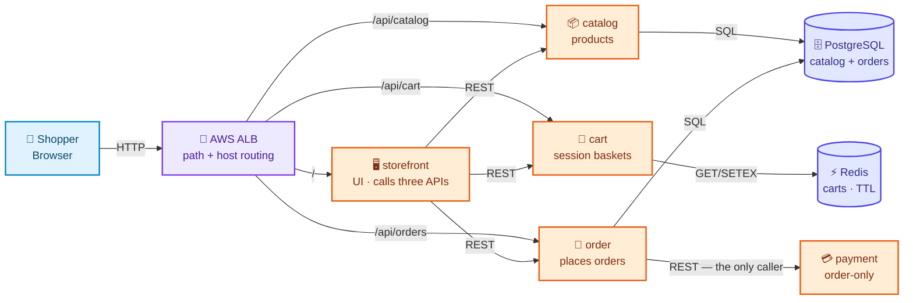

# Architecture — Project 04, E-Commerce Microservices on EKS

Design record. Written **before** the stage READMEs, as
[CONTRIBUTING §2](../../CONTRIBUTING.md#2-design-before-you-write-yaml) requires.

---

## 1. Design decisions

| Decision | Why |
|---|---|
| **Five services, not two** | This is the first project with real **east-west** traffic. A storefront that calls `catalog`, `cart` and `order`, and an `order` that calls `payment`, produces a call graph where "which service may talk to which" is a genuine question. With two services the answer is obvious and NetworkPolicy looks like paperwork. |
| **One entry point, five backends** | Exposing each service with its own `type: LoadBalancer` would create five NLBs and five hourly charges. One Ingress → one ALB, routing by **path** (`/api/catalog`, `/api/cart`, …) and by **host** (`shop.…` vs `admin.…`), is the answer, and the cost argument is the motivation the learner can check on the bill. |
| **`payment` is reachable only by `order`** | A payment service that any pod in the cluster can call is the clearest possible statement of why a flat pod network is a problem. It is also true to life: payment is where auditors look first. |
| **EKS with the VPC CNI network-policy agent enabled** | A NetworkPolicy is *accepted* by every cluster and *enforced* only by a CNI that implements it. This project turns enforcement on in `clusters/eks-advanced.yaml` and **proves enforcement before teaching the rules** — otherwise a learner writes a default-deny, sees traffic flow, and concludes NetworkPolicy does not work. |
| **Default-deny first, then explicit allows** | Allow-listing only teaches the syntax. Starting from "nothing can talk to anything", watching the whole storefront break, and re-opening it one rule at a time teaches the *model*: policies are additive, and a pod with no policy selecting it is unrestricted. |
| **The DNS egress trap is a first-class lesson, not a footnote** | The single most common NetworkPolicy mistake is an egress default-deny that blocks UDP/TCP 53 to CoreDNS. Every hostname in the application then fails to resolve, which looks like the services are down rather than like a policy problem. Stage 15 causes it deliberately before fixing it. |
| **`catalog` and `order` share one PostgreSQL, with separate databases** | 🧪 **A deliberate lab simplification.** Database-per-service is the production pattern, and the README says so. Four PostgreSQL StatefulSets would triple the cluster cost and runtime while adding nothing to a lesson about *routing and network policy*. Separate databases (`catalog`, `orders`) inside one instance keep the ownership story honest — no service reads another's tables — while keeping the cluster small. |
| **`cart` uses Redis, not PostgreSQL** | A cart is ephemeral, per-session state with a TTL. It gives the NetworkPolicy a second datastore with a *different* allowed client set (`cart` only), so the policies are not all the same shape. |
| **Storage and StatefulSets are recap stages (🟨), not headline lessons** | Project 02 and Project 03 teach PVCs, StorageClasses and StatefulSets in depth. The [coverage matrix](../../docs/RESOURCE-COVERAGE-MATRIX.md) marks them 🟨 here — used, with a short recap, so the reader never has to leave this project, but not re-taught at full length. |
| **Every service exposes `/healthz`, `/livez` and `/whoami`** | `/whoami` returns the pod name and the service's own view of its dependencies. With five services, "which one is actually broken" is the hard part, and an endpoint that answers it turns a cascading failure into a readable one. |
| **`payment` can be made deliberately slow** | `PAYMENT_LATENCY_MS` turns one service slow on demand. That is how the cascading-failure lesson is produced: `order` blocks on `payment`, the storefront blocks on `order`, and the whole site degrades from one slow dependency — which motivates timeouts, and previews the resource and autoscaling work in Project 05. |
| **Short-lived HTTP connections between services** | A pooled client pins to one backend pod and hides both load balancing and policy changes. One connection per call means every request re-resolves DNS and re-crosses the policy boundary, so a rule you just applied shows up on the very next request. |
| **Stage 10 (LoadBalancer) omitted** | On EKS a `type: LoadBalancer` Service creates an NLB — a real thing, an extra hourly cost, and a different lesson. The *reason* one Ingress beats five LoadBalancers is argued in stage 09 without paying for five of them. |
| **Stages 12–14 and 16–18 omitted** | Resources, autoscaling and disruption budgets are Project 05, which this project hands off to. Numbers are identities, not positions. |

---

## 2. High-Level Design (HLD)

**The one arrow that defines this project:** `order → payment`, and nothing else pointing at `payment`. Every
NetworkPolicy in stage 15 exists to make the diagram and the network agree.

### Component responsibilities

| Component | Responsibility | If it disappears |
|---|---|---|
| `storefront` | Serve the UI; fan out to catalog, cart and order | Site down; the APIs still answer through the ALB |
| `catalog` | List and look up products | Browsing fails; cart and orders still work on known IDs |
| `cart` | Add/read/clear a session basket in Redis | Cannot add to basket; browsing and past orders fine |
| `order` | Create orders, call `payment`, persist them | Checkout fails; browsing and cart fine |
| `payment` | Authorise a payment (simulated) | Checkout fails at the last step — `order` returns a named 502 |
| `postgres` | `catalog` and `orders` databases | Catalog and checkout down; cart survives (Redis) |
| `redis` | Cart contents, with a TTL | Carts empty; browsing and checkout of known items still work |

### Configuration contract

| Variable | Consumed by | Source, by stage |
|---|---|---|
| `CATALOG_URL`, `CART_URL`, `ORDER_URL` | storefront | 03 literal hostnames (NXDOMAIN) → 04 resolvable → 05 ConfigMap |
| `PAYMENT_URL` | order | 03 `http://payment:8080` → 05 ConfigMap |
| `POSTGRES_HOST` / `PORT` / `USER` | catalog, order | 03 literal → 05 ConfigMap |
| `POSTGRES_DB` | catalog (`catalog`), order (`orders`) | **Different per service** — the ownership boundary |
| `POSTGRES_PASSWORD` | catalog, order, postgres | 03 plaintext → 06 Secret |
| `REDIS_HOST` / `REDIS_PASSWORD` | cart | 03 literal → 05 ConfigMap / 06 Secret |
| `CART_TTL_SECONDS` | cart | 05 ConfigMap |
| `PAYMENT_LATENCY_MS` | payment | 05 ConfigMap — the cascading-failure dial |
| `UPSTREAM_TIMEOUT_SECONDS` | storefront, order | 05 ConfigMap — the fix for that failure |
| `POD_NAME` | all | Downward API |

---

## 3. Low-Level Design (LLD)

The full diagram is in [`../README.md` §7](../README.md#7-kubernetes-architecture--lld); its source is
[`architecture.mmd`](architecture.mmd).

### Object inventory (final state)

| Kind | Name | Namespace | Stage |
|---|---|---|---|
| Namespace | `ecommerce` | — | 00 |
| StorageClass | `ecommerce-gp3` | *cluster-scoped* | 07 |
| Secret | `postgres-secret`, `redis-secret` | ecommerce | 06 |
| ConfigMap | `ecommerce-config-<hash>` (generated, immutable) | ecommerce | 05 → 19 |
| Service (ClusterIP) | `storefront`, `catalog`, `cart`, `order`, `payment`, `postgres`, `redis` | ecommerce | 04 |
| Service (headless) | `postgres-headless`, `redis-headless` | ecommerce | 08 |
| Deployment | `storefront` (2), `catalog` (2), `cart` (2), `order` (2), `payment` (2) | ecommerce | 03 → 11 |
| StatefulSet | `postgres` (1), `redis` (1) | ecommerce | 08 |
| PVC *(generated)* | `postgres-data-postgres-0`, `redis-data-redis-0` | ecommerce | 08 |
| Ingress | `ecommerce-ingress` → one ALB | ecommerce | 09 |
| **NetworkPolicy** ×10 | `default-deny-all`, `allow-dns-egress`, `allow-internet-to-public-services`, `allow-{storefront,order,catalog,cart}-egress`, `allow-order-to-payment`, `allow-apps-to-postgres`, `allow-cart-to-redis` | ecommerce | **15** |

**Created in AWS by controllers, not by you:** one EBS volume per PVC (EBS CSI driver); one ALB with host/path
listener rules, one target group per backend Service, and security groups (AWS Load Balancer Controller).

**Cluster software, installed separately:** the EKS add-ons from `clusters/eks-advanced.yaml` — including the
**VPC CNI with `enableNetworkPolicy: "true"`**, without which stage 15 teaches nothing — and the AWS Load
Balancer Controller from Helm.

---

## 4. Failure domains

| Failure | Blast radius | Recovery |
|---|---|---|
| One replica of any service | None | The ReplicaSet replaces it; the ALB readiness gate keeps it out until healthy |
| `payment` | Checkout only. Browsing and cart unaffected | Recreated; `order` returns a 502 naming `payment` meanwhile |
| `payment` **slow** (not down) | **Cascading** — `order` blocks, then `storefront` blocks, then the whole site is slow | Timeouts bound it; stage 11 and Project 05 fix it properly |
| `order` | Checkout down | Recreated |
| `postgres-0` | Catalog and checkout down; cart survives | Recreated on a node **in its EBS volume's AZ** |
| `redis-0` | Carts lost (TTL data, no other copy) | Recreated with its volume |
| A NetworkPolicy that denies DNS | **Total** — every hostname stops resolving in every service at once | Delete the policy; stage 15 §9 |
| An entire AZ | Any datastore whose EBS volume is there cannot move — pods stay `Pending` | EBS is zonal; wait, or restore elsewhere |

---

## 5. What this architecture is not

- **Not database-per-service.** One PostgreSQL with two databases, labelled as a lab simplification.
- **Not resource-managed.** Requests only, no limits, no HPA, no PDB — that is Project 05, and the cascading
  failure here is the argument for it.
- **Not secure beyond the network.** No RBAC, no Pod Security Standards, no non-root enforcement, Secrets in
  Git — Project 07.
- **Not observable.** No metrics, dashboards or alerts; `/whoami` and pod logs are the whole toolkit — Project 08.
- **Not highly available.** One replica of each datastore, volumes pinned to single AZs — Project 09.

This project is about **east-west traffic: routing it at the edge, and controlling it inside the cluster.**
