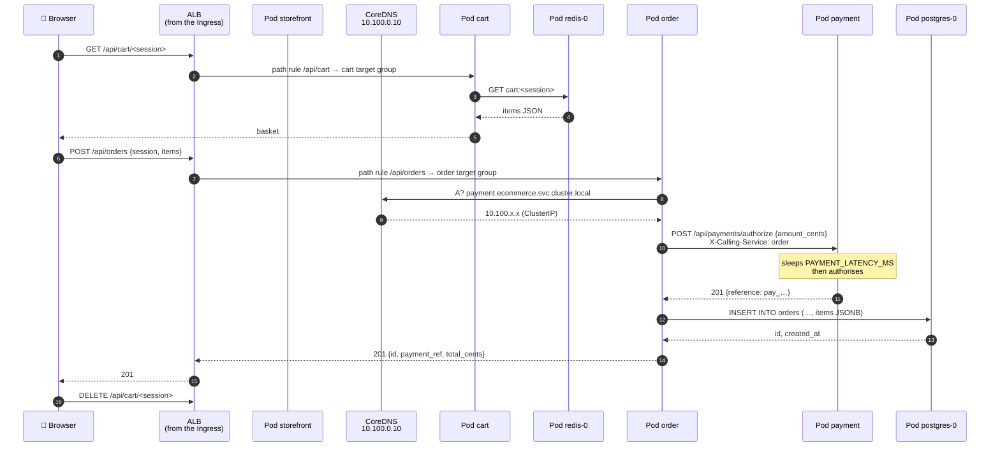
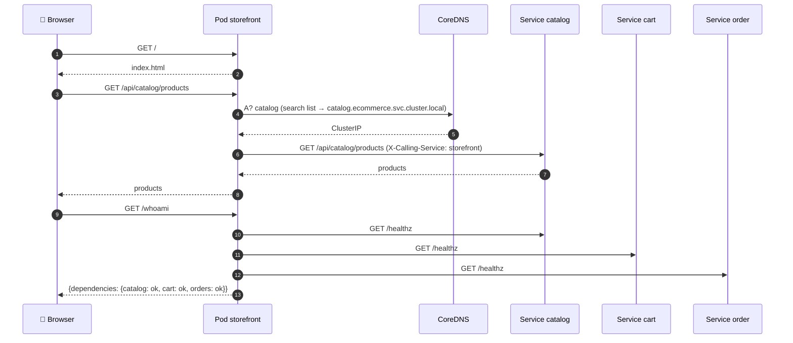

# Request Flow — Project 04

[⬅ Project 04](../README.md)

One checkout, traced from the browser through **four services** and both datastores, with the failure point of
every hop named. Open this page when something "just doesn't work": find the hop, run the command.

This is the first project where a single user action crosses several services, so the interesting question stops
being "is the pod up?" and becomes **"which hop failed, and did it fail loudly or silently?"**

---

## 1. The whole checkout, end to end

`POST /api/orders` — the shopper clicks **Checkout**.



**The one edge that defines this project:** `order → payment`. After stage 15, that is the *only* arrow any
NetworkPolicy permits into `payment` — and `payment`'s own `/whoami` counter proves it.

---

## 2. East-west traffic: the storefront's fan-out

Before the Ingress exists (stages 03–08), and for `kubectl port-forward` sessions afterwards, the browser talks
only to `storefront`, which calls three services itself. That is what makes this pod a real in-cluster client.



▸ **`/whoami` is the debugging tool of this project.** It reports, from *inside* a storefront pod, whether each
upstream is reachable. After a NetworkPolicy change it tells you which hop broke without exec-ing into anything.

---

## 3. Hop-by-hop, with the failure at each one

| # | Hop | Fails when | You see | First command |
|---|---|---|---|---|
| 1 | Browser → ALB hostname | Ingress has no address yet (2–3 min), or the controller never reconciled it | DNS failure / no `ADDRESS` | `kubectl describe ingress ecommerce-ingress -n ecommerce` |
| 2 | ALB security group | Your IP is not in `inbound-cidrs` | Connection **times out** — no response at all | `curl -s https://checkip.amazonaws.com` vs the annotation |
| 3 | Listener rule | No rule matches the path or the `Host` header | ALB **404** (plain HTML body) | `kubectl get ingress -o yaml` |
| 4 | Target group | No healthy targets for that backend | ALB **503** | `kubectl get endpointslices -n ecommerce` |
| 5 | → pod IP | Wrong `targetPort`, app not listening | ALB **502** | `kubectl get svc <name> -o yaml` |
| 6 | Any service → CoreDNS | **A NetworkPolicy denies egress to port 53** | *Every* hostname fails at once; `Name or service not known` in all services | `kubectl exec deploy/storefront -n ecommerce -- python -c "import socket;print(socket.gethostbyname('catalog'))"` |
| 7 | storefront → catalog/cart/order | Service missing, selector typo, or policy denies | `502` JSON from the storefront **naming the URL** | `curl .../whoami` |
| 8 | order → payment | Policy denies, or payment is down | `502` JSON `cannot reach payment at http://payment:8080` | `kubectl exec deploy/order -n ecommerce -- curl -sm3 http://payment:8080/healthz` |
| 9 | order → payment (**slow**, not down) | `PAYMENT_LATENCY_MS` exceeds `UPSTREAM_TIMEOUT_SECONDS` | `502` with `Read timed out`; before the timeout existed, the **whole site hangs** | `curl .../whoami` → `payment.reachable` |
| 10 | catalog/order → PostgreSQL | Policy denies, pod down, wrong database | `503` JSON `cannot reach postgres at …` | `kubectl logs statefulset/postgres -n ecommerce` |
| 11 | cart → Redis | Policy denies, pod down | `503` JSON `cannot reach redis at …`; cart pods go **NotReady** | `kubectl get pods -n ecommerce -l app.kubernetes.io/name=cart` |
| 12 | PostgreSQL → EBS | Volume in an AZ with no schedulable node | `postgres-0` **Pending**: `volume node affinity conflict` | `kubectl describe pod postgres-0 -n ecommerce` |

---

## 4. Reading the failure from the response alone

| You get | From | It means |
|---|---|---|
| **Timeout**, no response, from outside | the ALB security group | Your source IP is not in `inbound-cidrs` |
| **Timeout** between two pods | **a NetworkPolicy** | A denied packet is **dropped**, not refused. No RST, no error — silence is what "denied" looks like |
| **Connection refused** between two pods | the destination | The policy ALLOWED it; nothing is listening on that port |
| **404** plain HTML | the ALB | No listener rule matched the path or `Host` |
| **404** JSON `no such product` | `catalog` | Everything works; that SKU really is unknown |
| **502** plain `Bad Gateway` | the ALB | Target registered but refused / wrong port |
| **502** JSON `cannot reach payment at …` | `order` | `order` is up; `payment` is not reachable **from it** |
| **502** JSON `cannot reach http://catalog:8080` | `storefront` | The storefront is up; that one upstream is not reachable |
| **502** JSON with `Read timed out` | `storefront` or `order` | The upstream is **reachable but slow** — this is the cascading-failure signature |
| **402** JSON `payment was not authorized` | `order`, quoting `payment` | The whole chain worked; the card was declined (`PAYMENT_FAIL_RATE`) |
| **503** JSON `cannot reach postgres at …` | `catalog` or `order` | That service is up; PostgreSQL is not |
| **503** plain `Service Temporarily Unavailable` | the ALB | No healthy targets at all |

**The pattern:** every tier names what *it* could not reach. Read the body, not just the status code — with five
services, the status code alone cannot tell you which hop failed.

> ⚠️ **The single most important line in this table:** a NetworkPolicy denial looks like a **timeout**, because
> the packet is dropped with no reply. If you are expecting "connection refused" you will waste an hour. Stage 15
> turns on `nodeAgent.enablePolicyEventLogs` so the agent tells you which flow it dropped.

---

## 5. DNS names in this project

`/etc/resolv.conf` inside every pod:

```
search ecommerce.svc.cluster.local svc.cluster.local cluster.local ec2.internal
nameserver 10.100.0.10
options ndots:5
```

| Name, as typed in the `ecommerce` namespace | Resolves to | Why |
|---|---|---|
| `catalog` | ClusterIP | Search list appends `ecommerce.svc.cluster.local` |
| `payment` | ClusterIP | Same — note that **resolving it and being allowed to reach it are different questions** |
| `postgres` | ClusterIP | The shared PostgreSQL; the *database* differs per service, not the host |
| `postgres-0.postgres-headless` | `postgres-0`'s pod IP | Per-pod record, from the headless governing Service |
| `redis` | ClusterIP | One member, so the ClusterIP is enough here |
| `catalog.ecommerce.svc.cluster.local` | ClusterIP | Fully qualified — works from any namespace |

> ⚠️ **DNS resolving does not mean the connection is permitted.** CoreDNS answers from its own records; the
> NetworkPolicy is enforced later, on the packet. After stage 15 you will see names resolve perfectly and
> connections time out — that combination *is* the signature of a policy denial, and it is why hop 6 and hop 8 in
> §3 need different commands to diagnose.

> ⚠️ **Test DNS with the resolver the application uses.** busybox `nslookup` does not apply the search list to
> names containing a dot, so it reports NXDOMAIN for names the application resolves fine:
>
> ```bash
> kubectl exec deploy/storefront -n ecommerce -- \
>   python -c "import socket; print(socket.gethostbyname('payment'))"
> ```
