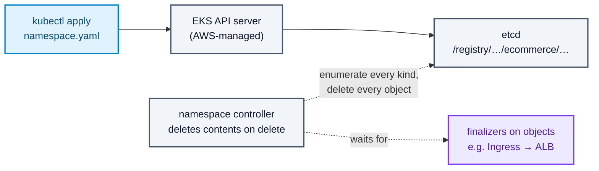
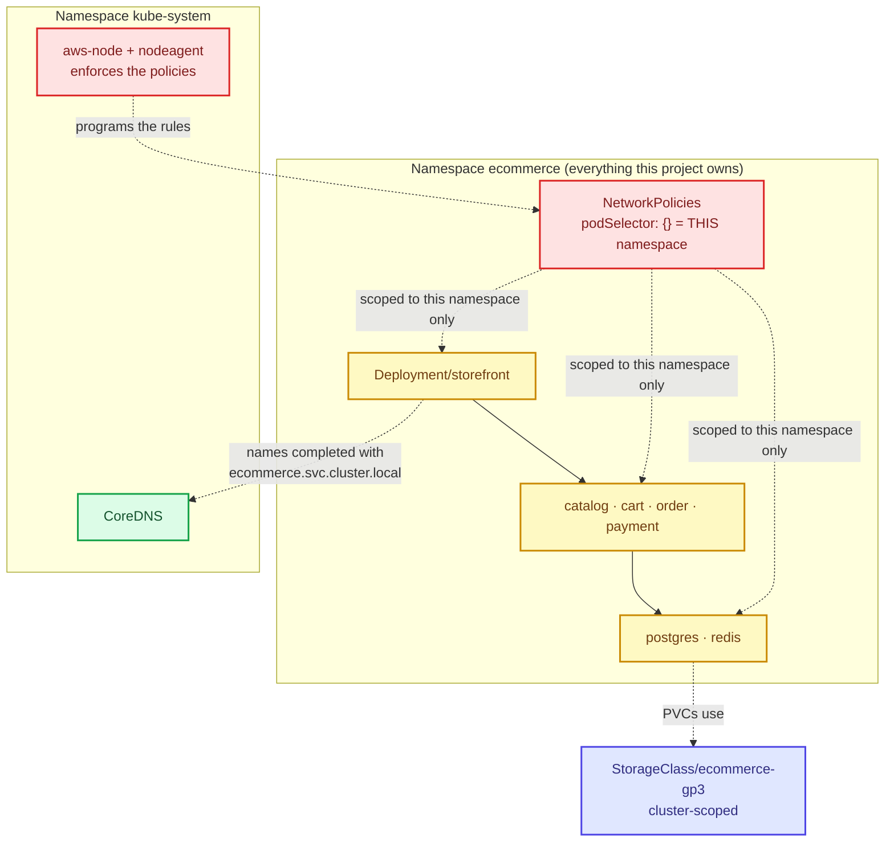

# Stage 00 — Namespace

[⬅ Project 04](../../README.md) · Stage 1 of 11

**00 Namespace** › [03 Deployments](../03-deployments/README.md) › [04 Services](../04-services/README.md) › [05 ConfigMaps](../05-configmaps/README.md) › [06 Secrets](../06-secrets/README.md) › [07 Storage](../07-storage/README.md) › [08 StatefulSets](../08-statefulsets/README.md) › [09 Ingress](../09-ingress/README.md) › [11 Probes](../11-health-checks/README.md) › [15 NetworkPolicy](../15-security/README.md) › [19 Final](../19-final/README.md)

> **The problem:** you are about to put **five services and two datastores** on a shared EKS cluster — seven
> Deployments, seven Services, two Secrets, an ALB, two EBS volumes and, by the end, seven NetworkPolicies. Put
> them in `default` and you cannot delete just this project, cannot tell your objects from anyone else's, and
> your `Service/redis` collides with the next team's `Service/redis`.
>
> There is a second reason, specific to this project: **the policy you will write in stage 15 is namespaced.**
> Without a namespace of its own there is nothing to scope a default-deny to.

---

## 1. WHY does this resource exist?

A cluster is one API shared by many applications and many people. Without partitions:

| Problem | What it looks like on a shared EKS cluster |
|---|---|
| **Name collisions** | Names are unique *per namespace*. Two applications that both want `Service/redis` cannot share one. |
| **No cleanup story** | "Remove this project" means remembering every kind you created. Miss one Ingress and its ALB bills forever. |
| **No ownership boundary** | Nothing distinguishes your `payment` from another team's except a naming convention somebody will break. |
| **No policy boundary** | RBAC Roles, ResourceQuotas, LimitRanges **and NetworkPolicies** are all *namespaced*. No namespace, nothing to attach them to. |

That last row is why this stage matters more here than in any earlier project. Stage 15's first policy is:

```yaml
spec:
  podSelector: {}        # every pod …
  policyTypes: [Ingress, Egress]
```

`podSelector: {}` means *every pod in this policy's namespace*. The namespace **is** the blast radius of that
rule. Get the namespace wrong and you either protect nothing or take down somebody else's application.

### When do you use one — and when not?

| Use a namespace | Don't |
|---|---|
| Per application or team | As a hard security boundary — it is a **soft** one until RBAC and NetworkPolicy make it harder |
| Per environment on a shared cluster (`shop-dev`, `shop-prod`) | To separate every microservice of one app — it only lengthens DNS names and complicates policy |
| Wherever you need quota, RBAC or **network policy** to attach | For cluster-scoped objects — they have no namespace to go in |

> **Five microservices, ONE namespace.** A namespace per service is a common instinct and usually wrong at this
> scale: every in-cluster URL grows a suffix, and every NetworkPolicy needs a `namespaceSelector` instead of a
> simple `podSelector`. One namespace per *application*, with policy between the pods inside it, is the pattern
> this project teaches.

> **Not everything is namespaced.** Nodes, PersistentVolumes, StorageClasses, IngressClasses and ClusterRoles —
> and namespaces themselves — are cluster-scoped. This project creates one cluster-scoped object of its own
> (`StorageClass/ecommerce-gp3`, stage 07) and causes two more to exist (the PVs). That is why its cleanup has
> more than one step. Check any kind:
>
> ```bash
> kubectl api-resources --namespaced=false | head -20
> ```

---

## 2. WHAT is it?

A Namespace is **a named scope for Kubernetes objects, and the unit that policy attaches to.**

> **Analogy:** a folder. `/ecommerce/redis` and `/payments/redis` are different files with the same name, and you
> can delete one folder without touching the other.
>
> **Technically:** a Namespace scopes *object names* and nothing else on its own. It is **not** a network
> boundary (a pod in `ecommerce` can connect to a pod in `kube-system` right now), **not** a resource boundary
> (until a ResourceQuota exists) and **not** an access boundary (until RBAC is scoped to it).

That first one is worth sitting with, because this project spends stage 15 fixing it. Creating a namespace does
**nothing** to the network. Every pod in this cluster can reach every other pod, in any namespace, on any port,
until a NetworkPolicy says otherwise.

### Namespaces are part of every DNS name

```
<service>.<namespace>.svc.cluster.local

catalog.ecommerce.svc.cluster.local
payment.ecommerce.svc.cluster.local
```

Every pod gets a DNS **search list** built from its own namespace, so a pod in `ecommerce` can say `catalog` and
mean `catalog.ecommerce.svc.cluster.local`. All five services live here, which is why every URL in stage 03 is a
bare name.

### What every EKS cluster starts with

```bash
kubectl get namespaces
```

| Namespace | Contains |
|---|---|
| `default` | Where objects go if you do not say otherwise |
| `kube-system` | CoreDNS, kube-proxy, the VPC CNI (`aws-node`, **including the network policy agent**), the EBS CSI driver, Metrics Server, the Pod Identity agent |
| `kube-public` | World-readable cluster info |
| `kube-node-lease` | One Lease per node: the heartbeat the control plane uses to notice a dead EC2 instance |

On EKS you never see the control plane itself — the API server and etcd run in an AWS-managed account. What you
see in `kube-system` is only what runs **on your nodes**.

> **Remember `kube-system` is a namespace too.** In stage 15 you will write an egress rule allowing traffic to
> CoreDNS, and it will select `kube-system` by label. A default-deny that forgets it breaks every hostname in
> every service simultaneously.

---

## 3. HOW does it work?



1. A Namespace is an ordinary API object stored in etcd.
2. Namespaced objects are **keyed by namespace** in etcd. That is the whole mechanism behind "names are unique
   per namespace".
3. Deleting a namespace sets it to `Terminating` and hands the work to the **namespace controller**, which lists
   every namespaced API type, deletes every object it finds, and only then removes the namespace itself.
4. Objects with **finalizers** are not removed until something clears the finalizer. On EKS that matters a lot:
   the Ingress you create in stage 09 carries `ingress.k8s.aws/resources`, which the AWS Load Balancer Controller
   clears only **after** it has deleted the real ALB. If that controller is not running, the namespace hangs in
   `Terminating` — and the ALB keeps billing.

---

## 4. Manifest

One file: [`namespace.yaml`](namespace.yaml).

```yaml
apiVersion: v1
kind: Namespace
metadata:
  name: ecommerce
  labels:
    app.kubernetes.io/name: ecommerce
    app.kubernetes.io/instance: ecommerce
    app.kubernetes.io/part-of: ecommerce
    app.kubernetes.io/version: "1.0.0"
    app.kubernetes.io/managed-by: kubectl
  annotations:
    kubernetes.io/description: "E-commerce microservices — storefront, catalog, cart, order, payment, PostgreSQL and Redis"
    lab.k8s-project/stage: "00-namespace"
```

---

## 5. Manifest breakdown

| Field | Value | What it does | What breaks if it's wrong |
|---|---|---|---|
| `metadata.name` | `ecommerce` | The scope, and the middle of every DNS name | Must be a DNS label: lowercase, ≤63 chars, no dots. A typo here means every FQDN in later ConfigMaps is wrong |
| `labels` | `app.kubernetes.io/*` | Lets you select namespaces: `kubectl get ns -l app.kubernetes.io/part-of=ecommerce` | Nothing breaks — you lose the ability to find them by label |
| `annotations.kubernetes.io/description` | one line | What the namespace is for | Nothing; required by this repository's conventions |

> Stage 11 adds one more label: `elbv2.k8s.aws/pod-readiness-gate-inject: enabled`. A label on a namespace can
> change controller behaviour for every pod inside it — a namespace is not *only* a name.

---

## 6. Apply

```bash
kubectl config current-context        # must be the lab cluster — never production
kubectl apply -f manifests/00-namespace/
kubectl get namespace ecommerce
```

▸ **What it does:** `apply` is declarative — create if missing, update if different, no-op if identical. Pointing
it at a directory applies every `.yaml` in it, in filename order.

▸ **Expected output:**

```
namespace/ecommerce created

NAME        STATUS   AGE
ecommerce   Active   2s
```

> ⚠️ **Check the context first, every time.** An engineer's kubeconfig often holds a production EKS context next
> to the lab. `kubectl` acts on whichever is *current*, and it will not ask.

---

## 7. Validate

```bash
kubectl get namespace ecommerce --show-labels
```

```
NAME        STATUS   AGE   LABELS
ecommerce   Active   10s   app.kubernetes.io/instance=ecommerce,…,kubernetes.io/metadata.name=ecommerce
```

| What you see | Means |
|---|---|
| `Active` | ✅ ready to hold objects |
| `kubernetes.io/metadata.name=ecommerce` | ✅ added automatically by the API server — you did not write it. **NetworkPolicies select namespaces by exactly this label**, which is how stage 15 will allow DNS to `kube-system` |
| `Terminating` | A previous delete is still waiting on a finalizer — see §9 |

---

## 8. Observe the mechanism

### Names are scoped; the same name can exist twice

```bash
kubectl create configmap demo --from-literal=owner=shop -n ecommerce
kubectl create configmap demo --from-literal=owner=system -n default
kubectl get configmap demo -A
kubectl delete configmap demo -n ecommerce && kubectl delete configmap demo -n default
```

▸ Two objects called `demo`, no conflict. `-A` (`--all-namespaces`) shows both with a NAMESPACE column.

### The label you did not write — and will depend on

```bash
kubectl get namespace kube-system -o jsonpath='{.metadata.labels}{"\n"}' | python3 -m json.tool
```

```json
{ "kubernetes.io/metadata.name": "kube-system" }
```

▸ The API server stamps `kubernetes.io/metadata.name` on **every** namespace automatically. Stage 15's
`allow-dns-egress` policy selects `kube-system` with it. This is the rare case where a label you never wrote is
load-bearing.

### A namespace is not a network boundary — prove it now

```bash
kubectl run probe --rm -i --restart=Never --image=busybox:1.36 -n ecommerce -- \
  sh -c 'cat /etc/resolv.conf'
```

```
search ecommerce.svc.cluster.local svc.cluster.local cluster.local ec2.internal
nameserver 10.100.0.10
options ndots:5
```

▸ The **search list starts with the pod's own namespace** — that is why `catalog` will work as a hostname in
stage 04. The trailing `ec2.internal` comes from the VPC's DHCP options, an EKS detail you will not see on a
laptop cluster. `10.100.0.10` is CoreDNS's ClusterIP on EKS.

▸ And note what that pod could do: it reached CoreDNS in **another namespace** with no policy permitting it.
Nothing about creating `ecommerce` isolated anything.

### Confirm the cluster will actually enforce policy later

Worth checking **now**, because discovering it in stage 15 wastes an hour:

```bash
kubectl get daemonset aws-node -n kube-system \
  -o jsonpath='{.spec.template.spec.containers[*].name}{"\n"}'
```

```
aws-node aws-eks-nodeagent
```

▸ Two containers. `aws-eks-nodeagent` is the **network policy agent**, present because
`clusters/eks-advanced.yaml` set `enableNetworkPolicy: "true"`. If you see only `aws-node`, every NetworkPolicy
you write in stage 15 will be accepted and silently ignored — fix the cluster before you get there.

---

## 9. Break it

### Break 1 — the wrong namespace, silently

```bash
kubectl config set-context --current --namespace=kube-system
kubectl get pods
kubectl config set-context --current --namespace=default     # undo
```

**Symptom:** `kubectl get pods` lists somebody else's workloads, or nothing at all.

**Root cause:** every command without `-n` uses the context's default namespace. It is invisible state.

**Fix / habit:** this repository passes `-n` explicitly in every command, and every manifest sets
`metadata.namespace`. Never rely on the context default in anything you write down.

### Break 2 — a namespace that will not die

You will meet this for real during cleanup if you get the order wrong:

```bash
kubectl get namespace ecommerce -o jsonpath='{.status.conditions}' | python3 -m json.tool
```

**Symptom (after deleting the load balancer controller before the Ingress):** the namespace stays `Terminating`,
and the conditions say `Some resources are remaining: ingresses.networking.k8s.io has 1 resource instances` with
`Some content in the namespace has finalizers remaining: ingress.k8s.aws/resources`.

**Root cause:** a finalizer is a promise — "the controller will delete the ALB, then remove me". The controller
that made the promise is gone.

**Fix:** reinstall the controller and let it finish. Removing the finalizer by hand
(`kubectl patch ingress … -p '{"metadata":{"finalizers":null}}' --type=merge`) unblocks the namespace **and
orphans the ALB**, which you must then delete in the EC2 console. Stage 09 and `scripts/cleanup.sh` avoid this by
deleting the Ingress first.

---

## 10. How it interacts



---

## 11. Production notes

> 🧪 **DEMO / LEARNING CONFIGURATION**
> One namespace with labels and nothing else: no RBAC, no quotas, no Pod Security labels, and — until stage 15 —
> no network policy at all.

> 🏭 **PRODUCTION CONSIDERATIONS**
> - **Attach policy, or the namespace is just a folder.** RoleBindings scoped to it, a ResourceQuota, a
>   LimitRange, and a default-deny NetworkPolicy from day one rather than as a later migration (Project 07).
> - **Pod Security Standards** via namespace labels — `pod-security.kubernetes.io/enforce: restricted`
>   (Project 07).
> - **Apply default-deny to a NEW namespace before the workloads.** Retrofitting it to a running application, as
>   this project does deliberately, is how you take production down at 3am. The order here is a teaching choice.
> - **On EKS, map IAM to namespaces** with EKS access entries so a team's IAM role can only act in its own.
> - **Cost allocation:** label namespaces with team and cost-centre; EKS split cost allocation data can then
>   attribute EC2 spend to them.
> - **Hard multi-tenancy needs separate clusters or accounts.** A namespace shares nodes, a kernel and the API
>   server with everyone else.

---

## 12. The next problem

The scope exists and is empty. Deploy the application into it the way most people would — each service as a
Deployment, each dependency addressed by an obvious hostname: `catalog`, `cart`, `order`, `payment`, `postgres`,
`redis`.

Nothing in the cluster answers to any of those names yet. Find out what five services do about that.

→ **[Stage 03 — Deployments](../03-deployments/README.md)**

---

## 📚 Official documentation

Everything above is self-contained — these are for going deeper, not for filling gaps.
*(All links verified 2026-09-19.)*

| Reference | What it adds |
|---|---|
| [Namespaces](https://kubernetes.io/docs/concepts/overview/working-with-objects/namespaces/) | Which objects are namespaced, and namespaces' role in DNS |
| [DNS for Services and Pods](https://kubernetes.io/docs/concepts/services-networking/dns-pod-service/) | How the namespace becomes part of every name and every search list |
| [Well-Known Labels, Annotations and Taints](https://kubernetes.io/docs/reference/labels-annotations-taints/) | `kubernetes.io/metadata.name` and the other labels the API server sets for you |
| [Network Policies](https://kubernetes.io/docs/concepts/services-networking/network-policies/) | States plainly that policies are namespaced — and that a CNI must enforce them |
| [What is Amazon EKS?](https://docs.aws.amazon.com/eks/latest/userguide/what-is-eks.html) | What AWS manages (control plane) versus what runs on your nodes |

---

| ◀ Previous | ▲ Up | Next ▶ |
|---|:--:|---:|
| ◀ *(first stage)* | [Project 04](../../README.md) · [Manual steps](../../scripts/manual-steps.md) | **[03 Deployments](../03-deployments/README.md)** ▶ |
