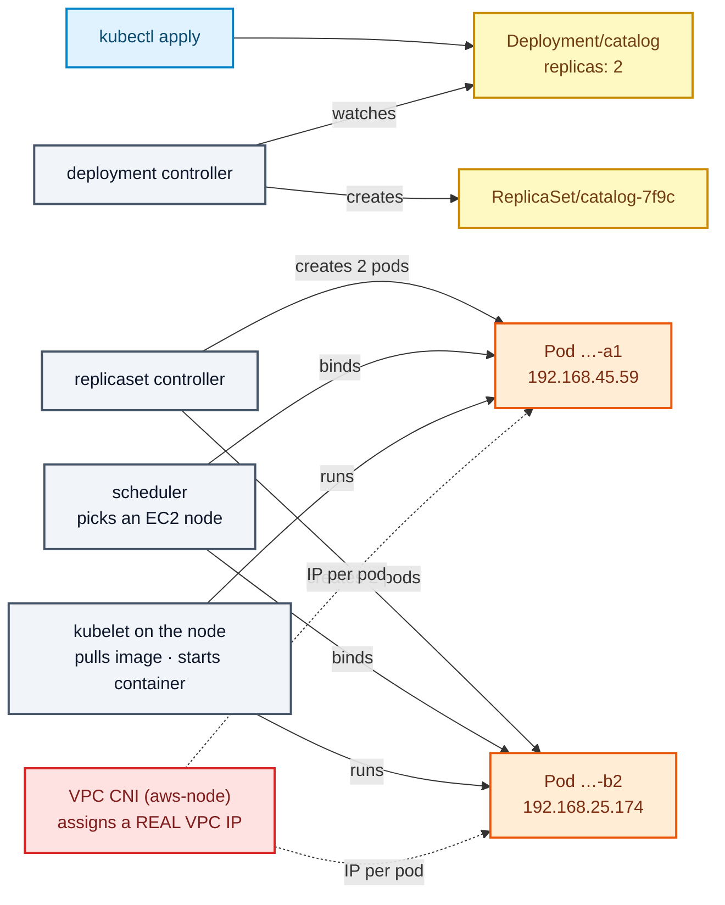
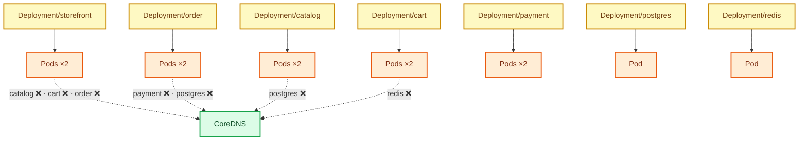

# Stage 03 — Deployments

[⬅ Project 04](../../README.md) · Stage 2 of 11

[00 Namespace](../00-namespace/README.md) › **03 Deployments** › [04 Services](../04-services/README.md) › [05 ConfigMaps](../05-configmaps/README.md) › [06 Secrets](../06-secrets/README.md) › [07 Storage](../07-storage/README.md) › [08 StatefulSets](../08-statefulsets/README.md) › [09 Ingress](../09-ingress/README.md) › [11 Probes](../11-health-checks/README.md) › [15 NetworkPolicy](../15-security/README.md) › [19 Final](../19-final/README.md)

> **The problem:** an empty namespace. Seven workloads have to run — five services and two datastores — and they
> have to find *each other*, which is new. Project 01's app talked to one backend; this one has a call graph.

---

## 1. WHY does this resource exist?

A bare Pod is bound to one node for its whole life. On EKS, nodes are EC2 instances and they go away: the managed
node group replaces them on AMI updates, Spot reclaims them, AZ rebalancing terminates them. A bare Pod on a
terminated instance is simply gone.

A **Deployment** declares *"keep N copies of this pod template running, and change them gradually"*:

| Without a Deployment | With one |
|---|---|
| A pod on a terminated node is gone | The ReplicaSet notices fewer than N pods and creates a replacement on a surviving node |
| Changing the image means deleting and recreating | A rolling update: new pods up, old pods down, a few at a time |
| A bad release has no undo | `kubectl rollout undo` returns to the previous ReplicaSet |
| Scaling means creating pods by hand | `replicas: 2`, reconciled forever |

### When do you use one — and when not?

| Deployment | Not a Deployment |
|---|---|
| Stateless tiers: `storefront`, `catalog`, `cart`, `order`, `payment` | Workloads whose replicas need distinct identities or their own disks — **StatefulSet** (stage 08) |
| Anything where "replace any replica with a fresh one" is safe | Work that runs to completion — Job (Project 06) |
| | One pod per node — DaemonSet (Project 08) |

> This stage deploys **PostgreSQL and Redis as Deployments too**, deliberately. It works today and fails
> instructively in stage 07, when a replaced pod takes every product and every basket with it. You will replace
> both with StatefulSets once you have felt why.

---

## 2. WHAT is it?

A Deployment is **a controller object that manages ReplicaSets, which manage Pods, to converge on a declared pod
template and replica count.**

> **Analogy:** a shift supervisor with a roster. The roster says "two cashiers, uniform version 3". If a cashier
> leaves, someone is hired. When the uniform changes, the supervisor swaps people over one at a time so the tills
> are never all closed.
>
> **Technically:** the Deployment owns ReplicaSets; each ReplicaSet corresponds to one *version* of the pod
> template, identified by the `pod-template-hash` label. A rollout scales a new ReplicaSet up while scaling the
> old one down.

### Every dependency is a hostname

The most important thing in this stage's manifests is not a Deployment field. It is these values:

```yaml
# storefront
- { name: CATALOG_URL, value: "http://catalog:8080" }
- { name: CART_URL,    value: "http://cart:8080" }
- { name: ORDER_URL,   value: "http://order:8080" }
# order
- { name: PAYMENT_URL,   value: "http://payment:8080" }
- { name: POSTGRES_HOST, value: "postgres" }
# cart
- { name: REDIS_HOST, value: "redis" }
```

That is how every real application is configured — **by name**. Nothing in Kubernetes turns a Deployment's name
into a DNS name. Whether those names resolve is the question this stage leaves open.

### The seven workloads

| Deployment | Image | Replicas | Why that many |
|---|---|---|---|
| `storefront` | `cloudprakhargupta/ecommerce:storefront-1.0.0` | 2 | Stateless — any replica serves any request |
| `catalog` | `…:catalog-1.0.0` | 2 | Stateless |
| `cart` | `…:cart-1.0.0` | 2 | Stateless (baskets live in Redis) |
| `order` | `…:order-1.0.0` | 2 | Stateless |
| `payment` | `…:payment-1.0.0` | 2 | Stateless |
| `postgres` | `postgres:17.5-alpine` | **1** | Two would be two unrelated, empty databases behind one name |
| `redis` | `redis:8.2.9-alpine` | **1** | Same |

### One PostgreSQL, two databases

`catalog` sets `POSTGRES_DB=catalog`; `order` sets `POSTGRES_DB=orders`. Same host, different databases, and
neither service can read or migrate the other's tables.

The second database does not exist by default — the image creates only `POSTGRES_DB` at first initialisation — so
[`postgres-init-configmap.yaml`](postgres-init-configmap.yaml) mounts a `.sql` file into
`/docker-entrypoint-initdb.d`, which the entrypoint runs **once**, at first initialisation only.

> 🧪 **DEMO / LEARNING CONFIGURATION**
> **Database-per-service is the production pattern**, and this is not it. Four PostgreSQL servers would triple
> this lab's cost and start-up time while teaching nothing about routing or network policy. Separate *databases*
> keep the ownership boundary honest — which is the part that matters for the lesson — at one server's cost.

> ⚠️ **`/docker-entrypoint-initdb.d` runs once, ever.** Not on restart, and not at all if the data directory
> already contains a database. After stage 07 gives PostgreSQL a volume, editing that SQL file does nothing. It is
> a classic trap, and the reason `CREATE DATABASE orders` lives there rather than in a migration.

---

## 3. HOW does it work?



1. `apply` stores the Deployment. The **deployment controller** hashes the pod template and creates a ReplicaSet
   named after that hash.
2. The **replicaset controller** creates pods until the count matches.
3. The **scheduler** picks a node for each pod — one of the managed node group's EC2 instances.
4. The **kubelet** on that node asks the container runtime to **pull the image from a registry**. There is no
   other way for an image to reach an EKS node.
5. The **VPC CNI** (`aws-node`) gives each pod an IP from the node's subnet — a **real VPC address**
   (`192.168.x.x`), not an overlay IP. Stage 09's ALB will target these directly, and stage 15's policy agent will
   filter them.

**Where in AWS is my pod?**

```bash
kubectl get pods -n ecommerce -o wide
kubectl get nodes -L topology.kubernetes.io/zone
```

---

## 4. Manifest

Eight files — seven workloads plus the PostgreSQL init script:
[`storefront-deployment.yaml`](storefront-deployment.yaml), [`catalog-deployment.yaml`](catalog-deployment.yaml),
[`cart-deployment.yaml`](cart-deployment.yaml), [`order-deployment.yaml`](order-deployment.yaml),
[`payment-deployment.yaml`](payment-deployment.yaml), [`postgres-deployment.yaml`](postgres-deployment.yaml),
[`postgres-init-configmap.yaml`](postgres-init-configmap.yaml), [`redis-deployment.yaml`](redis-deployment.yaml).

`order`, trimmed — it has the most interesting configuration in the project:

```yaml
apiVersion: apps/v1
kind: Deployment
metadata:
  name: order
  namespace: ecommerce
spec:
  replicas: 2
  selector:
    matchLabels:
      app.kubernetes.io/name: order
      app.kubernetes.io/instance: order      # ← only these two, forever
  template:
    metadata:
      labels: { … the same two, plus component/part-of/version … }
    spec:
      containers:
        - name: order
          image: cloudprakhargupta/ecommerce:order-1.0.0
          imagePullPolicy: IfNotPresent
          ports:
            - name: http
              containerPort: 8080
          env:
            - { name: POSTGRES_HOST, value: "postgres" }        # ← a name
            - { name: POSTGRES_DB,   value: "orders" }          # ← NOT catalog's
            - { name: PAYMENT_URL,   value: "http://payment:8080" }   # ← the guarded edge
            - { name: UPSTREAM_TIMEOUT_SECONDS, value: "3" }
            - { name: POSTGRES_PASSWORD, value: "dev-password-not-for-production" }  # ⚠️ stage 06
            - name: POD_NAME
              valueFrom:
                fieldRef:
                  fieldPath: metadata.name      # Downward API
          resources:
            requests: { cpu: "50m", memory: "96Mi" }
```

---

## 5. Manifest breakdown

| Field | Value | What it does | What breaks if it's wrong |
|---|---|---|---|
| `spec.replicas` | `2` (datastores `1`) | Desired pod count | Two PostgreSQL replicas = two unrelated empty databases behind one name |
| `spec.selector.matchLabels` | name + instance | Which pods this Deployment owns | **Immutable.** Must match the template labels or the API server rejects the object |
| `template.metadata.labels` | 5 labels | Stamped on every pod | Remove `name`/`instance` and the selector matches nothing. **Stage 15's policies select on these same labels** |
| `image` | `…:<svc>-1.0.0` | What the kubelet pulls | A tag never pushed ⇒ `ErrImagePull` → `ImagePullBackOff` |
| `imagePullPolicy` | `IfNotPresent` | Pull only if the node lacks this tag | `Always` adds a registry call per start |
| `ports[].name` | `http` | Names the port | Services, probes **and the VPC CNI policy engine** reference the name; renaming it breaks all three |
| `env[].value` | `catalog`, `payment`, `postgres`… | Plain literals | Read once at container start — changing one is a rollout |
| `POSTGRES_DB` | `catalog` / `orders` | **The ownership boundary** | Point both at one database and the services silently share tables |
| `UPSTREAM_TIMEOUT_SECONDS` | `3` | Bounds every upstream call | Unset/too high ⇒ a slow `payment` hangs the whole site (§12) |
| `env[].valueFrom.fieldRef` | `metadata.name` | Downward API: the pod's own name | Wrong `fieldPath` ⇒ the pod is rejected |
| `resources.requests` | small | What the scheduler reserves | Too large ⇒ `Pending` with `Insufficient cpu` |
| ConfigMap volume (postgres) | `/docker-entrypoint-initdb.d` | Creates the `orders` database once | Missing ⇒ `order` fails with `database "orders" does not exist` |

---

## 6. Apply

```bash
kubectl apply -f manifests/03-deployments/
kubectl rollout status deployment/postgres -n ecommerce --timeout=180s
kubectl rollout status deployment/redis -n ecommerce --timeout=180s
kubectl get pods -n ecommerce -o wide
```

▸ **What it does:** creates seven Deployments and one ConfigMap. `rollout status` blocks until the desired
replicas are available — the right way to wait, instead of `sleep`. `-o wide` adds pod IP and node.

▸ **Expected output:** twelve pods `Running` (2 each of five services, 1 each of two datastores), spread across
the node group, with `192.168.x.x` VPC addresses.

▸ **If it fails:** `ImagePullBackOff` — the image tag is not in the registry
(`docker manifest inspect <image>`). `Pending` — `kubectl describe pod` shows the scheduler's reason.

---

## 7. Validate

```bash
kubectl get deployments -n ecommerce
```

```
NAME         READY   UP-TO-DATE   AVAILABLE
cart         2/2     2            2
catalog      2/2     2            2
order        2/2     2            2
payment      2/2     2            2
postgres     1/1     1            1
redis        1/1     1            1
storefront   2/2     2            2
```

Everything says `Running`, `READY`. **Now ask the application:**

```bash
kubectl logs deployment/catalog -n ecommerce --tail=2
```

```
level=WARNING pod=catalog-cbb8bb775-v4wwk svc=catalog msg=database not reachable attempt=9/30 err=failed to resolve host 'postgres': [Errno -2] Name or service not known
```

```bash
kubectl port-forward -n ecommerce deployment/storefront 8080:8080 &
sleep 3
curl -s localhost:8080/whoami | python3 -m json.tool
kill %1
```

```json
{
    "dependencies": {
        "cart":    {"reachable": false, "error": "HTTPConnectionPool(host='cart', port=8080): Max retries exceeded with url: /healthz (Caused by NameResolutionError(…Failed to resolve 'cart' ([Errno -2] Name or service not known)))", "url": "http://cart:8080"},
        "catalog": {"reachable": false, "error": "…Failed to resolve 'catalog'…", "url": "http://catalog:8080"},
        "orders":  {"reachable": false, "error": "…Failed to resolve 'order'…",   "url": "http://order:8080"}
    },
    "pod": "storefront-6d8f7c9b4-m2xqp",
    "service": "storefront"
}
```

| What you see | Means |
|---|---|
| `READY 2/2` | The **containers** started. Kubernetes knows nothing more — no probes exist until stage 11 |
| `Name or service not known` | **NXDOMAIN.** The name does not exist in DNS |
| All three dependencies false | The call graph is entirely disconnected, on a cluster where every pod is `Running` |

▸ **Open the UI** (`http://localhost:8080` during the port-forward): it renders, and every panel shows a 502
naming the URL it could not reach. A working UI in front of a completely broken backend is exactly what this
failure looks like in production.

---

## 8. Observe the mechanism

### Nothing registers a Deployment's name

```bash
kubectl exec -n ecommerce deployment/storefront -- \
  python -c "import socket; print(socket.gethostbyname('catalog'))"
```

```
socket.gaierror: [Errno -2] Name or service not known
command terminated with exit code 1
```

```bash
kubectl get pods -n ecommerce -l app.kubernetes.io/name=catalog -o jsonpath='{.items[*].status.podIP}{"\n"}'
```

▸ The pods **have** addresses — two VPC IPs. They just have no names, and those IPs change every time a pod is
replaced.

### The datastores are running perfectly

```bash
kubectl exec -n ecommerce deployment/postgres -- psql -U ecommerce -d catalog -c '\l' | head -8
```

▸ Both `catalog` and `orders` databases exist — the init ConfigMap worked. PostgreSQL is healthy and utterly
unreachable by the two services that need it.

### A Deployment heals — watch it

```bash
kubectl delete pod -n ecommerce -l app.kubernetes.io/name=storefront --wait=false
kubectl get pods -n ecommerce -l app.kubernetes.io/name=storefront -w     # Ctrl-C
```

▸ Two replacements appear with new names and **new IPs**. The ReplicaSet counted fewer than 2 and acted. Anything
that had cached the old IP is now pointing at nothing.

### The migration retry is bounded on purpose

`catalog` and `order` retry 30 times, two seconds apart, then log
`giving up: database never became reachable` and serve requests anyway — each failing with a 503 that **names**
`postgres`. An unreachable dependency must eventually be loud rather than retry silently forever.

---

## 9. Break it

### Break 1 — an image tag that does not exist

```bash
kubectl set image deployment/catalog catalog=cloudprakhargupta/ecommerce:catalog-9.9.9 -n ecommerce
kubectl get pods -n ecommerce -l app.kubernetes.io/name=catalog
```

**Symptom:** one new pod `ErrImagePull` → `ImagePullBackOff`; the two old pods stay `Running`.

**Investigate:** `kubectl describe pod <new-pod> -n ecommerce | tail -5` — `manifest unknown`.

**Root cause:** the kubelet asked the registry for a tag that was never pushed. The old pods keep serving because
a rolling update only removes old pods once new ones are available.

**Fix:** `kubectl rollout undo deployment/catalog -n ecommerce`

### Break 2 — "just use the pod IP"

```bash
PG_IP=$(kubectl get pod -n ecommerce -l app.kubernetes.io/name=postgres -o jsonpath='{.items[0].status.podIP}')
kubectl set env deployment/catalog -n ecommerce POSTGRES_HOST="$PG_IP"
kubectl rollout status deployment/catalog -n ecommerce
kubectl logs deployment/catalog -n ecommerce --tail=2          # it works!
kubectl delete pod -n ecommerce -l app.kubernetes.io/name=postgres
sleep 25
kubectl logs deployment/catalog -n ecommerce --tail=2          # it does not
```

**Symptom:** it works — until PostgreSQL is recreated with a new VPC IP, and `catalog` is connecting to an
address that belongs to nothing (`connection timed out`).

**Root cause:** pod IPs are ephemeral by design. Anything that caches one is broken by the next reschedule — and
on EKS reschedules happen for reasons you do not control.

**Fix:** `kubectl apply -f manifests/03-deployments/catalog-deployment.yaml` — back to the name.

### Break 3 — one database for both services

```bash
kubectl set env deployment/order -n ecommerce POSTGRES_DB=catalog
kubectl rollout status deployment/order -n ecommerce
```

**Symptom:** nothing fails. That is the point — `order` happily creates its `orders` table inside the catalogue's
database, and the boundary is gone with no error anywhere.

**Root cause:** the ownership boundary is a *convention* enforced by configuration, not by the database. Nothing
in Kubernetes protects it.

**Fix:** `kubectl apply -f manifests/03-deployments/order-deployment.yaml`

---

## 10. How it interacts



Seven workloads, twelve pods, **zero working edges**.

---

## 11. Production notes

> 🧪 **DEMO / LEARNING CONFIGURATION**
> Plaintext passwords in env, datastores as Deployments with no storage, no probes, no limits, one PostgreSQL for
> two services, images on Docker Hub.

> 🏭 **PRODUCTION CONSIDERATIONS**
> - **Images in ECR**, in the cluster's region, pinned by digest. Docker Hub rate-limits anonymous pulls per IP,
>   and a node group behind one NAT gateway shares one IP.
> - **Probes on every container** (stage 11) — `READY 2/2` here meant nothing at all.
> - **Requests *and* limits**, sized from real usage (Project 05).
> - **Database per service**, each with its own credentials, so a compromised service cannot read another's data.
> - **Spread replicas across AZs** with topology spread constraints (Project 09). Two replicas on one node are one
>   EC2 failure from an outage.
> - **Never run a datastore as a Deployment** — stages 07 and 08 show exactly why.

---

## 12. The next problem

Twelve pods are `Running`, and the application is completely broken. Its entire configuration is a list of names —
`catalog`, `cart`, `order`, `payment`, `postgres`, `redis` — and a Deployment registers **nothing** in DNS. The
only addresses that exist are pod IPs, and those change every time a pod is replaced.

This is worse than Project 01's version of the same problem, because there are now **seven** names to resolve and
a call graph three hops deep: the storefront cannot reach `order`, and even if it could, `order` cannot reach
`payment` or `postgres`. A single missing name breaks a path, not just a page.

→ **[Stage 04 — Services](../04-services/README.md)**

---

## 📚 Official documentation

Everything above is self-contained — these are for going deeper, not for filling gaps.
*(All links verified 2026-09-19.)*

| Reference | What it adds |
|---|---|
| [Deployments](https://kubernetes.io/docs/concepts/workloads/controllers/deployment/) | Rollout mechanics, `maxSurge`/`maxUnavailable`, rollback |
| [Labels and Selectors](https://kubernetes.io/docs/concepts/overview/working-with-objects/labels/) | Why `matchLabels` is immutable, and how selectors match |
| [Images](https://kubernetes.io/docs/concepts/containers/images/) | Pull policies and how the kubelet resolves image names |
| [Expose pod information through environment variables](https://kubernetes.io/docs/tasks/inject-data-application/environment-variable-expose-pod-information/) | The Downward API used for `POD_NAME` |
| [Amazon EKS managed node groups](https://docs.aws.amazon.com/eks/latest/userguide/managed-node-groups.html) | Why and when EKS replaces your nodes |
| [Pod networking (Amazon VPC CNI)](https://docs.aws.amazon.com/eks/latest/userguide/pod-networking.html) | Why EKS pod IPs are real VPC addresses |

---

| ◀ Previous | ▲ Up | Next ▶ |
|---|:--:|---:|
| ◀ **[00 Namespace](../00-namespace/README.md)** | [Project 04](../../README.md) · [Manual steps](../../scripts/manual-steps.md) | **[04 Services](../04-services/README.md)** ▶ |
