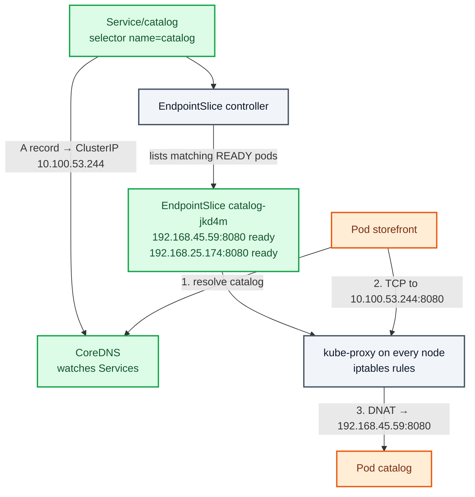
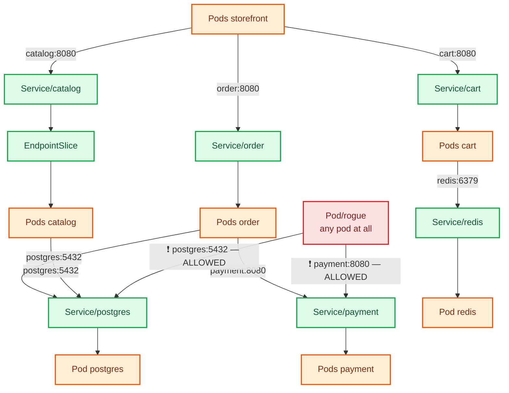

# Stage 04 — Services, DNS and EndpointSlices

[⬅ Project 04](../../README.md) · Stage 3 of 11

[00 Namespace](../00-namespace/README.md) › [03 Deployments](../03-deployments/README.md) › **04 Services** › [05 ConfigMaps](../05-configmaps/README.md) › [06 Secrets](../06-secrets/README.md) › [07 Storage](../07-storage/README.md) › [08 StatefulSets](../08-statefulsets/README.md) › [09 Ingress](../09-ingress/README.md) › [11 Probes](../11-health-checks/README.md) › [15 NetworkPolicy](../15-security/README.md) › [19 Final](../19-final/README.md)

> **The problem:** twelve pods `Running`, zero working edges. `Failed to resolve 'catalog'`,
> `failed to resolve host 'postgres'`, `Failed to resolve 'redis'`. Every component is configured by name,
> a Deployment registers no names, and pod IPs change on every reschedule.

---

## 1. WHY does this resource exist?

Pods are ephemeral and anonymous. A client needs three things pods cannot provide:

| Need | Pods alone | A Service |
|---|---|---|
| **A name in DNS** | None | `catalog.ecommerce.svc.cluster.local` |
| **An address that outlives pods** | Pod IP changes on every recreation | A ClusterIP that exists as long as the Service does |
| **Load balancing across replicas** | The client must know every IP | kube-proxy spreads connections over **ready** pods |

With five services this stops being a convenience and becomes structural: `storefront` has three upstreams,
`order` has two, and every one of them scales independently. Nothing can hardcode anything.

### 🔴 What a Service is *not*

**A Service is not access control.** Creating `Service/payment` makes `payment` reachable by name from **every pod
in the cluster** — not just from `order`. There is no field in a Service that says "only `order` may connect".

That is not a flaw; it is a separation of concerns. Discovery and authorisation are different problems, solved by
different objects and enforced by different components. Stage 15 adds the second one. Notice the gap now, because
for the next four stages your payment service is wide open and you should feel it.

### When do you use which?

| Use | For |
|---|---|
| **ClusterIP** | Anything in-cluster reached by name. The default, and all seven Services here. |
| **Headless** (`clusterIP: None`) | When clients need *individual* pod IPs — stage 08, for the StatefulSets |
| **NodePort / LoadBalancer** | Traffic from outside. On EKS a LoadBalancer Service creates an NLB — one per Service, one bill each. Stage 09 uses an Ingress/ALB instead |
| **ExternalName** | A CNAME alias for something you do not control (another namespace, RDS, a SaaS host) |

---

## 2. WHAT is it?

A Service is **a stable name and virtual IP in front of a set of pods chosen by a label selector.**

> **Analogy:** a company switchboard number. Callers dial one number; the switchboard rings whichever employee is
> at a desk. Nobody dials a person's desk directly, and people can change desks.
>
> **Technically:** a ClusterIP Service is three things, none of them a process: (1) an **A record** in CoreDNS,
> (2) a **virtual IP that nothing listens on**, and (3) **packet-rewriting rules** programmed on every node by
> kube-proxy, which DNAT that IP to a ready pod IP taken from the Service's EndpointSlices.

### DNS names, and the search list that completes them

Every pod's `/etc/resolv.conf` on this EKS cluster:

```
search ecommerce.svc.cluster.local svc.cluster.local cluster.local ec2.internal
nameserver 10.100.0.10
options ndots:5
```

| Line | Meaning |
|---|---|
| `nameserver 10.100.0.10` | CoreDNS's own ClusterIP (EKS uses `10.100.0.0/16` for Services) |
| `search …` | Suffixes the resolver tries appending, **in order**, starting with *your* namespace |
| `ndots:5` | A name with **fewer than 5 dots** is tried with every search suffix *first*, then as typed |

All seven Services are in one namespace, which is why every URL in this project is a bare name:

| Typed in `ecommerce` | First successful lookup | Result |
|---|---|---|
| `catalog` | `catalog.ecommerce.svc.cluster.local` | ✅ |
| `payment` | `payment.ecommerce.svc.cluster.local` | ✅ — **and reachable by anyone, for now** |
| `catalog.ecommerce` | `catalog.ecommerce.svc.cluster.local` | ✅ |
| `catalog.ecommerce.svc.cluster.local` | itself | ✅ from any namespace |

### ⚠️ Why every port here is `8080`, not `80`

The conventional Service publishes `port: 80` and maps it to the container's `8080`. **This project does not**,
and the reason is specific to the cluster it runs on:

> The Amazon VPC CNI network policy engine requires that **"the service port must be the same as the container
> port. If you're using named ports, use the same name in the service spec too."**
> — [Limit Pod traffic with Kubernetes network policies](https://docs.aws.amazon.com/eks/latest/userguide/cni-network-policy.html)

Map 80 → 8080 and stage 15's policies are enforced against a port nothing listens on. The symptom is a policy that
"randomly doesn't work", which is an afternoon you will not get back. Every Service in this project therefore
publishes the port its container actually listens on, with the same port **name**.

---

## 3. HOW does it work?



1. The API server allocates a ClusterIP from the Service range.
2. The **EndpointSlice controller** finds pods matching the selector and writes their IPs **and readiness** into
   EndpointSlices.
3. **CoreDNS** watches Services and answers `catalog.ecommerce.svc.cluster.local` with the ClusterIP.
4. **kube-proxy** on each node watches EndpointSlices and programs rules: traffic to `10.100.53.244:8080` is
   rewritten to one ready pod IP.
5. The client connects to an IP **no process listens on**; the kernel on the client's own node rewrites the
   packet. **Load balancing is per connection**, chosen when the connection opens.

> That last point is why this application opens a new connection per call. A pooled client would pin to one
> backend pod and hide both the load balancing and, later, the policy changes.

---

## 4. Manifest

Seven files, one per component. `catalog`, complete:

```yaml
apiVersion: v1
kind: Service
metadata:
  name: catalog
  namespace: ecommerce
spec:
  type: ClusterIP
  selector:                       # ← MUST match the Deployment's POD TEMPLATE labels
    app.kubernetes.io/name: catalog
    app.kubernetes.io/instance: catalog
  ports:
    - name: http                  # same NAME as the container port
      port: 8080                  # same NUMBER as the container port
      targetPort: http
      protocol: TCP
```

The other six are the same shape: [`storefront`](storefront-service.yaml), [`cart`](cart-service.yaml),
[`order`](order-service.yaml), [`payment`](payment-service.yaml) on `8080`;
[`postgres`](postgres-service.yaml) on `5432`; [`redis`](redis-service.yaml) on `6379`.

**Notice what did not change: the Deployments.** Stage 03 already asked for `catalog`, `cart`, `order`,
`payment`, `postgres` and `redis`. Creating Services with exactly those names is the entire fix.

---

## 5. Manifest breakdown

| Field | Value | What it does | What breaks if it's wrong |
|---|---|---|---|
| `metadata.name` | `catalog` | **Becomes the DNS name** | Name it `catalog-svc` and the app's `catalog` still gets NXDOMAIN |
| `spec.type` | `ClusterIP` | Internal virtual IP | — |
| `spec.selector` | name + instance | Which pods are backends | A typo ⇒ Service exists, **DNS resolves**, EndpointSlice is **empty**, connections refused. The most silent failure in Kubernetes |
| `ports[].port` | `8080` / `5432` / `6379` | What clients dial | Must equal the container port on this cluster (§2) |
| `ports[].targetPort` | `http` / `postgres` / `redis` | The container's **named** port | A number the container does not listen on ⇒ refused, *with* endpoints present |
| `ports[].name` | `http` | Names the Service port | Must match the container's port name for VPC CNI policy enforcement |

---

## 6. Apply

```bash
kubectl apply -f manifests/04-services/
kubectl get services,endpointslices -n ecommerce
```

▸ **What it does:** creates seven Services. The EndpointSlice listing is the check that matters — it is the
Service's real backend set.

▸ **Expected output:**

```
NAME                 TYPE        CLUSTER-IP       PORT(S)
service/cart         ClusterIP   10.100.118.22    8080/TCP
service/catalog      ClusterIP   10.100.53.244    8080/TCP
service/order        ClusterIP   10.100.9.71      8080/TCP
service/payment      ClusterIP   10.100.204.18    8080/TCP
service/postgres     ClusterIP   10.100.214.108   5432/TCP
service/redis        ClusterIP   10.100.220.41    6379/TCP
service/storefront   ClusterIP   10.100.6.178     8080/TCP

NAME                                       ADDRESSTYPE   PORTS   ENDPOINTS
endpointslice.discovery.k8s.io/catalog-…   IPv4          8080    192.168.45.59,192.168.25.174
endpointslice.discovery.k8s.io/postgres-…  IPv4          5432    192.168.6.124
…
```

▸ Every Service must have **at least one endpoint**. An empty `ENDPOINTS` column is a selector mismatch.

---

## 7. Validate

The migration loops from stage 03 are still retrying. Within a few seconds:

```bash
kubectl logs deployment/catalog -n ecommerce --tail=2
kubectl logs deployment/order -n ecommerce --tail=2
```

```
level=INFO … svc=catalog msg=waiting for migration lock id=4040001
level=INFO … svc=catalog msg=schema up to date products=5
level=INFO … svc=order   msg=schema up to date
```

▸ **No restart, no redeploy.** The pods were retrying a name; the name started to exist.

**Use the product:**

```bash
kubectl port-forward -n ecommerce svc/storefront 8080:8080 &
sleep 3
curl -s localhost:8080/whoami | python3 -m json.tool
```

```json
{
    "dependencies": {
        "cart":    {"reachable": true, "error": null, "url": "http://cart:8080"},
        "catalog": {"reachable": true, "error": null, "url": "http://catalog:8080"},
        "orders":  {"reachable": true, "error": null, "url": "http://order:8080"}
    },
    "pod": "storefront-6d8f7c9b4-m2xqp",
    "service": "storefront"
}
```

```bash
curl -s localhost:8080/api/catalog/products | python3 -m json.tool | head
curl -s -X POST localhost:8080/api/cart/demo -H 'Content-Type: application/json' \
  -d '{"sku":"SKU-1001","name":"Mechanical keyboard","price_cents":8900,"quantity":2}'
ITEMS=$(curl -s localhost:8080/api/cart/demo | python3 -c 'import json,sys;print(json.dumps(json.load(sys.stdin)["items"]))')
curl -s -X POST localhost:8080/api/orders -H 'Content-Type: application/json' \
  -d "{\"session\":\"demo\",\"items\":$ITEMS}" | python3 -m json.tool
kill %1
```

```json
{"created_at": "…", "id": 1, "payment_ref": "pay_818704e7a12c", "session": "demo", "total_cents": 17800}
```

▸ **A whole checkout just crossed four services and both datastores.** Open `http://localhost:8080` and shop.

---

## 8. Observe the mechanism

### Resolve names the way the application does

```bash
kubectl exec -n ecommerce deployment/storefront -- python -c '
import socket
for n in ["catalog","cart","order","payment","postgres","redis",
          "catalog.ecommerce","catalog.ecommerce.svc.cluster.local"]:
    try:    print(f"{n:42} -> {socket.gethostbyname(n)}")
    except OSError as e: print(f"{n:42} -> {e}")'
```

▸ All seven resolve to `10.100.x.x` ClusterIPs.

> ⚠️ **Do not test this with busybox `nslookup`.** It does not apply the search list to names containing a dot,
> so it reports NXDOMAIN for names the application resolves fine. Use the app's own resolver, as above.

### The ClusterIP is not a machine

```bash
kubectl exec -n ecommerce deployment/storefront -- python -c \
  "import socket; s=socket.socket(); s.settimeout(3); s.connect(('10.100.53.244', 22)); print('open')"
```

▸ Times out. Nothing listens on the ClusterIP. Only port 8080 is rewritten, and only to a pod.

### Endpoints follow pods, not the other way round

```bash
kubectl scale deployment/catalog --replicas=3 -n ecommerce
kubectl get endpointslices -n ecommerce -l kubernetes.io/service-name=catalog \
  -o jsonpath='{.items[*].endpoints[*].addresses[*]}{"\n"}'
kubectl scale deployment/catalog --replicas=2 -n ecommerce
```

▸ A third IP appears within seconds and disappears on scale-down. Nobody edited the Service.

### 🔴 Prove that a Service is not access control

This is the single most important command in this stage. A throwaway pod, belonging to nothing, authorises a
payment:

```bash
kubectl run rogue --rm -i --restart=Never --image=curlimages/curl:8.10.1 -n ecommerce -- \
  curl -s -X POST http://payment:8080/api/payments/authorize \
    -H 'Content-Type: application/json' -H 'X-Calling-Service: rogue' \
    -d '{"amount_cents":999999}'
```

```json
{"authorized": true, "reference": "pay_…", "amount_cents": 999999, "served_by": "payment-…"}
```

Now ask `payment` who has been calling it. The counter lives in each pod's memory, so ask **every replica**:

```bash
for ip in $(kubectl get pods -n ecommerce -l app.kubernetes.io/name=payment -o jsonpath='{.items[*].status.podIP}'); do
  kubectl exec -n ecommerce deployment/order -c order -- python -c \
    "import urllib.request,json;print('$ip', json.load(urllib.request.urlopen('http://$ip:8080/whoami'))['stats']['callers_seen'])"
done
```

```
192.168.4.242  {'rogue': 1}
192.168.63.217 {'order': 1}
```

▸ Your split will differ — the Service picked a replica per connection — but the `rogue` entry is there.

▸ **A pod with no relationship to checkout just authorised $9,999.99.** Every pod in this namespace can do that,
and so can every pod in every *other* namespace. Nothing you have built so far can stop it. Remember this output —
stage 15 runs the identical command and gets a timeout.

---

## 9. Break it

### Break 1 — a selector that matches nothing

```bash
kubectl patch service catalog -n ecommerce -p '{"spec":{"selector":{"app.kubernetes.io/name":"catalogg"}}}'
kubectl get endpointslices -n ecommerce -l kubernetes.io/service-name=catalog
```

**Symptom:** the EndpointSlice has **no endpoints**. DNS still resolves `catalog` perfectly. The storefront's
catalogue panel returns a 502; `/whoami` shows `catalog.reachable: false` with a **connection refused**, not a
DNS error.

**Root cause:** a Service with an empty backend set is not an error anywhere — no event, no warning. Resolution
working while connection fails is the fingerprint of a selector problem.

**Fix:** `kubectl apply -f manifests/04-services/catalog-service.yaml`

### Break 2 — the wrong `targetPort`

```bash
kubectl patch service cart -n ecommerce --type=json \
  -p '[{"op":"replace","path":"/spec/ports/0/targetPort","value":9999}]'
```

**Symptom:** endpoints are present (`192.168.x.x:9999`) and every connection is refused.

**Root cause:** the endpoint list is built from the selector, not from what the container listens on. Kubernetes
never checks that anything is on port 9999.

**Fix:** `kubectl apply -f manifests/04-services/cart-service.yaml`

### Break 3 — name it the way you'd name a variable

```bash
kubectl delete service order -n ecommerce
kubectl create service clusterip order-service --tcp=8080:8080 -n ecommerce
kubectl logs deployment/storefront -n ecommerce --tail=2
```

**Symptom:** `Failed to resolve 'order'` is back, even though a perfectly healthy Service exists.

**Root cause:** `metadata.name` **is** the DNS name. `order-service` publishes
`order-service.ecommerce.svc.cluster.local`, which nothing is configured to call.

**Fix:** `kubectl delete service order-service -n ecommerce && kubectl apply -f manifests/04-services/order-service.yaml`

---

## 10. How it interacts



The two red edges are real today. Stage 15 removes them.

---

## 11. Production notes

> 🧪 **DEMO / LEARNING CONFIGURATION**
> Seven ClusterIP Services, no network policy, no TLS between services, and a payment service any pod can call.

> 🏭 **PRODUCTION CONSIDERATIONS**
> - **Default-deny NetworkPolicy from day one** (stage 15), not retrofitted to a running app as this project does
>   for teaching.
> - **Mind `ndots:5`.** Every lookup of an external name like `api.stripe.com` first tries four in-cluster
>   suffixes. At scale that is real CoreDNS load; use a trailing dot or `dnsConfig.options ndots: "2"` for pods
>   that call many external names.
> - **NodeLocal DNSCache** on busy clusters removes a network hop and conntrack races from every lookup.
> - **Topology-aware routing** (`service.kubernetes.io/topology-mode: Auto`) keeps traffic in-AZ, which on AWS is
>   also a data-transfer cost saving.
> - **mTLS between services** (a service mesh) if you need identity rather than just reachability — NetworkPolicy
>   authorises an *IP*, not a *workload identity*.

---

## 12. The next problem

The shop works. Now look at what "configured" means: the PostgreSQL host, user and password are repeated in
**three** manifests; the Redis password in **two**; `UPSTREAM_TIMEOUT_SECONDS` in **two**; and five service URLs
are literals inside a Deployment that has to be edited and rolled to change any of them.

Worse, two of those repeated values are **passwords**, sitting in plain text in YAML that goes into Git — and
visible to anyone who can run `kubectl get deploy -o yaml`.

→ **[Stage 05 — ConfigMaps](../05-configmaps/README.md)**

---

## 📚 Official documentation

Everything above is self-contained — these are for going deeper, not for filling gaps.
*(All links verified 2026-09-19.)*

| Reference | What it adds |
|---|---|
| [Service](https://kubernetes.io/docs/concepts/services-networking/service/) | Every Service type, selectors, and port definitions |
| [DNS for Services and Pods](https://kubernetes.io/docs/concepts/services-networking/dns-pod-service/) | Record formats, search lists, `ndots`, `dnsConfig` |
| [EndpointSlices](https://kubernetes.io/docs/concepts/services-networking/endpoint-slices/) | How backends and readiness are tracked |
| [Virtual IPs and Service Proxies](https://kubernetes.io/docs/reference/networking/virtual-ips/) | What kube-proxy actually programs, and why a ClusterIP has no listener |
| [Debugging DNS resolution](https://kubernetes.io/docs/tasks/administer-cluster/dns-debugging-resolution/) | The official checklist when names do not resolve |
| [Limit Pod traffic with Kubernetes network policies](https://docs.aws.amazon.com/eks/latest/userguide/cni-network-policy.html) | The source for the port-matching requirement in §2 |

---

| ◀ Previous | ▲ Up | Next ▶ |
|---|:--:|---:|
| ◀ **[03 Deployments](../03-deployments/README.md)** | [Project 04](../../README.md) · [Manual steps](../../scripts/manual-steps.md) | **[05 ConfigMaps](../05-configmaps/README.md)** ▶ |
