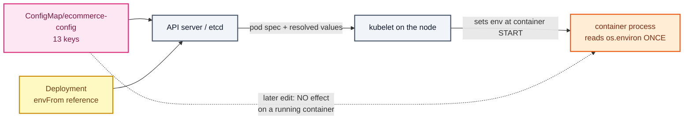
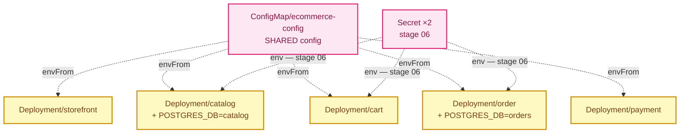

# Stage 05 — ConfigMaps: shared, owned and secret configuration

[⬅ Project 04](../../README.md) · Stage 4 of 11

[00 Namespace](../00-namespace/README.md) › [03 Deployments](../03-deployments/README.md) › [04 Services](../04-services/README.md) › **05 ConfigMaps** › [06 Secrets](../06-secrets/README.md) › [07 Storage](../07-storage/README.md) › [08 StatefulSets](../08-statefulsets/README.md) › [09 Ingress](../09-ingress/README.md) › [11 Probes](../11-health-checks/README.md) › [15 NetworkPolicy](../15-security/README.md) › [19 Final](../19-final/README.md)

> **The problem:** the shop works, and its configuration is scattered. `POSTGRES_HOST` appears in two Deployments,
> the Redis password in two, `UPSTREAM_TIMEOUT_SECONDS` in two, and five service URLs sit as literals inside
> workloads that must be edited and rolled to change any of them. Change one copy and miss another, and two
> services disagree with no error anywhere.

---

## 1. WHY does this resource exist?

An image should be built once and run anywhere — dev, staging, production. The moment a hostname or a timeout is
baked into the workload definition, three things follow:

| Problem | What it looks like here |
|---|---|
| **Duplication** | `POSTGRES_HOST: "postgres"` in `catalog` **and** `order`. Two places to change, one to forget |
| **No single source of truth** | Nothing says these values are *supposed* to be identical. Drift is undetectable |
| **Config change = manifest edit** | Raising a timeout means editing YAML, reviewing it, and rolling — for a value that is not code |
| **Credentials in workload YAML** | Two passwords are sitting in `kubectl get deploy -o yaml`, readable by anyone with `get` on Deployments |

A **ConfigMap** separates configuration from the workload that consumes it.

### The three kinds of configuration in this project

This is the distinction that matters at five services, and the reason this stage exists beyond "put strings in a
ConfigMap":

| Kind | Example | Where it lives | Why |
|---|---|---|---|
| **Shared** | `POSTGRES_HOST`, `UPSTREAM_TIMEOUT_SECONDS`, the service URLs | **One ConfigMap** | Every service must agree. One place to change, no drift possible |
| **Owned** | `POSTGRES_DB` — `catalog` vs `orders` | **The Deployment's own `env`** | Each service has a *different* correct answer. Sharing it would be wrong |
| **Secret** | `POSTGRES_PASSWORD`, `REDIS_PASSWORD` | **A Secret** (stage 06) | Different handling, different RBAC, different audit story |

> 🔴 **Putting `POSTGRES_DB` in the shared ConfigMap would be a real bug**, not a style preference. Both services
> would be forced onto one database, `order` would create its `orders` table inside the catalogue, and the
> ownership boundary would vanish — with no error, no event, and nothing in `kubectl get` to show for it. "Put all
> the config in the ConfigMap" is a reflex worth resisting.

### When do you use which?

| Use | For |
|---|---|
| **ConfigMap as env** (`envFrom`, `configMapKeyRef`) | Scalar settings the app reads at start-up — this stage |
| **ConfigMap as a file** (volume, `subPath`) | Config files: `redis.conf`, `nginx.conf`, the `init.sql` you already used in stage 03 |
| **Secret** | Anything whose disclosure is a problem — stage 06 |
| **Neither** | Values that genuinely differ per environment and belong in a Kustomize overlay (Project 10) |

---

## 2. WHAT is it?

A ConfigMap is **a namespaced key/value object holding non-confidential configuration, consumed by pods as
environment variables or as files.**

> **Analogy:** a settings file that lives outside the application, next to it rather than inside it. The program
> is unchanged; the settings can be swapped.
>
> **Technically:** a ConfigMap is a map of string keys to string values in etcd. It has **no schema, no types and
> no validation** — nothing checks that `UPSTREAM_TIMEOUT_SECONDS` is a number, or that a key the app requires is
> present. The consuming pod discovers a mistake at start-up, or at the first request.

### ⚠️ Values are always strings

```yaml
data:
  PAYMENT_LATENCY_MS: "0"     # ✅
  PAYMENT_LATENCY_MS: 0       # ❌ rejected by the API server
```

Unquoted `0` is a YAML integer, and the API server refuses it:
`cannot unmarshal number into Go value of type string`. Same for `true`, `false`, and anything that looks like a
number. Quote everything.

### `envFrom` vs `configMapKeyRef`

| | `envFrom: configMapRef` | `env: valueFrom: configMapKeyRef` |
|---|---|---|
| Injects | **Every** key | One named key |
| Rename a key | Silently disappears from the pod's env | Pod fails to start: `CreateContainerConfigError` |
| Missing ConfigMap | Pod fails to start | Pod fails to start |
| Good for | A service that uses most of the config | Giving a pod only what it needs |

This project uses `envFrom` for brevity, and pays a real price for it: the `payment` pod receives `POSTGRES_HOST`
and `CART_TTL_SECONDS`, which it never reads. Harmless here; in a stricter setup, list keys explicitly so a pod
cannot see configuration that is none of its business.

### 🔴 Environment variables are read ONCE, at container start

This is the single most misunderstood thing about ConfigMaps:

```
kubectl edit configmap   →  etcd changes  →  NOTHING happens to running pods
```

No restart, no reload, no event. The pods keep the values they started with, **until something replaces them** —
a crash, a node rotation, a scale-up, or an explicit rollout. Which means a ConfigMap edit can appear to do
nothing for a week and then change behaviour on half your fleet when one node is replaced.

Every config change in this project is therefore followed by an explicit `kubectl rollout restart`.

> Mounted **files** behave differently: the kubelet updates them eventually (tens of seconds), **except**
> `subPath` mounts, which never update. Project 03 takes that apart in depth, and Project 10 replaces the whole
> problem with a Kustomize `configMapGenerator` whose *name* is a hash of its content.

---

## 3. HOW does it work?



1. The ConfigMap is stored in etcd like any other object.
2. When the kubelet **starts a container**, it resolves every `envFrom`/`configMapKeyRef` against the current
   ConfigMap and sets the process's environment.
3. The process reads its environment at start-up. From then on it holds copies; nothing links them back.
4. If the ConfigMap or a referenced key is **missing at container start**, the container does not start:
   `CreateContainerConfigError`, and `kubectl describe pod` names the missing object or key.

**Order matters when applying:** the ConfigMap must exist before the workloads that reference it, or the new pods
sit in `CreateContainerConfigError` waiting for a key that does not exist yet.

---

## 4. Manifest

Six files: the ConfigMap, then the five Deployments that now consume it.

```yaml
# 01-ecommerce-config.yaml
apiVersion: v1
kind: ConfigMap
metadata:
  name: ecommerce-config
  namespace: ecommerce
data:
  POSTGRES_HOST: "postgres"
  POSTGRES_PORT: "5432"
  POSTGRES_USER: "ecommerce"
  REDIS_HOST: "redis"
  REDIS_PORT: "6379"
  CATALOG_URL: "http://catalog:8080"
  CART_URL: "http://cart:8080"
  ORDER_URL: "http://order:8080"
  PAYMENT_URL: "http://payment:8080"
  UPSTREAM_TIMEOUT_SECONDS: "3"
  CART_TTL_SECONDS: "1800"
  PAYMENT_LATENCY_MS: "0"
  PAYMENT_FAIL_RATE: "0"
```

And the pattern every Deployment now follows — [`03-catalog-deployment.yaml`](03-catalog-deployment.yaml),
excerpted:

```yaml
          envFrom:
            - configMapRef:
                name: ecommerce-config     # every shared key
          env:
            - name: POSTGRES_DB
              value: "catalog"             # ← OWNED: not in the ConfigMap
            - name: POSTGRES_PASSWORD
              value: "dev-password-not-for-production"   # ⚠️ stage 06
            - name: POD_NAME
              valueFrom:
                fieldRef:
                  fieldPath: metadata.name
```

Also updated: [`02-storefront`](02-storefront-deployment.yaml), [`04-cart`](04-cart-deployment.yaml),
[`05-order`](05-order-deployment.yaml), [`06-payment`](06-payment-deployment.yaml).

---

## 5. Manifest breakdown

| Field | Value | What it does | What breaks if it's wrong |
|---|---|---|---|
| `data` values | **quoted strings** | The configuration | Unquoted numbers/booleans are rejected by the API server |
| `envFrom[].configMapRef.name` | `ecommerce-config` | Injects every key as env | ConfigMap missing at container start ⇒ `CreateContainerConfigError` |
| `env[].name: POSTGRES_DB` | `catalog` / `orders` | **Owned** config, per service | In the ConfigMap instead ⇒ both services share one database, silently |
| `env` vs `envFrom` precedence | `env` wins | Lets a service override a shared value | Forgetting this ⇒ "the ConfigMap change did nothing" for that key |
| `env[].valueFrom.fieldRef` | `metadata.name` | Downward API | Wrong `fieldPath` ⇒ the pod is rejected |
| ConfigMap `metadata.namespace` | `ecommerce` | A ConfigMap is namespaced | A pod cannot reference a ConfigMap in another namespace. There is no cross-namespace form |

---

## 6. Apply

**The ConfigMap first**, then the workloads that reference it:

```bash
kubectl apply -f manifests/05-configmaps/01-ecommerce-config.yaml
kubectl apply -f manifests/05-configmaps/
kubectl rollout status deployment/storefront -n ecommerce --timeout=180s
kubectl rollout status deployment/catalog -n ecommerce --timeout=180s
kubectl rollout status deployment/order -n ecommerce --timeout=180s
```

▸ **What it does:** creates the ConfigMap, then updates five Deployments. Each pod template changed, so each
triggers a rolling update.

▸ **Expected output:** `configmap/ecommerce-config created`, then five
`deployment.apps/<name> configured` lines and successful rollouts.

▸ **If it fails:** pods in `CreateContainerConfigError` — you applied the Deployments before the ConfigMap.
`kubectl describe pod <pod> -n ecommerce` names the missing object.

---

## 7. Validate

```bash
kubectl get configmap ecommerce-config -n ecommerce
kubectl describe configmap ecommerce-config -n ecommerce | head -20
```

**Confirm a pod actually received the values:**

```bash
kubectl exec -n ecommerce deployment/order -- printenv \
  | grep -E '^(POSTGRES_(HOST|PORT|USER|DB)|PAYMENT_URL|UPSTREAM_TIMEOUT_SECONDS)=' | sort
```

```
PAYMENT_URL=http://payment:8080
POSTGRES_DB=orders
POSTGRES_HOST=postgres
POSTGRES_PORT=5432
POSTGRES_USER=ecommerce
UPSTREAM_TIMEOUT_SECONDS=3
```

▸ `POSTGRES_DB=orders` — from the Deployment. Everything else — from the ConfigMap. **The boundary is visible in
one command.**

> Without the anchored `grep` you would also see `POSTGRES_SERVICE_HOST`, `POSTGRES_PORT_5432_TCP` and friends. The
> kubelet injects those for every Service that existed when the pod started — a legacy discovery mechanism from
> before cluster DNS. Harmless, but it is why a Service named `postgres` sets `POSTGRES_PORT` to
> `tcp://10.100.x.x:5432` in pods that start *after* it — a classic collision if your app reads `POSTGRES_PORT`
> and you rely on `envFrom` order. (Here the explicit ConfigMap value wins.)

```bash
kubectl exec -n ecommerce deployment/catalog -- printenv | grep POSTGRES_DB
```

```
POSTGRES_DB=catalog
```

▸ Same shared ConfigMap, different owned database. That is the design working.

**And the shop still works:**

```bash
kubectl port-forward -n ecommerce svc/storefront 8080:8080 &
sleep 3; curl -s localhost:8080/whoami | python3 -m json.tool; kill %1
```

---

## 8. Observe the mechanism

### Editing a ConfigMap changes nothing

The single most important experiment in this stage:

```bash
kubectl patch configmap ecommerce-config -n ecommerce --type merge \
  -p '{"data":{"UPSTREAM_TIMEOUT_SECONDS":"30"}}'
kubectl get configmap ecommerce-config -n ecommerce -o jsonpath='{.data.UPSTREAM_TIMEOUT_SECONDS}{"\n"}'
kubectl exec -n ecommerce deployment/order -- printenv UPSTREAM_TIMEOUT_SECONDS
```

```
30        ← the ConfigMap
3         ← the running pod
```

▸ **The object changed; the pod did not.** No event, no warning, no restart. The pod will keep serving with `3`
until something replaces it.

```bash
kubectl rollout restart deployment/order -n ecommerce
kubectl rollout status deployment/order -n ecommerce
kubectl exec -n ecommerce deployment/order -- printenv UPSTREAM_TIMEOUT_SECONDS
```

```
30
```

▸ Now it agrees. Put it back:

```bash
kubectl apply -f manifests/05-configmaps/01-ecommerce-config.yaml
kubectl rollout restart deployment/order -n ecommerce
```

> 🎯 **Interview:** *"I edited a ConfigMap and nothing happened. A week later half my pods behaved differently.
> Why?"* — Env vars are read once at container start. The edit changed etcd only. Later, some pods restarted
> (node rotation, eviction, scale-up) and picked up the new values; the rest kept the old ones. Nothing rolled
> out, so there was no revision and nothing for `rollout undo` to revert.

### One value, changed once, affecting five services

```bash
for d in storefront catalog cart order payment; do
  printf '%-11s ' "$d"
  kubectl exec -n ecommerce deployment/$d -- printenv UPSTREAM_TIMEOUT_SECONDS 2>/dev/null || echo "-"
done
```

▸ One edit and one restart each would change all of them consistently. Before this stage, that was five manifest
edits and five chances to miss one.

### The `env` beats `envFrom` precedence

```bash
kubectl exec -n ecommerce deployment/catalog -- printenv POSTGRES_DB
kubectl get configmap ecommerce-config -n ecommerce -o jsonpath='{.data.POSTGRES_DB}{"\n"}'
```

```
catalog
          ← empty: the key is not in the ConfigMap at all
```

▸ Owned config is not "an override of a shared default" here — it is simply **absent** from the shared object,
which is stronger. Nothing can accidentally supply a default that turns out to be wrong for one service.

---

## 9. Break it

### Break 1 — a key the app needs, renamed

```bash
kubectl patch configmap ecommerce-config -n ecommerce --type json \
  -p '[{"op":"remove","path":"/data/PAYMENT_URL"},{"op":"add","path":"/data/PAYMENT_ENDPOINT","value":"http://payment:8080"}]'
kubectl rollout restart deployment/order -n ecommerce
kubectl rollout status deployment/order -n ecommerce
kubectl exec -n ecommerce deployment/order -- printenv PAYMENT_URL || echo "not set"
```

**Symptom:** the pod starts **perfectly**. No error. Checkout then fails with
`cannot reach payment at http://127.0.0.1:8080` — the application's built-in default.

**Investigate:** `curl .../whoami` on an order pod shows `payment.url` pointing at localhost.

**Root cause:** `envFrom` injects whatever keys exist. A renamed key does not fail — it **silently disappears**,
and the app falls back to a default that happens to be wrong. This is the cost of `envFrom` over
`configMapKeyRef`, which would have refused to start the container.

**Fix:** `kubectl apply -f manifests/05-configmaps/01-ecommerce-config.yaml && kubectl rollout restart deployment/order -n ecommerce`

### Break 2 — a missing ConfigMap

```bash
kubectl delete configmap ecommerce-config -n ecommerce
kubectl rollout restart deployment/cart -n ecommerce
sleep 15
kubectl get pods -n ecommerce -l app.kubernetes.io/name=cart
kubectl describe pod -n ecommerce -l app.kubernetes.io/name=cart | grep -A3 Events | tail -4
```

**Symptom:** the new pod sits in `CreateContainerConfigError`; the old pods keep serving.

```
Warning  Failed  …  Error: configmap "ecommerce-config" not found
```

**Root cause:** `envFrom` is resolved at container start. A missing ConfigMap means the kubelet cannot build the
environment, so it never starts the container — a loud, immediate failure, unlike Break 1.

**Fix:** `kubectl apply -f manifests/05-configmaps/01-ecommerce-config.yaml`

### Break 3 — an unquoted number

```bash
kubectl apply -f - <<'EOF'
apiVersion: v1
kind: ConfigMap
metadata: {name: bad-types, namespace: ecommerce}
data: {CART_TTL_SECONDS: 1800}
EOF
```

**Symptom:**

```
Error from server (BadRequest): … cannot unmarshal number into Go struct field ConfigMap.data of type string
```

**Root cause:** ConfigMap values are strings, always. YAML helpfully typed `1800` as an integer.

**Fix:** quote it. (Nothing to clean up — the object was never created.)

---

## 10. How it interacts



---

## 11. Production notes

> 🧪 **DEMO / LEARNING CONFIGURATION**
> One mutable ConfigMap, `envFrom` injecting everything into everyone, passwords still in plaintext env, and
> config changes that need a manual `rollout restart` to take effect.

> 🏭 **PRODUCTION CONSIDERATIONS**
> - **Immutable, versioned ConfigMaps.** `immutable: true` plus a version in the name means a config change is a
>   *new object* and therefore a pod-template change and therefore a **rollout** — with a revision you can
>   `rollout undo`. It also stops the "edited under a live fleet, half the pods disagree" failure dead. Project 03
>   demonstrates that outage in full.
> - **Kustomize `configMapGenerator`** automates exactly that: the ConfigMap's name becomes a hash of its content,
>   and every reference is rewritten for you (Project 10).
> - **`configMapKeyRef` over `envFrom`** where a service should only see its own configuration.
> - **Validate config at start-up.** A ConfigMap has no schema; the application should refuse to start on a
>   missing or malformed value rather than fall back to a default that silently points at localhost (Break 1).
> - **Environment overlays**, not environment names in keys. Never ship `POSTGRES_HOST_PROD` — that is what
>   Kustomize overlays and separate namespaces are for.

---

## 12. The next problem

Configuration is tidy. Two things in it are not configuration at all:

```bash
kubectl get deployment order -n ecommerce -o yaml | grep -A1 POSTGRES_PASSWORD
kubectl get deployment cart  -n ecommerce -o yaml | grep -A1 REDIS_PASSWORD
```

Both print a password in plain text. They are in Git, in `kubectl get -o yaml`, in every `describe`, and visible
to anyone with read access to Deployments in this namespace — which is a much wider group than the people who
should know a database password.

They are also duplicated: the PostgreSQL password appears in `catalog`, in `order`, **and** in the PostgreSQL
Deployment itself, so rotating it means changing three places in lockstep or breaking the application.

→ **[Stage 06 — Secrets](../06-secrets/README.md)**

---

## 📚 Official documentation

Everything above is self-contained — these are for going deeper, not for filling gaps.
*(All links verified 2026-09-19.)*

| Reference | What it adds |
|---|---|
| [ConfigMaps](https://kubernetes.io/docs/concepts/configuration/configmap/) | Every way to consume one, immutability, and the update semantics |
| [Configure a Pod to Use a ConfigMap](https://kubernetes.io/docs/tasks/configure-pod-configmap/) | `envFrom`, `configMapKeyRef` and volume mounts, with worked examples |
| [Deployments — rolling update](https://kubernetes.io/docs/concepts/workloads/controllers/deployment/) | Why a pod-template change is what actually triggers a rollout |
| [configMapGenerator](https://kubectl.docs.kubernetes.io/references/kustomize/kustomization/configmapgenerator/) | The production answer to the "edit does nothing" problem |

---

| ◀ Previous | ▲ Up | Next ▶ |
|---|:--:|---:|
| ◀ **[04 Services](../04-services/README.md)** | [Project 04](../../README.md) · [Manual steps](../../scripts/manual-steps.md) | **[06 Secrets](../06-secrets/README.md)** ▶ |
