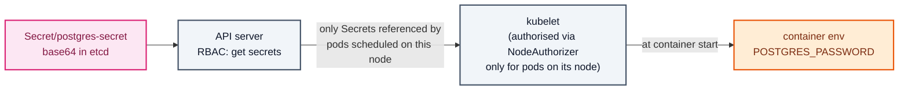
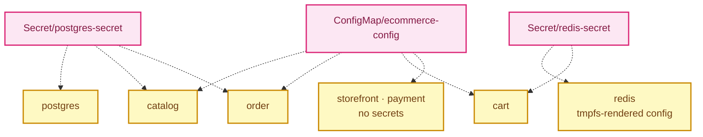

# Stage 06 — Secrets

[⬅ Project 04](../../README.md) · Stage 5 of 11

[00 Namespace](../00-namespace/README.md) › [03 Deployments](../03-deployments/README.md) › [04 Services](../04-services/README.md) › [05 ConfigMaps](../05-configmaps/README.md) › **06 Secrets** › [07 Storage](../07-storage/README.md) › [08 StatefulSets](../08-statefulsets/README.md) › [09 Ingress](../09-ingress/README.md) › [11 Probes](../11-health-checks/README.md) › [15 NetworkPolicy](../15-security/README.md) › [19 Final](../19-final/README.md)

> **The problem:** the PostgreSQL password is a literal in **three** Deployments and the Redis password in **two** —
> one of them on Redis's *command line*. Anyone with `get deployments` in this namespace can read both, they are in
> Git, and rotating either means editing several files in lockstep.

---

## 1. WHY does this resource exist?

| Problem | Literal in a Deployment | A Secret |
|---|---|---|
| Who can read it | Anyone with `get deployments` (a very common permission) | Anyone with `get secrets` — grant it separately, narrowly |
| Where it appears | `kubectl get deploy -o yaml`, `describe`, Git, CI logs | Referenced by name; the value never appears in the workload |
| Rotation | Edit every consumer | Change one object, roll the consumers |
| Process list | Command-line args are visible in `ps` and `describe pod` | Injected as env or a file |

The core argument is **separation of access**: configuration and credentials need different people to be able to
read them. A Secret is a separate *kind*, so RBAC can treat it separately.

### 🔴 What a Secret is *not*

**It is not encrypted.** A Secret's `data` is base64 — an encoding, reversible by anyone:

```bash
kubectl get secret postgres-secret -n ecommerce -o jsonpath='{.data.POSTGRES_PASSWORD}' | base64 -d
```

The protection is: (1) **RBAC** on `get`/`list` secrets, (2) **encryption at rest** of etcd (EKS encrypts the etcd
volumes; KMS envelope encryption of Secrets is an opt-in), and (3) keeping values **out of Git** — which this lab
does *not* do. [The Kubernetes docs say this plainly.](https://kubernetes.io/docs/concepts/configuration/secret/)

---

## 2. WHAT is it?

A Secret is **a namespaced key/value object for confidential data, consumed like a ConfigMap but handled with
different RBAC, and never logged by Kubernetes itself.**

> **Analogy:** the ConfigMap is the office noticeboard; the Secret is the key safe. Same building, same
> handwriting — a different lock and a different list of people who have the combination.

| Field | Meaning |
|---|---|
| `type: Opaque` | Arbitrary user data (other types: `kubernetes.io/tls`, `dockerconfigjson`, …) |
| `stringData` | Write-only convenience: plain text in, base64 stored in `data` |
| `data` | base64-encoded values — what `get -o yaml` shows |

Two Secrets, each read by exactly the workloads that need it:

| Secret | Read by |
|---|---|
| `postgres-secret` | `postgres`, `catalog`, `order` |
| `redis-secret` | `redis`, `cart` |

`storefront` and `payment` reference neither — least exposure, the same principle stage 15 applies to the network.

---

## 3. HOW does it work?



1. The Secret is stored in etcd (encrypted at rest on EKS).
2. The **node authorizer** lets a kubelet read only the Secrets referenced by pods scheduled to *its* node — a
   compromised node cannot read every Secret in the cluster.
3. At container start the kubelet resolves `secretKeyRef` and sets the env. Like a ConfigMap, **env is read once**:
   changing the Secret does nothing until the pod is replaced.
4. A missing Secret or key ⇒ `CreateContainerConfigError`, naming it.

### Getting the Redis password off the command line

Redis takes its password from its config (`requirepass`). Passing `--requirepass <pw>` puts it in `ps`. Instead
the container runs:

```sh
printf 'requirepass %s\nappendonly yes\ndir /data\n' "$REDIS_PASSWORD" > /run/redis/redis.conf
exec redis-server /run/redis/redis.conf
```

`/run/redis` is an `emptyDir` with `medium: Memory` — tmpfs, never on the node's disk, gone with the pod. `exec`
makes `redis-server` PID 1, so it receives SIGTERM directly.

---

## 4. Manifest

```yaml
# 01-postgres-secret.yaml
apiVersion: v1
kind: Secret
metadata:
  name: postgres-secret
  namespace: ecommerce
type: Opaque
stringData:
  POSTGRES_PASSWORD: "dev-password-not-for-production"
```

Every consumer switches from a literal to a reference — `order`, excerpted:

```yaml
            - name: POSTGRES_PASSWORD
              valueFrom:
                secretKeyRef:
                  name: postgres-secret
                  key: POSTGRES_PASSWORD
```

Files: [`01-postgres-secret`](01-postgres-secret.yaml), [`02-redis-secret`](02-redis-secret.yaml),
[`03-postgres`](03-postgres-deployment.yaml), [`04-redis`](04-redis-deployment.yaml),
[`05-catalog`](05-catalog-deployment.yaml), [`06-cart`](06-cart-deployment.yaml), [`07-order`](07-order-deployment.yaml).

---

## 5. Manifest breakdown

| Field | Value | What it does | What breaks if it's wrong |
|---|---|---|---|
| `type` | `Opaque` | Generic secret | — |
| `stringData` | plain text | Encoded into `data` on write | Put plain text under `data:` ⇒ `illegal base64 data` |
| `secretKeyRef.name` / `.key` | `postgres-secret` / `POSTGRES_PASSWORD` | One value into one env var | Missing ⇒ `CreateContainerConfigError: secret "…" not found` / `couldn't find key` |
| Redis `command` + tmpfs | rendered config | Password never on argv | Using `--requirepass` ⇒ visible in `ps` and `describe` |
| `emptyDir.medium` | `Memory` | tmpfs | Omitted ⇒ the rendered password lands on the node's disk |
| `REDISCLI_AUTH` | from the Secret | `redis-cli` authenticates | Missing ⇒ `NOAUTH` in probes (stage 11) |

---

## 6. Apply

**Secrets first**, then consumers:

```bash
kubectl apply -f manifests/06-secrets/01-postgres-secret.yaml -f manifests/06-secrets/02-redis-secret.yaml
kubectl apply -f manifests/06-secrets/
for d in postgres redis catalog cart order; do
  kubectl rollout status deployment/$d -n ecommerce --timeout=180s
done
```

▸ **Expected:** two `secret/… created`, five `deployment.apps/… configured`, five successful rollouts.

---

## 7. Validate

```bash
kubectl describe secret postgres-secret -n ecommerce | tail -3
kubectl get deployment order -n ecommerce -o yaml | grep -A4 POSTGRES_PASSWORD
kubectl exec -n ecommerce deployment/redis -- sh -c 'ps -o user,args | head -2; redis-cli ping'
```

```
POSTGRES_PASSWORD:  31 bytes

- name: POSTGRES_PASSWORD
  valueFrom:
    secretKeyRef:
      name: postgres-secret

USER     COMMAND
redis    redis-server *:6379
PONG
```

▸ `describe` shows **byte counts, not values**; the Deployment shows a **reference**; `ps` shows **no password** —
and the process runs as the `redis` user, not root;
`redis-cli` still authenticates via `REDISCLI_AUTH`.

> ⚠️ **Your baskets and orders are gone.** Rolling `postgres` and `redis` replaced their pods, and neither has a
> volume yet. Open the shop: products are back (re-seeded by the migration), orders are empty. That is stage 07.

---

## 8. Observe the mechanism

### base64 is not encryption

```bash
kubectl get secret redis-secret -n ecommerce -o jsonpath='{.data.REDIS_PASSWORD}'; echo
kubectl get secret redis-secret -n ecommerce -o jsonpath='{.data.REDIS_PASSWORD}' | base64 -d; echo
```

▸ One command decodes it. Your right to run that command is the real control:

```bash
kubectl auth can-i get secrets -n ecommerce
kubectl auth can-i get secrets -n ecommerce --as=system:serviceaccount:ecommerce:default
```

```
yes
no
```

### Least exposure: who can see which Secret

```bash
for d in storefront catalog cart order payment; do
  printf '%-11s ' $d
  kubectl exec -n ecommerce deployment/$d -- sh -c 'env | grep -oE "^(POSTGRES|REDIS)_PASSWORD" | tr "\n" " "'; echo
done
```

```
storefront
catalog     POSTGRES_PASSWORD
cart        REDIS_PASSWORD
order       POSTGRES_PASSWORD
payment
```

---

## 9. Break it

### Break 1 — a Secret key that does not exist

```bash
kubectl patch deployment cart -n ecommerce --type=json \
  -p '[{"op":"replace","path":"/spec/template/spec/containers/0/env/0/valueFrom/secretKeyRef/key","value":"PASSWORD"}]'
kubectl get pods -n ecommerce -l app.kubernetes.io/name=cart
```

**Symptom:** new pod `CreateContainerConfigError`; `describe` → `couldn't find key PASSWORD in Secret ecommerce/redis-secret`.
Old pods keep serving.

**Fix:** `kubectl apply -f manifests/06-secrets/06-cart-deployment.yaml`

### Break 2 — rotate the Secret, not the database

```bash
kubectl patch secret postgres-secret -n ecommerce --type merge -p '{"stringData":{"POSTGRES_PASSWORD":"rotated"}}'
kubectl rollout restart deployment/catalog -n ecommerce
sleep 20; kubectl logs deployment/catalog -n ecommerce --tail=1
```

**Symptom:** `password authentication failed for user "ecommerce"`.

**Root cause:** `POSTGRES_PASSWORD` is only applied when the data directory is **initialised**. The running
database still has the old password; the Secret and the database now disagree.

**Fix:** `kubectl apply -f manifests/06-secrets/01-postgres-secret.yaml && kubectl rollout restart deployment/catalog -n ecommerce`.
Real rotation: `ALTER USER ecommerce PASSWORD '…'` first, then the Secret, then roll the clients.

---

## 10. How it interacts



---

## 11. Production notes

> 🧪 **DEMO / LEARNING CONFIGURATION**
> Secrets committed to Git with trivial passwords; one database user shared by two services.

> 🏭 **PRODUCTION CONSIDERATIONS**
> - **AWS Secrets Manager + External Secrets Operator**, authorised with EKS Pod Identity — no secret in Git.
> - **KMS envelope encryption** for Secrets in etcd, with a customer-managed key.
> - **One database user per service**, each granted only its own database — so a leaked `catalog` credential
>   cannot read orders.
> - **IAM authentication to RDS** where possible: no password at all.
> - **Mount as files** (a Secret volume) rather than env for anything a crash dump or `/proc/<pid>/environ` could
>   leak; files also update without a restart.

---

## 12. The next problem

Look at the shop after that stage 06 rollout: **every order is gone and every basket is empty.** Replacing the
PostgreSQL and Redis pods threw their data away, because both write to the container's own filesystem, which is
created with the container and deleted with it.

On EKS, pods are replaced whenever nodes are — AMI updates, Spot reclaims, scale-in. An e-commerce site that
loses its order history on routine maintenance is not a site.

→ **[Stage 07 — Storage](../07-storage/README.md)**

---

## 📚 Official documentation

Everything above is self-contained — these are for going deeper, not for filling gaps.
*(All links verified 2026-09-19.)*

| Reference | What it adds |
|---|---|
| [Secrets](https://kubernetes.io/docs/concepts/configuration/secret/) | Types, consumption, and the explicit warning that base64 is not encryption |
| [Good practices for Kubernetes Secrets](https://kubernetes.io/docs/concepts/security/secrets-good-practices/) | RBAC, encryption at rest, least exposure |
| [Distribute Credentials Securely Using Secrets](https://kubernetes.io/docs/tasks/inject-data-application/distribute-credentials-secure/) | `secretKeyRef` and volume mounts, worked through |
| [ConfigMaps](https://kubernetes.io/docs/concepts/configuration/configmap/) | The sibling object — same consumption mechanics |

---

| ◀ Previous | ▲ Up | Next ▶ |
|---|:--:|---:|
| ◀ **[05 ConfigMaps](../05-configmaps/README.md)** | [Project 04](../../README.md) · [Manual steps](../../scripts/manual-steps.md) | **[07 Storage](../07-storage/README.md)** ▶ |
