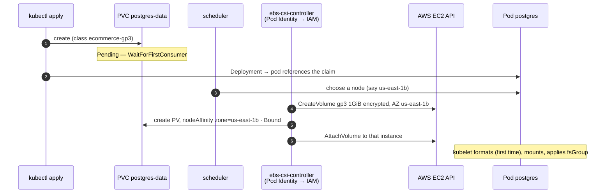
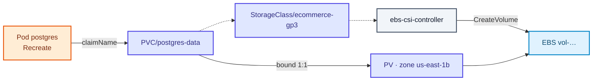

# Stage 07 — Storage: StorageClass, PVC and EBS *(recap)*

[⬅ Project 04](../../README.md) · Stage 6 of 11

[00 Namespace](../00-namespace/README.md) › [03 Deployments](../03-deployments/README.md) › [04 Services](../04-services/README.md) › [05 ConfigMaps](../05-configmaps/README.md) › [06 Secrets](../06-secrets/README.md) › **07 Storage** › [08 StatefulSets](../08-statefulsets/README.md) › [09 Ingress](../09-ingress/README.md) › [11 Probes](../11-health-checks/README.md) › [15 NetworkPolicy](../15-security/README.md) › [19 Final](../19-final/README.md)

> **The problem:** stage 06 rolled the PostgreSQL and Redis pods and **every order and every basket disappeared.**
> Both datastores write to the container's own filesystem, created with the container and deleted with it.

> **Recap stage.** Persistent storage is taught in depth in Projects 02 and 03. Everything you need is here, in
> short form — this project's lesson is east-west traffic, and its datastores simply have to survive.

---

## 1. WHY does this resource exist?

| Requirement | Container filesystem | `emptyDir` | **PVC → EBS** |
|---|---|---|---|
| Survives a container restart | ❌ | ✅ | ✅ |
| Survives the pod being deleted | ❌ | ❌ | ✅ |
| Survives the node being terminated | ❌ | ❌ | ✅ — the volume detaches and reattaches |
| Survives the **AZ** failing | ❌ | ❌ | ❌ — EBS lives in **one** availability zone |

And it must do that **without the application knowing anything about AWS**: the manifest asks for "1 GiB, one
writer, class `ecommerce-gp3`"; the cluster decides it means an encrypted gp3 volume in `us-east-1b`.

| Store | Lost without a volume | How bad |
|---|---|---|
| PostgreSQL | Every order (products re-seed from the migration) | Catastrophic — real money was taken |
| Redis | Every open basket | Degraded, but customers notice |

---

## 2. WHAT is it?

| Object | Scope | Who writes it | What it is |
|---|---|---|---|
| **StorageClass** | cluster | platform | A *recipe*: driver, volume type, encryption, reclaim policy, when to create |
| **PersistentVolumeClaim** | namespace | application | A *request*: size, access mode, class |
| **PersistentVolume** | cluster | the driver, automatically | The *fulfilment*: "this claim is `vol-0f74…` in `us-east-1b`" |

> **Analogy:** the PVC is the order, the StorageClass is the menu item saying which kitchen makes it, the PV is
> the plate that arrives with your table number on it. The pod references **only the claim**.

**A new EKS cluster has one class, `gp2`, and it is *not* marked default.** A claim that names no class is
fulfilled by nothing — which is why this project creates `ecommerce-gp3` and names it everywhere.

`ReadWriteOnce` means **one node**, not one pod — the only mode EBS supports.

---

## 3. HOW does it work?



1. **`WaitForFirstConsumer`** creates the volume in the AZ the pod lands in. `Immediate` would pick a random AZ.
2. The PV carries **node affinity** to that AZ. From then on the pod can only run there.
3. Attach is an AWS API call, made by the EBS CSI driver with an IAM role from `clusters/eks-advanced.yaml`.
4. **One EC2 instance at a time** ⇒ both Deployments switch to `strategy: Recreate`, or a rolling update waits
   forever on `Multi-Attach error`.
5. A fresh ext4 filesystem is owned by root and contains `lost+found` ⇒ `fsGroup: 1000` for Redis,
   `PGDATA=…/pgdata` (a subdirectory) for PostgreSQL.

---

## 4. Manifest

```yaml
# 01-ecommerce-gp3-storageclass.yaml
apiVersion: storage.k8s.io/v1
kind: StorageClass
metadata:
  name: ecommerce-gp3
provisioner: ebs.csi.aws.com
parameters: { type: gp3, encrypted: "true" }
reclaimPolicy: Delete
volumeBindingMode: WaitForFirstConsumer
allowVolumeExpansion: true
```

```yaml
# 02-postgres-data-pvc.yaml  (03-redis-data-pvc.yaml differs only in name)
apiVersion: v1
kind: PersistentVolumeClaim
metadata: { name: postgres-data, namespace: ecommerce }
spec:
  storageClassName: ecommerce-gp3
  accessModes: [ReadWriteOnce]
  resources: { requests: { storage: 1Gi } }
```

```yaml
# 04-postgres-deployment.yaml (excerpt)
spec:
  strategy: { type: Recreate }
  template:
    spec:
      containers:
        - name: postgres
          volumeMounts:
            - { name: data, mountPath: /var/lib/postgresql/data }
      volumes:
        - name: data
          persistentVolumeClaim: { claimName: postgres-data }
```

[`05-redis-deployment.yaml`](05-redis-deployment.yaml) mounts `redis-data` at `/data` with `fsGroup: 1000`.

---

## 5. Manifest breakdown

| Field | Value | What breaks if it's wrong |
|---|---|---|
| `provisioner` | `ebs.csi.aws.com` | Typo ⇒ claims `Pending` forever, `waiting for a volume to be created` |
| `volumeBindingMode` | `WaitForFirstConsumer` | `Immediate` ⇒ volume in a random AZ, pod unschedulable |
| `reclaimPolicy` | `Delete` | `Retain` ⇒ EBS volumes (and bills) survive cleanup |
| PVC `storageClassName` | `ecommerce-gp3` | Omitted ⇒ `Pending`: `no storage class is set` |
| PVC `accessModes` | `ReadWriteOnce` | `ReadWriteMany` on EBS ⇒ `ProvisioningFailed` |
| `strategy.type` | `Recreate` | `RollingUpdate` ⇒ `Multi-Attach error` if the new pod lands elsewhere |
| `fsGroup` | `1000` | Omitted ⇒ Redis cannot write `/data` — `Permission denied` |

---

## 6. Apply

```bash
kubectl apply -f manifests/07-storage/01-ecommerce-gp3-storageclass.yaml
kubectl apply -f manifests/07-storage/02-postgres-data-pvc.yaml -f manifests/07-storage/03-redis-data-pvc.yaml
kubectl get pvc -n ecommerce                       # Pending — correct, nothing uses them yet
kubectl apply -f manifests/07-storage/04-postgres-deployment.yaml -f manifests/07-storage/05-redis-deployment.yaml
kubectl rollout status deployment/postgres -n ecommerce --timeout=300s
kubectl rollout status deployment/redis -n ecommerce --timeout=300s
# The new PostgreSQL volume is EMPTY — re-run migrations by restarting their owners:
kubectl rollout restart deployment/catalog deployment/order -n ecommerce
```

▸ The first rollout is slower: an EBS volume is created, attached and formatted.

---

## 7. Validate

```bash
kubectl get pvc,pv -n ecommerce
PV=$(kubectl get pvc postgres-data -n ecommerce -o jsonpath='{.spec.volumeName}')
kubectl get pv "$PV" -o jsonpath='{.spec.csi.volumeHandle}{"  "}{.spec.nodeAffinity.required.nodeSelectorTerms[0].matchExpressions[0].values}{"\n"}'
```

```
persistentvolumeclaim/postgres-data   Bound   pvc-5638…   1Gi   RWO   ecommerce-gp3
persistentvolumeclaim/redis-data      Bound   pvc-613c…   1Gi   RWO   ecommerce-gp3

vol-0f74c7dadabfa69f6  ["us-east-1b"]
```

▸ A real, encrypted, billed EBS volume, pinned to one AZ.

---

## 8. Observe the mechanism

Place an order and fill a basket in the UI, then:

```bash
kubectl delete pod -n ecommerce -l app.kubernetes.io/name=postgres
kubectl delete pod -n ecommerce -l app.kubernetes.io/name=redis
kubectl rollout status deployment/postgres -n ecommerce
kubectl rollout status deployment/redis -n ecommerce
kubectl exec -n ecommerce deployment/postgres -- psql -U ecommerce -d orders -tAc 'SELECT count(*) FROM orders'
kubectl exec -n ecommerce deployment/redis -- redis-cli --scan --pattern 'cart:*'
```

▸ Orders and baskets survived. The replacement pods mounted the same EBS volumes — on a node in the volume's AZ,
every time.

---

## 9. Break it

### A claim with no StorageClass

```bash
kubectl apply -f - <<'EOF'
apiVersion: v1
kind: PersistentVolumeClaim
metadata: {name: no-class-demo, namespace: ecommerce}
spec: {accessModes: [ReadWriteOnce], resources: {requests: {storage: 1Gi}}}
EOF
kubectl describe pvc no-class-demo -n ecommerce | tail -1
kubectl delete pvc no-class-demo -n ecommerce
```

**Symptom:** `Pending` — `no persistent volumes available for this claim and no storage class is set`.

**Root cause:** EKS's `gp2` is not the default class, so a class-less claim can only bind to a hand-made PV.

**Fix:** always name `storageClassName`.

---

## 10. How it interacts



---

## 11. Production notes

> 🧪 **DEMO / LEARNING CONFIGURATION**
> `reclaimPolicy: Delete`, 1 GiB, AWS-managed key, no snapshots, no backups.

> 🏭 **PRODUCTION CONSIDERATIONS**
> - **RDS Multi-AZ** for orders and **ElastiCache** for sessions; an in-cluster EBS database is only as available
>   as one AZ.
> - If it stays in-cluster: `reclaimPolicy: Retain`, EBS snapshots (VolumeSnapshot), tested restores.
> - Customer-managed KMS key (`kmsKeyId`), tagged volumes, IOPS sized independently of GiB on gp3.

---

## 12. The next problem

The data survives — as long as there is exactly one replica. Scale either datastore and a Deployment has only
**one pod template naming one claim**: both replicas mount the same volume (if the scheduler puts them on the same
node) or one sits `Pending` (if it does not). There is no way to give each replica its own disk, a stable name,
or an order in which to start.

And `strategy: Recreate` means every configuration change to PostgreSQL is a short **outage** — acceptable for one
lab database, and a sign that a Deployment is the wrong controller for it.

→ **[Stage 08 — StatefulSets](../08-statefulsets/README.md)**

---

## 📚 Official documentation

Everything above is self-contained — these are for going deeper, not for filling gaps.
*(All links verified 2026-09-19.)*

| Reference | What it adds |
|---|---|
| [Persistent Volumes](https://kubernetes.io/docs/concepts/storage/persistent-volumes/) | Binding, access modes (per node!), reclaim policies |
| [Storage Classes](https://kubernetes.io/docs/concepts/storage/storage-classes/) | `volumeBindingMode`, default classes, expansion |
| [Store Kubernetes volumes with Amazon EBS](https://docs.aws.amazon.com/eks/latest/userguide/ebs-csi.html) | The EBS CSI driver add-on and its IAM role |
| [Storage classes on Amazon EKS](https://docs.aws.amazon.com/eks/latest/userguide/storage-classes.html) | What EKS creates by default |

---

| ◀ Previous | ▲ Up | Next ▶ |
|---|:--:|---:|
| ◀ **[06 Secrets](../06-secrets/README.md)** | [Project 04](../../README.md) · [Manual steps](../../scripts/manual-steps.md) | **[08 StatefulSets](../08-statefulsets/README.md)** ▶ |
