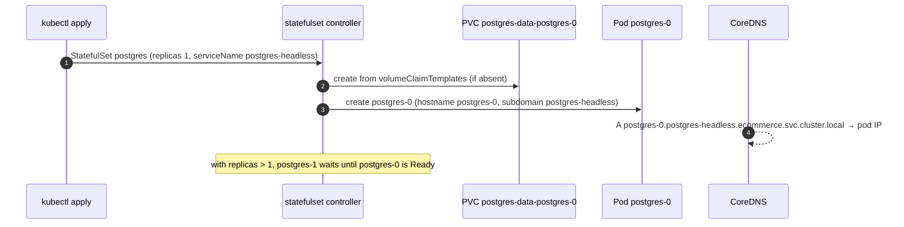
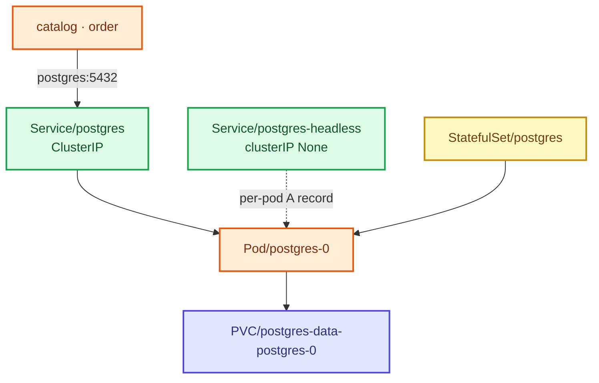

# Stage 08 — StatefulSets and headless Services *(recap)*

[⬅ Project 04](../../README.md) · Stage 7 of 11

[00 Namespace](../00-namespace/README.md) › [03 Deployments](../03-deployments/README.md) › [04 Services](../04-services/README.md) › [05 ConfigMaps](../05-configmaps/README.md) › [06 Secrets](../06-secrets/README.md) › [07 Storage](../07-storage/README.md) › **08 StatefulSets** › [09 Ingress](../09-ingress/README.md) › [11 Probes](../11-health-checks/README.md) › [15 NetworkPolicy](../15-security/README.md) › [19 Final](../19-final/README.md)

> **The problem:** both datastores are Deployments with **one pod template naming one claim**. Scale either and
> the replicas either share a volume (same node) or one sits `Pending` (another node). There is no way to give a
> replica its own disk, a name that survives rescheduling, or a start-up order.

> **Recap stage.** StatefulSets are taught in depth in Projects 02 and 03 (where two Redis members need distinct
> roles). Here both datastores stay at one replica; the point is that they are now on the *correct* controller.

---

## 1. WHY does this resource exist?

| Need | Deployment | **StatefulSet** |
|---|---|---|
| Stable pod name | `postgres-7f9c4b-xk2ln`, new every time | `postgres-0`, forever |
| Own volume per replica | One claim shared by all | `volumeClaimTemplates` ⇒ one claim per ordinal |
| Volume follows identity | — | `postgres-0` always gets `postgres-data-postgres-0` |
| Ordered start / stop | All at once | `-0` Ready before `-1` starts; reverse on scale-down |
| Never two copies of one member | Rolling update runs old + new together | One pod per ordinal, ever |
| Per-pod DNS | None | `postgres-0.postgres-headless.ecommerce.svc.cluster.local` |

### When do you use one — and when not?

| StatefulSet | Not a StatefulSet |
|---|---|
| Databases, queues, anything with per-member data or identity | Stateless services — all five app services stay Deployments |
| Clustered systems whose members address each other | "It has a volume" alone — a single-writer app on a Deployment + `Recreate` works |
| | Anything a managed service does better (RDS, ElastiCache) |

> A StatefulSet gives **identity, per-pod storage and ordering**. It does **not** give replication, failover or
> backups — those are the database's job, or an operator's.

---

## 2. WHAT is it?

A StatefulSet is **a controller that manages pods with stable ordinal identities, each bound to its own
PersistentVolumeClaim, created and removed in order.**

> **Analogy:** numbered lockers. Locker 0 always belongs to member 0, whoever is currently wearing the badge; if
> member 0 is replaced, the new one gets the same locker and the same contents.

It requires a **headless governing Service** (`clusterIP: None`, named in `spec.serviceName`). Headless means
CoreDNS returns **pod IPs** rather than a virtual IP, and creates one A record per pod.

| Service | Kind | Used by |
|---|---|---|
| `postgres` (stage 04) | ClusterIP | `catalog`, `order` — unchanged |
| `postgres-headless` (this stage) | Headless | The StatefulSet's identity; per-pod DNS |

The application's configuration does not change at all: `POSTGRES_HOST` is still `postgres`.

---

## 3. HOW does it work?



1. For each ordinal the controller creates the claim (if it does not exist) **then** the pod.
2. The pod is named `<sts>-<ordinal>` and its hostname/subdomain produce the per-pod DNS record.
3. If `postgres-0` is deleted, a new `postgres-0` is created and re-binds **the same claim** — on a node in that
   volume's AZ.
4. Deleting the StatefulSet **leaves the claims**. The data outlives the controller.

---

## 4. Manifest

```yaml
# 02-postgres-statefulset.yaml (excerpt)
apiVersion: apps/v1
kind: StatefulSet
metadata: { name: postgres, namespace: ecommerce }
spec:
  serviceName: postgres-headless
  replicas: 1
  template:
    spec:
      containers:
        - name: postgres
          volumeMounts:
            - { name: postgres-data, mountPath: /var/lib/postgresql/data }
  volumeClaimTemplates:
    - metadata: { name: postgres-data }
      spec:
        storageClassName: ecommerce-gp3
        accessModes: [ReadWriteOnce]
        resources: { requests: { storage: 1Gi } }
```

```yaml
# 01-postgres-headless-service.yaml (excerpt)
spec:
  clusterIP: None
  publishNotReadyAddresses: true
  selector: { app.kubernetes.io/name: postgres, app.kubernetes.io/instance: postgres }
```

Redis is the same shape: [`03-redis-headless-service.yaml`](03-redis-headless-service.yaml),
[`04-redis-statefulset.yaml`](04-redis-statefulset.yaml).

---

## 5. Manifest breakdown

| Field | Value | What breaks if it's wrong |
|---|---|---|
| `serviceName` | `postgres-headless` | Names a non-headless Service ⇒ pods run, **no per-pod DNS** |
| Service `clusterIP` | `None` | Anything else ⇒ one VIP, no per-pod records |
| `publishNotReadyAddresses` | `true` | A member cannot resolve its own name while starting |
| `volumeClaimTemplates[].metadata.name` | `postgres-data` | Must equal the container's `volumeMounts[].name` or the pod is rejected |
| claim template `storageClassName` | `ecommerce-gp3` | Omitted ⇒ `Pending` forever on EKS |
| *(no `strategy`)* | — | StatefulSets use `updateStrategy` (RollingUpdate one ordinal at a time) |

---

## 6. Apply

A StatefulSet and a Deployment with the **same labels** would fight over the same pods, so delete the Deployment
first:

```bash
kubectl delete deployment postgres redis -n ecommerce
kubectl wait --for=delete pod -l 'app.kubernetes.io/name in (postgres,redis)' -n ecommerce --timeout=120s
kubectl apply -f manifests/08-statefulsets/
kubectl rollout status statefulset/postgres -n ecommerce --timeout=300s
kubectl rollout status statefulset/redis -n ecommerce --timeout=300s
# New, EMPTY volumes: let the owners re-create their schemas
kubectl rollout restart deployment/catalog deployment/order -n ecommerce
kubectl rollout status deployment/order -n ecommerce
# The stage 07 claims are no longer used by anything:
kubectl delete pvc postgres-data redis-data -n ecommerce
```

▸ **Expected:** `postgres-0` and `redis-0` `Running`; claims `postgres-data-postgres-0` and `redis-data-redis-0`
`Bound`.

> ⚠️ Orders placed before this stage were on the old `postgres-data` claim and are gone once it is deleted. On a
> real system you would `pg_dump` from the old pod and restore into the new one first.

---

## 7. Validate

```bash
kubectl get statefulsets,pods,pvc -n ecommerce -l 'app.kubernetes.io/name in (postgres,redis)'
kubectl exec -n ecommerce deployment/order -- python -c \
  "import socket; print(socket.gethostbyname('postgres-0.postgres-headless'), socket.gethostbyname('postgres'))"
kubectl get pod postgres-0 -n ecommerce -o jsonpath='{.status.podIP}{"\n"}'
```

▸ The per-pod name resolves to **exactly `postgres-0`'s pod IP**; `postgres` resolves to the ClusterIP. Place an
order in the UI to confirm the shop works end to end.

---

## 8. Observe the mechanism

```bash
kubectl delete pod postgres-0 -n ecommerce
kubectl get pods -n ecommerce -l app.kubernetes.io/name=postgres -w      # Ctrl-C
kubectl exec -n ecommerce postgres-0 -- psql -U ecommerce -d orders -tAc 'SELECT count(*) FROM orders'
```

▸ The replacement is called **`postgres-0` again**, and the order count is unchanged: identity and volume came
back together.

```bash
kubectl delete statefulset redis -n ecommerce
kubectl get pvc redis-data-redis-0 -n ecommerce          # still Bound — the data outlived the controller
kubectl apply -f manifests/08-statefulsets/04-redis-statefulset.yaml
```

---

## 9. Break it

### A governing Service that is not headless

```bash
kubectl delete service redis-headless -n ecommerce
kubectl create service clusterip redis-headless --tcp=6379:6379 -n ecommerce
kubectl delete pod redis-0 -n ecommerce; sleep 20
kubectl exec -n ecommerce deployment/cart -- python -c \
  "import socket; print(socket.gethostbyname('redis-0.redis-headless'))"
```

**Symptom:** `Name or service not known` — yet `redis-0` is `Running` and `cart` (which uses `redis`) still works.

**Root cause:** per-pod records exist only under a **headless** Service. "Headless" is `clusterIP: None`, not a
name.

**Fix:** `kubectl delete service redis-headless -n ecommerce && kubectl apply -f manifests/08-statefulsets/03-redis-headless-service.yaml`

---

## 10. How it interacts



---

## 11. Production notes

> 🧪 **DEMO / LEARNING CONFIGURATION**
> One replica of each datastore, no replication, no failover, no backups, `reclaimPolicy: Delete`.

> 🏭 **PRODUCTION CONSIDERATIONS**
> - **RDS / ElastiCache**, reached through the same Service name with an ExternalName, so the application config
>   never changes.
> - If in-cluster: an **operator** (CloudNativePG, a Redis operator) for replication, failover and backups;
>   `persistentVolumeClaimRetentionPolicy` set deliberately; PDBs (Project 05).

---

## 12. The next problem

The shop is complete and durable — and still only reachable through `kubectl port-forward`, a tunnel from one
laptop through the EKS API server. Shoppers need one public address, where `/` reaches the storefront and
`/api/catalog`, `/api/cart` and `/api/orders` reach three different services.

The obvious answer — a `type: LoadBalancer` Service for each — would create **four NLBs**, four hourly bills and
four hostnames, and still could not route by URL path.

→ **[Stage 09 — Ingress](../09-ingress/README.md)**

---

## 📚 Official documentation

Everything above is self-contained — these are for going deeper, not for filling gaps.
*(All links verified 2026-09-19.)*

| Reference | What it adds |
|---|---|
| [StatefulSets](https://kubernetes.io/docs/concepts/workloads/controllers/statefulset/) | Identity, ordering, update strategies, PVC retention |
| [DNS for Services and Pods](https://kubernetes.io/docs/concepts/services-networking/dns-pod-service/) | Headless Services and per-pod records |
| [Service — headless](https://kubernetes.io/docs/concepts/services-networking/service/) | `clusterIP: None` and `publishNotReadyAddresses` |

---

| ◀ Previous | ▲ Up | Next ▶ |
|---|:--:|---:|
| ◀ **[07 Storage](../07-storage/README.md)** | [Project 04](../../README.md) · [Manual steps](../../scripts/manual-steps.md) | **[09 Ingress](../09-ingress/README.md)** ▶ |
