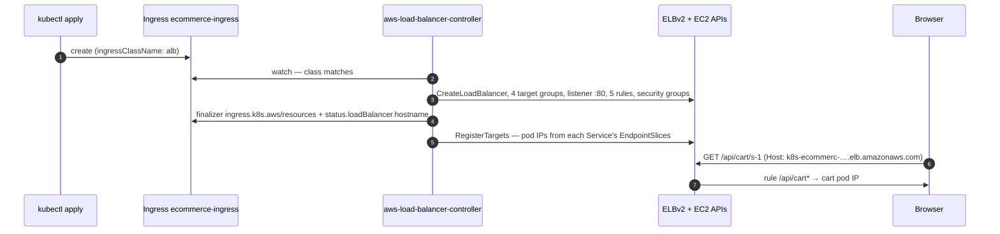
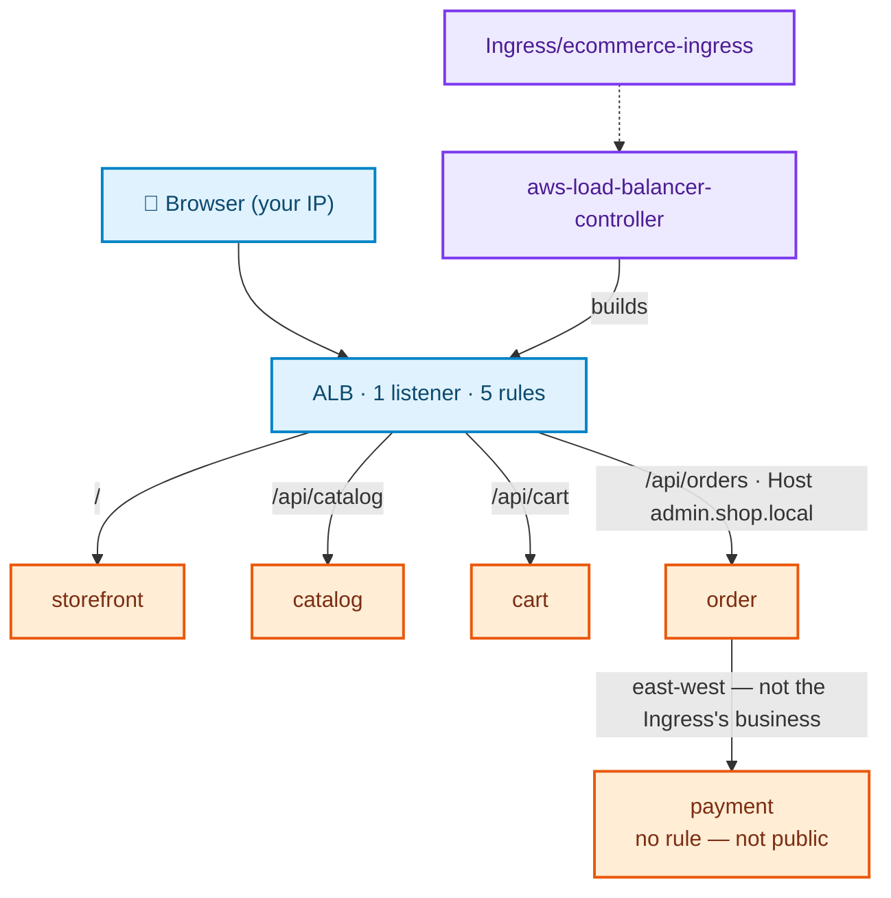

# Stage 09 — Ingress: path and host routing on one ALB

[⬅ Project 04](../../README.md) · Stage 8 of 11

[00 Namespace](../00-namespace/README.md) › [03 Deployments](../03-deployments/README.md) › [04 Services](../04-services/README.md) › [05 ConfigMaps](../05-configmaps/README.md) › [06 Secrets](../06-secrets/README.md) › [07 Storage](../07-storage/README.md) › [08 StatefulSets](../08-statefulsets/README.md) › **09 Ingress** › [11 Probes](../11-health-checks/README.md) › [15 NetworkPolicy](../15-security/README.md) › [19 Final](../19-final/README.md)

> **The problem:** the shop is reachable only through `kubectl port-forward`. Four things must be public at **one**
> address — `/` → storefront, `/api/catalog` → catalog, `/api/cart` → cart, `/api/orders` → order — and `payment`
> must **not** be public at all. Services route by *port*, not by URL path.

---

## 1. WHY does this resource exist?

| Option | On EKS | Why not |
|---|---|---|
| `kubectl port-forward` | A tunnel for one person with cluster credentials | Not a front door |
| `type: NodePort` per Service | A port on every node | Nodes change, ugly ports, security group per port, no paths |
| `type: LoadBalancer` per Service | **One NLB per Service** — four here, ~$0.0225/h **each** | Layer 4: cannot route `/api/cart` differently from `/`; four hostnames for one shop |
| **Ingress** | **One ALB**, HTTP routing by host and path | ✅ |

**The cost argument is real and checkable:** four NLBs is four line items on the bill for one application, and
each is a separate public hostname your frontend would have to know. One Ingress collapses that to one ALB and
one address.

An Ingress is only **rules**. An **Ingress controller** makes them real. On EKS that is the **AWS Load Balancer
Controller**, which calls AWS APIs to build an ALB in your account.

> **Why not ingress-nginx?** The Kubernetes project [retired it in March 2026](https://kubernetes.io/blog/2025/11/11/ingress-nginx-retirement/).
> On EKS the ALB controller is the native answer anyway: no proxy pods to run, pods as direct targets, WAF and ACM
> integration.

### North-south is not east-west

The Ingress decides what the **internet** can reach. It says **nothing** about traffic *between pods*. `payment`
has no rule here, so no one outside can call it — but every pod inside the cluster still can (you proved that in
stage 04 with a rogue pod). Two different directions, two different objects: **Ingress** for north-south,
**NetworkPolicy** (stage 15) for east-west.

---

## 2. WHAT is it?

An Ingress is **a namespaced object of HTTP routing rules — by host and by path — implemented by whichever
controller its `ingressClassName` names.**

> **Analogy:** a building directory in the lobby. "Floor 1: shop. Floor 2: catalogue. Deliveries: side entrance
> (admin)." The controller is the facilities team that builds the doors the directory describes.

| Layer | Object | Owner |
|---|---|---|
| The rules | `Ingress/ecommerce-ingress` | you |
| Which implementation | `IngressClass/alb` | the controller's Helm chart |
| The implementation | `Deployment/aws-load-balancer-controller` + IAM role (Pod Identity) | the platform |

### Two routing dimensions

| Rule kind | Matches on | This project |
|---|---|---|
| **Path-based** | The URL path | `/api/catalog`, `/api/cart`, `/api/orders`, `/` |
| **Host-based** | The HTTP `Host` header | `admin.shop.local` → `order` (an admin view of orders) |

A rule **with** a `host:` only matches that `Host` header; a rule **without** one matches any host — including the
ALB's generated hostname, which is how shoppers reach the site without you owning DNS.

### Why there are no rewrite annotations here

Many tutorials route `/api/catalog` to a service that serves `/products`, and strip the prefix with a
`rewrite-target` annotation. That annotation belongs to ingress-nginx and does nothing on an ALB. This project
avoids the need altogether: **each service serves under its own prefix** (`catalog` answers
`/api/catalog/products`), so the ALB forwards paths unchanged. Designing services to own their prefix is the
portable choice — it works behind any ingress, and the path means the same thing inside and outside the cluster.

---

## 3. HOW does it work?



1. The controller turns the rules into ALB **listener rules**: one with a *host-header* condition for
   `admin.shop.local`, and path conditions for the rest.
2. It creates **one target group per backend Service** and registers **pod IPs** (`target-type: ip`) — no
   NodePort, no kube-proxy hop.
3. The hostname appears in the Ingress status within seconds; the ALB is usable after 2–3 minutes (provisioning,
   DNS, and targets passing the ALB's **own** health checks).
4. The finalizer makes `kubectl delete ingress` block until the ALB is gone — the property cleanup relies on.

---

## 4. Manifest

[`ecommerce-ingress.yaml`](ecommerce-ingress.yaml), excerpted:

```yaml
spec:
  ingressClassName: alb
  rules:
    - host: admin.shop.local                  # HOST-based
      http:
        paths:
          - path: /
            pathType: Prefix
            backend: { service: { name: order, port: { number: 8080 } } }
    - http:                                   # any other host: PATH-based
        paths:
          - { path: /api/catalog, pathType: Prefix, backend: { service: { name: catalog,    port: { number: 8080 } } } }
          - { path: /api/cart,    pathType: Prefix, backend: { service: { name: cart,       port: { number: 8080 } } } }
          - { path: /api/orders,  pathType: Prefix, backend: { service: { name: order,      port: { number: 8080 } } } }
          - { path: /,            pathType: Prefix, backend: { service: { name: storefront, port: { number: 8080 } } } }
```

Annotations: `scheme: internet-facing`, `target-type: ip`, `healthcheck-path: /healthz`,
`deregistration_delay.timeout_seconds=20`, and `inbound-cidrs` — replaced with **your** IP in §6.

---

## 5. Manifest breakdown

| Field | Value | What it does | What breaks if it's wrong |
|---|---|---|---|
| `ingressClassName` | `alb` | Hands it to the ALB controller | Wrong/missing ⇒ accepted, **no ALB, no error** |
| `scheme` | `internet-facing` | Public ALB in public subnets | `internal` ⇒ VPC-only |
| `target-type` | `ip` | Pod IPs are targets | `instance` needs NodePort Services |
| `healthcheck-path` | `/healthz` | ALB's own check | 404 path ⇒ all targets unhealthy ⇒ **503** |
| `inbound-cidrs` | your `/32` | The ALB security group's only source | `0.0.0.0/0` ⇒ open to the internet |
| `rules[0].host` | `admin.shop.local` | Host-header condition | Requests without that `Host` never match it |
| `path` + `Prefix` | `/api/cart` | Matches `/api/cart` and `/api/cart/*` | `Exact` ⇒ `/api/cart/s-1` falls through to `/` → storefront 404 |
| `backend.service.port.number` | `8080` | The **Service** port | A port the Service does not expose ⇒ controller error event, no targets |
| *(no rule for payment)* | — | Not internet-reachable | Adding one would expose payment publicly |

---

## 6. Apply

### 6.1 Prerequisite — the controller (once per cluster)

`clusters/eks-advanced.yaml` created the ServiceAccount `kube-system/aws-load-balancer-controller` with an IAM
role via Pod Identity. Install the controller:

```bash
VPC_ID=$(aws eks describe-cluster --region us-east-1 --name kubernetes-lab \
           --query cluster.resourcesVpcConfig.vpcId --output text)
helm repo add eks https://aws.github.io/eks-charts
helm repo update eks
helm upgrade --install aws-load-balancer-controller eks/aws-load-balancer-controller \
  --version 3.5.0 --namespace kube-system \
  --set clusterName=kubernetes-lab \
  --set serviceAccount.create=false --set serviceAccount.name=aws-load-balancer-controller \
  --set region=us-east-1 --set vpcId="$VPC_ID" --wait
kubectl get ingressclass
```

▸ `serviceAccount.create=false` reuses the ServiceAccount that already carries the IAM association.

### 6.2 The Ingress, locked to your IP

```bash
kubectl apply -f manifests/09-ingress/ecommerce-ingress.yaml
MY_IP=$(curl -s https://checkip.amazonaws.com)
kubectl annotate ingress ecommerce-ingress -n ecommerce \
  alb.ingress.kubernetes.io/inbound-cidrs="${MY_IP}/32" --overwrite
ALB=$(kubectl get ingress ecommerce-ingress -n ecommerce -o jsonpath='{.status.loadBalancer.ingress[0].hostname}')
until curl -s -o /dev/null -m 5 -w '%{http_code}' "http://$ALB/healthz" | grep -q 200; do echo waiting…; sleep 10; done
```

▸ Two to three minutes the first time. `Could not resolve host` means DNS has not propagated yet.

---

## 7. Validate

```bash
curl -s "http://$ALB/api/catalog/products" | head -c 120; echo
curl -s -o /dev/null -w 'ui %{http_code}\n' "http://$ALB/"
curl -s "http://$ALB/api/orders" | head -c 120; echo
curl -s -o /dev/null -w 'payment %{http_code}\n' "http://$ALB/api/payments/authorize"
```

```
[{"name":"Mechanical keyboard","price_cents":8900,"sku":"SKU-1001"},…
ui 200
[…]
payment 404
```

▸ `payment 404` — no rule sends `/api/payments` anywhere except `/` → the storefront, which has no such route.
**Payment is not on the internet.**

**Host-based routing — same ALB, a different `Host` header:**

```bash
curl -s -H 'Host: admin.shop.local' "http://$ALB/api/orders" | head -c 120; echo
curl -s -H 'Host: admin.shop.local' "http://$ALB/whoami" | python3 -m json.tool | head -8
```

▸ The second response comes from **`order`**'s `/whoami` (`"service": "order"`), not the storefront's — the host
rule sent `/whoami` to a different backend than the hostless rule would have.

**Open `http://$ALB/` in a browser** and shop. The UI's `/api/*` calls now go browser → ALB → each service
directly; the storefront only serves `/`.

```bash
kubectl get targetgroupbindings -n ecommerce
```

```
NAME                               SERVICE-NAME   SERVICE-PORT   TARGET-TYPE
k8s-ecommerc-cart-…                cart           8080           ip
k8s-ecommerc-catalog-…             catalog        8080           ip
k8s-ecommerc-order-…               order          8080           ip
k8s-ecommerc-storefro-…            storefront     8080           ip
```

▸ Four target groups — one per exposed Service. None for payment.

---

## 8. Observe the mechanism

### Targets are pod IPs

```bash
for tg in $(aws elbv2 describe-target-groups --region us-east-1 \
    --query "TargetGroups[?contains(TargetGroupName,'ecommerc')].TargetGroupArn" --output text); do
  aws elbv2 describe-target-health --region us-east-1 --target-group-arn "$tg" \
    --query 'TargetHealthDescriptions[].[Target.Id,TargetHealth.State]' --output text
done
kubectl get pods -n ecommerce -o custom-columns=NAME:.metadata.name,IP:.status.podIP
```

▸ Every target ID is a pod IP. Scale `catalog` to 3 and a new target appears.

### The listener rules the controller wrote

```bash
LB_ARN=$(aws elbv2 describe-load-balancers --region us-east-1 \
  --query "LoadBalancers[?DNSName=='$ALB'].LoadBalancerArn" --output text)
L_ARN=$(aws elbv2 describe-listeners --region us-east-1 --load-balancer-arn "$LB_ARN" --query 'Listeners[0].ListenerArn' --output text)
aws elbv2 describe-rules --region us-east-1 --listener-arn "$L_ARN" \
  --query 'Rules[].[Priority,Conditions[].Field|join(`,`,@),Conditions[].Values[]|join(` `,@)]' --output text
```

▸ One rule with a **`host-header`** condition, four with **`path-pattern`** — the Ingress, translated into AWS.

### East-west is untouched

```bash
kubectl run rogue --rm -i --restart=Never --image=curlimages/curl:8.10.1 -n ecommerce -- \
  curl -s -m 5 -X POST http://payment:8080/api/payments/authorize \
    -H 'Content-Type: application/json' -H 'X-Calling-Service: rogue' -d '{"amount_cents":100}'
```

▸ `"authorized": true`. The Ingress hid payment from the internet and did nothing about the pods next to it.

---

## 9. Break it

### Break 1 — `Exact` instead of `Prefix`

```bash
kubectl patch ingress ecommerce-ingress -n ecommerce --type=json \
  -p '[{"op":"replace","path":"/spec/rules/1/http/paths/1/pathType","value":"Exact"}]'
sleep 30
curl -s -o /dev/null -w '%{http_code}\n' "http://$ALB/api/cart/s-1"
```

**Symptom:** `404` from the **storefront** (a Flask 404 page, not the ALB's). `/api/cart` alone would match; nothing
under it does, so the request falls through to `/`.

**Fix:** `kubectl apply -f manifests/09-ingress/ecommerce-ingress.yaml` and re-run the `annotate` from §6.2.

### Break 2 — 502 vs 503

```bash
kubectl scale deployment/catalog -n ecommerce --replicas=0; sleep 30
curl -s -o /dev/null -w '503? %{http_code}\n' "http://$ALB/api/catalog/products"
kubectl scale deployment/catalog -n ecommerce --replicas=2
kubectl patch service cart -n ecommerce --type=json -p '[{"op":"replace","path":"/spec/ports/0/targetPort","value":9999}]'
sleep 45
curl -s -o /dev/null -w '502? %{http_code}\n' "http://$ALB/api/cart/s-1"
kubectl apply -f manifests/04-services/cart-service.yaml
```

▸ **503** = nothing healthy to send to. **502** = a target was tried and refused. Each other path keeps working —
one ALB, independent target groups.

### Break 3 — the host nobody sends

```bash
curl -s -o /dev/null -w '%{http_code}\n' "http://$ALB/api/orders" -H 'Host: admin.shop.example'
```

▸ `200` from the **hostless** rule, not the admin one: a host rule only matches its exact `Host`. A typo in a host
rule never errors — traffic just silently takes a different route.

---

## 10. How it interacts



---

## 11. Production notes

> 🧪 **DEMO / LEARNING CONFIGURATION**
> Plain HTTP, a generated hostname, a host rule tested with `curl -H`, one IP allowed, no WAF.

> 🏭 **PRODUCTION CONSIDERATIONS**
> - **HTTPS**: an ACM certificate, `listen-ports` for 443, `ssl-redirect`. Real hosts via Route53 + ExternalDNS
>   (Project 10).
> - **An admin host deserves more than a Host header** — a separate *internal* ALB, or authentication at the ALB
>   (`auth-type: cognito`/`oidc`).
> - **AWS WAF** in front of a shop: rate limits, bot control.
> - **Share one ALB** across Ingresses with `alb.ingress.kubernetes.io/group.name`.
> - **Gateway API** is the successor to Ingress for richer routing, and the ALB controller supports it.

---

## 12. The next problem

The shop is on the internet. Roll out any change under traffic and look at the start of each pod's life:

- A new `catalog` pod joins the target group as soon as its container **starts** — before its migration thread has
  reached PostgreSQL. Nothing tells anyone whether it is ready; with no probes, "Running" is all Kubernetes knows.
- Every catalog and order replica still creates its schema from **inside the serving process**, in a background
  thread, while it is already receiving traffic.
- And turn `payment` slow (`PAYMENT_LATENCY_MS=8000`): nothing is *down*, every pod passes every check — and
  checkout hangs for three seconds per click before failing, while the storefront keeps sending more.

→ **[Stage 11 — Probes and init containers](../11-health-checks/README.md)**

---

## 📚 Official documentation

Everything above is self-contained — these are for going deeper, not for filling gaps.
*(All links verified 2026-09-19.)*

| Reference | What it adds |
|---|---|
| [Ingress](https://kubernetes.io/docs/concepts/services-networking/ingress/) | Host and path rules, `pathType`, IngressClass |
| [Route internet traffic with AWS Load Balancer Controller](https://docs.aws.amazon.com/eks/latest/userguide/aws-load-balancer-controller.html) | Installing and authorising the controller on EKS |
| [Ingress annotations](https://kubernetes-sigs.github.io/aws-load-balancer-controller/latest/guide/ingress/annotations/) | Every `alb.ingress.kubernetes.io/*` annotation used above |
| [Ingress specification (ALB controller)](https://kubernetes-sigs.github.io/aws-load-balancer-controller/latest/guide/ingress/spec/) | How host and path rules map to ALB listener rules |
| [Ingress NGINX Retirement](https://kubernetes.io/blog/2025/11/11/ingress-nginx-retirement/) | The primary source for the retirement cited in §1 |

---

| ◀ Previous | ▲ Up | Next ▶ |
|---|:--:|---:|
| ◀ **[08 StatefulSets](../08-statefulsets/README.md)** | [Project 04](../../README.md) · [Manual steps](../../scripts/manual-steps.md) | **[11 Probes](../11-health-checks/README.md)** ▶ |
