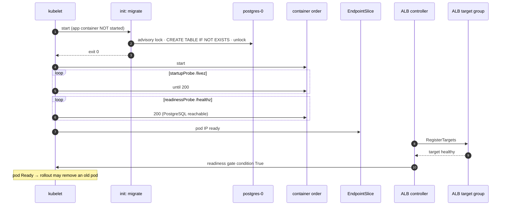
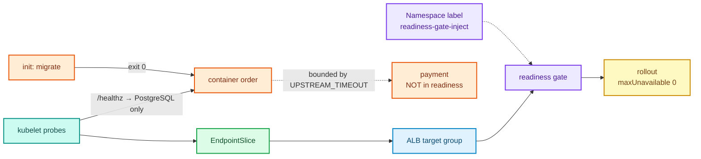

# Stage 11 — Probes, init containers and the cascading failure

[⬅ Project 04](../../README.md) · Stage 9 of 11

[00 Namespace](../00-namespace/README.md) › [03 Deployments](../03-deployments/README.md) › [04 Services](../04-services/README.md) › [05 ConfigMaps](../05-configmaps/README.md) › [06 Secrets](../06-secrets/README.md) › [07 Storage](../07-storage/README.md) › [08 StatefulSets](../08-statefulsets/README.md) › [09 Ingress](../09-ingress/README.md) › **11 Probes** › [15 NetworkPolicy](../15-security/README.md) › [19 Final](../19-final/README.md)

> **The problem:** nothing tells Kubernetes — or the ALB — whether a pod can serve. A new `catalog` pod joins the
> target group the moment its container starts, before it has reached PostgreSQL. Schemas are created by a
> background thread *inside* the serving process. And with five services, readiness has a new question attached:
> **which dependencies should a pod's health depend on?** Answer it wrong and one slow service takes down the site.

---

## 1. WHY does this resource exist?

Kubernetes can observe exactly one thing on its own: whether the process is alive. Everything else needs the
application's help.

| Question | Without it | Mechanism |
|---|---|---|
| "Has it finished starting?" | Liveness kills slow starters mid-boot | **startupProbe** |
| "Can it serve **now**?" | Traffic reaches pods that cannot answer; rollouts proceed on broken pods | **readinessProbe** → endpoints |
| "Is it stuck?" | A deadlocked process runs forever | **livenessProbe** → restart |
| "Does the ALB agree it's healthy?" | Old pods are deleted before the ALB trusts new ones | **pod readiness gate** |
| "Is the precondition met?" | The app starts against a missing schema | **init container** |

### The microservices-specific question: what should readiness check?

With one backend and one database the answer is obvious. With a call graph it is the whole lesson:

| Service | Readiness checks | Why — and what goes wrong otherwise |
|---|---|---|
| `storefront` | **nothing** | If it checked its three upstreams, one slow `catalog` would pull the entire UI out of the ALB. The UI can render and *report* the broken dependency, so it is genuinely ready |
| `catalog` | PostgreSQL | A hard dependency — it cannot serve a catalogue without it |
| `cart` | Redis | Redis *is* the cart |
| `order` | PostgreSQL — **not `payment`** | Checking payment would turn "checkout is broken" into "every order endpoint and the admin host return 503" |
| `payment` | nothing | No dependencies |

> **The rule:** readiness reflects what *this pod* genuinely cannot work without. Every dependency you add to a
> readiness check is a new way for someone else's outage to become yours — the textbook **cascading readiness
> failure**.

**Liveness never checks a dependency.** A PostgreSQL blip must not restart every `catalog` and `order` pod at once:
restarting them cannot fix PostgreSQL, and when it returns every pod is in back-off.

---

## 2. WHAT is it?

**Probes** are checks the kubelet runs periodically against a container, with thresholds. **Init containers** run
sequentially to completion before the app containers start. A **readiness gate** is an extra pod condition, set by
an outside controller, that must be `True` for the pod to count as Ready.

> **Analogy:** a restaurant. The init container is the prep cook — no guests until prep is done. Startup is "doors
> unlocked yet?", readiness is the host deciding whether to seat people at this table *right now*, liveness is the
> manager checking a waiter hasn't collapsed, and the readiness gate is the booking system confirming the table is
> actually in the reservation list.

| Workload | Startup | Readiness | Liveness | Type |
|---|---|---|---|---|
| five app services | `/livez` 30×1s | `/healthz` 3×5s | `/livez` 3×10s | HTTP |
| `postgres` | `pg_isready` 60×2s | `pg_isready` 3×5s | `pg_isready` 6×10s | exec |
| `redis` | `redis-cli ping` 30×2s | same 3×5s | same 6×10s | exec |

---

## 3. HOW does it work?



1. Init containers run one at a time; each must exit 0. On failure the kubelet retries with back-off; the pod shows
   `Init:0/1`, `Init:Error`, `Init:CrashLoopBackOff`.
2. While `startupProbe` has not succeeded, readiness and liveness are **not run**.
3. Failing **readiness** removes the pod from every Service's EndpointSlice (and so the ALB). **No restart.**
4. Failing **liveness** `failureThreshold` times ⇒ the kubelet kills the container (exit 137) and restarts it.
5. The namespace label `elbv2.k8s.aws/pod-readiness-gate-inject: enabled` makes the controller add a readiness gate
   to **new** pods; `Ready` stays `False` until the ALB reports the target healthy. With `maxUnavailable: 0`, a
   rollout never has fewer ALB-healthy pods than desired.

---

## 4. Manifest

Eight files: the relabelled namespace, both StatefulSets with exec probes, and five Deployments. `order`, excerpted:

```yaml
spec:
  replicas: 2
  strategy:
    type: RollingUpdate
    rollingUpdate: { maxSurge: 1, maxUnavailable: 0 }
  template:
    spec:
      initContainers:
        - name: migrate
          image: cloudprakhargupta/ecommerce:order-1.0.0     # same image as the app
          command: ["python", "migrate.py"]
          envFrom: [{ configMapRef: { name: ecommerce-config } }]
          env: [ POSTGRES_DB=orders, POSTGRES_PASSWORD from postgres-secret, … ]
      containers:
        - name: order
          env:
            - { name: RUN_MIGRATIONS, value: "false" }      # the init container owns the schema
          startupProbe:   { httpGet: { path: /livez,   port: http }, periodSeconds: 1,  failureThreshold: 30 }
          readinessProbe: { httpGet: { path: /healthz, port: http }, periodSeconds: 5,  timeoutSeconds: 2, failureThreshold: 3 }
          livenessProbe:  { httpGet: { path: /livez,   port: http }, periodSeconds: 10, timeoutSeconds: 2, failureThreshold: 3 }
```

```yaml
# 01-ecommerce-namespace.yaml
metadata:
  name: ecommerce
  labels:
    elbv2.k8s.aws/pod-readiness-gate-inject: enabled
```

---

## 5. Manifest breakdown

| Field | Value | What breaks if it's wrong |
|---|---|---|
| `initContainers[].command` | `python migrate.py` | Non-zero forever ⇒ `Init:CrashLoopBackOff`; the app never starts |
| init image = app image | `order-1.0.0` | Different tag ⇒ new code against an old schema |
| `RUN_MIGRATIONS` | `"false"` | `true` ⇒ harmless (lock + idempotent) but redundant |
| `startupProbe` budget | 30 × 1s | Too short ⇒ slow nodes kill pods mid-boot |
| readiness path | `/healthz` | Pointing `order`'s at a payment check ⇒ payment outage empties the ALB |
| readiness `timeoutSeconds` | `2` | Below real latency ⇒ pods flap in and out |
| liveness path | `/livez` | `/healthz` ⇒ a database blip becomes a restart storm (exit 137) |
| `maxUnavailable` | `0` | Default 25% ⇒ one of two pods removed immediately |
| `pg_isready -h 127.0.0.1` | exec | Without `-h`, it tests a Unix socket |
| namespace label | readiness-gate-inject | Only **new** pods get the gate — roll existing ones |

---

## 6. Apply

```bash
kubectl apply -f manifests/11-health-checks/01-ecommerce-namespace.yaml     # label FIRST
kubectl apply -f manifests/11-health-checks/02-postgres-statefulset.yaml \
              -f manifests/11-health-checks/03-redis-statefulset.yaml
kubectl rollout status statefulset/postgres -n ecommerce --timeout=300s
kubectl rollout status statefulset/redis -n ecommerce --timeout=300s
kubectl apply -f manifests/11-health-checks/
for d in storefront catalog cart order payment; do
  kubectl rollout status deployment/$d -n ecommerce --timeout=300s
done
```

▸ **Namespace label first**, so the pods the Deployment updates create get readiness gates.

---

## 7. Validate

```bash
kubectl get pods -n ecommerce -o wide
```

```
NAME                       READY   STATUS    RESTARTS   AGE   …   READINESS GATES
catalog-5c7d9f8b4-2xkqp    1/1     Running   0          40s   …   1/1
order-7b6c8d9f5-m4vtn      1/1     Running   0          38s   …   1/1
storefront-6f8b9c7d4-r2lzp 1/1     Running   0          45s   …   1/1
payment-7c844758c6-z452j   1/1     Running   0          40s   …   <none>
postgres-0                 1/1     Running   0          2m    …   <none>
```

▸ `payment`, `postgres` and `redis` show `<none>`: they are not ALB targets, so the controller's webhook has no
target health to gate them on. Only pods behind an Ingress rule get a readiness gate.

```bash
POD=$(kubectl get pods -n ecommerce -l app.kubernetes.io/name=order -o jsonpath='{.items[0].metadata.name}')
kubectl logs "$POD" -n ecommerce -c migrate
```

```
level=INFO … svc=order-migrate msg=waiting for migration lock id=4040002
level=INFO … svc=order-migrate msg=schema up to date
```

▸ `-c migrate` is required to read an **init** container's logs.

---

## 8. Observe the mechanism

### Init container waiting — not crashing

```bash
kubectl scale statefulset/postgres -n ecommerce --replicas=0
kubectl rollout restart deployment/catalog -n ecommerce
sleep 30
kubectl get pods -n ecommerce -l 'app.kubernetes.io/name in (catalog,cart)'
curl -s -o /dev/null -w 'catalog %{http_code}\n' "http://$ALB/api/catalog/products"
curl -s -o /dev/null -w 'cart    %{http_code}\n' "http://$ALB/api/cart/s-1"
```

| Pod | State | Means |
|---|---|---|
| old `catalog` pods `0/1 Running` | readiness failing | PostgreSQL gone ⇒ out of the ALB. **Not restarted** |
| new `catalog` pod `Init:0/1` | `migrate` retrying | Waiting for a precondition, not broken |
| `cart` pods `1/1` | unaffected | Readiness checks *Redis*, not PostgreSQL |
| catalog `503`, cart `200` | per-path | One ALB, independent target groups — a partial outage stays partial |

```bash
kubectl scale statefulset/postgres -n ecommerce --replicas=1
kubectl rollout status deployment/catalog -n ecommerce --timeout=300s
```

▸ The rollout completes on its own once PostgreSQL returns.

### The cascading failure: slow, not down

This is the failure that probes *cannot* see, and the reason `UPSTREAM_TIMEOUT_SECONDS` exists. Make `payment`
slow:

```bash
kubectl patch configmap ecommerce-config -n ecommerce --type merge -p '{"data":{"PAYMENT_LATENCY_MS":"8000"}}'
kubectl rollout restart deployment/payment -n ecommerce
kubectl rollout status deployment/payment -n ecommerce
kubectl get pods -n ecommerce -l app.kubernetes.io/name=payment      # 1/1 Ready — every probe passes
```

Checkout now takes `UPSTREAM_TIMEOUT_SECONDS` (3 s) and fails with a named 502:

```bash
time curl -s -X POST "http://$ALB/api/orders" -H 'Content-Type: application/json' \
  -d '{"session":"slow","items":[{"sku":"SKU-1001","name":"k","price_cents":8900,"quantity":1}]}'
```

```
{"detail":"…Read timed out. (read timeout=3.0)","error":"cannot reach payment at http://payment:8080","service":"order",…}
real    0m3.1s
```

Now remove the bound, and put **sustained** load on it — 50 clients, each checking out in a loop for 60 s:

```bash
kubectl patch configmap ecommerce-config -n ecommerce --type merge -p '{"data":{"UPSTREAM_TIMEOUT_SECONDS":"60"}}'
kubectl rollout restart deployment/order -n ecommerce && kubectl rollout status deployment/order -n ecommerce
BODY='{"session":"slow","items":[{"sku":"SKU-1001","name":"k","price_cents":8900,"quantity":1}]}'
END=$(( $(date +%s) + 60 ))
for i in $(seq 1 50); do
  ( while [ $(date +%s) -lt $END ]; do
      curl -s -o /dev/null -m 70 -X POST "http://$ALB/api/orders" -H 'Content-Type: application/json' -d "$BODY"
    done ) &
done
for t in 10 20 30 40 50 60; do
  sleep 10
  printf 't=%ss ready=%s ' $t "$(kubectl get pods -n ecommerce -l app.kubernetes.io/name=order --no-headers | awk '{printf "%s,",$2}')"
  curl -s -o /dev/null -m 10 -w 'order-list=%{http_code} ' "http://$ALB/api/orders"
  curl -s -o /dev/null -m 10 -w 'catalog=%{http_code}\n' "http://$ALB/api/catalog/products"
done; wait
kubectl get events -n ecommerce --field-selector reason=Unhealthy | tail -4
```

Measured on this project's cluster:

```
t=10s ready=1/1,1/1, order-list=000 (10 s timeout)  catalog=200
t=20s ready=0/1,0/1, order-list=503                 catalog=200
t=30s ready=1/1,0/1, order-list=000 (10 s timeout)  catalog=200
t=40s ready=0/1,1/1, order-list=200                 catalog=200

Warning  Unhealthy  pod/order-…    Readiness probe failed: … context deadline exceeded
Warning  Unhealthy  pod/order-…    Liveness probe failed: … context deadline exceeded
Warning  Unhealthy  pod/payment-…  Readiness probe failed: … context deadline exceeded
```

▸ Each `order` pod has one gunicorn worker with 8 threads. Every checkout holds a thread for 8 s, so the pool is
always full; `/healthz` and `/livez` **queue behind real requests** and time out. Readiness fails, both pods leave
the ALB, and the *order list* — which never touches payment — returns **503**. Liveness failed too, which means the
kubelet was one threshold away from **restarting** healthy processes. `catalog` never noticed: the blast radius is
exactly the services that call the slow one.

Now the same load with the bound restored (`UPSTREAM_TIMEOUT_SECONDS=3`):

```
t=10s ready=1/1,1/1, order-list=200 (6.6 s)   catalog=200
t=20s ready=1/1,1/1, order-list=200 (4.4 s)   catalog=200
t=30s ready=1/1,0/1, order-list=503           catalog=200
t=40s ready=1/1,1/1, order-list=200           catalog=200
t=50s ready=1/1,1/1, order-list=200 (0.6 s)   catalog=200
```

▸ **Much better, not immune.** Threads are released after 3 s instead of 8, so the pool mostly keeps up — but
latency is still multiplied and one pod still dropped out once. A timeout **bounds** the damage; it does not remove
it. The rest of the answer is capacity and isolation: more threads or replicas, and health endpoints that do not
share a queue with real work.

Restore:

```bash
kubectl apply -f manifests/05-configmaps/01-ecommerce-config.yaml
kubectl rollout restart deployment/order deployment/payment -n ecommerce
```

> This gap — how many concurrent requests a pod can hold, and what happens when it runs out — is resources,
> concurrency and autoscaling. That is **Project 05**.

---

## 9. Break it

### Break 1 — liveness pointed at a dependency

```bash
kubectl patch deployment catalog -n ecommerce --type=json \
  -p '[{"op":"replace","path":"/spec/template/spec/containers/0/livenessProbe/httpGet/path","value":"/healthz"}]'
kubectl rollout status deployment/catalog -n ecommerce
kubectl scale statefulset/postgres -n ecommerce --replicas=0
sleep 60
kubectl get pods -n ecommerce -l app.kubernetes.io/name=catalog
```

**Symptom:** `RESTARTS` climbing on every catalog pod; `describe` shows `Liveness probe failed … 503` and
`Exit Code: 137`.

**Fix:** `kubectl scale statefulset/postgres -n ecommerce --replicas=1 && kubectl apply -f manifests/11-health-checks/05-catalog-deployment.yaml`

### Break 2 — readiness that includes a dependency you don't own

Imagine `storefront`'s `/healthz` called `catalog`. Scale catalog to 0: with the real manifest the shop's `/` keeps
returning 200 and the catalogue panel shows its error; with a dependency-aware readiness check, `/` would return
**503 for everyone**. Readiness must not encode somebody else's outage.

### Break 3 — a migration that can never run

```bash
kubectl set env deployment/order -n ecommerce -c migrate POSTGRES_HOST=postgres.nowhere.svc.cluster.local
kubectl get pods -n ecommerce -l app.kubernetes.io/name=order -w       # Ctrl-C after ~2 min
```

**Symptom:** new pod `Init:0/1` for ~60 s, then `Init:Error`, then `Init:CrashLoopBackOff`; old pods keep serving
(`maxUnavailable: 0`). `kubectl logs <pod> -c migrate` → `failed to resolve host 'postgres.nowhere.svc.cluster.local'`.

**Fix:** `kubectl rollout undo deployment/order -n ecommerce`

---

## 10. How it interacts



---

## 11. Production notes

> 🧪 **DEMO / LEARNING CONFIGURATION**
> Probes tuned for fast feedback; timeouts as flat numbers; no retries, no circuit breaker, no `preStop`.

> 🏭 **PRODUCTION CONSIDERATIONS**
> - **Timeouts everywhere, sized from real p99**, with a budget that shrinks down the call chain (storefront >
>   order > payment) so an inner call never outlives its caller.
> - **Circuit breakers and bulkheads**: stop calling a failing dependency, and give it a bounded share of threads
>   so it cannot starve health checks (as §8 showed).
> - **Retries only with backoff and jitter**, and only on idempotent calls — never blindly retry a payment.
> - **Graceful shutdown**: `preStop` + `terminationGracePeriodSeconds` for zero-drop rollouts behind an ALB
>   (Project 05).
> - **Migrations as a release step** (a Job) with expand/contract changes, rather than per-pod init containers.

---

## 12. The next problem

Every hop is healthy, bounded and observable. Now look at *who* can make those hops. Run the stage 04 test again:

```bash
kubectl run rogue --rm -i --restart=Never --image=curlimages/curl:8.10.1 -n ecommerce -- \
  curl -s -m 5 -X POST http://payment:8080/api/payments/authorize \
    -H 'Content-Type: application/json' -H 'X-Calling-Service: rogue' -d '{"amount_cents":999999}'
kubectl run rogue-db --rm -i --restart=Never --image=postgres:17.5-alpine -n ecommerce -- \
  pg_isready -h postgres -p 5432
```

`"authorized": true`, and `postgres:5432 - accepting connections`. **Any pod in the cluster** — a compromised
dependency, a debug pod, another team's workload — can authorise payments and reach the database. The Ingress
protects north-south; nothing protects east-west. The pod network is flat.

→ **[Stage 15 — NetworkPolicy](../15-security/README.md)**

---

## 📚 Official documentation

Everything above is self-contained — these are for going deeper, not for filling gaps.
*(All links verified 2026-09-19.)*

| Reference | What it adds |
|---|---|
| [Configure liveness, readiness and startup probes](https://kubernetes.io/docs/tasks/configure-pod-container/configure-liveness-readiness-startup-probes/) | Every probe field and its timing semantics |
| [Pod lifecycle](https://kubernetes.io/docs/concepts/workloads/pods/pod-lifecycle/) | Readiness gates, conditions, and container states |
| [Init containers](https://kubernetes.io/docs/concepts/workloads/pods/init-containers/) | Ordering, restart behaviour, resource accounting |
| [Pod readiness gate (AWS Load Balancer Controller)](https://kubernetes-sigs.github.io/aws-load-balancer-controller/latest/deploy/pod_readiness_gate/) | How the gate is injected and when it turns True |
| [Deployments](https://kubernetes.io/docs/concepts/workloads/controllers/deployment/) | `maxSurge`, `maxUnavailable`, and how readiness gates a rollout |

---

| ◀ Previous | ▲ Up | Next ▶ |
|---|:--:|---:|
| ◀ **[09 Ingress](../09-ingress/README.md)** | [Project 04](../../README.md) · [Manual steps](../../scripts/manual-steps.md) | **[15 NetworkPolicy](../15-security/README.md)** ▶ |
