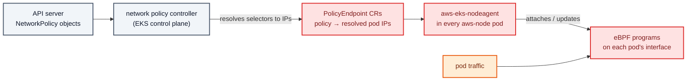
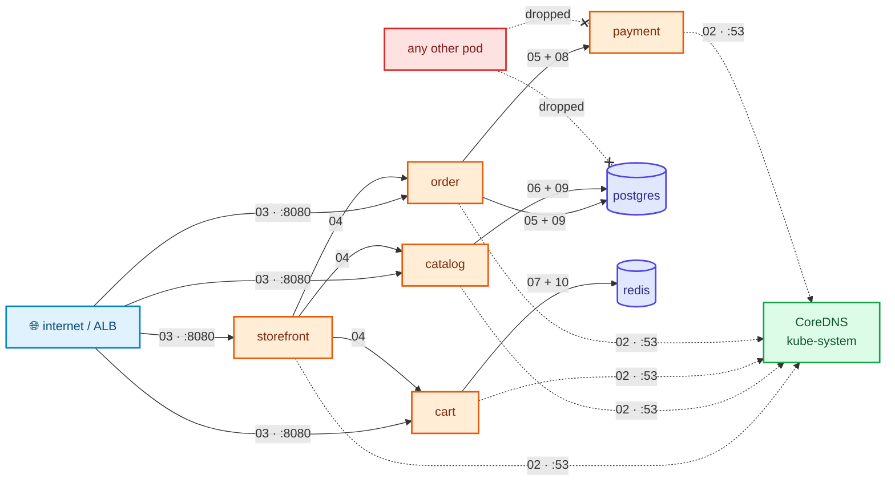

# Stage 15 — NetworkPolicy: default-deny, then the call graph

[⬅ Project 04](../../README.md) · Stage 10 of 11

[00 Namespace](../00-namespace/README.md) › [03 Deployments](../03-deployments/README.md) › [04 Services](../04-services/README.md) › [05 ConfigMaps](../05-configmaps/README.md) › [06 Secrets](../06-secrets/README.md) › [07 Storage](../07-storage/README.md) › [08 StatefulSets](../08-statefulsets/README.md) › [09 Ingress](../09-ingress/README.md) › [11 Probes](../11-health-checks/README.md) › **15 NetworkPolicy** › [19 Final](../19-final/README.md)

> **The problem:** a throwaway pod authorised a $9,999.99 payment, and another reached PostgreSQL. The Ingress hid
> `payment` from the internet; nothing hides it from the **pods next to it**. The pod network is flat — every pod
> can reach every pod, in every namespace, on every port — and a compromised dependency anywhere in the cluster
> inherits all of that reach.

---

## 1. WHY does this resource exist?

Kubernetes' network model makes one promise: **every pod can reach every other pod without NAT.** That is what
makes Services, DNS and the whole call graph work with zero configuration. It is also a security model of
"everything trusts everything".

| Without NetworkPolicy | With it |
|---|---|
| Any pod can call `payment` | Only `order` can |
| Any pod can try the PostgreSQL password | Only `catalog` and `order` can connect at all |
| A compromised storefront can reach every datastore | It can reach three APIs and CoreDNS, nothing else |
| Blast radius of one bad pod: the cluster | The edges that pod legitimately had |

This is **east-west** control. The Ingress (stage 09) is **north-south**. Different direction, different object,
different enforcer.

### ⚠️ An object is not enforcement

A NetworkPolicy is **accepted by every cluster and enforced only by a CNI that implements it**. On a default Kind
cluster, or an EKS cluster without the policy agent, you can apply a default-deny and watch traffic flow anyway.
This project's cluster (`clusters/eks-advanced.yaml`) sets `enableNetworkPolicy: "true"` on the VPC CNI add-on,
which runs the **network policy agent** in every `aws-node` pod. **Prove it before trusting it** (§6.0).
[The Kubernetes documentation states this requirement plainly.](https://kubernetes.io/docs/concepts/services-networking/network-policies/)

### When do you use which?

| Use | For |
|---|---|
| **Default-deny + explicit allows** | Every namespace that runs anything you care about — this stage |
| Allow-list only (no default deny) | Nothing. Without a deny-all, unselected pods stay wide open, and new pods start unprotected |
| `ipBlock` | Traffic from/to outside the cluster (the ALB, an external API) |
| Security groups for pods | Controlling access to **AWS services** (RDS, ElastiCache) by pod |
| A service mesh (mTLS) | Authorising a **workload identity**, not an IP — NetworkPolicy trusts labels and addresses |

---

## 2. WHAT is it?

A NetworkPolicy is **a namespaced set of allow rules for traffic to (ingress) and from (egress) the pods it
selects, matching peers by pod labels, namespace labels or IP blocks.**

> **Analogy:** a building with keycards. Before this stage every door is propped open. A default-deny locks every
> door; each allow rule issues one keycard for one door. Nobody writes "deny" rules — you only ever hand out
> keycards.
>
> **Technically:** policies are **additive allow-lists**. A pod selected by *no* policy for a direction is
> unrestricted in that direction. A pod selected by *any* policy for a direction is isolated in that direction, and
> only traffic some policy allows gets through. There is no deny rule and no ordering — the union of all allows is
> the answer.

### The five rules you must internalise

| # | Rule | Consequence here |
|---|---|---|
| 1 | Isolation is **per direction** and **opt-in** | `policyTypes: [Ingress, Egress]` on the default-deny isolates both |
| 2 | Policies are **additive** — the union of allows | Ten small policies, not one big one |
| 3 | A connection needs **egress on the source AND ingress on the destination** | `order → payment` needs `allow-order-egress` *and* `allow-order-to-payment` |
| 4 | Egress default-deny blocks **DNS** too | The classic trap — §6.2 |
| 5 | **Replies are allowed automatically** (connection tracking) | You never write a rule for the response |

### ⚠️ `from:` list semantics — AND vs OR

```yaml
    - from:
        - namespaceSelector: {…kube-system}
          podSelector: {…kube-dns}      # SAME item  ⇒ AND: kube-dns pods IN kube-system
```

```yaml
    - from:
        - namespaceSelector: {…kube-system}
        - podSelector: {…kube-dns}      # TWO items  ⇒ OR: anything in kube-system, OR kube-dns pods HERE
```

One dash is the difference between "CoreDNS" and "the whole of kube-system". It is the most common subtle policy
bug.

### The policies in this stage

| # | Name | Selects | Allows |
|---|---|---|---|
| 01 | `default-deny-all` | every pod | nothing, both directions |
| 02 | `allow-dns-egress` | every pod | egress UDP/TCP 53 → CoreDNS |
| 03 | `allow-internet-to-public-services` | storefront, catalog, cart, order | ingress 8080 from any source |
| 04 | `allow-storefront-egress` | storefront | egress → catalog, cart, order :8080 |
| 05 | `allow-order-egress` | order | egress → payment :8080, postgres :5432 |
| 06 | `allow-catalog-egress` | catalog | egress → postgres :5432 |
| 07 | `allow-cart-egress` | cart | egress → redis :6379 |
| 08 | `allow-order-to-payment` | payment | ingress from **order only** :8080 |
| 09 | `allow-apps-to-postgres` | postgres | ingress from catalog, order :5432 |
| 10 | `allow-cart-to-redis` | redis | ingress from cart :6379 |

**Why rule 03 admits `0.0.0.0/0`:** the ALB sends traffic straight to pod IPs, and on this lab cluster the nodes,
the pods and the ALB's network interfaces all live in the **same public subnets** — there is no CIDR meaning "the
ALB and nothing else". Those four services are public by design (the Ingress exposes them), so admitting any
source on 8080 grants nothing the internet does not already have. The three **non-public** workloads get no such
rule — that is where the protection is.

---

## 3. HOW does it work?



1. You create NetworkPolicy objects. They are data.
2. The **network policy controller** resolves each policy's selectors into concrete pod IPs and writes
   **`PolicyEndpoint`** custom resources (`policyendpoints.networking.k8s.aws`). Never edit these.
3. The **node agent** (`aws-eks-nodeagent` container in the `aws-node` DaemonSet) on each node reads the
   PolicyEndpoints for its pods and programs **eBPF** filters on each pod's network interface.
4. A packet that no rule allows is **dropped** — no RST, no ICMP. The client sees a **timeout**, never
   "connection refused". *A timeout between two pods is the signature of a policy denial.*
5. Pods scale, IPs change → the controller updates PolicyEndpoints → the agent updates the filters. Selectors,
   not IPs, are the contract.

**EKS specifics you will meet:**

| Behaviour | Consequence |
|---|---|
| Service port must equal container port ([AWS](https://docs.aws.amazon.com/eks/latest/userguide/cni-network-policy.html)) | Why every Service in stage 04 publishes 8080/5432/6379 unmapped |
| **Standard mode** (default): a *new* pod starts **allow-all** until its policies are programmed | A brief window of openness at pod start. `NETWORK_POLICY_ENFORCING_MODE=strict` starts pods deny-all instead ([AWS](https://docs.aws.amazon.com/eks/latest/userguide/cni-network-policy-configure.html)) |
| Enforcement is optimised for pods with **ownerReferences** (Deployment, StatefulSet…); standalone pods "might not" be enforced reliably | The `kubectl run rogue` test below is blocked by **payment's ingress** policy — payment is Deployment-owned, so the test is valid |
| `enablePolicyEventLogs` (set in the cluster config) | The agent logs every ACCEPT/DENY — §8 |

---

## 4. Manifest

Ten files. The three that carry the lesson:

```yaml
# 01-default-deny-all.yaml
spec:
  podSelector: {}            # every pod in the namespace
  policyTypes: [Ingress, Egress]
  # no rules ⇒ nothing allowed
```

```yaml
# 02-allow-dns-egress.yaml
spec:
  podSelector: {}
  policyTypes: [Egress]
  egress:
    - to:
        - namespaceSelector:
            matchLabels: { kubernetes.io/metadata.name: kube-system }
          podSelector:
            matchLabels: { k8s-app: kube-dns }      # same item ⇒ AND
      ports:
        - { protocol: UDP, port: 53 }
        - { protocol: TCP, port: 53 }
```

```yaml
# 08-allow-order-to-payment.yaml
spec:
  podSelector:
    matchLabels: { app.kubernetes.io/name: payment }
  policyTypes: [Ingress]
  ingress:
    - from:
        - podSelector:
            matchLabels: { app.kubernetes.io/name: order }
      ports:
        - { protocol: TCP, port: 8080 }
```

The rest follow the same two shapes — **egress by source** (04–07) and **ingress by destination** (08–10).

---

## 5. Manifest breakdown

| Field | Value | What it does | What breaks if it's wrong |
|---|---|---|---|
| `podSelector: {}` | empty | Every pod in the namespace | A typo'd label ⇒ selects nothing ⇒ protects nothing, silently |
| `policyTypes` | `[Ingress, Egress]` | Directions this policy isolates | Omit `Egress` ⇒ default-deny only covers ingress |
| `ingress[].from[].podSelector` | `name: order` | Peers in **this** namespace | Pods elsewhere need a `namespaceSelector` |
| `namespaceSelector` + `podSelector` in one item | AND | kube-dns pods *in* kube-system | Split into two items ⇒ OR ⇒ far wider than intended |
| `kubernetes.io/metadata.name` | `kube-system` | Selects a namespace by name | A custom label that doesn't exist ⇒ DNS stays blocked |
| DNS `ports` | UDP **and** TCP 53 | Normal and large/truncated responses | UDP only ⇒ intermittent failures on big answers |
| `ipBlock.cidr` | `0.0.0.0/0` | Any source (public services only) | On payment/postgres/redis it would undo the whole stage |
| `ports[].port` | `8080` / `5432` / `6379` | The **container** port | The Service port if they differed — why stage 04 kept them equal |

---

## 6. Apply — deliberately, in four steps

### 6.0 Prove the cluster enforces policy

```bash
kubectl get daemonset aws-node -n kube-system -o jsonpath='{.spec.template.spec.containers[*].name}{"\n"}'
kubectl get crd policyendpoints.networking.k8s.aws
```

```
aws-node aws-eks-nodeagent
policyendpoints.networking.k8s.aws   …
```

▸ No `aws-eks-nodeagent`, or no CRD ⇒ policies will be accepted and ignored. Fix the cluster first.

### 6.1 Default-deny — and watch everything break

```bash
ALB=$(kubectl get ingress ecommerce-ingress -n ecommerce -o jsonpath='{.status.loadBalancer.ingress[0].hostname}')
kubectl apply -f manifests/15-security/01-default-deny-all.yaml
sleep 20
curl -s -o /dev/null -m 10 -w 'shop %{http_code}\n' "http://$ALB/"
kubectl exec -n ecommerce deployment/storefront -- python -c "import socket; print(socket.gethostbyname('catalog'))"
kubectl get pods -n ecommerce
```

Measured on this project's cluster:

```
shop 000                                   ← curl -m 10 gave up: the request hangs, nothing answers
command terminated with exit code 1        ← `catalog` no longer resolves: DNS is egress too
cart-…        0/1      catalog-…    0/1      order-…      0/1
payment-…     1/1      storefront-… 1/1      postgres-0   1/1      redis-0   1/1
```

▸ The ALB's requests and health checks are **dropped**, so the shop hangs rather than erroring. `cart`,
`catalog` and `order` go `0/1` because their readiness checks can no longer reach Redis/PostgreSQL.

▸ `payment` and `storefront` — whose readiness checks nothing — stay **`1/1`**: the VPC CNI's node agent lets the
**kubelet's** probes from the node through a default-deny. That is why no policy in this stage mentions probes.

### 6.2 DNS — the classic trap, fixed

```bash
kubectl apply -f manifests/15-security/02-allow-dns-egress.yaml
sleep 10
kubectl exec -n ecommerce deployment/storefront -- python -c "import socket; print(socket.gethostbyname('catalog'))"
kubectl exec -n ecommerce deployment/storefront -- python -c \
  "import urllib.request; urllib.request.urlopen('http://catalog:8080/healthz', timeout=3)"
```

```
10.100.221.22
URLError <urlopen error timed out>
```

▸ The name **resolves** now — and the connection **times out**. *Resolves-but-times-out* is exactly what a policy
denial looks like: DNS and the data path are separate permissions.

### 6.3 Open the call graph, edge by edge

```bash
kubectl apply -f manifests/15-security/
sleep 20
kubectl get pods -n ecommerce
curl -s -o /dev/null -w 'shop %{http_code}\n' "http://$ALB/"
curl -s "http://$ALB/whoami" | python3 -m json.tool
```

▸ Every pod `1/1`; the shop `200`; `/whoami` reports all three upstreams reachable. Place an order in the UI —
the whole checkout path works again, through exactly ten allowances.

---

## 7. Validate

```bash
kubectl get networkpolicies -n ecommerce
kubectl get policyendpoints -n ecommerce
```

```
NAME                                POD-SELECTOR                                                AGE
allow-apps-to-postgres              app.kubernetes.io/name=postgres                             1m
allow-cart-egress                   app.kubernetes.io/name=cart                                 1m
…
default-deny-all                    <none>                                                      3m
```

▸ `<none>` for `default-deny-all` means `podSelector: {}` — every pod. Each policy has a matching
`PolicyEndpoint`, which is the controller's resolved list of IPs.

**The proof — the stage 04 rogue test, again:**

```bash
kubectl run rogue --rm -i --restart=Never --image=curlimages/curl:8.10.1 -n ecommerce -- \
  curl -s -m 5 -w '\nexit=%{exitcode}\n' -X POST http://payment:8080/api/payments/authorize \
    -H 'Content-Type: application/json' -H 'X-Calling-Service: rogue' -d '{"amount_cents":999999}'
```

```
exit=28
```

▸ **Exit 28 is curl's timeout.** Dropped, not refused. And the legitimate path still works:

```bash
kubectl exec -n ecommerce deployment/order -- python -c \
  "import urllib.request,json; print(json.load(urllib.request.urlopen('http://payment:8080/whoami',timeout=3))['stats']['callers_seen'])"
```

▸ `callers_seen` no longer grows for `rogue` — only for `order`. **The service itself is the witness.**

---

## 8. Observe the mechanism

### The whole matrix, from inside

```bash
for src in storefront catalog cart order payment; do
  for dst in catalog:8080 cart:8080 order:8080 payment:8080 postgres:5432 redis:6379; do
    h=${dst%%:*}; p=${dst##*:}
    r=$(kubectl exec -n ecommerce deployment/$src -- python -c "
import socket; s=socket.socket(); s.settimeout(2)
try: s.connect(('$h',$p)); print('OPEN')
except Exception as e: print('----')" 2>/dev/null)
    printf '%-6s' "$r"
  done; echo "  ← $src"
done
echo "catalog cart  order payment postgres redis"
```

```
OPEN  OPEN  OPEN  ----  ----  ----    ← storefront
----  ----  ----  ----  OPEN  ----    ← catalog
----  ----  ----  ----  ----  OPEN    ← cart
----  ----  ----  OPEN  OPEN  ----    ← order
----  ----  ----  ----  ----  ----    ← payment
```

▸ Compare that grid with the call graph in the project README. **They are now the same picture.** (Rows are
*egress* permissions; `catalog → catalog` etc. are denied because no service calls another service of its own kind.)

### Read what the agent did

Both containers of `aws-node` are shell-less, so `kubectl exec … cat` cannot reach the agent's log. It is a file
**on the node** (`--log-file=/var/log/aws-routed-eni/network-policy-agent.log` in the agent's args). Read it with a
node debug pod, which mounts the node's filesystem at `/host`:

```bash
NODE=$(kubectl get pod -n ecommerce -l app.kubernetes.io/name=payment -o jsonpath='{.items[0].spec.nodeName}')
kubectl debug node/$NODE -it --image=busybox:1.36 --profile=general -- \
  sh -c 'grep -i "default deny" /host/var/log/aws-routed-eni/network-policy-agent.log | tail -3'
kubectl get pods -n default -o name | grep node-debugger | xargs -r kubectl delete -n default   # tidy up
```

```
{"level":"info",…,"msg":"Default Deny enabled on Egress"}
{"level":"info",…,"msg":"Default Deny enabled on Ingress"}
```

▸ That is the agent programming the eBPF filters for your pods. With `enablePolicyEventLogs` on (set in the
cluster config), AWS documents per-flow ACCEPT/DENY records in the same log; in this project's verification run
the programming messages above were captured, but no per-flow record appeared within the test window — treat the
timeout-plus-`/whoami` method in §7 as the reliable proof.

> ⚠️ `kubectl debug node` leaves its pod behind in `default` — delete it, as above.

---

## 9. Break it

### Break 1 — only half an edge

```bash
kubectl delete networkpolicy allow-order-egress -n ecommerce
curl -s -X POST "http://$ALB/api/orders" -H 'Content-Type: application/json' \
  -d '{"session":"b1","items":[{"sku":"SKU-1001","name":"k","price_cents":8900,"quantity":1}]}'
```

**Symptom:** checkout **and** the order list fail — `order` can no longer reach `payment` *or* PostgreSQL, even
though `allow-order-to-payment` and `allow-apps-to-postgres` still exist.

**Root cause:** a connection needs egress on the source **and** ingress on the destination. The destination side
alone is not enough.

**Fix:** `kubectl apply -f manifests/15-security/05-allow-order-egress.yaml`

### Break 2 — AND becomes OR

```bash
kubectl patch networkpolicy allow-dns-egress -n ecommerce --type=json -p '[
 {"op":"replace","path":"/spec/egress/0/to","value":[
   {"namespaceSelector":{"matchLabels":{"kubernetes.io/metadata.name":"kube-system"}}},
   {"podSelector":{"matchLabels":{"k8s-app":"kube-dns"}}}]}]'
kubectl exec -n ecommerce deployment/storefront -- python -c "import socket; print(socket.gethostbyname('catalog'))"
```

**Symptom:** nothing breaks — which is the problem. DNS still works, and every pod may now send UDP/TCP 53 to
**anything in kube-system**. One dash widened the rule silently.

**Fix:** `kubectl apply -f manifests/15-security/02-allow-dns-egress.yaml`

### Break 3 — delete the default-deny, and find out it was not the only lock

```bash
kubectl delete networkpolicy default-deny-all allow-order-egress -n ecommerce
kubectl get pods -n ecommerce -l app.kubernetes.io/name=order
```

**Symptom:** `order` goes `0/1` — *more* broken, not less, after deleting the deny-all.

**Root cause:** `allow-dns-egress` has `podSelector: {}` and `policyTypes: [Egress]`. It **selects every pod for
egress on its own**, so every pod is still egress-isolated — only DNS is allowed. Without `allow-order-egress`,
`order` can no longer reach PostgreSQL. Any policy that selects a pod for a direction isolates it in that direction;
"the deny-all" is just the most obvious one.

**Fix:** `kubectl apply -f manifests/15-security/`

### Break 4 — a label is not an identity

```bash
kubectl run fake-order --rm -i --restart=Never --image=curlimages/curl:8.10.1 -n ecommerce \
  --labels=app.kubernetes.io/name=order -- \
  curl -s -m 5 -X POST http://payment:8080/api/payments/authorize \
    -H 'Content-Type: application/json' -H 'X-Calling-Service: fake' -d '{"amount_cents":1}'
```

▸ `"authorized": true`. Anyone who can create a pod **with the right label** in this namespace passes the rule.
NetworkPolicy authorises labels and IPs; **RBAC on who may create pods** (Project 07) and, beyond that, mTLS
workload identity are what turn a label into an identity.

---

## 10. How it interacts



---

## 11. Production notes

> 🧪 **DEMO / LEARNING CONFIGURATION**
> Policies retrofitted onto a running application; public services admitted from `0.0.0.0/0` because the lab puts
> nodes, pods and the ALB in the same subnets; standard (not strict) enforcement mode.

> 🏭 **PRODUCTION CONSIDERATIONS**
> - **Default-deny before the first workload**, as part of namespace creation — never retrofitted under traffic.
> - **Private node subnets**, so an `ipBlock` of the ALB subnets (or the ALB security group) can distinguish
>   north-south traffic from pods.
> - **Strict enforcement mode** (`NETWORK_POLICY_ENFORCING_MODE=strict`) so new pods start deny-all, closing the
>   start-up window.
> - **Egress to the internet** explicitly: an allow for the specific external CIDRs or an egress proxy, and a
>   deliberate decision about the EC2 metadata endpoint (169.254.169.254).
> - **Cluster-wide guardrails** with `ClusterNetworkPolicy` (admin tier) that namespace owners cannot override.
> - **RBAC + Pod Security** so labels cannot be forged (Project 07); **mTLS** where you need workload identity.
> - **Test policies in CI** — apply them to an ephemeral cluster and run the §8 matrix as an assertion.

---

## 12. The next problem

The platform is correct, durable, routed and segmented. Rebuilding it, though, means knowing that the final
`order` is the file in stage 11 layered on 06 and 05, the final Redis is stage 11 but its Secret is 06, the Services
are 04 **and** 08, the StorageClass is 07, the Ingress is 09 plus an annotation you typed by hand, and the policies
are ten files that must all be present or checkout silently breaks. And the shared ConfigMap is still mutable —
the stage 05 "edit does nothing, then half the fleet changes" trap is still armed.

→ **[Stage 19 — The complete manifest](../19-final/README.md)**

---

## 📚 Official documentation

Everything above is self-contained — these are for going deeper, not for filling gaps.
*(All links verified 2026-09-19.)*

| Reference | What it adds |
|---|---|
| [Network Policies](https://kubernetes.io/docs/concepts/services-networking/network-policies/) | Full semantics, AND/OR selector rules, and the statement that a CNI must enforce them |
| [Limit Pod traffic with Kubernetes network policies](https://docs.aws.amazon.com/eks/latest/userguide/cni-network-policy.html) | EKS considerations: port matching, ownerReferences, limits |
| [Restrict Pod network traffic with Kubernetes network policies](https://docs.aws.amazon.com/eks/latest/userguide/cni-network-policy-configure.html) | Enabling the agent, standard vs strict mode |
| [Declare Network Policy](https://kubernetes.io/docs/tasks/administer-cluster/declare-network-policy/) | A worked walkthrough of allow rules |
| [Cluster Networking](https://kubernetes.io/docs/concepts/cluster-administration/networking/) | The flat pod network model this stage restricts |

---

| ◀ Previous | ▲ Up | Next ▶ |
|---|:--:|---:|
| ◀ **[11 Probes](../11-health-checks/README.md)** | [Project 04](../../README.md) · [Manual steps](../../scripts/manual-steps.md) | **[19 Final](../19-final/README.md)** ▶ |
