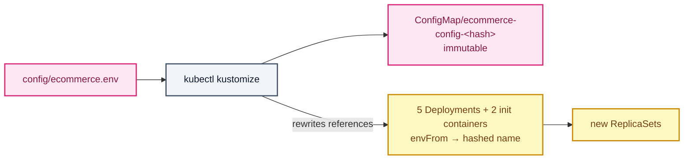

# Stage 19 — The complete manifest, with generated config

[⬅ Project 04](../../README.md) · Stage 11 of 11

[00 Namespace](../00-namespace/README.md) › [03 Deployments](../03-deployments/README.md) › [04 Services](../04-services/README.md) › [05 ConfigMaps](../05-configmaps/README.md) › [06 Secrets](../06-secrets/README.md) › [07 Storage](../07-storage/README.md) › [08 StatefulSets](../08-statefulsets/README.md) › [09 Ingress](../09-ingress/README.md) › [11 Probes](../11-health-checks/README.md) › [15 NetworkPolicy](../15-security/README.md) › **19 Final**

> **The problem:** the working platform is spread across ten directories, the order you applied them in was the
> lesson, and one trap from stage 05 is still armed — `ecommerce-config` is **mutable**, so the next edit will do
> nothing until pods restart one by one and the fleet silently splits.

---

## 1. WHY combine now (and why generate config)?

| | Teaching stages | Operating |
|---|---|---|
| Files | One resource per file, one idea per stage | One desired state |
| Order | The order is the lesson | Order must not matter |
| Superseded versions | Kept, so you can see the change | Gone, so nothing is ambiguous |
| Config changes | Edit, then remember to `rollout restart` | **A new name** — the rollout is automatic |

---

## 2. WHAT is Kustomize (and a configMapGenerator)?

**Kustomize** is built into `kubectl` (`-k`). It loads plain YAML and applies transformations — generated objects,
labels, image retargeting — without templates.

A **configMapGenerator** builds a ConfigMap from a file and:

| Stage 05, by hand | Generator |
|---|---|
| Mutable `ecommerce-config` — edits reach nobody until restarts | Name = `ecommerce-config-` + **hash of the content** |
| Remember `rollout restart` after every edit | New content ⇒ new name ⇒ **pod templates change** ⇒ rollout |
| Nothing to `rollout undo` to | The previous ReplicaSet references the **previous** ConfigMap, which still exists |
| Could be edited in place | `immutable: true` — it cannot be |

> **Analogy:** instead of scribbling on the one noticeboard everyone reads, you print a new sheet whose title *is*
> a fingerprint of its text — and every worker's instructions already point at the new title.

---

## 3. HOW does it work here?

```yaml
# kustomization.yaml
resources:
  - complete-production-manifest.yaml
generatorOptions:
  immutable: true
configMapGenerator:
  - name: ecommerce-config
    namespace: ecommerce
    envs:
      - config/ecommerce.env        # KEY=VALUE per line
labels:
  - pairs: { app.kubernetes.io/managed-by: kustomize }
    includeSelectors: false
images:
  - { name: cloudprakhargupta/ecommerce, newName: cloudprakhargupta/ecommerce }
  - { name: postgres, newTag: "17.5-alpine" }
  - { name: redis,    newTag: "8.2.9-alpine" }
```

`complete-production-manifest.yaml` is **generated by copying the final version of each object** from its stage,
so it cannot drift from what you learned:

| Section | From stage |
|---|---|
| Namespace (with readiness-gate label) | 11 |
| StorageClass `ecommerce-gp3` | 07 |
| Secrets ×2, `postgres-init` ConfigMap | 06, 03 |
| Services ×7, headless ×2 | 04, 08 |
| StatefulSets ×2 (probes) | 11 |
| Deployments ×5 (probes, init containers, `maxUnavailable: 0`) | 11 |
| Ingress | 09 |
| NetworkPolicies ×10 | 15 |

| Field | What breaks if it's wrong |
|---|---|
| `configMapGenerator[].namespace` | Omitted ⇒ generated in your *context's* namespace |
| `envs` | A line without `=` fails the build |
| `labels.includeSelectors: false` | `true` rewrites **immutable** selectors; every later apply fails |
| `images` | Retarget registries here — never edit the manifest |

---

## 4. Manifest

[`kustomization.yaml`](kustomization.yaml), [`config/ecommerce.env`](config/ecommerce.env) and
[`complete-production-manifest.yaml`](complete-production-manifest.yaml).

---

## 5. Manifest breakdown

See §3's table. The rendered output is 33 objects:

```
      2 kind: ConfigMap        ← ecommerce-config-<hash> + postgres-init
      5 kind: Deployment
      1 kind: Ingress
      1 kind: Namespace
     10 kind: NetworkPolicy
      2 kind: Secret
      9 kind: Service
      2 kind: StatefulSet
      1 kind: StorageClass
```

---

## 6. Apply

```bash
kubectl kustomize manifests/19-final/ | less           # ALWAYS read what you are about to apply
MY_IP=$(curl -s https://checkip.amazonaws.com)
kubectl kustomize manifests/19-final/ \
  | sed "s#inbound-cidrs: 0.0.0.0/0#inbound-cidrs: ${MY_IP}/32#" \
  | kubectl apply -f -
kubectl delete configmap ecommerce-config -n ecommerce --ignore-not-found   # the hand-written one
```

▸ `sed` swaps the Ingress's placeholder CIDR for your IP. Note it matches **only** the Ingress annotation — the
NetworkPolicy's `cidr: 0.0.0.0/0` is a different key and is untouched.

▸ **This is exactly what `scripts/deploy.sh` does**, preceded by prerequisite checks.

---

## 7. Validate

```bash
kubectl get configmap -n ecommerce
kubectl get deployment order -n ecommerce -o jsonpath='{.spec.template.spec.containers[0].envFrom[0].configMapRef.name}{"\n"}'
./scripts/validate.sh
```

```
NAME                          DATA   AGE
ecommerce-config-57mf226hk7   13     1m
postgres-init                 1      2h

ecommerce-config-57mf226hk7
```

---

## 8. Observe the mechanism

### A config change is now a rollout — with an undo

```bash
sed -i 's/^UPSTREAM_TIMEOUT_SECONDS=3$/UPSTREAM_TIMEOUT_SECONDS=5/' manifests/19-final/config/ecommerce.env
kubectl kustomize manifests/19-final/ | grep -m1 'name: ecommerce-config-'
kubectl kustomize manifests/19-final/ | sed "s#inbound-cidrs: 0.0.0.0/0#inbound-cidrs: $(curl -s https://checkip.amazonaws.com)/32#" | kubectl apply -f -
kubectl rollout status deployment/order -n ecommerce
kubectl exec -n ecommerce deployment/order -- printenv UPSTREAM_TIMEOUT_SECONDS
kubectl rollout undo deployment/order -n ecommerce
kubectl rollout status deployment/order -n ecommerce
kubectl exec -n ecommerce deployment/order -- printenv UPSTREAM_TIMEOUT_SECONDS
git checkout manifests/19-final/config/ecommerce.env
```

▸ `5`, then `3` after the undo — because the previous ReplicaSet still references the previous, still-existing
ConfigMap. Stage 05 could not do that.

### The generated ConfigMap cannot be edited

```bash
CM=$(kubectl get deployment order -n ecommerce -o jsonpath='{.spec.template.spec.containers[0].envFrom[0].configMapRef.name}')
kubectl patch configmap "$CM" -n ecommerce --type merge -p '{"data":{"PAYMENT_LATENCY_MS":"8000"}}'
```

▸ `field is immutable when immutable is set`. The stage 05 trap is gone.

---

## 9. Break it

### `includeSelectors: true`

```bash
sed -i 's/includeSelectors: false/includeSelectors: true/' manifests/19-final/kustomization.yaml
kubectl kustomize manifests/19-final/ | kubectl apply -f - 2>&1 | grep -m2 -i immutable
git checkout manifests/19-final/kustomization.yaml
```

▸ `spec.selector: Invalid value: … field is immutable` on every Deployment and StatefulSet — the label was pushed
into their selectors, which can never change.

### Forgetting generated ConfigMaps pile up

Every config change leaves the previous hashed ConfigMap behind (that is what makes `undo` work). Over months
they accumulate:

```bash
kubectl get configmap -n ecommerce -l app.kubernetes.io/managed-by=kustomize
```

▸ `kubectl apply --prune` or a GitOps tool with pruning (Project 10) cleans up objects no longer in the rendered
output.

---

## 10. How it interacts



---

## 11. Production notes

> 🧪 **DEMO / LEARNING CONFIGURATION**
> One overlay-less kustomization, Secrets in the manifest, your IP substituted with `sed`.

> 🏭 **PRODUCTION CONSIDERATIONS**
> - **Base + overlays** per environment; a GitOps controller applies, prunes and detects drift (Project 10).
> - **Secrets from a secret manager** (External Secrets Operator), never in the rendered output.
> - **Images by digest**, retargeted to ECR in the `images` field.
> - **Policy tests in CI**: render, apply to an ephemeral cluster, run the stage 15 reachability matrix.

---

## 12. The next problem

The shop is complete — and stage 11 showed its weakest point is not a missing object but **capacity**: one slow
dependency held every thread in `order`, readiness probes queued behind real requests, and pods that were never
"down" left the load balancer. Nothing here says how much CPU or memory any pod may use, how many replicas each
service needs under load, or what protects the shop when a node is drained for maintenance.

→ **[Project 05 — Production Web Platform](../../../project-05-production-web-platform/README.md)**

---

## 📚 Official documentation

Everything above is self-contained — these are for going deeper, not for filling gaps.
*(All links verified 2026-09-19.)*

| Reference | What it adds |
|---|---|
| [configMapGenerator](https://kubectl.docs.kubernetes.io/references/kustomize/kustomization/configmapgenerator/) | Every generator option, including `envs` vs `files` |
| [Declarative Management of Kubernetes Objects Using Kustomize](https://kubernetes.io/docs/tasks/manage-kubernetes-objects/kustomization/) | Kustomize as built into kubectl |
| [ConfigMaps — immutable](https://kubernetes.io/docs/concepts/configuration/configmap/) | Why immutable ConfigMaps exist |

---

| ◀ Previous | ▲ Up | Next ▶ |
|---|:--:|---:|
| ◀ **[15 NetworkPolicy](../15-security/README.md)** | [Project 04](../../README.md) · [Manual steps](../../scripts/manual-steps.md) | **[Project 05](../../../project-05-production-web-platform/README.md)** ▶ |
