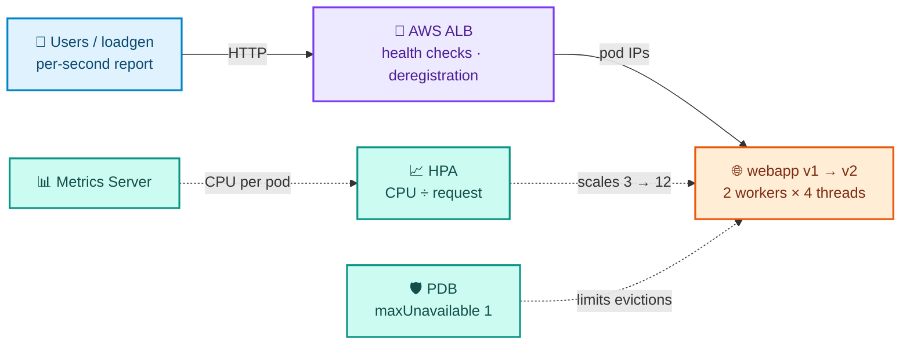

# Architecture — Project 05, Production Web Platform on EKS

Design record. Written **before** the stage READMEs, as
[CONTRIBUTING §2](../../CONTRIBUTING.md#2-design-before-you-write-yaml) requires.

---

## 1. Design decisions

| Decision | Why |
|---|---|
| **One application, not five** | Project 04 was about the call graph. This project is about **capacity and change** — CPU, memory, replicas, disruption, rollouts — and every one of those is clearer on a single service you can load precisely. More services would add noise, not insight. |
| **An app with dials** (`/api/work`, `/api/memory`, `/api/slow`, `STARTUP_DELAY_SECONDS`) | Throttling, OOMKills, autoscaling and graceful shutdown are invisible on an app that does nothing. Each dial produces exactly one of them on demand, so every claim in the READMEs is something you can reproduce. |
| **A load generator that reports per second** (`loadgen`) | "The rollout dropped requests" and "the HPA absorbed the spike" are claims about traffic. A per-second table of status codes, latency and serving version turns them into measurements. Stdlib only, so nothing to pin or break. |
| **Version baked into the image** (`webapp-1.0.0`, `webapp-2.0.0`) | A rollout, a canary and a blue/green switch should change *what is running*, not an env var. Every response carries `X-App-Version`, so the traffic table shows the switch request by request. |
| **EKS, with a real ALB in front** | The 502s during a rollout come from the gap between "the pod got SIGTERM" and "the load balancer stopped sending to it". A `port-forward` has no such gap; a laptop cluster has a different one. The real ALB, with its own health checks and deregistration delay, is the thing the `preStop` hook is sized against. |
| **Three nodes** (`clusters/eks-advanced.yaml`) | A drain on two nodes cannot distinguish "the PDB protected us" from "there was nowhere to go". |
| **Metrics Server as an EKS community add-on** | The HPA needs a metrics source. On EKS the kubelet's serving certificates are properly signed, so none of the `--kubelet-insecure-tls` workaround a Kind cluster needs. |
| **Stages in numeric order tell the story** | 03 (no resources, no probes) → 09 (real traffic) → 11 (rollouts break, then don't) → 12 (a pod starves / gets killed) → 13 (load varies) → 14 (maintenance takes pods) → 19. Numbers are identities, and here the identity order *is* the narrative. |
| **Canary and blue/green inside stage 11, with labels only** | They are rollout strategies, not new resources. Implementing them with nothing but labels, selectors and two Deployments teaches the mechanism every progressive-delivery tool uses underneath. Argo Rollouts/Flagger are named, not installed. |
| **The Service selects the application; Deployments select an instance** | That asymmetry is the whole canary mechanism, and it is worth a design decision rather than an accident. |
| **`spec.replicas` removed once the HPA exists** | Otherwise every `kubectl apply` resets the autoscaler's decision. Made visible as a lesson in stage 13. |
| **Native `preStop: sleep`** | Kubernetes' built-in sleep lifecycle action needs no shell in the image, so the hook works even for distroless images. |
| **`maxUnavailable` PDB, not `minAvailable`** | It stays correct as the HPA changes the replica count; `minAvailable: 3` at 3 replicas blocks every drain (a failure lab). |
| **Stages 06–08, 10, 15–18 omitted** | No credentials, no state, no scheduling beyond a preferred anti-affinity. Numbers are identities, not positions. |

---

## 2. High-Level Design (HLD)

### The dials

| Dial | Produces | Stage |
|---|---|---|
| `STARTUP_DELAY_SECONDS=8` | A pod that is Running but not ready for 8 s | 05 → 11 |
| `/api/slow?seconds=N` | An in-flight request that outlives a rollout | 11 |
| `/api/work?ms=N` | CPU usage; throttling under a limit; HPA load | 12, 13 |
| `/api/memory?mb=N` | Resident memory; OOMKilled above the limit | 12 |
| image `2.0.0` | A real rollout, canary and blue/green | 11 |

---

## 3. Low-Level Design (LLD)

The full diagram is in [`../README.md` §7](../README.md#7-kubernetes-architecture--lld); its source is
[`architecture.mmd`](architecture.mmd).

### Object inventory (final state)

| Kind | Name | Stage |
|---|---|---|
| Namespace | `web-platform` (readiness-gate label) | 00, 11 |
| ConfigMap | `webapp-config-<hash>` (generated, immutable) | 05 → 19 |
| Service | `webapp` (selects the application) | 04, 11 |
| Deployment | `webapp` (no `replicas`; probes, preStop, resources, anti-affinity) | 03 → 14 |
| LimitRange | `web-platform-defaults` | 12 |
| ResourceQuota | `web-platform-quota` | 12 |
| HorizontalPodAutoscaler | `webapp-hpa` (3 → 12, CPU 60%) | 13 |
| Deployment | `loadgen` (replicas 0) | 13 |
| PodDisruptionBudget | `webapp-pdb` (maxUnavailable 1) | 14 |
| Ingress | `web-platform-ingress` → one ALB | 09 |

**Teaching artifacts, applied then removed:** `webapp-canary`, the blue/green demo (`webapp-blue`, `webapp-green`,
`Service/webapp-bluegreen`), the mutable `webapp-config`.

**Cluster software:** the EKS add-ons from `clusters/eks-advanced.yaml` (including **metrics-server**) and the AWS
Load Balancer Controller.

---

## 4. Failure domains

| Failure | Blast radius | Recovery |
|---|---|---|
| One pod | None | ReplicaSet replaces it; readiness gate keeps it out of the ALB until healthy |
| A pod over its memory limit | That pod restarts (OOMKilled) | Automatic; fix the limit or the leak |
| A pod at its CPU limit | Higher latency (throttling), no restart | HPA adds pods; or raise the limit |
| A traffic spike | Latency until the HPA reacts (~30–60 s) | HPA scale-up policy; headroom via `minReplicas` |
| A node drain | ≤ 1 pod at a time (PDB) | Pods reschedule on other nodes |
| A node crash | The pods on it (PDB does not apply) | Anti-affinity spread limits it to ~1/3 |
| A rollout | None, *if* probes + preStop + grace are right; 502s if not | Stage 11 |

---

## 5. What this architecture is not

- **Not stateful.** No datastore; Projects 02–04 cover that.
- **Not secure beyond basics.** Non-root containers, no privilege escalation — no RBAC, PSS, or NetworkPolicy
  (Projects 04, 07).
- **Not observable beyond `/metrics`.** Nothing scrapes it; Prometheus and dashboards are Project 08.
- **Not zone-aware.** A preferred anti-affinity on hostname, not topology spread across AZs — Project 09.
