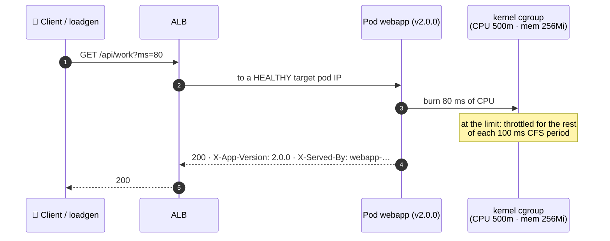
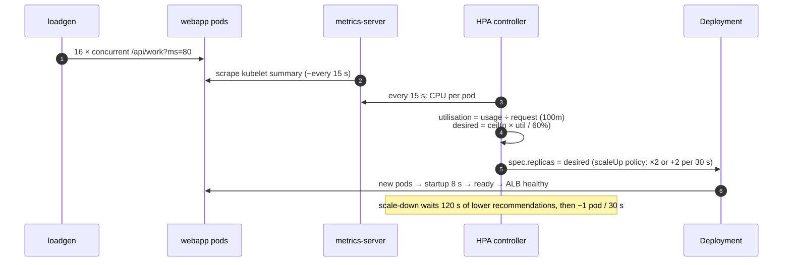
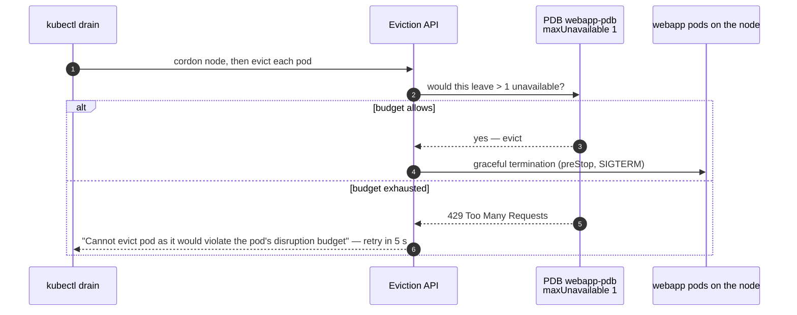

# Request Flow — Project 05

[⬅ Project 05](../README.md)

This project has one service, so the interesting flows are not *across* services but *through time*: what
happens to a request while a pod is starting, while it is being replaced, while it is at its CPU limit, and while
its node is being drained.

---

## 1. A request, normally



---

## 2. A pod leaving, and why it drops requests without a `preStop`

```mermaid
sequenceDiagram
    autonumber
    participant D as Deployment rollout
    participant API as API server
    participant K as kubelet
    participant P as old Pod
    participant EPS as EndpointSlice
    participant LBC as ALB controller
    participant ALB as ALB

    D->>API: delete old pod (after a new one is Ready)
    par at the same moment
        API->>K: terminate
        K->>P: run preStop (sleep 20)… then SIGTERM
    and
        API->>EPS: pod marked terminating → not ready
        EPS->>LBC: watch
        LBC->>ALB: DeregisterTargets (takes seconds)
    end
    Note over P: WITHOUT preStop: SIGTERM at once →<br/>gunicorn closes its socket immediately →<br/>the ALB, not yet updated, still sends here → 502
    Note over P: WITH preStop sleep 20: still serving while<br/>the ALB stops sending; then SIGTERM,<br/>gunicorn drains in-flight requests (≤ 25 s)
    K->>P: SIGKILL if still alive at terminationGracePeriodSeconds (45)
```

**The key fact:** endpoint removal and SIGTERM are **parallel**, not sequential. Nothing waits for the load
balancer. The `preStop` sleep is how you make the pod outlive the propagation.

| Budget | Value | Must satisfy |
|---|---|---|
| ALB health check detection | 5 s × 2 | — |
| Deregistration (in-flight grace at the ALB) | 15 s | — |
| `preStop` sleep | 20 s | > time for the ALB to stop sending *new* requests |
| gunicorn `--graceful-timeout` | 25 s | ≥ your longest normal request |
| `terminationGracePeriodSeconds` | 45 s | ≥ preStop + graceful-timeout |

---

## 3. A pod arriving

| Time | Pod state | Receives traffic? |
|---|---|---|
| 0 s | container started, app sleeping (`STARTUP_DELAY_SECONDS=8`) | **No probe (stages 03–09): yes → errors.** With probes: no |
| 0–8 s | startupProbe `/healthz` → 503 | No |
| ~8 s | startupProbe passes → readiness `/healthz` 200 | EndpointSlice: yes |
| ~8–20 s | ALB health check 5 s × 2 | ALB: not yet (readiness gate `0/1`) |
| ~20 s | readiness gate True → pod Ready | Yes. The rollout may now delete an old pod |

---

## 4. Scaling under load



---

## 5. A node drain



---

## 6. Reading the result from `loadgen`

| You see | It means |
|---|---|
| `200:N` only | Healthy |
| `502:N` during a rollout | Requests reached a pod that had stopped listening — missing/short `preStop` |
| `ERR:N` | No HTTP response at all — refused or reset, same cause, seen without an ALB in between |
| `503:N` | The ALB had no healthy targets — all pods NotReady at once |
| p95 rising, all `200` | CPU throttling or too few replicas — `kubectl top`, the HPA |
| `v1.0.0:N v2.0.0:M` | Two versions serving at once — a rolling update or a canary, mid-flight |
