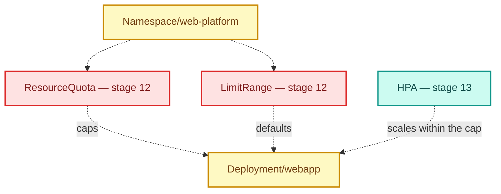

# Stage 00 — Namespace

[⬅ Project 05](../../README.md) · Stage 1 of 10

**00 Namespace** › [03 Deployments](../03-deployments/README.md) › [04 Services](../04-services/README.md) › [05 ConfigMaps](../05-configmaps/README.md) › [09 Ingress](../09-ingress/README.md) › [11 Rollouts](../11-health-checks/README.md) › [12 Resources](../12-resources/README.md) › [13 HPA](../13-hpa/README.md) › [14 PDB](../14-pdb/README.md) › [19 Final](../19-final/README.md)

> **The problem:** this project runs a workload *hot* — CPU burns, held memory, load tests, rolling updates under
> traffic, node drains. On a shared cluster that needs a boundary: somewhere to cap total consumption, somewhere to
> set defaults, and a single thing to delete when you are done.

---

## 1. WHY does this resource exist?

| Problem | Without a namespace |
|---|---|
| Name collisions | `Deployment/webapp` clashes with anyone else's `webapp` |
| No cleanup story | "Delete the project" means remembering every kind — miss the Ingress and its ALB bills forever |
| **Nowhere to put a budget** | **ResourceQuota and LimitRange (stage 12) are namespaced.** No namespace, no cap on what an autoscaler may claim |

That last row is this project's reason. In stage 13 an autoscaler will add pods on its own; the namespace is what
you put a ceiling on.

| Use a namespace | Don't |
|---|---|
| Per application or team | As a hard security or resource boundary — until quota, RBAC and policy make it one |
| Wherever quota, limits or policy must attach | For cluster-scoped objects (nodes, StorageClasses) |

---

## 2. WHAT is it?

A Namespace is **a named scope for objects, and the unit that quota, defaults and policy attach to.**

> **Analogy:** a department with its own budget line. Creating the department does not limit spending — the
> budget (ResourceQuota) and the purchasing rules (LimitRange) do. But you cannot have a budget without a
> department.
>
> **Technically:** it scopes names, and nothing else, until objects that reference it (quotas, limit ranges,
> RoleBindings, NetworkPolicies) give it teeth.

---

## 3. HOW does it work?

1. A Namespace is an API object; namespaced objects are keyed by it in etcd.
2. Admission plugins consult namespace-level objects **when a pod is created**: the `LimitRanger` fills in
   default requests/limits, the `ResourceQuota` plugin rejects anything that would exceed the budget.
3. Deleting a namespace deletes its contents, waiting on finalizers — including the Ingress's
   `ingress.k8s.aws/resources`, which the ALB controller clears only after deleting the ALB.

---

## 4. Manifest

```yaml
apiVersion: v1
kind: Namespace
metadata:
  name: web-platform
  labels:
    app.kubernetes.io/name: web-platform
    app.kubernetes.io/part-of: web-platform
  annotations:
    kubernetes.io/description: "Production web platform — one traffic-serving app, made observable under load"
```

---

## 5. Manifest breakdown

| Field | Value | What breaks if it's wrong |
|---|---|---|
| `metadata.name` | `web-platform` | Must be a DNS label; it is the middle of every in-cluster name |
| labels | `app.kubernetes.io/*` | Nothing — you lose `kubectl get ns -l …` |

> Stage 11 adds `elbv2.k8s.aws/pod-readiness-gate-inject: enabled` — a namespace label that changes how every new
> pod in it becomes Ready.

---

## 6. Apply

```bash
kubectl config current-context        # the lab cluster — never production
kubectl apply -f manifests/00-namespace/
```

▸ **Expected:** `namespace/web-platform created`.

---

## 7. Validate

```bash
kubectl get namespace web-platform --show-labels
kubectl describe namespace web-platform
```

▸ `describe` prints `No resource quota.` and `No LimitRange resource.` — the namespace is a folder with no budget
yet. Stage 12 changes both lines.

---

## 8. Observe the mechanism

### This cluster has three nodes — check before you need them

```bash
kubectl get nodes -L topology.kubernetes.io/zone
kubectl top nodes
```

▸ Three nodes (stage 14's drain needs somewhere for pods to go), and `kubectl top` works because
`clusters/eks-advanced.yaml` installed **Metrics Server** as an EKS add-on. If `top` says
`Metrics API not available`, stage 13's autoscaler will never scale — fix it now.

### Capacity is finite — see it

```bash
kubectl describe nodes | grep -A6 'Allocatable:' | grep -E 'cpu|memory'
```

▸ About 1930m CPU and ~3.3 GiB memory allocatable per t3.medium. Everything in stage 12 is a question of how pods
share exactly these numbers.

---

## 9. Break it

```bash
kubectl config set-context --current --namespace=kube-system
kubectl get pods          # somebody else's pods
kubectl config set-context --current --namespace=default
```

▸ Every command without `-n` uses invisible context state. This repository always passes `-n`.

---

## 10. How it interacts



---

## 11. Production notes

> 🧪 **DEMO / LEARNING CONFIGURATION**
> A bare namespace; quota and defaults arrive in stage 12, after you have seen why.

> 🏭 **PRODUCTION CONSIDERATIONS**
> - **Quota and LimitRange from day one** for every team namespace.
> - **Cost allocation labels** (team, cost-centre) — EKS split cost allocation can attribute EC2 spend to them.
> - **Separate clusters or accounts** for hard isolation; a namespace shares nodes and a kernel.

---

## 12. The next problem

The scope exists and is empty. Deploy the web app the simplest way that works: three replicas, no resource
settings, no health checks. It will run — and every omission is a failure waiting for load, a rollout or a drain.

→ **[Stage 03 — Deployments](../03-deployments/README.md)**

---

## 📚 Official documentation

Everything above is self-contained — these are for going deeper, not for filling gaps.
*(All links verified 2026-09-19.)*

| Reference | What it adds |
|---|---|
| [Namespaces](https://kubernetes.io/docs/concepts/overview/working-with-objects/namespaces/) | What is and is not namespaced |
| [Resource Quotas](https://kubernetes.io/docs/concepts/policy/resource-quotas/) | The budget that attaches to a namespace |
| [View resource usage with the Kubernetes Metrics Server](https://docs.aws.amazon.com/eks/latest/userguide/metrics-server.html) | The add-on behind `kubectl top` on EKS |

---

| ◀ Previous | ▲ Up | Next ▶ |
|---|:--:|---:|
| ◀ *(first stage)* | [Project 05](../../README.md) · [Manual steps](../../scripts/manual-steps.md) | **[03 Deployments](../03-deployments/README.md)** ▶ |
