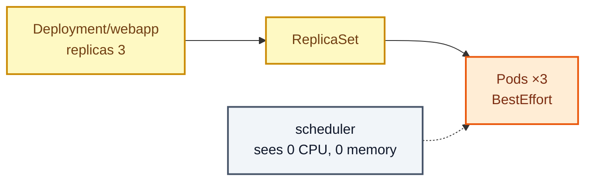

# Stage 03 — Deployments (the naïve version)

[⬅ Project 05](../../README.md) · Stage 2 of 10

[00 Namespace](../00-namespace/README.md) › **03 Deployments** › [04 Services](../04-services/README.md) › [05 ConfigMaps](../05-configmaps/README.md) › [09 Ingress](../09-ingress/README.md) › [11 Rollouts](../11-health-checks/README.md) › [12 Resources](../12-resources/README.md) › [13 HPA](../13-hpa/README.md) › [14 PDB](../14-pdb/README.md) › [19 Final](../19-final/README.md)

> **The problem:** an empty namespace, and a web app that must keep serving through crashes and node
> replacements. A bare Pod dies with its node.

---

## 1. WHY does this resource exist?

| Without a Deployment | With one |
|---|---|
| A pod on a terminated EC2 instance is gone | The ReplicaSet recreates it on another node |
| A new version means delete-and-recreate (downtime) | A rolling update, a few pods at a time |
| A bad release has no undo | `kubectl rollout undo` |
| Scaling is manual pod creation | `replicas: 3`, reconciled forever |

This stage deploys the app **the way most first deployments look** — and deliberately leaves out three things:

| Omitted | Consequence | Fixed in |
|---|---|---|
| `resources` | QoS **BestEffort**: the scheduler reserves nothing, the kubelet evicts it first, no HPA possible | 12 |
| probes | "Running" is all Kubernetes knows; traffic reaches pods that are still starting | 11 |
| `preStop` / grace tuning | Rollouts drop requests | 11 |

> This is a documented exception to the repository convention that every container sets `requests`. The
> absence is the lesson.

---

## 2. WHAT is it?

A Deployment is **a controller that manages ReplicaSets, which manage Pods, converging on a pod template and a
replica count.** Each template version is one ReplicaSet (named by `pod-template-hash`); a rollout scales the new
one up and the old one down.

> **Analogy:** a shift supervisor with a roster — "three cashiers, uniform v1". Someone leaves, someone is hired;
> the uniform changes, people swap one at a time.

### A pod with no resources is BestEffort

The **QoS class** is computed from `resources`, never set:

| QoS | Rule | Evicted |
|---|---|---|
| **BestEffort** | no requests or limits on any container | **first** |
| Burstable | some requests/limits, not all equal | next |
| Guaranteed | requests == limits for CPU **and** memory, every container | last |

---

## 3. HOW does it work?

1. The deployment controller creates a ReplicaSet for the template hash.
2. The ReplicaSet creates three pods; the scheduler places them. With **no requests**, the scheduler sees each
   pod as needing *zero* CPU and memory — it would happily put all three on one node.
3. The kubelet pulls `cloudprakhargupta/web-platform:webapp-1.0.0` and starts gunicorn.
4. The VPC CNI assigns each pod a real VPC IP.

---

## 4. Manifest

[`webapp-deployment.yaml`](webapp-deployment.yaml), excerpted:

```yaml
spec:
  replicas: 3
  selector:
    matchLabels:
      app.kubernetes.io/name: webapp
      app.kubernetes.io/instance: webapp
  template:
    spec:
      containers:
        - name: webapp
          image: cloudprakhargupta/web-platform:webapp-1.0.0
          ports: [{ name: http, containerPort: 8080 }]
          env:
            - name: POD_NAME
              valueFrom: { fieldRef: { fieldPath: metadata.name } }
            - name: NODE_NAME
              valueFrom: { fieldRef: { fieldPath: spec.nodeName } }   # which EC2 node
          securityContext:
            allowPrivilegeEscalation: false
            runAsNonRoot: true
          # no resources · no probes · no lifecycle — on purpose
```

---

## 5. Manifest breakdown

| Field | Value | What breaks if it's wrong |
|---|---|---|
| `replicas` | `3` | One node down with 1 replica = outage |
| `selector.matchLabels` | name + instance | Immutable; must match the template |
| `image` | `…:webapp-1.0.0` | Unpushed tag ⇒ `ImagePullBackOff` |
| `NODE_NAME` ← `spec.nodeName` | Downward API | Lets every response say which node served it |
| `runAsNonRoot` | `true` | Kubelet refuses to start an image whose user is root |
| *(no `resources`)* | — | BestEffort; no HPA; scheduler overpacks |

---

## 6. Apply

```bash
kubectl apply -f manifests/03-deployments/
kubectl rollout status deployment/webapp -n web-platform
kubectl get pods -n web-platform -o wide
```

▸ **Expected:** three `webapp-…` pods `Running` with `192.168.x.x` IPs.

---

## 7. Validate

```bash
kubectl get pods -n web-platform -o custom-columns=NAME:.metadata.name,QOS:.status.qosClass,NODE:.spec.nodeName
```

```
NAME                      QOS          NODE
webapp-6c9f7d8b5d-4kx2p   BestEffort   ip-192-168-12-41.ec2.internal
…
```

```bash
kubectl describe node "$(kubectl get pod -n web-platform -l app.kubernetes.io/name=webapp -o jsonpath='{.items[0].spec.nodeName}')" \
  | grep -A8 'Non-terminated Pods' | grep webapp
```

▸ The webapp rows read `0 (0%)` for CPU and memory requests and limits. **The scheduler thinks these pods cost
nothing.**

---

## 8. Observe the mechanism

```bash
kubectl port-forward -n web-platform deployment/webapp 8080:8080 &
sleep 2
curl -s 'localhost:8080/api/work?ms=300'; echo
curl -s localhost:8080/api/info | python3 -m json.tool
kill %1
kubectl top pods -n web-platform
```

▸ The pod burned 300 ms of CPU; `kubectl top` shows real usage against **no** request. Nothing in the cluster
knows what "normal" is for this pod, which is why an autoscaler could not compute a percentage (stage 13).

---

## 9. Break it

### Scale "to handle load"

```bash
kubectl scale deployment/webapp -n web-platform --replicas=40
kubectl get pods -n web-platform --no-headers | awk '{print $3}' | sort | uniq -c
kubectl scale deployment/webapp -n web-platform --replicas=3
```

Measured on this project's three-node cluster:

```
      9 Pending
     31 Running

Warning  FailedScheduling  pod/webapp-…  0/3 nodes are available: 3 Too many pods.
```

▸ With no requests the scheduler admits pods until the **per-node pod limit** (17 on a t3.medium with the VPC
CNI, minus the system pods already there) — not until CPU or memory runs out. Capacity was never reasoned about at
all: 31 pods that could each burn a full CPU now share six.

---

## 10. How it interacts



---

## 11. Production notes

> 🧪 **DEMO / LEARNING CONFIGURATION**
> No resources, no probes, no graceful shutdown — every gap is fixed later in this project.

> 🏭 **PRODUCTION CONSIDERATIONS**
> - Never ship a container without **requests**; enforce it with a LimitRange or an admission policy.
> - Probes and graceful shutdown on every long-running container.
> - Images from ECR, pinned by digest.

---

## 12. The next problem

Three pods, three IPs that change whenever a pod is replaced. The load generator, the ALB and you need one stable
name that only sends traffic to pods that exist.

→ **[Stage 04 — Services](../04-services/README.md)**

---

## 📚 Official documentation

Everything above is self-contained — these are for going deeper, not for filling gaps.
*(All links verified 2026-09-19.)*

| Reference | What it adds |
|---|---|
| [Deployments](https://kubernetes.io/docs/concepts/workloads/controllers/deployment/) | Rollouts, rollback, scaling |
| [Pod Quality of Service Classes](https://kubernetes.io/docs/concepts/workloads/pods/pod-qos/) | How BestEffort/Burstable/Guaranteed are computed |
| [Expose pod information through environment variables](https://kubernetes.io/docs/tasks/inject-data-application/environment-variable-expose-pod-information/) | `POD_NAME` and `NODE_NAME` |

---

| ◀ Previous | ▲ Up | Next ▶ |
|---|:--:|---:|
| ◀ **[00 Namespace](../00-namespace/README.md)** | [Project 05](../../README.md) · [Manual steps](../../scripts/manual-steps.md) | **[04 Services](../04-services/README.md)** ▶ |
