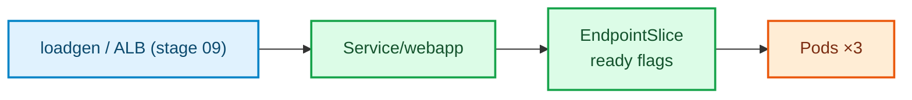

# Stage 04 — Services

[⬅ Project 05](../../README.md) · Stage 3 of 10

[00 Namespace](../00-namespace/README.md) › [03 Deployments](../03-deployments/README.md) › **04 Services** › [05 ConfigMaps](../05-configmaps/README.md) › [09 Ingress](../09-ingress/README.md) › [11 Rollouts](../11-health-checks/README.md) › [12 Resources](../12-resources/README.md) › [13 HPA](../13-hpa/README.md) › [14 PDB](../14-pdb/README.md) › [19 Final](../19-final/README.md)

> **The problem:** three pods, three IPs that change on every replacement. The load generator, the ALB and you
> need **one stable name** that spreads traffic over pods that can take it.

---

## 1. WHY does this resource exist?

| Need | Pods alone | A Service |
|---|---|---|
| A name in DNS | none | `webapp.web-platform.svc.cluster.local` |
| An address that outlives pods | pod IPs change | a ClusterIP for the Service's lifetime |
| Load spread over **ready** pods | client must track IPs | kube-proxy per connection; EndpointSlices track readiness |

That last row is what this project leans on. *Which pods count as "ready"* is decided by probes (stage 11), and a
Service is only as good as that decision.

---

## 2. WHAT is it?

A Service is **a stable name and virtual IP in front of the pods its selector matches.** It is an A record in
CoreDNS, a virtual IP nothing listens on, and DNAT rules kube-proxy programs on every node, fed by
**EndpointSlices** — the list of matching pod IPs *and whether each is ready*.

> **Analogy:** a switchboard number. Callers dial one number; the switchboard rings whoever is at a desk.

---

## 3. HOW does it work?

1. The EndpointSlice controller lists pods matching the selector and records each IP with `ready: true|false`.
2. kube-proxy on every node programs rules so connections to the ClusterIP land on a **ready** endpoint.
3. With no readiness probe, a pod is `ready` the instant its container starts — whether or not the app can
   answer. That becomes visible in stage 05.

---

## 4. Manifest

```yaml
apiVersion: v1
kind: Service
metadata: { name: webapp, namespace: web-platform }
spec:
  type: ClusterIP
  selector:
    app.kubernetes.io/name: webapp
    app.kubernetes.io/instance: webapp
  ports:
    - { name: http, port: 8080, targetPort: http, protocol: TCP }
```

---

## 5. Manifest breakdown

| Field | Value | What breaks if it's wrong |
|---|---|---|
| `metadata.name` | `webapp` | It **is** the DNS name |
| `selector` | name + instance | Typo ⇒ empty EndpointSlice, connections refused, no error anywhere |
| `port` / `targetPort` | 8080 / `http` | Wrong targetPort ⇒ refused with endpoints present |

> Stage 11 **drops `instance`** from this selector, so a canary Deployment can share it. The Service selects the
> *application*; each Deployment selects its own *instance*.

---

## 6. Apply

```bash
kubectl apply -f manifests/04-services/
kubectl get service,endpointslices -n web-platform
```

▸ **Expected:** `service/webapp ClusterIP 10.100.x.x 8080/TCP` and an EndpointSlice with three pod IPs.

---

## 7. Validate

```bash
kubectl get endpointslices -n web-platform -l kubernetes.io/service-name=webapp \
  -o jsonpath='{range .items[*].endpoints[*]}{.addresses[0]}{"  ready="}{.conditions.ready}{"\n"}{end}'
```

▸ Three addresses, `ready=true` — though nothing has actually checked.

---

## 8. Observe the mechanism

Load it from **inside** the cluster with the project's load generator:

```bash
kubectl run loadgen --rm -i --restart=Never -n web-platform \
  --image=cloudprakhargupta/web-platform:loadgen-1.0.0 -- \
  --url http://webapp:8080/api/info --concurrency 6 --duration 10
```

▸ Around a thousand requests per second, all `200`. Now add `-o wide` pod names to responses:

```bash
for i in $(seq 1 9); do kubectl exec -n web-platform deploy/webapp -- python -c \
  "import urllib.request as u; print(u.urlopen('http://webapp:8080/api/info').headers['X-Served-By'])"; done | sort | uniq -c
```

▸ Three pod names: load spreads **per connection**, which is why this app never pools connections.

---

## 9. Break it

```bash
kubectl patch service webapp -n web-platform -p '{"spec":{"selector":{"app.kubernetes.io/name":"webap"}}}'
kubectl get endpointslices -n web-platform -l kubernetes.io/service-name=webapp
kubectl apply -f manifests/04-services/webapp-service.yaml
```

▸ An empty EndpointSlice — DNS still resolves `webapp`, every connection is refused, and nothing reports an error.

---

## 10. How it interacts



---

## 11. Production notes

> 🧪 **DEMO / LEARNING CONFIGURATION**
> One ClusterIP; readiness is not yet meaningful.

> 🏭 **PRODUCTION CONSIDERATIONS**
> - Readiness probes decide EndpointSlice membership — the Service is only as good as the probe (stage 11).
> - Topology-aware routing keeps traffic in-AZ (a cost saving on AWS).

---

## 12. The next problem

The app has dials — how long it takes to start, how much CPU or memory a request may use — and they are baked
into its defaults. A realistic app spends seconds warming up; configure that, and you will be able to *see* what
Kubernetes does with a pod that is running but not ready.

→ **[Stage 05 — ConfigMaps](../05-configmaps/README.md)**

---

## 📚 Official documentation

Everything above is self-contained — these are for going deeper, not for filling gaps.
*(All links verified 2026-09-19.)*

| Reference | What it adds |
|---|---|
| [Service](https://kubernetes.io/docs/concepts/services-networking/service/) | Types, selectors, ports |
| [EndpointSlices](https://kubernetes.io/docs/concepts/services-networking/endpoint-slices/) | The `ready` / `serving` / `terminating` conditions |
| [Virtual IPs and Service Proxies](https://kubernetes.io/docs/reference/networking/virtual-ips/) | What kube-proxy programs |

---

| ◀ Previous | ▲ Up | Next ▶ |
|---|:--:|---:|
| ◀ **[03 Deployments](../03-deployments/README.md)** | [Project 05](../../README.md) · [Manual steps](../../scripts/manual-steps.md) | **[05 ConfigMaps](../05-configmaps/README.md)** ▶ |
