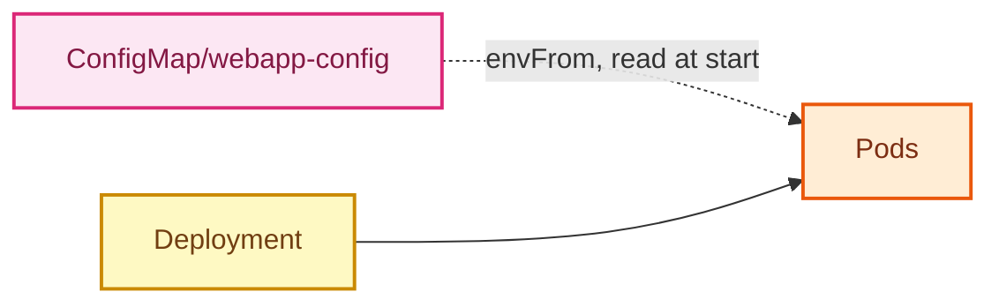

# Stage 05 — ConfigMaps: the app's dials

[⬅ Project 05](../../README.md) · Stage 4 of 10

[00 Namespace](../00-namespace/README.md) › [03 Deployments](../03-deployments/README.md) › [04 Services](../04-services/README.md) › **05 ConfigMaps** › [09 Ingress](../09-ingress/README.md) › [11 Rollouts](../11-health-checks/README.md) › [12 Resources](../12-resources/README.md) › [13 HPA](../13-hpa/README.md) › [14 PDB](../14-pdb/README.md) › [19 Final](../19-final/README.md)

> **The problem:** the app's behaviour — how long it warms up, how much CPU or memory one request may take — is
> fixed in its defaults. Real applications spend seconds starting (loading config, warming caches, opening pools),
> and you cannot study what Kubernetes does with a *slow starter* until you have one.

---

## 1. WHY does this resource exist?

Configuration belongs outside the image: the same image must behave differently per environment without a
rebuild. Here the configuration is three dials:

| Key | Value | Why |
|---|---|---|
| `STARTUP_DELAY_SECONDS` | `8` | A realistic warm-up. Makes stage 11's startup/readiness probes necessary |
| `MAX_WORK_MS` | `2000` | Upper bound on `/api/work` — a safety rail, not a lesson |
| `MAX_MEMORY_MB` | `1024` | Upper bound on `/api/memory` |

---

## 2. WHAT is it?

A ConfigMap is **a namespaced map of string keys to string values, consumed as env vars or files.** No schema, no
types: quote every number.

> **Environment variables are read once, at container start.** Editing a ConfigMap changes nothing in running
> pods; only a rollout does. Stage 19 replaces this mutable ConfigMap with a hash-named, immutable one so a change
> *is* a rollout.

---

## 3. HOW does it work?

The kubelet resolves `envFrom` when it **starts** the container. A missing ConfigMap ⇒
`CreateContainerConfigError`. Changing the Deployment to add `envFrom` changes the pod template ⇒ a rolling
update.

---

## 4. Manifest

```yaml
# 01-webapp-config.yaml
apiVersion: v1
kind: ConfigMap
metadata: { name: webapp-config, namespace: web-platform }
data:
  STARTUP_DELAY_SECONDS: "8"
  MAX_WORK_MS: "2000"
  MAX_MEMORY_MB: "1024"
```

```yaml
# 02-webapp-deployment.yaml (the one change)
          envFrom:
            - configMapRef: { name: webapp-config }
```

---

## 5. Manifest breakdown

| Field | What breaks if it's wrong |
|---|---|
| `data` values unquoted | API server rejects: `cannot unmarshal number into … string` |
| `envFrom` before the ConfigMap exists | `CreateContainerConfigError` |

---

## 6. Apply — and measure the rollout

Start traffic **first**, then apply, so the rollout happens under load:

```bash
kubectl apply -f manifests/05-configmaps/01-webapp-config.yaml
kubectl run loadgen --rm -i --restart=Never -n web-platform \
  --image=cloudprakhargupta/web-platform:loadgen-1.0.0 -- \
  --url http://webapp:8080/api/info --concurrency 6 --duration 60 &
sleep 5
kubectl apply -f manifests/05-configmaps/02-webapp-deployment.yaml
wait
```

---

## 7. Validate

```bash
kubectl exec -n web-platform deploy/webapp -- printenv STARTUP_DELAY_SECONDS
```

▸ `8`. Now read the load generator's table from §6.

---

## 8. Observe the mechanism

The table from §6, measured on this project's cluster (rows with only `200`s omitted):

```
t=   15s rps= 853 p50=  5ms p95=   16ms  200:545 ERR:308
t=   16s rps=   0                                            ← clients stuck connecting to a pod that is gone
t=   17s rps=   0
t=   18s rps=   0
t=   19s rps=   0
t=   20s rps=  20 p50= 18ms p95= 5007ms  503:14 ERR:6
t=   21s rps=1010 p50=  6ms p95=   11ms  503:1010             ← a warming-up pod, IN the Service
t=   22s rps= 977 p50=  6ms p95=   11ms  503:977
t=   23s rps= 950 p50=  5ms p95=    9ms  503:950
t=   24s rps= 921 p50=  4ms p95=    6ms  200:126 503:795
t=   25s rps= 888 p50=  4ms p95=    6ms  200:316 503:572
…
TOTAL {'200': 20813, '503': 4584, 'ERR': 344}  success=20813/25741
```

**One config rollout failed 19% of requests**, although every pod was `Running` throughout. Two different
failures are in that table:

| Rows | What happened | Why |
|---|---|---|
| `503` — thousands, at full speed | A **new** pod was in the Service while still warming up | No readiness probe ⇒ the EndpointSlice marks a pod ready the instant its container starts. The app answers `503 warming up` for 8 s |
| `ERR` and `rps=0` stalls | Requests to an **old** pod that was leaving | Endpoint removal and SIGTERM happen in parallel; the pod stops accepting before every node's kube-proxy has stopped sending to it, and connections to its vanished IP hang until the client's 5 s timeout |

Both halves of that table are stage 11.

---

## 9. Break it

```bash
kubectl delete configmap webapp-config -n web-platform
kubectl rollout restart deployment/webapp -n web-platform
kubectl get pods -n web-platform
kubectl apply -f manifests/05-configmaps/01-webapp-config.yaml
```

▸ New pods `CreateContainerConfigError: configmap "webapp-config" not found`; old ones keep serving.

---

## 10. How it interacts



---

## 11. Production notes

> 🧪 **DEMO / LEARNING CONFIGURATION**
> A mutable ConfigMap and a simulated warm-up.

> 🏭 **PRODUCTION CONSIDERATIONS**
> - Immutable, content-hashed ConfigMaps (stage 19) so a change is a revisioned rollout.
> - Measure real start-up time and size the startup probe from it.

---

## 12. The next problem

Every lesson ahead — throttling, autoscaling, drains, rollouts — is about what happens to **real traffic arriving
through a real load balancer**. So far traffic only exists inside the cluster, and `port-forward` would pin you to
one pod and hide every failure this project is about.

→ **[Stage 09 — Ingress](../09-ingress/README.md)**

---

## 📚 Official documentation

Everything above is self-contained — these are for going deeper, not for filling gaps.
*(All links verified 2026-09-19.)*

| Reference | What it adds |
|---|---|
| [ConfigMaps](https://kubernetes.io/docs/concepts/configuration/configmap/) | Consumption and update semantics |
| [Configure a Pod to Use a ConfigMap](https://kubernetes.io/docs/tasks/configure-pod-container/configure-pod-configmap/) | `envFrom` worked through |

---

| ◀ Previous | ▲ Up | Next ▶ |
|---|:--:|---:|
| ◀ **[04 Services](../04-services/README.md)** | [Project 05](../../README.md) · [Manual steps](../../scripts/manual-steps.md) | **[09 Ingress](../09-ingress/README.md)** ▶ |
