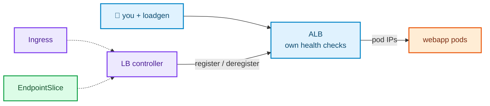

# Stage 09 — Ingress: a real load balancer in front

[⬅ Project 05](../../README.md) · Stage 5 of 10

[00 Namespace](../00-namespace/README.md) › [03 Deployments](../03-deployments/README.md) › [04 Services](../04-services/README.md) › [05 ConfigMaps](../05-configmaps/README.md) › **09 Ingress** › [11 Rollouts](../11-health-checks/README.md) › [12 Resources](../12-resources/README.md) › [13 HPA](../13-hpa/README.md) › [14 PDB](../14-pdb/README.md) › [19 Final](../19-final/README.md)

> **The problem:** every lesson ahead is about what happens to **real traffic, through a real load balancer**,
> while pods start, stop, scale and move. Right now traffic only exists inside the cluster, and a `port-forward`
> would pin you to a single pod and hide every one of those failures.

---

## 1. WHY does this resource exist?

| Option | On EKS | Why not |
|---|---|---|
| `port-forward` | A tunnel to **one pod** | Hides load balancing, rollouts and drains entirely |
| `type: LoadBalancer` | An NLB (L4) | Works — but this project's lessons are about an **HTTP** load balancer's health checks and deregistration |
| **Ingress → ALB** | An L7 load balancer that targets **pod IPs** and health-checks each one | ✅ |

The ALB matters here for a specific reason: it keeps its **own** view of which pods are healthy, updated on its own
schedule. The gap between "Kubernetes decided a pod is leaving" and "the ALB stopped sending to it" is exactly
what drops requests during a rollout — and what stage 11's `preStop` hook is sized against.

---

## 2. WHAT is it?

An Ingress is **HTTP routing rules**, implemented here by the **AWS Load Balancer Controller**, which builds an ALB
whose targets are pod IPs (`target-type: ip`).

| ALB setting (annotation) | Value | Why it matters in this project |
|---|---|---|
| `healthcheck-path` | `/healthz` | The ALB's own readiness check — independent of the kubelet's |
| `healthcheck-interval-seconds` × `unhealthy-threshold-count` | 5 s × 2 | How fast the ALB notices a target is gone (~10 s) |
| `deregistration_delay.timeout_seconds` | 15 | How long a *removed* target still gets its **in-flight** requests |
| `inbound-cidrs` | your `/32` | Only you (and your laptop's load test) may reach it |

---

## 3. HOW does it work?

1. The controller creates the ALB, a listener, a target group for `Service/webapp`, and registers each **ready**
   pod IP from the Service's EndpointSlices.
2. The ALB health-checks every target on its own schedule.
3. When a pod leaves the EndpointSlice, the controller calls `DeregisterTargets`; the ALB stops sending **new**
   requests after that propagates, and lets in-flight ones finish for up to 15 s.

---

## 4. Manifest

[`web-platform-ingress.yaml`](web-platform-ingress.yaml):

```yaml
metadata:
  annotations:
    alb.ingress.kubernetes.io/scheme: internet-facing
    alb.ingress.kubernetes.io/target-type: ip
    alb.ingress.kubernetes.io/healthcheck-path: /healthz
    alb.ingress.kubernetes.io/healthcheck-interval-seconds: "5"
    alb.ingress.kubernetes.io/healthcheck-timeout-seconds: "3"
    alb.ingress.kubernetes.io/healthy-threshold-count: "2"
    alb.ingress.kubernetes.io/unhealthy-threshold-count: "2"
    alb.ingress.kubernetes.io/target-group-attributes: deregistration_delay.timeout_seconds=15
    alb.ingress.kubernetes.io/inbound-cidrs: 0.0.0.0/0      # replaced with YOUR IP
spec:
  ingressClassName: alb
  rules:
    - http:
        paths:
          - { path: /, pathType: Prefix, backend: { service: { name: webapp, port: { number: 8080 } } } }
```

---

## 5. Manifest breakdown

| Field | What breaks if it's wrong |
|---|---|
| `ingressClassName: alb` | Missing ⇒ accepted, no ALB, no error |
| `target-type: ip` | `instance` needs NodePort Services and adds a kube-proxy hop |
| `healthcheck-path` | A 404 path ⇒ every target unhealthy ⇒ 503 |
| `deregistration_delay` | AWS default is **300 s** — every rollout and every cleanup waits five minutes per pod |
| `inbound-cidrs` | `0.0.0.0/0` ⇒ your CPU-burn endpoint is open to the internet |

---

## 6. Apply

The AWS Load Balancer Controller must be installed once per cluster — see
[`manual-steps.md` Step 1.4](../../scripts/manual-steps.md). Then:

```bash
kubectl apply -f manifests/09-ingress/web-platform-ingress.yaml
MY_IP=$(curl -s https://checkip.amazonaws.com)
kubectl annotate ingress web-platform-ingress -n web-platform \
  alb.ingress.kubernetes.io/inbound-cidrs="${MY_IP}/32" --overwrite
ALB=$(kubectl get ingress web-platform-ingress -n web-platform -o jsonpath='{.status.loadBalancer.ingress[0].hostname}')
until curl -s -o /dev/null -m 5 -w '%{http_code}' "http://$ALB/healthz" | grep -q 200; do echo waiting…; sleep 10; done
```

---

## 7. Validate

```bash
curl -s "http://$ALB/api/info" | python3 -m json.tool | head
for i in $(seq 1 9); do curl -s -o /dev/null -D - "http://$ALB/api/info" | grep -i x-served-by; done | sort | uniq -c
```

▸ Three different pods answer. Open `http://$ALB/` in a browser and reload to watch it change.

---

## 8. Observe the mechanism

Run the load generator **from your laptop**, through the ALB — this is the vantage point of a real user, and the
one every later stage measures from:

```bash
docker run --rm cloudprakhargupta/web-platform:loadgen-1.0.0 \
  --url "http://$ALB/api/info" --concurrency 8 --duration 20
```

▸ A steady column of `200`s. Keep this command handy: stage 11 runs it during a rollout.

---

## 9. Break it

```bash
kubectl annotate ingress web-platform-ingress -n web-platform \
  alb.ingress.kubernetes.io/healthcheck-path=/nope --overwrite
sleep 30; curl -s -o /dev/null -w '%{http_code}\n' "http://$ALB/"
kubectl annotate ingress web-platform-ingress -n web-platform \
  alb.ingress.kubernetes.io/healthcheck-path=/healthz --overwrite
```

▸ **503** while every pod is Running and Ready: the ALB's opinion is independent of Kubernetes'.

---

## 10. How it interacts



---

## 11. Production notes

> 🧪 **DEMO / LEARNING CONFIGURATION**
> Plain HTTP, one IP allowed, aggressive health checks for fast feedback.

> 🏭 **PRODUCTION CONSIDERATIONS**
> - HTTPS with ACM; WAF; Route53 + ExternalDNS (Project 10).
> - Tune deregistration delay to your longest request, and `preStop` to the propagation time (stage 11).

---

## 12. The next problem

Roll out version 2.0.0 while the load generator runs through the ALB. Every pod is `Running` throughout, and the
table fills with `502`s — at the start of each new pod's life (it gets traffic before its 8-second warm-up ends)
and at the end of each old pod's life (it stops listening before the ALB stops sending).

→ **[Stage 11 — Probes and zero-drop rollouts](../11-health-checks/README.md)**

---

## 📚 Official documentation

Everything above is self-contained — these are for going deeper, not for filling gaps.
*(All links verified 2026-09-19.)*

| Reference | What it adds |
|---|---|
| [Ingress](https://kubernetes.io/docs/concepts/services-networking/ingress/) | Rules and IngressClass |
| [Route internet traffic with AWS Load Balancer Controller](https://docs.aws.amazon.com/eks/latest/userguide/aws-load-balancer-controller.html) | Installing the controller on EKS |
| [Ingress annotations](https://kubernetes-sigs.github.io/aws-load-balancer-controller/latest/guide/ingress/annotations/) | Health-check and target-group attributes used above |

---

| ◀ Previous | ▲ Up | Next ▶ |
|---|:--:|---:|
| ◀ **[05 ConfigMaps](../05-configmaps/README.md)** | [Project 05](../../README.md) · [Manual steps](../../scripts/manual-steps.md) | **[11 Rollouts](../11-health-checks/README.md)** ▶ |
