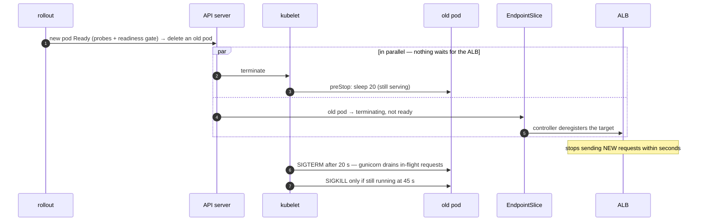
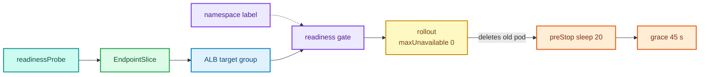

# Stage 11 — Probes, graceful shutdown, and zero-drop rollouts

[⬅ Project 05](../../README.md) · Stage 6 of 10

[00 Namespace](../00-namespace/README.md) › [03 Deployments](../03-deployments/README.md) › [04 Services](../04-services/README.md) › [05 ConfigMaps](../05-configmaps/README.md) › [09 Ingress](../09-ingress/README.md) › **11 Rollouts** › [12 Resources](../12-resources/README.md) › [13 HPA](../13-hpa/README.md) › [14 PDB](../14-pdb/README.md) › [19 Final](../19-final/README.md)

> **The problem:** roll out a change while real traffic flows through the ALB, and requests fail — at **both ends**
> of each pod's life. New pods get traffic while still warming up; old pods stop listening while the load balancer
> is still sending to them. Measured below: **4.1% of requests failed** during one ordinary rollout, with every pod
> `Running` the whole time.

---

## 1. WHY does this resource exist?

A rolling update replaces pods one at a time. Each replacement has two dangerous moments:

| Moment | What goes wrong without help | Fix |
|---|---|---|
| **Start** of a new pod's life | It is added to the Service/ALB the instant its container starts — before the app can serve | **readiness probe** (+ **startup probe** for slow starters) and the **ALB readiness gate** |
| **End** of an old pod's life | Removal from endpoints and SIGTERM happen **at the same time**; the app stops accepting before every proxy and the ALB have stopped sending | **`preStop` hook** + **`terminationGracePeriodSeconds`** |
| The rollout itself | Old pods removed before new ones can serve | `maxSurge: 1`, `maxUnavailable: 0` |

The second row is the one most tutorials miss. A readiness probe only governs how pods **join**; nothing
Kubernetes does on termination waits for a load balancer.

---

## 2. WHAT is it?

| Mechanism | What it is |
|---|---|
| **startupProbe** | A check that must pass once before readiness/liveness run. Gives slow starters a budget without weakening liveness |
| **readinessProbe** | Run for the life of the container. Failing ⇒ removed from endpoints (and the ALB). No restart |
| **livenessProbe** | Failing `failureThreshold` times ⇒ container killed and restarted. The **process** only — never load or dependencies |
| **ALB readiness gate** | A pod condition the ALB controller sets only when the ALB reports the target healthy |
| **`lifecycle.preStop`** | Runs **before** SIGTERM is sent. `sleep: {seconds: 20}` keeps the pod serving while traffic drains away |
| **`terminationGracePeriodSeconds`** | The whole shutdown budget, from deletion to SIGKILL — must cover preStop **plus** the app's own drain |

> **Analogy:** closing a shop. The readiness probe is the "open" sign — only turned on once the tills work. The
> `preStop` sleep is taking the sign down and then waiting for the customers already inside to be served before
> locking the door. Locking the door the moment you decide to close is what drops requests.

### The shutdown budget in this project

| Step | Budget |
|---|---|
| ALB notices a target is leaving (health 5 s × 2, plus deregistration propagation) | seconds |
| `preStop: sleep 20` — pod keeps serving | 20 s |
| SIGTERM → gunicorn stops accepting, drains in-flight (`--graceful-timeout 25`) | ≤ 25 s |
| `terminationGracePeriodSeconds` | **45 s** ≥ 20 + 25 |

---

## 3. HOW does it work?



The native `sleep` action runs inside the kubelet — no shell or `sleep` binary needed in the image.

---

## 4. Manifest

[`02-webapp-deployment.yaml`](02-webapp-deployment.yaml), excerpted:

```yaml
spec:
  replicas: 3
  strategy:
    type: RollingUpdate
    rollingUpdate: { maxSurge: 1, maxUnavailable: 0 }
  template:
    spec:
      terminationGracePeriodSeconds: 45
      containers:
        - name: webapp
          image: cloudprakhargupta/web-platform:webapp-2.0.0     # applying this IS the rollout
          startupProbe:   { httpGet: { path: /healthz, port: http }, periodSeconds: 2, failureThreshold: 30 }
          readinessProbe: { httpGet: { path: /healthz, port: http }, periodSeconds: 5, timeoutSeconds: 2, failureThreshold: 2 }
          livenessProbe:  { httpGet: { path: /livez,   port: http }, periodSeconds: 10, timeoutSeconds: 3, failureThreshold: 3 }
          lifecycle:
            preStop:
              sleep: { seconds: 20 }
```

Plus [`01-web-platform-namespace.yaml`](01-web-platform-namespace.yaml) (the readiness-gate label), and the two
delivery demos: [`03-webapp-canary-deployment.yaml`](03-webapp-canary-deployment.yaml) +
[`04-webapp-service.yaml`](04-webapp-service.yaml), and [`05-bluegreen-demo.yaml`](05-bluegreen-demo.yaml).

---

## 5. Manifest breakdown

| Field | Value | What breaks if it's wrong |
|---|---|---|
| `startupProbe` budget | 30 × 2 s = 60 s | Shorter than the warm-up ⇒ restart loop before the app ever starts |
| readiness path | `/healthz` (503 until warmed up) | Pointing at `/livez` ⇒ traffic during warm-up |
| liveness path | `/livez` | `/healthz` ⇒ a slow warm-up or a busy pod gets restarted |
| `maxUnavailable` | `0` | Default 25% ⇒ capacity drops during every rollout |
| `preStop.sleep.seconds` | `20` | Missing/too short ⇒ 502s and connection errors at the end of each old pod's life |
| `terminationGracePeriodSeconds` | `45` | < preStop + drain ⇒ in-flight requests SIGKILLed |
| namespace label | readiness-gate-inject | Missing ⇒ a rollout can outrun the ALB's health checks |

---

## 6. Apply — and measure

Keep a load generator running **from your laptop, through the ALB**, for every rollout below:

```bash
ALB=$(kubectl get ingress web-platform-ingress -n web-platform -o jsonpath='{.status.loadBalancer.ingress[0].hostname}')
docker run --rm cloudprakhargupta/web-platform:loadgen-1.0.0 --url "http://$ALB/api/info" --concurrency 24 --duration 150 &
```

### 6.1 The baseline — a rollout with nothing in place

```bash
kubectl rollout restart deployment/webapp -n web-platform
```

Measured on this project's cluster:

```
t=   13s rps=  45 p50= 543ms p95=  559ms  200:40 502:5
t=   20s rps=  24 p50=3623ms p95= 5304ms  502:4 503:9 ERR:11
t=   21s rps=  36 p50= 584ms p95= 5286ms  503:30 ERR:6
t=   23s rps=  41 p50= 562ms p95=  604ms  200:2 503:39
…
TOTAL {'200': 4535, '502': 18, '503': 157, 'ERR': 20}  success=4535/4730
```

▸ **4.1% failed.** `503` = the ALB sent requests to a pod still warming up; `502`/`ERR` = requests to a pod that
had already stopped listening.

### 6.2 Apply stage 11 — probes, preStop, readiness gates

```bash
kubectl apply -f manifests/11-health-checks/01-web-platform-namespace.yaml     # label FIRST
kubectl apply -f manifests/11-health-checks/02-webapp-deployment.yaml          # this IS a rollout to 2.0.0
kubectl rollout status deployment/webapp -n web-platform
```

```
t=   43s rps=  41  200:36 502:5          v1.0.0:25 v2.0.0:11
t=   48s rps=  17  200:12 ERR:5          v1.0.0:8  v2.0.0:4
…
TOTAL {'200': 5729, '502': 19, 'ERR': 49}  success=5729/5797
```

▸ **Every `503` is gone** — new pods only receive traffic after their probes *and* the ALB say so. But `502`s and
errors remain, and they line up exactly with **old** pods terminating. Those old pods were created from the stage
09 template, **which has no `preStop`**. A hook protects only pods created *from* the template that contains it.

### 6.3 The real test — a rollout where both sides have the hook

```bash
kubectl rollout restart deployment/webapp -n web-platform
kubectl rollout status deployment/webapp -n web-platform
```

```
TOTAL {'200': 7127}  success=7127/7127
```

▸ **Zero failures** across a full rollout of three pods under load, through a real ALB.

---

## 7. Validate

```bash
kubectl get pods -n web-platform -o wide
kubectl get deployment webapp -n web-platform -o jsonpath='{.spec.template.spec.containers[0].lifecycle}{"\n"}'
```

▸ `READINESS GATES 1/1` on every pod, and the `preStop` sleep in the template.

---

## 8. Observe the mechanism — canary and blue/green with labels

### Canary

A canary is a second Deployment whose pods share the label the **Service** selects on. Stage 11 changes the
Service to select only the *application*:

```yaml
# 04-webapp-service.yaml
spec:
  selector:
    app.kubernetes.io/name: webapp            # ← no instance: every webapp pod
```

| Object | Selects |
|---|---|
| `Service/webapp` | `name=webapp` |
| `Deployment/webapp` | `name=webapp, instance=webapp` |
| `Deployment/webapp-canary` | `name=webapp, instance=webapp-canary` |

With stable on `1.0.0` and one canary pod on `2.0.0`:

```bash
kubectl set image deployment/webapp -n web-platform webapp=cloudprakhargupta/web-platform:webapp-1.0.0
kubectl apply -f manifests/11-health-checks/03-webapp-canary-deployment.yaml -f manifests/11-health-checks/04-webapp-service.yaml
kubectl run lg --rm -i --restart=Never -n web-platform --image=cloudprakhargupta/web-platform:loadgen-1.0.0 -- \
  --url http://webapp:8080/api/info -c 6 -d 5
```

```
t=    5s rps= 984 …  200:984   v1.0.0:739 v2.0.0:245
```

▸ **25%** to the canary — one pod of four. Promote: set the stable image to `2.0.0` and delete the canary. Abort:
delete the canary. Precise percentages or metric-driven promotion need weighted target groups, a mesh, or a tool
like Argo Rollouts.

```bash
kubectl delete deployment webapp-canary -n web-platform
kubectl set image deployment/webapp -n web-platform webapp=cloudprakhargupta/web-platform:webapp-2.0.0
```

### Blue/green

Two complete stacks, one Service whose selector names exactly one colour:

```bash
kubectl apply -f manifests/11-health-checks/05-bluegreen-demo.yaml
kubectl run bg --rm -i --restart=Never -n web-platform --image=busybox:1.36 -- sh -c \
  'for i in $(seq 1 20); do wget -qO- http://webapp-bluegreen:8080/api/info | grep -o "\"version\":\"[0-9.]*\""; done | sort | uniq -c'
kubectl patch service webapp-bluegreen -n web-platform -p '{"spec":{"selector":{"app.kubernetes.io/instance":"webapp-green"}}}'
# … same loop again …
kubectl delete -f manifests/11-health-checks/05-bluegreen-demo.yaml
```

```
     20 "version":"1.0.0"        ← before the patch
     20 "version":"2.0.0"        ← after
```

▸ One selector patch, atomic for new connections, reversible by patching back.

---

## 9. Break it

### Break 1 — a grace period shorter than the drain

```bash
kubectl patch deployment webapp -n web-platform --type merge -p '{"spec":{"template":{"spec":{"terminationGracePeriodSeconds":5}}}}'
kubectl rollout status deployment/webapp -n web-platform
curl -s -m 60 "http://$ALB/api/slow?seconds=30" &      # an in-flight request
sleep 2; kubectl rollout restart deployment/webapp -n web-platform; wait
kubectl apply -f manifests/11-health-checks/02-webapp-deployment.yaml
```

▸ The in-flight request is cut off — the kubelet SIGKILLs the container at 5 s, `preStop` and gunicorn's drain
included. `terminationGracePeriodSeconds` is a hard ceiling on everything else.

### Break 2 — liveness on the readiness endpoint

```bash
kubectl patch deployment webapp -n web-platform --type=json \
  -p '[{"op":"replace","path":"/spec/template/spec/containers/0/livenessProbe/httpGet/path","value":"/healthz"},
       {"op":"remove","path":"/spec/template/spec/containers/0/startupProbe"}]'
kubectl patch configmap webapp-config -n web-platform --type merge -p '{"data":{"STARTUP_DELAY_SECONDS":"45"}}'
kubectl rollout restart deployment/webapp -n web-platform
kubectl get pods -n web-platform -w         # watch RESTARTS climb on the new pod
```

▸ A 45 s warm-up with liveness checking `/healthz` (503 while warming) and no startup probe: the kubelet restarts
the pod every ~30 s, forever — `CrashLoopBackOff` on a perfectly healthy app. The rollout never progresses
(`maxUnavailable: 0`), so users are unaffected — the old pods carry on.

```bash
kubectl apply -f manifests/05-configmaps/01-webapp-config.yaml -f manifests/11-health-checks/02-webapp-deployment.yaml
```

---

## 10. How it interacts



---

## 11. Production notes

> 🧪 **DEMO / LEARNING CONFIGURATION**
> A 20 s preStop and aggressive ALB health checks, tuned for fast, visible feedback.

> 🏭 **PRODUCTION CONSIDERATIONS**
> - **Size `preStop` from measurement**: ALB deregistration propagation, plus kube-proxy sync, plus margin.
> - **Size the grace period from your slowest legitimate request**, and set the app's own drain timeout inside it.
> - **Progressive delivery with analysis** (Argo Rollouts, Flagger) for real canaries: weighted traffic and
>   automatic rollback on error-rate or latency regressions.
> - **Readiness gates on every ALB-fronted namespace.**

---

## 12. The next problem

Rollouts are now clean. Push real load at the service instead and look at what the pods *cost*:

```bash
kubectl describe node <any> | grep -A8 'Non-terminated Pods'
```

Every webapp pod still requests **0 CPU and 0 memory**. The scheduler cannot tell a node that is full from one that
is idle, one pod burning CPU slows every neighbour on its node, a memory leak can grow until the kernel starts
killing processes on the **node**, and no autoscaler can compute a percentage of a request that does not exist.

→ **[Stage 12 — Resources](../12-resources/README.md)**

---

## 📚 Official documentation

Everything above is self-contained — these are for going deeper, not for filling gaps.
*(All links verified 2026-09-19.)*

| Reference | What it adds |
|---|---|
| [Configure liveness, readiness and startup probes](https://kubernetes.io/docs/tasks/configure-pod-container/configure-liveness-readiness-startup-probes/) | Every probe field |
| [Pod Lifecycle — termination](https://kubernetes.io/docs/concepts/workloads/pods/pod-lifecycle/) | The termination sequence, grace period and SIGKILL |
| [Container Lifecycle Hooks](https://kubernetes.io/docs/concepts/containers/container-lifecycle-hooks/) | `preStop`, including the `sleep` action |
| [Deployments](https://kubernetes.io/docs/concepts/workloads/controllers/deployment/) | `maxSurge`, `maxUnavailable`, rollback |
| [Pod readiness gate (AWS Load Balancer Controller)](https://kubernetes-sigs.github.io/aws-load-balancer-controller/latest/deploy/pod_readiness_gate/) | How the gate ties pod readiness to ALB health |

---

| ◀ Previous | ▲ Up | Next ▶ |
|---|:--:|---:|
| ◀ **[09 Ingress](../09-ingress/README.md)** | [Project 05](../../README.md) · [Manual steps](../../scripts/manual-steps.md) | **[12 Resources](../12-resources/README.md)** ▶ |
