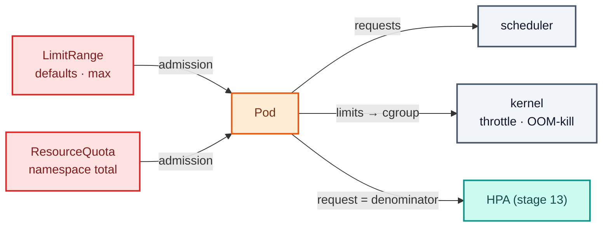

# Stage 12 — Resources: requests, limits, QoS, LimitRange, ResourceQuota

[⬅ Project 05](../../README.md) · Stage 7 of 10

[00 Namespace](../00-namespace/README.md) › [03 Deployments](../03-deployments/README.md) › [04 Services](../04-services/README.md) › [05 ConfigMaps](../05-configmaps/README.md) › [09 Ingress](../09-ingress/README.md) › [11 Rollouts](../11-health-checks/README.md) › **12 Resources** › [13 HPA](../13-hpa/README.md) › [14 PDB](../14-pdb/README.md) › [19 Final](../19-final/README.md)

> **The problem:** every webapp pod requests **zero** CPU and memory. The scheduler cannot tell a full node from an
> idle one; one pod burning CPU slows every neighbour; a leak grows until the **node** runs out of memory; and no
> autoscaler can compute "60% of the request" when there is no request. Stage 03 already showed 31 such pods
> admitted onto six CPUs.

---

## 1. WHY does this resource exist?

A node is a fixed amount of CPU and memory shared by every pod on it. Without declared needs:

| Problem | Without requests/limits |
|---|---|
| **Placement** | The scheduler sees 0 cost; it overpacks nodes until the pod-count limit |
| **Noisy neighbour** | One pod can use every CPU cycle on its node |
| **Memory exhaustion** | A leak grows until the kubelet evicts pods or the kernel OOM-kills processes node-wide |
| **Eviction order** | BestEffort pods are evicted first, with no say in it |
| **Autoscaling** | HPA utilisation is *usage ÷ request* — undefined without a request |

Two different tools, because two different questions:

| Question | Tool |
|---|---|
| "What does **this container** need, and what may it use at most?" | `resources.requests` / `resources.limits` |
| "What must every container in **this namespace** declare, and within what bounds?" | **LimitRange** |
| "How much may **this whole namespace** consume?" | **ResourceQuota** |

---

## 2. WHAT is it?

| | **Request** | **Limit** |
|---|---|---|
| Used by | the **scheduler** (placement) and the **HPA** (denominator) | the **kernel** (cgroups) |
| CPU above it | fine if spare cycles exist | **throttled** — paused for the rest of each 100 ms period |
| Memory above it | fine, but first to be reclaimed under pressure | **OOM-killed** — exit 137, restart |

> **Analogy:** a restaurant booking. The request is the table you reserved — guaranteed, and how the host plans
> the room. The limit is the most you are allowed to order. Order more food than the limit (CPU) and the kitchen
> just makes you wait; try to occupy more tables than the limit (memory) and you are thrown out.

**QoS class** — computed from these, never set:

| Class | Rule | Evicted under node pressure |
|---|---|---|
| Guaranteed | requests == limits, CPU **and** memory, every container | last |
| **Burstable** | anything in between — **this project** | middle |
| BestEffort | none at all | first |

---

## 3. HOW does it work?

1. **Admission.** When a pod is created, the `LimitRanger` plugin fills in missing requests/limits from the
   namespace's LimitRange and rejects anything above `max`; the `ResourceQuota` plugin rejects the pod if it would
   push the namespace total over `hard`.
2. **Scheduling.** The scheduler places the pod only on a node whose *allocatable* minus the *requests* of pods
   already there fits the new pod's requests. Usage is irrelevant to placement.
3. **Running.** The kubelet writes the limits into the container's cgroup: CPU as a CFS quota (`cpu.max`: 50 ms
   of every 100 ms for 500m), memory as a hard ceiling (`memory.max`).
4. **Pressure.** Over the CPU quota ⇒ throttled. Over the memory limit ⇒ the kernel's OOM killer. Node short of
   memory ⇒ the kubelet evicts pods, BestEffort first.

---

## 4. Manifest

```yaml
# 03-webapp-deployment.yaml (excerpt)
          resources:
            requests: { cpu: "100m", memory: "128Mi" }
            limits:   { cpu: "500m", memory: "256Mi" }
```

```yaml
# 01-limitrange.yaml
spec:
  limits:
    - type: Container
      defaultRequest: { cpu: "100m", memory: "128Mi" }
      default:        { cpu: "500m", memory: "256Mi" }
      max:            { cpu: "2",    memory: "1Gi" }
```

```yaml
# 02-resourcequota.yaml
spec:
  hard:
    requests.cpu: "3"
    requests.memory: "3Gi"
    limits.cpu: "8"
    limits.memory: "6Gi"
    pods: "30"
```

---

## 5. Manifest breakdown

| Field | Value | Why this number | What breaks if it's wrong |
|---|---|---|---|
| `requests.cpu` | 100m | Idle + light traffic; the HPA's denominator | Too high ⇒ few pods per node, HPA scales late; too low ⇒ overpacking, HPA scales early |
| `limits.cpu` | 500m | A ceiling, 5× the request | Too low ⇒ constant throttling, latency |
| `requests.memory` | 128Mi | Two idle workers (~65Mi measured) | Too low ⇒ first reclaimed under pressure |
| `limits.memory` | 256Mi | Room for normal use, a wall for leaks | Too low ⇒ OOMKilled under normal load |
| LimitRange `defaultRequest`/`default` | 100m/128Mi → 500m/256Mi | Nothing in the namespace is BestEffort by accident | — |
| LimitRange `max.cpu` | 2 | No single container may claim a node | — |
| ResourceQuota `limits.cpu` | 8 | Caps the HPA and runaway scaling | Too low ⇒ the HPA cannot reach `maxReplicas` |

---

## 6. Apply

```bash
kubectl apply -f manifests/12-resources/01-limitrange.yaml -f manifests/12-resources/02-resourcequota.yaml
kubectl apply -f manifests/12-resources/03-webapp-deployment.yaml
kubectl rollout status deployment/webapp -n web-platform
```

---

## 7. Validate

```bash
kubectl get pods -n web-platform -l app.kubernetes.io/name=webapp -o custom-columns=NAME:.metadata.name,QOS:.status.qosClass
kubectl describe namespace web-platform
```

```
NAME                      QOS
webapp-597977664d-hpjrp   Burstable
…
Resource Quotas
  Resource         Used   Hard
  limits.cpu       1500m  8
  limits.memory    768Mi  6Gi
  pods             3      30
  requests.cpu     300m   3
  requests.memory  384Mi  3Gi

Resource Limits
 Type       Resource  Min  Max  Default Request  Default Limit
 Container  cpu       -    2    100m             500m
 Container  memory    -    1Gi  128Mi            256Mi
```

---

## 8. Observe the mechanism

### CPU throttling — measured

The same request, 500 ms of busy loop, before and after the limit:

```bash
kubectl exec -n web-platform deploy/webapp -- python -c \
  "import urllib.request;print(urllib.request.urlopen('http://localhost:8080/api/work?ms=500').read().decode())"
```

| | `cpu_ms` | `iterations` |
|---|---|---|
| No limit | 497.0 | 2,087,357 |
| `limits.cpu: 500m` | **253.8** | **1,104,132** |

```bash
kubectl exec -n web-platform deploy/webapp -- sh -c 'cat /sys/fs/cgroup/cpu.max; grep throttled /sys/fs/cgroup/cpu.stat'
```

```
50000 100000
nr_throttled 35
throttled_usec 1706157
```

▸ `50000 100000` — 50 ms of CPU per 100 ms period. The request ran for 500 ms of wall time but got half the
cycles, and was throttled 35 times. **Nothing was killed; everything was slower.** That is why a CPU limit set
too low shows up as latency, never as an error.

### OOMKilled — measured

```bash
POD=$(kubectl get pods -n web-platform -l app.kubernetes.io/name=webapp -o jsonpath='{.items[0].metadata.name}')
kubectl exec -n web-platform $POD -- python -c \
  "import urllib.request;print(urllib.request.urlopen('http://localhost:8080/api/memory?mb=300',timeout=20).read())"
kubectl describe pod $POD -n web-platform | grep -A3 'Last State'
```

```
command terminated with exit code 137

    Last State:     Terminated
      Reason:       OOMKilled
      Exit Code:    137
```

▸ 300 MiB into a 256Mi limit: the kernel killed the process, the kubelet restarted the container, `RESTARTS`
went to 1. Memory cannot be throttled — the only enforcement is death.

### The LimitRange fills gaps and enforces ceilings

```bash
kubectl run naked --restart=Never --image=busybox:1.36 -n web-platform -- sleep 3600
kubectl get pod naked -n web-platform -o jsonpath='{.spec.containers[0].resources}{"  "}{.status.qosClass}{"\n"}'
kubectl delete pod naked -n web-platform
```

```
{"limits":{"cpu":"500m","memory":"256Mi"},"requests":{"cpu":"100m","memory":"128Mi"}}  Burstable
```

```bash
kubectl run greedy --restart=Never --image=busybox:1.36 -n web-platform \
  --overrides='{"spec":{"containers":[{"name":"greedy","image":"busybox:1.36","command":["sleep","60"],"resources":{"limits":{"cpu":"3"}}}]}}'
```

```
Error from server (Forbidden): pods "greedy" is forbidden: maximum cpu usage per Container is 2, but limit is 3
```

---

## 9. Break it

### The quota stops scaling — and the error is not on a pod

```bash
kubectl scale deployment/webapp -n web-platform --replicas=35
sleep 25
kubectl get deployment webapp -n web-platform
kubectl get events -n web-platform --field-selector reason=FailedCreate | tail -1
kubectl scale deployment/webapp -n web-platform --replicas=3
```

```
NAME     READY   UP-TO-DATE   AVAILABLE
webapp   5/35    15           5

Warning  FailedCreate  replicaset-controller  Error creating: pods "webapp-…" is forbidden: exceeded quota:
web-platform-quota, requested: limits.cpu=500m, used: limits.cpu=8, limited: limits.cpu=8
```

▸ It stopped at **15 pods**, not 30: 16 × 500m = 8 CPUs of **limits** exhausted the quota before the pod count or
the requests did. And the error lives on the **ReplicaSet** (`kubectl describe rs`) — `kubectl get pods` shows
nothing wrong, because the missing pods were never created.

---

## 10. How it interacts



---

## 11. Production notes

> 🧪 **DEMO / LEARNING CONFIGURATION**
> Numbers chosen to make throttling and OOM easy to trigger; a quota sized for a three-node lab.

> 🏭 **PRODUCTION CONSIDERATIONS**
> - **Set requests from measurement** (p95 usage over days), not guesses; VPA in recommendation mode can suggest
>   them.
> - **Many teams drop CPU limits** for latency-sensitive services and rely on requests for fairness — throttling
>   hurts tail latency even when the node is idle. Keep **memory** limits.
> - **Guaranteed QoS** for anything that must never be evicted first.
> - **Quota every team namespace**, and alert before it is exhausted.

---

## 12. The next problem

Pods are sized and bounded. Now vary the load: at three replicas × 500m, a traffic spike saturates every pod and
latency climbs; at night the same three pods idle, paid for. Choosing the replica count by hand means being wrong
twice a day.

→ **[Stage 13 — HorizontalPodAutoscaler](../13-hpa/README.md)**

---

## 📚 Official documentation

Everything above is self-contained — these are for going deeper, not for filling gaps.
*(All links verified 2026-09-19.)*

| Reference | What it adds |
|---|---|
| [Resource Management for Pods and Containers](https://kubernetes.io/docs/concepts/configuration/manage-resources-containers/) | Requests, limits, and how each is enforced |
| [Pod Quality of Service Classes](https://kubernetes.io/docs/concepts/workloads/pods/pod-qos/) | The QoS rules and eviction order |
| [Limit Ranges](https://kubernetes.io/docs/concepts/policy/limit-range/) | Defaults and bounds at admission |
| [Resource Quotas](https://kubernetes.io/docs/concepts/policy/resource-quotas/) | Namespace totals, and the `FailedCreate` behaviour |

---

| ◀ Previous | ▲ Up | Next ▶ |
|---|:--:|---:|
| ◀ **[11 Rollouts](../11-health-checks/README.md)** | [Project 05](../../README.md) · [Manual steps](../../scripts/manual-steps.md) | **[13 HPA](../13-hpa/README.md)** ▶ |
